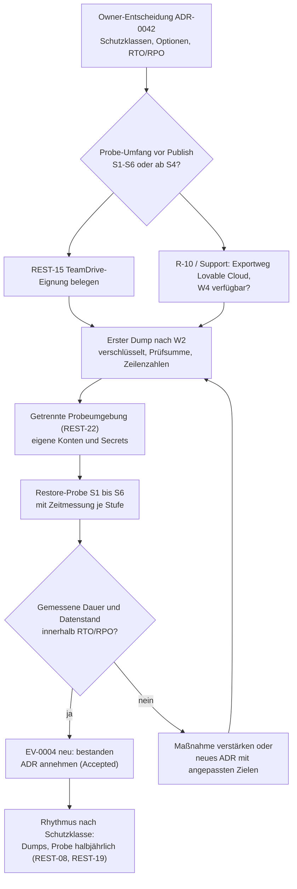

# ADR-0042: RTO, RPO und Schutzklassen für die Wiederherstellung

- **Status**: Proposed
- **Datum**: 2026-11-06
- **Bezug**: REST-09, REST-16 bis REST-19 (`docs/standards/STANDARD-WIEDERHERSTELLBARKEIT.md`), Risiken R-14, R-04, R-10, R-11, Gate G03 (`docs/PUBLISH-GATE-BERICHT.md`)
- **Ergänzt**: ADR-0015 (Backup-/Restore-Tests der Anwendung), ADR-0037 (Datenaufträge)
- **Herkunft**: Auftrag A08 „R-14 Teil 1“, Entwurf durch Claude Code. **Nichts in diesem ADR ist beschlossen.** Empfehlungen sind als solche gekennzeichnet; die Entscheidung trifft der Owner in Abschnitt „Entscheidungsfelder“.

## Kontext

Das Risiko R-14 („Kein Nachweis für Wiederherstellung von Daten, Konfiguration und Schema“, Score 15, hoch, SPoF, funktionale Sicherheit) liegt auf dem kritischen Pfad zum ersten Publish (`docs/RISIKOREGISTER.md:19`, `docs/PUBLISH-GATE-BERICHT.md:12`). Der Owner hat am 2026-11-02 entschieden, dass Datenexport und Wiederherstellungsprobe in einer zweiten Umgebung Gate vor dem ersten Publish sind (`docs/GOLDEN-GATE-EXECUTION-TRACKER.yaml:666-668`).

Der Standard verlangt, RTO und RPO als ADR festzulegen (REST-09, `STANDARD-WIEDERHERSTELLBARKEIT.md:29`), Daten und Dienste in Schutzklassen einzuteilen (REST-17, `:37`) und daraus RTO, RPO, Backup-Rhythmus, Übungsrhythmus und Zahl unabhängiger Wege als Tabelle abzuleiten (REST-18, `:38`). Ein Vorschlag mit Richtwerten liegt im Standard vor (`:223-229`), die Bewertung der Szenarien N1 bis N10 als Vorschlag im Standard (`:231-244`) und im Notfallhandbuch (`docs/NOTFALL-HANDBUCH.md:197-212`). Beide sind nicht bestätigt (`NOTFALL-HANDBUCH.md:193`, Lücke 10).

Ist-Stand der Belege:

- Restore-Probe: EV-0004 „nicht bestanden“, keine Probe durchgeführt, Abbruch wegen fehlender Testumgebung (`docs/NACHWEISE.yaml:45-55`).
- Code (W1, W5): Sicherung vom 2026-10-31 mit Bundle, Dateikopie und SHA-256 nachgeprüft (`docs/BERICHT-2026-10-31-SICHERUNG.md:9`, `:52-61`). Sie betrifft nur Code, keine Live-Daten.
- Daten (W2): Kein Dump und kein Backup-Protokoll im Repo belegt. Ablage TeamDrive ist vom Owner gewählt (2026-11-03), die Eignung nach REST-15 ist offen (`STANDARD-WIEDERHERSTELLBARKEIT.md:108`, `:195`; `NOTFALL-HANDBUCH.md:192`, Lücke 9).
- Plattform-Backup (W4): Plan, Aufbewahrung und Einsehbarkeit bei Lovable Cloud nicht belegt (`STANDARD-WIEDERHERSTELLBARKEIT.md:122`, `:196`).
- Schema: wegen Lücken der Migrationshistorie aus den Migrationen nicht als identisch nachgewiesen (R-10, `GOLDEN-GATE-EXECUTION-TRACKER.yaml:629-634`, `:663-665`).
- Betrieb: Ein Betreiber für Freigaben und Supabase-Zugriff (R-04, Score 20) und knappe Kapazität (R-11, Score 16) (`docs/RISIKOREGISTER.md:16-17`). Jede RTO-Zusage hängt an der Verfügbarkeit dieser einen Person.

## Begriffe

| Begriff        | Bedeutung in diesem ADR                                                                                                                                                                                              | Zuordnung BSI-Standard 200-4 (Vorschlag, `STANDARD-WIEDERHERSTELLBARKEIT.md:264-265`) |
| -------------- | -------------------------------------------------------------------------------------------------------------------------------------------------------------------------------------------------------------------- | ------------------------------------------------------------------------------------- |
| RTO            | Recovery Time Objective: höchste Zeit von der Entscheidung „Wiederherstellung“ bis zur bestandenen Prüfung der betroffenen Stufe (S1 bis S6). Gemessen in Arbeitstagen (AT) des Owners, wenn nicht anders angegeben. | Wiederanlaufzeit; die tolerierbare Ausfallzeit ist größer oder gleich der RTO         |
| RPO            | Recovery Point Objective: größter tolerierter Datenverlust, ausgedrückt als Zeitabstand zwischen letztem verwertbarem Sicherungsstand und Ausfall.                                                                   | tolerierbarer Datenverlust                                                            |
| Schutzklasse   | Einstufung von Daten und Diensten nach Schutzbedarf: `normal`, `hoch`, `kritisch` (REST-17).                                                                                                                         | vereinfachte Business-Impact-Analyse, keine formale BIA                               |
| Szenario-Stufe | Bewertung eines Notfallszenarios N1 bis N10 nach Eintritt × Auswirkung: `niedrig`, `mittel`, `hoch` (REST-16). Nicht mit der Schutzklasse verwechseln.                                                               | Risikoanalyse                                                                         |
| AT             | Arbeitstag des Owners. Wochenenden, Urlaub und Abwesenheit des Owners zählen nicht, solange keine zweite berechtigte Person besteht (R-04, REST-20).                                                                 | –                                                                                     |

## Einteilung in Schutzklassen (Vorschlag)

Grundlage: Beispiele aus `STANDARD-WIEDERHERSTELLBARKEIT.md:227-229`, ergänzt um die Bestände des Projekts aus R-14 (`GOLDEN-GATE-EXECUTION-TRACKER.yaml:663`).

| Schutzklasse | Daten und Dienste im Projekt                                                                                               | Begründung                                                                                     |
| ------------ | -------------------------------------------------------------------------------------------------------------------------- | ---------------------------------------------------------------------------------------------- |
| normal       | Demo- und Testdaten (synthetisch, DEMO-gekennzeichnet nach ADR-0037), Dokumentation, Berichte                              | Aus Git oder per Datenauftrag neu erzeugbar; Verlust stört, schadet aber niemandem             |
| hoch         | Quellcode, Migrationen, Konfiguration ohne Werte (Secret-Inventar), Rollen und Rechte (RLS, Permissions), CI, Startdateien | Neuaufbau möglich, aber aufwendig; Fehler in Rollenrechten berühren die funktionale Sicherheit |
| kritisch     | Echte Kunden-, Mandanten- und Zeitdaten, Benutzerkonten und Auth-Konfiguration, `audit_log`, Secrets, Zugänge zu Konten    | Nicht aus Git rekonstruierbar; `audit_log` darf nie gelöscht werden; Verlust ist endgültig     |

Offen: Ob die Live-Datenbank heute bereits echte Kundendaten enthält oder nur Demo-Mandanten, ist im Repo nicht belegt (Offene Frage 6). Davon hängt ab, ob die Klasse „kritisch“ vor dem ersten Publish schon bedient werden muss oder erst mit dem ersten echten Kunden.

## Optionen je Schutzklasse

Kostenangaben sind **Schätzungen als Spanne**. Preise für Lovable Cloud, für Supabase-Pläne mit Point-in-Time-Recovery (PITR) und für TeamDrive-Lizenzen sind im Repo nicht belegt und als „nicht ermittelt“ gekennzeichnet; sie müssen mit Herstellerangabe und Abrufdatum nachgetragen werden (REST-07: Herstellerangabe ist Hinweis, kein Nachweis). Aufwand in Stunden ist eine Schätzung von Claude Code auf Basis der Spannen in `docs/PUBLISH-GATE-BERICHT.md:23` (G03: 8–32 h) und `:241-248`.

| Klasse   | Option | RTO          | RPO                              | Maßnahmen (Kurzform)                                                                                                                                                                 | Kosten €/Monat (Schätzung)                         | Aufwand einmalig (h) | Aufwand laufend (h/Monat) |
| -------- | ------ | ------------ | -------------------------------- | ------------------------------------------------------------------------------------------------------------------------------------------------------------------------------------ | -------------------------------------------------- | -------------------- | ------------------------- |
| normal   | N-A    | bis 5 AT     | bis 1 Woche                      | Wöchentlicher Dump nach W2, Neuaufbau über W1 und W6                                                                                                                                 | 0 (vorhandene Ablage, zu belegen)                  | 2–4                  | 1–2                       |
| normal   | N-B    | bis 5 AT     | bis zum letzten Seed in Git      | Kein eigenes Backup; Demo-Daten per Datenauftrag aus Git neu erzeugen (Golden Dataset, TD-01)                                                                                        | 0                                                  | 1–3                  | 0–0,5                     |
| normal   | N-C    | bis 2 AT     | bis 1 Tag                        | Wie Klasse hoch, Option H-A (kein eigener Pfad)                                                                                                                                      | wie H-A                                            | wie H-A              | wie H-A                   |
| hoch     | H-A    | bis 2 AT     | bis 1 Tag                        | Täglicher Dump nach W2; Git mit Mirror oder Bundle (W1, W5); Restore-Probe halbjährlich                                                                                              | 0–10 (Mirror; Ablage nicht ermittelt)              | 6–12                 | 3–6                       |
| hoch     | H-B    | bis 2 AT     | bis zur letzten Änderung         | Ereignisgesteuerter Dump vor jedem Datenauftrag, jeder Migration und jedem Publish, zusätzlich wöchentlich; Git wie H-A                                                              | 0–10 (wie H-A)                                     | 6–12                 | 2–4                       |
| hoch     | H-C    | bis 1 AT     | Minuten bis Stunden (zu belegen) | W4 PITR des Plattformplans plus wöchentlicher Dump nach W2                                                                                                                           | nicht ermittelt (Plan Lovable Cloud oder Supabase) | 4–10                 | 1–3                       |
| kritisch | K-A    | bis 1 AT     | bis 1 Tag                        | Täglicher, mit eigenem Schlüssel verschlüsselter Dump nach W2 außerhalb der Plattformen; zwei unabhängige Wege; Notfallzugang (REST-20, REST-21); Probe halbjährlich mit Zeitmessung | 0–20 (Ablage, Tresor; nicht ermittelt)             | 12–24                | 4–8                       |
| kritisch | K-B    | bis 1 AT     | bis 1 Stunde (zu belegen)        | K-A plus W4 PITR als ergänzender, plattformabhängiger Weg                                                                                                                            | K-A plus PITR: nicht ermittelt                     | 14–28                | 4–8                       |
| kritisch | K-C    | 4 h bis 1 AT | bis 1 Stunde                     | Automatischer stündlicher Dump über einen Dienst außerhalb der Plattform; Warmbereitschaft einer zweiten Umgebung                                                                    | nicht ermittelt (zweite Umgebung, Rechenzeit)      | 24–40                | 4–10                      |

Hinweise zu den Optionen:

- N-B setzt voraus, dass der Live-Bestand der Klasse normal tatsächlich vollständig aus Git oder Datenaufträgen reproduzierbar ist. Für TD-01 liegt ein Datenauftrag mit Postflight vor (`docs/BACKLOG.md:258`), für andere Demo-Bestände nicht geprüft.
- H-C und K-B nutzen W4. W4 liegt im selben Konto wie die Produktion und ersetzt keinen unabhängigen Weg (REST-02, `STANDARD-WIEDERHERSTELLBARKEIT.md:22`, `:124`).
- K-C braucht einen automatischen Zugang zur Produktivdatenbank außerhalb der Plattform. Das berührt REST-05 und REST-22 (Secret-Haltung, getrennte Schlüssel) und widerspricht dem bisherigen manuellen Freigabemodell. Der Aufwand passt nicht zu R-11.
- RTO in AT ist nur haltbar, solange der Owner verfügbar ist. Ohne zweite Person (REST-20) ist jede RTO bei Abwesenheit des Owners nicht erreichbar (R-04).

```yaml
# Optionen je Schutzklasse (Entwurf ADR-0042, Stand 2026-11-06). Kosten und Aufwand sind Schätzungen.
# kosten_eur_monat: Spanne [min, max] oder null, wenn nicht ermittelt; kosten_hinweis erklärt die Lücke.
optionen:
  - schutzklasse: normal
    option: N-A
    rto: bis 5 AT
    rpo: bis 1 Woche
    massnahmen: [wöchentlicher Dump nach W2, Neuaufbau über W1 und W6]
    kosten_eur_monat: [0, 0]
    kosten_hinweis: vorhandene Ablage TeamDrive angenommen; Lizenzkosten nicht ermittelt
    aufwand_h_einmalig: [2, 4]
    aufwand_h_laufend: [1, 2]
    voraussetzungen: [REST-15 TeamDrive-Eignung, Exportweg W2 belegt]
  - schutzklasse: normal
    option: N-B
    rto: bis 5 AT
    rpo: bis zum letzten Seed in Git
    massnahmen: [kein eigenes Backup, Demo-Daten per Datenauftrag nach ADR-0037 neu erzeugen]
    kosten_eur_monat: [0, 0]
    kosten_hinweis: keine Zusatzkosten
    aufwand_h_einmalig: [1, 3]
    aufwand_h_laufend: [0, 0.5]
    voraussetzungen: [Demo-Bestand vollständig aus Git reproduzierbar (zu prüfen), ADR-0037]
  - schutzklasse: normal
    option: N-C
    rto: bis 2 AT
    rpo: bis 1 Tag
    massnahmen: [wie H-A]
    kosten_eur_monat: null
    kosten_hinweis: wie H-A
    aufwand_h_einmalig: null
    aufwand_h_laufend: null
    voraussetzungen: [wie H-A]
  - schutzklasse: hoch
    option: H-A
    rto: bis 2 AT
    rpo: bis 1 Tag
    massnahmen:
      [täglicher Dump nach W2, Git-Mirror oder Bundle (W1, W5), Restore-Probe halbjährlich]
    kosten_eur_monat: [0, 10]
    kosten_hinweis: Mirror-Anbieter und Ablage nicht ermittelt
    aufwand_h_einmalig: [6, 12]
    aufwand_h_laufend: [3, 6]
    voraussetzungen: [REST-15, Exportweg W2 belegt, getrennte Probeumgebung REST-22]
  - schutzklasse: hoch
    option: H-B
    rto: bis 2 AT
    rpo: bis zur letzten Änderung
    massnahmen:
      - Dump nach W2 vor jedem Datenauftrag, jeder Migration und jedem Publish
      - zusätzlich wöchentlicher Dump
      - Git-Mirror oder Bundle (W1, W5)
    kosten_eur_monat: [0, 10]
    kosten_hinweis: wie H-A
    aufwand_h_einmalig: [6, 12]
    aufwand_h_laufend: [2, 4]
    voraussetzungen: [REST-15, Exportweg W2 belegt, REST-22, Schritt im Ablauf ADR-0037 ergänzt]
  - schutzklasse: hoch
    option: H-C
    rto: bis 1 AT
    rpo: Minuten bis Stunden (zu belegen)
    massnahmen: [W4 Point-in-Time-Recovery des Plattformplans, wöchentlicher Dump nach W2]
    kosten_eur_monat: null
    kosten_hinweis: Preis für PITR bei Lovable Cloud oder Supabase nicht ermittelt; Verfügbarkeit offen (R-10)
    aufwand_h_einmalig: [4, 10]
    aufwand_h_laufend: [1, 3]
    voraussetzungen: [W4 im Plan verfügbar und belegt, REST-15]
  - schutzklasse: kritisch
    option: K-A
    rto: bis 1 AT
    rpo: bis 1 Tag
    massnahmen:
      - täglicher Dump nach W2, verschlüsselt mit eigenem Schlüssel außerhalb der Ablage
      - zwei unabhängige Wege (W1 und W2, W6 als Probe)
      - Notfallzugang oder zweite berechtigte Person (REST-20, REST-21)
      - Restore-Probe halbjährlich mit Zeitmessung
    kosten_eur_monat: [0, 20]
    kosten_hinweis: Ablage und Passwort-Tresor nicht ermittelt
    aufwand_h_einmalig: [12, 24]
    aufwand_h_laufend: [4, 8]
    voraussetzungen: [REST-15, REST-20, REST-21, REST-22, Exportweg W2 belegt]
  - schutzklasse: kritisch
    option: K-B
    rto: bis 1 AT
    rpo: bis 1 Stunde (zu belegen)
    massnahmen: [wie K-A, zusätzlich W4 Point-in-Time-Recovery als ergänzender Weg]
    kosten_eur_monat: null
    kosten_hinweis: K-A plus PITR; Preis PITR nicht ermittelt
    aufwand_h_einmalig: [14, 28]
    aufwand_h_laufend: [4, 8]
    voraussetzungen: [wie K-A, W4 im Plan verfügbar und belegt]
  - schutzklasse: kritisch
    option: K-C
    rto: 4 h bis 1 AT
    rpo: bis 1 Stunde
    massnahmen:
      - automatischer stündlicher Dump über einen Dienst außerhalb der Plattform
      - zweite Umgebung in Warmbereitschaft
    kosten_eur_monat: null
    kosten_hinweis: zweite Umgebung und Rechenzeit nicht ermittelt
    aufwand_h_einmalig: [24, 40]
    aufwand_h_laufend: [4, 10]
    voraussetzungen:
      [
        wie K-A,
        automatischer Zugang mit eigenem Secret (REST-05,
        REST-22),
        zweite Person für Betrieb,
      ]
```

## Bewertung der Szenarien N1 bis N10

Eintritt, Auswirkung, Score und Szenario-Stufe sind unverändert aus dem Vorschlag übernommen (`STANDARD-WIEDERHERSTELLBARKEIT.md:233-244`, gleichlautend `NOTFALL-HANDBUCH.md:201-212`) und **nicht bestätigt**. Die Spalten Schutzklasse und Ziel-RTO/RPO folgen der Empfehlung unten (Abschnitt „Empfehlung“) und sind ebenfalls nicht beschlossen. Runbook und Übung nach REST-19 (`STANDARD-WIEDERHERSTELLBARKEIT.md:39`).

| ID  | Szenario                           | E × A = Score | Stufe   | Betroffene Schutzklasse | Ziel-RTO (Empfehlung)                                                         | Ziel-RPO (Empfehlung)                                  | Wege                | Runbook und Übung                       | Erreichbar heute?                                         |
| --- | ---------------------------------- | ------------- | ------- | ----------------------- | ----------------------------------------------------------------------------- | ------------------------------------------------------ | ------------------- | --------------------------------------- | --------------------------------------------------------- |
| N1  | App defekt                         | 3 × 2 = 6     | hoch    | hoch, kritisch (Daten)  | Code 1 AT; Daten 1 AT                                                         | Code: letzter Commit; Daten: letzter Dump vor Änderung | W1, W3, W2, W4      | Pflicht, halbjährlich                   | nein: Rücknahme eines Publish nicht belegt (REST-10, G05) |
| N2  | Claude nicht erreichbar            | 2 × 2 = 4     | mittel  | hoch (Arbeitsstand)     | 2 AT                                                                          | letzter Push                                           | W1, W5              | Runbook, jährlich                       | teilweise: Auftragstexte nicht in Git (REST-14)           |
| N3  | Lovable nicht erreichbar           | 2 × 3 = 6     | hoch    | hoch                    | vorübergehend: kein Publish; dauerhaft: nicht festlegbar ohne Hosting-Runbook | letzter Push                                           | W1, W6, W5          | Pflicht, halbjährlich                   | nein: kein Runbook für alternatives Hosting               |
| N4  | Git nicht erreichbar               | 1 × 3 = 3     | mittel  | hoch                    | 1 AT (lokaler Klon)                                                           | letzter lokaler Stand oder Bundle                      | W1 (Mirror), W5     | Runbook, jährlich                       | teilweise: kein Mirror, Bundle nur vom 2026-10-31         |
| N5  | Supabase, Daten, Fehlmigration     | 2 × 3 = 6     | hoch    | kritisch                | 1 AT                                                                          | 1 Tag; vor Änderungen: letzter Dump                    | W4, W2, W6          | Pflicht, halbjährlich mit Messung       | nein: kein Dump, EV-0004 nicht bestanden                  |
| N6  | Arbeitsrechner defekt              | 2 × 2 = 4     | mittel  | hoch                    | 1 AT                                                                          | letzter Push                                           | W1, W5              | Runbook, jährlich                       | teilweise: Startdatei nur lokal                           |
| N7  | Kontoinhaber fehlt, Konto gesperrt | 2 × 3 = 6     | hoch    | kritisch (Zugänge)      | 1 AT, sobald Notfallzugang besteht                                            | entfällt (keine Daten)                                 | Secret-Inventar     | Pflicht, halbjährlich                   | nein: Bus-Faktor 1, kein Notfallkonto (REST-20)           |
| N8  | Secret kompromittiert              | 2 × 3 = 6     | hoch    | kritisch                | Sofortmaßnahme in 1 h; Rotation 1 AT                                          | `audit_log` ohne Verlust                               | Secret-Inventar, W2 | Pflicht, halbjährlich                   | nein: Rotationsanleitung fehlt                            |
| N9  | Domain, DNS, Auth-Konfiguration    | 1 × 3 = 3     | mittel  | kritisch (Auth)         | 2 AT                                                                          | letzter dokumentierter Stand (S5)                      | Inventar, W6        | Runbook, jährlich                       | nein: S5 nicht dokumentiert                               |
| N10 | Lieferkette (npm)                  | 1 × 2 = 2     | niedrig | normal                  | 5 AT                                                                          | Lockfile im letzten Commit                             | W1, W5              | Beschreibung genügt, Verzicht begründen | teilweise: kein Offline-Cache                             |

Beobachtungen zur Bewertung:

- Die Szenario-Bewertung nutzt die Skala 1 bis 3 und gibt an, „wie im Risikoregister“ zu sein (`STANDARD-WIEDERHERSTELLBARKEIT.md:221`). Das Risikoregister nutzt 1 bis 5 mit Schwellen 15 und 8 (`docs/RISIKOREGISTER.md:7`). REST-16 verlangt dieselbe Skala wie das Register (`STANDARD-WIEDERHERSTELLBARKEIT.md:36`). Offene Frage 2.
- Sechs von zehn Szenarien sind „hoch“ und verlangen Runbook und halbjährliche Übung. Das ist mit R-11 (Kapazität) nur tragbar, wenn die Übungen gebündelt werden (eine Planübung für N1, N3, N5, N7, N8).

## Empfehlung (Entwurf von Claude Code, **nicht beschlossen**)

Die folgende Kombination wird empfohlen. Sie ist keine Entscheidung; sie gilt erst, wenn der Owner sie in den Entscheidungsfeldern übernimmt.

1. **Klasse normal: Option N-B.** Demo- und Testdaten werden nicht eigens gesichert, sondern aus Git und Datenaufträgen neu erzeugt. Begründung: synthetische Daten, kein Zusatzaufwand, R-11. Vorbehalt: Reproduzierbarkeit ist je Demo-Bestand zu prüfen; wo sie fehlt, gilt N-A.
2. **Klasse hoch: Option H-B.** Ereignisgesteuerter Dump vor jedem Datenauftrag, jeder Migration und jedem Publish plus wöchentlicher Dump; Git mit zusätzlichem Bundle oder Mirror. Begründung: Änderungen am Live-System sind selten und laufen schon heute über einen Freigabeschritt (ADR-0037); ein Dump an genau dieser Stelle senkt den RPO auf „letzte Änderung“ bei geringem laufendem Aufwand.
3. **Klasse kritisch: Option K-A vor dem ersten Publish, K-B prüfen nach Klärung von W4.** Täglicher verschlüsselter Dump nach W2 plus ereignisgesteuerter Dump wie H-B; zwei unabhängige Wege; Notfallzugang. W4 (PITR) erst aufnehmen, wenn Verfügbarkeit und Preis belegt sind (R-10, Lovable-Support). K-C wird nicht empfohlen, weil Aufwand und Secret-Haltung nicht zu R-04 und R-11 passen.
4. **RTO-Vorbehalt:** Die RTO-Werte gelten als Arbeitstage des Owners. Bis eine zweite berechtigte Person oder ein Notfallkonto besteht (REST-20), wird der Vorbehalt „bei Verfügbarkeit des Owners“ im ADR und im Risikoregister (R-04) vermerkt.
5. **Messung statt Annahme:** Die gewählten RTO-Werte gelten als vorläufig, bis die erste Restore-Probe (EV-0004 neu) die tatsächliche Dauer je Stufe gemessen hat. Liegt die Messung über dem Ziel, wird das ADR durch ein neues ADR ersetzt oder die Maßnahme verstärkt.
6. **Umfang der Probe vor dem Publish:** Empfohlen wird, dem Standardtext REST-01 und `:59` zu folgen (S1 bis S6 vor dem ersten Publish), mit Etappen S1 bis S4 zuerst. Die Projektregel `:194` („mindestens bis S4, danach S5 und S6“) widerspricht dem; die Auflösung ist eine Owner-Entscheidung (Offene Frage 1).

```yaml
# Empfehlung (nicht beschlossen), Stand 2026-11-06
empfehlung:
  status: vorgeschlagen
  normal: { option: N-B, rueckfall: N-A }
  hoch: { option: H-B }
  kritisch: { option: K-A, spaeter_pruefen: K-B, nicht_empfohlen: K-C }
  rto_vorbehalt: Arbeitstage des Owners, bis REST-20 erfüllt ist
  rto_gueltig_ab: erste bestandene Restore-Probe (EV-0004 neu)
  probe_umfang_vor_publish: S1 bis S6, Etappe S1 bis S4 zuerst (Owner-Entscheidung offen)
```

## Abhängigkeiten

| Abhängigkeit                                        | Inhalt                                                                                                                                    | Stand                                                                  | Beleg                                                                                                 |
| --------------------------------------------------- | ----------------------------------------------------------------------------------------------------------------------------------------- | ---------------------------------------------------------------------- | ----------------------------------------------------------------------------------------------------- |
| W2 Backup (Dump)                                    | Dump von Schema und Daten außerhalb von Lovable und Supabase, verschlüsselt, mit Datum, Prüfsumme und Zeilenzahl je Tabelle (REST-04)     | offen; Exportweg bei Lovable Cloud nicht belegt; kein Backup-Protokoll | `STANDARD-WIEDERHERSTELLBARKEIT.md:24`, `:103-110`                                                    |
| REST-15 TeamDrive-Eignung                           | Vertrag zur Auftragsverarbeitung, Serverstandort, Ende-zu-Ende-Verschlüsselung, Zugriffs-, Aufbewahrungs- und Löschkonzept, Versionierung | offen; Ablage gewählt, Eignung nicht belegt                            | `STANDARD-WIEDERHERSTELLBARKEIT.md:35`, `:195`; `NOTFALL-HANDBUCH.md:192`                             |
| REST-22 getrennte Umgebung, Restore-Probe S1 bis S6 | Probeumgebung mit eigenen Konten, Schlüsseln und Secrets; Probe-Protokoll nach Abschnitt 8 des Standards                                  | offen; EV-0004 „nicht bestanden“; Ort der zweiten Umgebung offen       | `STANDARD-WIEDERHERSTELLBARKEIT.md:42`, `:169`; `NACHWEISE.yaml:45-55`; `PUBLISH-GATE-BERICHT.md:270` |
| R-10 Migrationshistorie                             | Schema aus Migrationen nicht als identisch belegt; S3 braucht Schema-Vergleich; Lovable-Support-Rückfrage gebündelt mit R-07              | wartet auf Dritte                                                      | `RISIKOREGISTER.md:30`; `GOLDEN-GATE-EXECUTION-TRACKER.yaml:629-634`                                  |
| REST-20, REST-21 Notfallzugang                      | Voraussetzung, damit RTO der Klasse kritisch ohne Owner erreichbar ist                                                                    | offen (Bus-Faktor 1)                                                   | `NOTFALL-HANDBUCH.md:185`, `:216`; R-04                                                               |
| W4 Plattform-Backup                                 | Nur für H-C und K-B; Plan, Aufbewahrung, Preis                                                                                            | nicht belegt                                                           | `STANDARD-WIEDERHERSTELLBARKEIT.md:122`, `:196`                                                       |



## Entscheidungsfelder für den Owner

Alle Felder sind leer. Claude Code trägt nichts ein.

| Nr. | Gegenstand                                                 | Optionen                                                     | Entscheidung | Datum   | Owner   |
| --- | ---------------------------------------------------------- | ------------------------------------------------------------ | ------------ | ------- | ------- |
| D1  | Einteilung der Schutzklassen (Abschnitt „Einteilung“)      | übernehmen / ändern                                          | _offen_      | _offen_ | _offen_ |
| D2  | Option Klasse normal                                       | N-A / N-B / N-C                                              | _offen_      | _offen_ | _offen_ |
| D3  | Option Klasse hoch                                         | H-A / H-B / H-C                                              | _offen_      | _offen_ | _offen_ |
| D4  | Option Klasse kritisch                                     | K-A / K-B / K-C                                              | _offen_      | _offen_ | _offen_ |
| D5  | Bewertung N1 bis N10 bestätigen (REST-16)                  | bestätigen / ändern                                          | _offen_      | _offen_ | _offen_ |
| D6  | Skala der Szenario-Bewertung                               | 1–3 beibehalten / auf 1–5 umstellen                          | _offen_      | _offen_ | _offen_ |
| D7  | Probe-Umfang vor dem ersten Publish                        | S1–S6 / S1–S4, danach S5–S6                                  | _offen_      | _offen_ | _offen_ |
| D8  | Ort der getrennten Probeumgebung (REST-22)                 | eigenes Supabase-Projekt / zweites Lovable-Projekt / anderes | _offen_      | _offen_ | _offen_ |
| D9  | RTO-Vorbehalt „Arbeitstage des Owners“ bis REST-20 erfüllt | annehmen / ablehnen                                          | _offen_      | _offen_ | _offen_ |
| D10 | Aufbewahrungsdauer der Dumps                               | _offen_                                                      | _offen_      | _offen_ | _offen_ |

```yaml
entscheidung:
  status: offen
  datum: null
  owner: null
  felder:
    D1: null
    D2: null
    D3: null
    D4: null
    D5: null
    D6: null
    D7: null
    D8: null
    D9: null
    D10: null
```

## Alternativen

- **Keine Schutzklassen, ein Ziel für alles:** einfacher, aber entweder zu teuer für Demo-Daten oder zu schwach für `audit_log` und Auth; widerspricht REST-17.
- **Nur Plattform-Backup (W4):** geringer Aufwand, aber im selben Konto wie die Produktion und damit kein unabhängiger Weg (REST-02); bei Kontoverlust (N7) wirkungslos.
- **Ziele erst nach der Probe festlegen:** vermeidet falsche Zusagen, lässt aber die Probe ohne Prüfmaßstab; empfohlen ist stattdessen „vorläufige Ziele, nach Messung bestätigen“ (Empfehlung Punkt 5).
- **Stündliche Automatik (K-C) sofort:** bestes RPO, aber unverhältnismäßig zu R-04 und R-11 und mit zusätzlicher Secret-Angriffsfläche.

## Konsequenzen

- Positiv: Die Restore-Probe (G03) erhält einen Prüfmaßstab; „bestanden“ wird messbar (REST-07, REST-26).
- Positiv: Der ereignisgesteuerte Dump (H-B, K-A) koppelt die Sicherung an die vorhandenen Freigabeschritte nach ADR-0037 und deckt N1 und N5 bei Datenänderungen ab.
- Negativ: Der Ablauf nach ADR-0037 erhält einen zusätzlichen Pflichtschritt (Dump vor dem „Go“); das braucht eine Ergänzung, die selbst eine Entscheidung ist.
- Negativ: Laufender Aufwand von geschätzt 6–12 h je Monat für Dumps, Prüfungen und Übungen (Summe der empfohlenen Optionen) bei knapper Kapazität (R-11).
- Negativ: Ohne zweite Person bleibt jede RTO eine bedingte Zusage (R-04).
- Folgearbeit: Notfallhandbuch Abschnitt 7 und Standard Abschnitt 13 nach der Entscheidung angleichen; Risikoregister R-14 mit dem Ergebnis der Probe neu bewerten; Tracker-Eintrag mit Beleg.

## Offene Fragen

1. **Widerspruch zum Probe-Umfang:** `STANDARD-WIEDERHERSTELLBARKEIT.md:59` verlangt S1 bis S6 vor dem ersten Publish (ebenso REST-01, `:21`); `:194` nennt als Projekt-Gate „mindestens bis S4, danach S5 und S6“. Welche Regel gilt? (D7, auch `PUBLISH-GATE-BERICHT.md:224`, `:270`)
2. **Skala:** Szenarien 1 bis 3 (`STANDARD-WIEDERHERSTELLBARKEIT.md:221`) gegenüber Risikoregister 1 bis 5 (`RISIKOREGISTER.md:7`); REST-16 verlangt dieselbe Skala. Umrechnen oder Standard anpassen? (D6)
3. **Exportweg Lovable Cloud:** Lässt sich aus Lovable Cloud ein vollständiger Dump (Schema, Daten, Auth-Benutzer) ziehen, und ist W4 einsehbar? Antwort des Supports offen (R-10, R-07).
4. **Preise:** Lovable Cloud, Supabase-Plan mit PITR, TeamDrive-Lizenz, ggf. zweites Projekt für die Probeumgebung – im Repo nicht ermittelt.
5. **Ort der Probeumgebung:** eigenes Supabase-Projekt oder zweites Lovable-Projekt (`PUBLISH-GATE-BERICHT.md:270`); lässt sich Lovable Cloud von der Probe trennen (`STANDARD-WIEDERHERSTELLBARKEIT.md:250`)?
6. **Bestand der Klasse kritisch:** Enthält die Live-Datenbank heute echte Kunden- und Zeitdaten oder nur Demo-Mandanten? Davon hängt ab, ob K-A schon vor dem Publish nötig ist.
7. **Bezug R-10:** Standard (`:196`) und Notfallhandbuch (`:194`, Lücke 11) verweisen für Lovable Cloud und Umgebungstrennung auf R-10; R-10 selbst beschreibt die Lücken der Migrationshistorie (`RISIKOREGISTER.md:30`). Eigenes Risiko oder Erweiterung von R-10?
8. **Begriffe BSI 200-4:** Soll RTO als „Wiederanlaufzeit“ geführt und eine „tolerierbare Ausfallzeit“ getrennt festgelegt werden (REST-23)?
9. **Anwendungseigenes Backup:** Deckt Backupformat 2.0 (ADR-0015, ADR-0022) auch Team-Daten in der Datenbank ab und kann es als zusätzlicher Weg zählen (`STANDARD-WIEDERHERSTELLBARKEIT.md:339`)?

## Trust-Boundary / Security-Note

Dumps der Klassen hoch und kritisch enthalten personenbezogene Daten, Auth-Daten und `audit_log`. Sie müssen vor der Ablage mit einem eigenen Schlüssel verschlüsselt werden, der nicht im selben Ablagebereich liegt (`STANDARD-WIEDERHERSTELLBARKEIT.md:108`). Eine Restore-Probe darf keinen Produktivschlüssel verwenden (REST-22), und nach jeder Wiederherstellung muss die Rollenabnahme je Rolle wiederholt werden; Rollenrechte dürfen nicht weiter öffnen als im Betrieb (REST-11). `audit_log` wird nie gelöscht, auch nicht in der Probeumgebung vor Abschluss des Protokolls.
