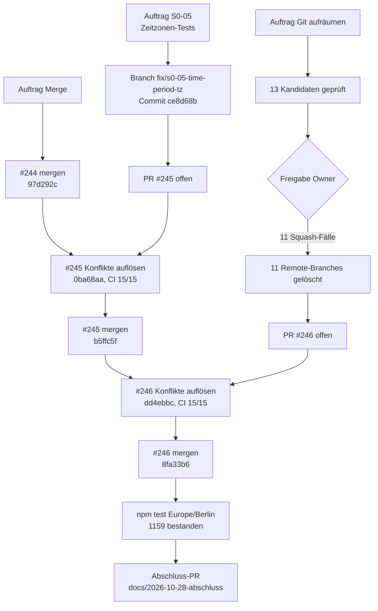

# Bericht 2026-10-28: S0-05, Git-Aufräumen, Merge #244 bis #246

Stand: 2026-10-28 · Werkzeug: Claude Code (ADR-0039) · `main` nach Abschluss: `8fa33b6`

Dieser Bericht fasst drei aufeinanderfolgende Aufträge zusammen. Aussagen zu Ergebnissen stützen sich auf die genannten Belege; was nicht belegt ist, ist als „nicht belegt“ gekennzeichnet.

## Gesamtbild



## 1 Auftrag S0-05: Zeitzonen-abhängige Tests

### 1.1 Auftrag

Die Tests in `src/__tests__/lib/time-period.test.ts` müssen unabhängig von der Zeitzone bestehen; Quelle: `docs/AUFTRAG-S0-05-ZEITZONEN-TESTS.md`, Tracker S0-05.

### 1.2 Durchführung

1. Eigenen Worktree `sysingdashboard-s0-05` auf `origin/main` (`23a8f3c`) mit Branch `fix/s0-05-time-period-tz` angelegt, weil die vorhandenen Klone fremde Branches bzw. uncommittete Änderungen hatten. Abhängigkeiten mit `bun install --frozen-lockfile` (kein `package-lock.json` vorhanden).
2. Fehler unter Windows/PowerShell mit `$env:TZ` reproduziert; `$env:TZ` wirkt.
3. Tests: lokaler Formatierer `localDay` (getFullYear/getMonth/getDate) statt `toISOString().slice(0, 10)`.
4. Produkt, nur `src/lib/time-period.ts`: Hilfsfunktion `parseActivityDate`. Reiner Datumstext `YYYY-MM-DD` (Monat 1 bis 12) wird als lokaler Kalendertag ausgewertet; Zeitstempel mit Uhrzeit oder Zone und ungültige Texte laufen unverändert über `new Date`. Verwendet in `sumActivitiesInRange` und an beiden Stellen in `buildChartBuckets`.
5. Regressionstest `should_includeLastDayOfMonth_when_monthMode` ergänzt und gegen den alten Code geprüft (schlägt dort fehl).
6. tsc, eslint, Prettier, `docs:check`, `docs:project`; Doku (Tracker, CURRENT-STATUS, Tagebuch, CHANGELOG); Commit, Push, PR #245.

### 1.3 Ergebnis mit Beleg

| Zeitzone         | vorher (`23a8f3c`) | nachher (`ce8d68b`) |
| ---------------- | ------------------ | ------------------- |
| UTC              | 20 von 20          | 21 von 21           |
| Europe/Berlin    | 4 Fehlschläge      | 21 von 21           |
| America/New_York | 2 Fehlschläge      | 21 von 21           |
| Asia/Tokyo       | nicht geprüft      | 21 von 21           |

Beleg: lokale Läufe `npx vitest run src/__tests__/lib/time-period.test.ts` mit `$env:TZ`, 2026-10-28.

- PR #245, Merge-Commit `b5ffc5fba2ce1d6b7f0d2c018edb4661b8c3af2e`.
- CI auf Head `0ba68aa`: 15 von 15 Checks `success` (Workflow-Läufe 40754934605, 40754934674): 1 · Setup; 2 · Static (format, lint, types, docs); 3+4 · Unit & Components; 5 · Backend; 6 · API; 7 · RBAC & Security; 8 · Import/Export; 9 · Backup/Restore; 10 · Production Build; 11 · E2E (Playwright); 12 · Accessibility; 13 · Technical Debt; 14 · Technical Report & Quality Gate; Database Schema Drift; Secrets, Headers, Azure-Strings.
- Testprotokoll `npm test` unter `TZ=Europe/Berlin` auf `main@8fa33b6` (wörtlich):

```text
 Test Files  171 passed (171)
      Tests  1159 passed | 4 todo (1163)
   Start at  20:54:07
   Duration  137.15s (transform 35.94s, setup 317.83s, import 91.62s, tests 63.76s, environment 838.62s)
```

### 1.4 Abweichungen und Befunde

- **Zusatzbefund (nutzersichtbar):** Unter deutscher Zeit fielen im Monatsdiagramm Aktivitäten am letzten Monatstag heraus, weil `new Date("YYYY-MM-DD")` UTC-Mitternacht liefert (lokal 01:00 bzw. 02:00) und damit nach der lokalen Grenze `last` lag. Behoben durch dieselbe Änderung, abgesichert durch den Regressionstest.
- **CHANGELOG:** Eintrag unter der noch unveröffentlichten Version 1.69.0 statt einer neuen Version, damit sich `DASHBOARD_VERSION` vor dem geplanten Tag v1.69.0 nicht ändert (Annahme).
- **Testanzahl:** 21 statt der im Auftrag genannten 20, wegen des Regressionstests.
- **Vollsuite am Branch (vor dem Merge):** 2 Fehlschläge in `BackendAdminDialog.test.tsx` unter Volllast; isoliert 6 von 6 grün, kein Bezug zu `time-period`. Im Lauf auf `main@8fa33b6` trat der Fehler nicht auf. Ursache nicht belegt (vermutlich Zeitüberschreitung unter Last).
- **Randfall:** Ein Datumstext mit Monat 13 bleibt wie bisher ungültig; Tagesüberlauf (z. B. `2025-02-30`) verhält sich wie zuvor (Überlauf in den Folgemonat).

### 1.5 Offene Punkte und Risiken

- `BackendAdminDialog.test.tsx` sollte auf Lastabhängigkeit untersucht werden (Kandidat für `docs/BACKLOG.md`).
- Die Sichtprüfung des Monatsdiagramms in der veröffentlichten App ist nicht belegt; sie ist erst nach dem Publish möglich (R-07).

## 2 Auftrag Git aufräumen

### 2.1 Auftrag

Remote-Branches mit bereits gemergtem PR müssen nach Einzelprüfung und ausdrücklicher Freigabe gelöscht werden, ohne Merge; Quelle: Auftrag des Owners vom 2026-10-28, Regeln GA-1 bis GA-5 in `docs/GIT-AUFRAEUMEN.md`.

### 2.2 Durchführung

1. `git fetch --prune`, `main` aktualisiert, `npm run git:hygiene` (0 gemergte Remote-Branches, 1 gemergter lokaler Branch).
2. Je Kandidat: offener PR (Head oder Basis), `git rev-list --count origin/main..origin/<branch>`, PR-Nummer und Merge-Commit, Vergleich des Dateistands der Branch-Spitze mit dem Merge-Commit.
3. Ergebnis gemeldet und angehalten. Freigabe des Owners: „Löschen freigegeben für die 11 identischen Squash-Fälle“.
4. Löschen einzeln mit `git push --force-with-lease=refs/heads/<branch>:<sha> origin :refs/heads/<branch>` nach erneuter Prüfung von SHA und offenen PRs.
5. Doku in `docs/GIT-AUFRAEUMEN.md` Abschnitt 7, Tracker, CURRENT-STATUS, Tagebuch; PR #246.

### 2.3 Ergebnis mit Beleg

Gelöscht (11):

| Branch                                             | Kurz-SHA   | Commits nicht in main | PR (Merge-Commit)            |
| -------------------------------------------------- | ---------- | --------------------- | ---------------------------- |
| `chore/repository-line-endings`                    | `ed1eac46` | 1                     | #158 (`a1bbaf1f`)            |
| `docs/bsf-03e-main-baseline-2026-09-22`            | `2c6ec7f3` | 6                     | #151 (`00dc0637`)            |
| `docs/bsf03e-p5-closure-2026-10-15`                | `c15eb3f0` | 1                     | #186 (`7affeeb6`), dann #187 |
| `feat/bsf-03b-performance-statement`               | `92712927` | 157                   | #149 (`12b37be8`)            |
| `fix/bsf03b-e2e-reference-date`                    | `b207f238` | 1                     | #152 (`1ca8f093`)            |
| `governance/lovable-connector-fallback-2026-10-13` | `dfa6cfed` | 7                     | #180, #182 (`e6c86a29`)      |
| `restack/bsf-03e-p3b-docs-2026-10-14`              | `fa1d3aa4` | 1                     | #184 (`430e7737`), dann #185 |
| `signed/bsf-03e-p3b-work-view-2026-10-15`          | `430e7737` | 1                     | #185 (`008c798a`)            |
| `signed/bsf-07-p0-contract-2026-10-16`             | `c83b33ce` | 2                     | #190 (`fd8aa71b`)            |
| `signed/bsf03e-p5-closure-2026-10-15`              | `7affeeb6` | 1                     | #187 (`601874ec`)            |
| `signed/gg-delivery-plan-2026-10-16`               | `d4708c62` | 1                     | #189 (`fb55000c`)            |

Nicht gelöscht:

| Branch                                        | Kurz-SHA   | Begründung                                                                                 |
| --------------------------------------------- | ---------- | ------------------------------------------------------------------------------------------ |
| `aqgs-pilot`                                  | `d9ec5101` | Evidenz (GA-3), nie löschen                                                                |
| `docs/tracker-lovable-broker-ruecksetzung`    | `28bcd15b` | Commit nach dem Merge von #219; 34 von 39 hinzugefügten Zeilen in `main` gefunden, 5 nicht |
| lokal `docs/stand-2026-10-26-merge-abschluss` | –          | im Worktree `sysingdashboard-gg-docs` ausgecheckt, `git branch -d` nicht möglich           |

- PR #246, Merge-Commit `8fa33b6198055102c83a6b1c62a3d956836208b2`.
- CI auf Head `dd4ebbc`: 15 von 15 Checks `success` (Workflow-Läufe 40756742516, 40756742573; Checks wie in 1.3).
- Remote-Branches: 88 vor dem Löschen, 77 danach, 75 nach dem Auto-Delete der gemergten PR-Branches.

### 2.4 Abweichungen und Befunde

- Alle 13 Kandidaten hatten Commits außerhalb von `main` (Squash-Merges). Nach der Auftragsregel wäre keiner löschbar gewesen. Gelöscht wurde nur auf ausdrückliche Einzelfreigabe der 11 Fälle mit identischem Dateistand.
- `git:hygiene` erkennt Squash-Merges nicht als gemergt und meldete vor und nach dem Löschen 0; die Wirkung zeigt sich nur an der Zahl der Remote-Branches.
- Zwei Fälle waren gestapelte PRs (Basis war ein anderer Branch); ihre Inhalte gelangten über den Folge-PR nach `main`.

### 2.5 Offene Punkte und Risiken

- `docs/tracker-lovable-broker-ruecksetzung`: Der Owner muss entscheiden, ob die 5 fehlenden Zeilen aus `28bcd15b` übernommen oder verworfen werden.
- Worktree `sysingdashboard-gg-docs` sollte entfernt werden, damit der gemergte lokale Branch gelöscht werden kann.
- `git:hygiene` sollte Squash-Merges erkennen (z. B. über PR-Status), sonst bleibt die Kennzahl ohne Aussagekraft.

## 3 Auftrag Merge #244, #245, #246

### 3.1 Auftrag

Die PRs #244, #245 und #246 müssen in dieser Reihenfolge nach grüner CI per REST gemergt werden; Quelle: Auftrag mit Freigabe des Owners vom 2026-10-28.

### 3.2 Durchführung

1. Vorprüfung: `main` auf `23a8f3c`; keine Lovable-Schreibaktivität (letzter `lovable-sync`-Branch 2026-10-24 13:16 UTC, keine Lovable-Commits auf `main` seit 2026-10-24).
2. #244: `update-branch` nicht nötig (0 Commits hinter `main`), CI 15 von 15, Merge.
3. #245: `update-branch` per REST scheiterte am Konflikt; lokal aufgelöst (Tagebuch und Tracker, beide Einträge erhalten, neuer oben; `base_main_sha` und `main`-Verweis auf `97d292c`), Prüfungen, Push, CI 15 von 15, Merge.
4. #246: wie #245, Konflikte zusätzlich in CURRENT-STATUS; Verweise auf `b5ffc5f`; CI 15 von 15, Merge.
5. Lokale Branches mit `git branch -d` gelöscht; Remote-Branches waren durch Auto-Delete bereits entfernt.
6. `npm test` unter Europe/Berlin auf `main@8fa33b6` (Protokoll in 1.3).

### 3.3 Ergebnis mit Beleg

| PR   | Inhalt                     | Head (geprüft) | CI                                         | Merge-Commit |
| ---- | -------------------------- | -------------- | ------------------------------------------ | ------------ |
| #244 | Stand-Abgleich nach PR 243 | `89a2bf3e`     | 15 von 15 (Läufe 40751583265, 40751583350) | `97d292c3`   |
| #245 | S0-05                      | `0ba68aad`     | 15 von 15 (Läufe 40754934605, 40754934674) | `b5ffc5fb`   |
| #246 | Git-Aufräumen              | `dd4ebbc6`     | 15 von 15 (Läufe 40756742516, 40756742573) | `8fa33b61`   |

Gemergt wurde jeweils mit `sha`-Absicherung auf den geprüften Head (`gh api -X PUT …/pulls/N/merge -f merge_method=merge -f sha=<head>`).

### 3.4 Abweichungen und Befunde

- Konflikte traten wie erwartet in Tracker, Tagebuch und (bei #246) CURRENT-STATUS auf; keine Code-Konflikte.
- Nach dem letzten Merge waren CURRENT-STATUS (main-Verweis `b5ffc5f`, S0-05 „PR offen“) und Tracker (S0-05 `in_progress`, `base_main_sha`) veraltet; korrigiert im Abschluss-PR.

### 3.5 Offene Punkte und Risiken

- Der Abschluss-PR (`docs/2026-10-28-abschluss`) ist nicht gemergt; Merge nur auf Anweisung des Owners.
- Publish bleibt No-Go (R-07); der S0-05-Fix ist damit nur in `main`, nicht in der veröffentlichten App.

## Doku-Stand nach dem Merge

| Dokument                        | Stand                                                                                                                                         |
| ------------------------------- | --------------------------------------------------------------------------------------------------------------------------------------------- |
| `docs/CURRENT-STATUS.md`        | `Stand: 2026-10-28`; `main`-Verweis im Abschluss-PR auf `8fa33b6` korrigiert; S0-05 als abgeschlossen; Verweis auf diesen Bericht             |
| `docs/ENTWICKLUNGSTAGEBUCH.md`  | Einträge vom 28.10.: Auftrag S0-05 und Korrektur zum MVP, S0-05, Git aufgeräumt; im Abschluss-PR ergänzt: Merge der PRs                       |
| Tracker                         | `base_main_sha` im Abschluss-PR auf `8fa33b6`; S0-05 `done`; `fortschritt`-Einträge zu S0-05, Git-Aufräumen und Merge                         |
| `CHANGELOG.md`                  | Zeile „Monatsdiagramm …(S0-05)“ unter 1.69.0 vorhanden                                                                                        |
| `src/lib/help-documentation.ts` | nicht geändert: Die Korrektur ändert keine Bedienung; die Änderungshistorie des Handbuchs liest `CHANGELOG.md` zur Build-Zeit automatisch ein |

## Hygiene

Gemergte Remote-Branches / offene PRs / Drafts: 0 / 9 / 6 (vor dem Aufräumen) → 0 / 7 / 6 (nach dem Merge von #246, ohne den Abschluss-PR).

## Empfehlung

Als Nächstes sollte der Owner über `docs/tracker-lovable-broker-ruecksetzung` entscheiden und den Abschluss-PR freigeben; R-07 (Antwort des Lovable-Teams) blockiert weiterhin den Publish.
