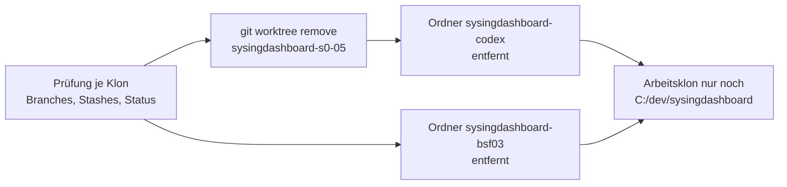

# Bericht 2026-10-31: Aufräumen der Arbeitsklone unter OneDrive

Stand: 2026-10-31 · Werkzeug: Claude Code (ADR-0039) · Freigabe des Betreibers: 2026-10-31 („Ich stimme allen Vorschlägen zu“)

Grundlage: Bestandsaufnahme der Ordner vom 2026-10-31 und Sicherungsbericht `docs/BERICHT-2026-10-31-SICHERUNG.md`. Aussagen stützen sich auf die genannten Prüfbefehle.

## Ergebnis in Kürze

- Entfernt: Worktree `sysingdashboard-s0-05`, Klon `sysingdashboard-codex`, Klon `sysingdashboard-bsf03`, alle unter `C:\Users\bmarn\OneDrive\Dokumente\Dashboard`.
- Verloren ging nichts: Jeder lokale Branch war auf `origin` enthalten, es gab keine Stashes, und außer `node_modules` und Zwischenspeichern lagen keine ignorierten Dateien vor.
- Einziger aktiver Arbeitsklon ist `C:\dev\sysingdashboard`. Erhalten bleiben `backup/codex-2026-10-31` auf GitHub und `C:\dev\_sicherung_sysingdashboard-codex`.
- Kein Remote-Branch gelöscht, keine Änderung am Live-System.

## 1 Vorprüfung

| Klon                    | Lokale Branches (SHA)                                                                                                | Auf `origin` enthalten | Stashes | Arbeitsstand                                                                          |
| ----------------------- | -------------------------------------------------------------------------------------------------------------------- | ---------------------- | ------- | ------------------------------------------------------------------------------------- |
| `sysingdashboard-codex` | `backup/codex-2026-10-31` (`2a0cf1d9`), `codex/gg-l2-01-management-cockpit-domain` (`3649b098`), `main` (`d9996906`) | 3 von 3                | 0       | sauber; ignoriert nur `node_modules/`                                                 |
| `sysingdashboard-s0-05` | Worktree von `sysingdashboard-codex`, `main` (`d9996906`)                                                            | ja                     | 0       | sauber                                                                                |
| `sysingdashboard-bsf03` | `feat/bsf03-meine-kunden-runtime` (`9f1b10d`, PR #128 gemergt)                                                       | 1 von 1                | 0       | fehlender Zeilenumbruch in `docs/ENTWICKLUNGSTAGEBUCH.md`, `.tool-cache/` (ca. 45 MB) |

Befehle: `git for-each-ref refs/heads` mit `git branch -r --contains <sha>`, `git stash list`, `git status --porcelain --ignored`.

## 2 Durchführung

1. `git -C sysingdashboard-codex worktree remove sysingdashboard-s0-05` (ohne `--force`, der Worktree war sauber).
2. Ordner `sysingdashboard-codex` gelöscht.
3. Ordner `sysingdashboard-bsf03` gelöscht. Der erste Versuch scheiterte an neun gesperrten Dateien in `.tool-cache/` („Device or resource busy“, vermutlich OneDrive-Synchronisation); der zweite Versuch mit `Remove-Item -Recurse -Force` war erfolgreich.

## 3 Nachprüfung

| Prüfung                                         | Ergebnis                                                    |
| ----------------------------------------------- | ----------------------------------------------------------- |
| `Test-Path` auf alle drei Ordner                | alle nicht mehr vorhanden                                   |
| Ordner `OneDrive\Dokumente\Dashboard`           | ca. 83 MB vorher, ca. 51 KB nachher; Report-App unverändert |
| `git worktree list` in `C:\dev\sysingdashboard` | nur der Hauptklon                                           |
| `backup/codex-2026-10-31` auf `origin`          | vorhanden (`2a0cf1d9`)                                      |
| `C:\dev\_sicherung_sysingdashboard-codex`       | unverändert vorhanden                                       |

Wiederherstellung: bei Bedarf neu klonen bzw. den Sicherungsbranch auschecken (Befehle in `docs/BERICHT-2026-10-31-SICHERUNG.md`, Abschnitt 4). OneDrive hält gelöschte Dateien zusätzlich eine Zeit lang im Papierkorb vor (Dauer nicht geprüft).

## 4 Festlegung

Arbeitsklone von sysingdashboard liegen künftig nur unter `C:\dev`. Unter OneDrive liegt nur die eigenständige Report-App „Senior Engineer Report System“ (kein Git-Repo), die unberührt blieb.
