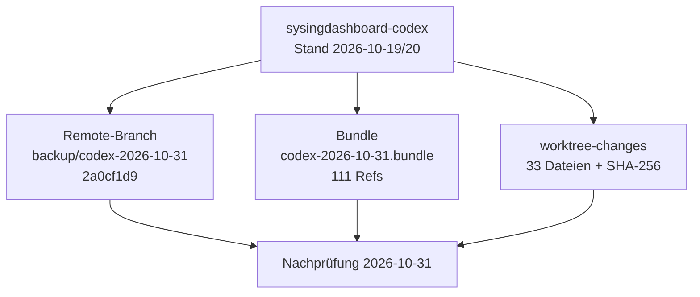

# Bericht 2026-10-31: Sicherung Codex-Arbeitsstand

Stand: 2026-10-31 · Werkzeug: Claude Code (ADR-0039) · `main`: `026047e4` (nach PR #249)

Dieser Bericht dokumentiert die Sicherung vom 2026-10-31 (05:04 Uhr) und deren Nachprüfung am selben Tag. Korrigiert am 2026-10-31 nach einer Bestandsaufnahme der Ordner (Abschnitt 3). Aussagen zu Ergebnissen stützen sich auf die genannten Prüfbefehle; was nicht belegt ist, ist als „nicht belegt“ gekennzeichnet.

## Ergebnis in Kürze

- Der Codex-Arbeitsstand aus `sysingdashboard-codex` ist dreifach gesichert: Remote-Branch `backup/codex-2026-10-31`, Git-Bundle und Dateikopie mit SHA-256-Liste. Alle drei Prüfungen bestehen.
- Nichts wurde gemergt, kein Remote-Branch gelöscht, keine Änderung am Live-System.
- Der Sicherungsbranch darf nicht gemergt werden: Die ADR-Nummern 0036 bis 0039 sind auf `main` anders belegt.



## 1 Gegenstand der Sicherung

| Quelle                  | Ziel                                       | Zeitpunkt        | Umfang                                      |
| ----------------------- | ------------------------------------------ | ---------------- | ------------------------------------------- |
| `sysingdashboard-codex` | Branch `origin/backup/codex-2026-10-31`    | 2026-10-31 05:04 | 5 Commits vor Basis `fd8aa71b` (2026-10-17) |
| `sysingdashboard-codex` | `C:\dev\_sicherung_sysingdashboard-codex\` | 2026-10-31 05:04 | Bundle (ca. 6 MB), 33 Dateien, Hashliste    |

### 1.1 Inhalt des Sicherungsbranches

Commit `2a0cf1d9edbfb9a2af773719c0975810420c631a` („wip: Codex-Arbeit sichern (nicht mergen)“) auf der Basis `3649b098` (Branch `codex/gg-l2-01-management-cockpit-domain`, nur im Bundle und als Vorgänger im Sicherungsbranch vorhanden). Gegenüber der Basis `fd8aa71b` umfasst der Branch 37 Dateien mit 3088 Einfügungen:

- ADR-Entwürfe 0036 bis 0040 (Testziel-Abgleich, OneDrive-Toolchain, WSL-Fallback, Toolchain-Image, lokale Speicherwartung),
- BSF-07-P1-Berichte (`docs/BSF-07-P1-MC-COVERAGE.md`, `docs/BSF-07-P1-TECHNICAL-TEST-REPORT.md`), Pläne und Designs vom 2026-10-17 bis 2026-10-20,
- Dev-Container (`.devcontainer/`) und Golden-Gate-Skripte (`scripts/golden-gate/`, 13 Dateien),
- Domänendienst `management-cockpit-service.ts` mit Test (365 Zeilen),
- Änderungen an `docs/PROJECT-GOVERNANCE.md`, `docs/ADR/README.md`, `scripts/check-docs-sync.mjs`, `scripts/project-status/check.mjs`, `security-report/`.

### 1.2 Kollision mit `main`

| ADR  | Sicherungsbranch                   | `main`                               |
| ---- | ---------------------------------- | ------------------------------------ |
| 0036 | Kontinuierlicher Testziel-Abgleich | QS-01 Konto- und Berechtigungsschutz |
| 0037 | OneDrive-Toolchain-Umgebung        | Kontrollierte Datenaufträge          |
| 0038 | WSL-Toolchain-Fallback             | BSF-Umfang und Meilensteine          |
| 0039 | Golden-Gate-Toolchain-Image        | Claude Code statt Codex              |
| 0040 | Sichere lokale Speicherwartung     | nicht vorhanden                      |

Eine Übernahme einzelner Inhalte nach `main` muss die ADRs neu nummerieren und als eigener PR erfolgen.

## 2 Prüfungen und Belege (2026-10-31)

| Prüfung                             | Befehl                                                                 | Ergebnis                                        |
| ----------------------------------- | ---------------------------------------------------------------------- | ----------------------------------------------- |
| Bundle vollständig und lesbar       | `git bundle verify codex-2026-10-31.bundle`                            | „is okay“, „records a complete history“, Exit 0 |
| Refs im Bundle                      | `git bundle list-heads`                                                | 111 Refs; alle Objekte im Hauptklon vorhanden   |
| Dateikopie unverändert              | `sha256sum -c ../worktree-changes.sha256` (in `worktree-changes`)      | 33 von 33 OK                                    |
| Dateikopie gleich Sicherungscommit  | `git hash-object` je Datei gegen `2a0cf1d9:<pfad>`                     | 33 von 33 gleich, keine fehlende Datei          |
| Basis im Sicherungsbranch enthalten | `git merge-base --is-ancestor 3649b098 origin/backup/codex-2026-10-31` | erfüllt                                         |
| Branch auf dem Remote               | `git ls-remote --heads origin backup/codex-2026-10-31`                 | `2a0cf1d9…`                                     |

## 3 Befunde

### 3.1 Originalordner `sysingdashboard-codex`

Korrektur: Die erste Fassung meldete den Ordner als nicht mehr vorhanden. Geprüft war nur `C:\dev`. Der Ordner existiert unter `C:\Users\bmarn\OneDrive\Dokumente\Dashboard\sysingdashboard-codex`. Dort ist `backup/codex-2026-10-31` (`2a0cf1d9`) ausgecheckt, der Arbeitsstand ist sauber, und der Branch `codex/gg-l2-01-management-cockpit-domain` liegt lokal vor. Zu diesem Klon gehört der Worktree `sysingdashboard-s0-05` (`main` auf `d999690`). Kein Worktree zeigt auf einen fehlenden Pfad.

### 3.2 Weitere Klone unter OneDrive

`sysingdashboard-bsf03` (Branch `feat/bsf03-meine-kunden-runtime`, `9f1b10d`, über PR #128 in `main`) hat zwei Abweichungen: ein fehlender Zeilenumbruch am Ende von `docs/ENTWICKLUNGSTAGEBUCH.md` und den nicht versionierten Zwischenspeicher `.tool-cache/` (ca. 45 MB). Beides ist ohne Inhalt.

### 3.3 Abgrenzung zu repo-cockpit

Der Ordner `C:\dev\_sicherung_repo-cockpit` gehört zum eigenen Repo `bmarnau/repo-cockpit` und ist nicht Gegenstand dieses Berichts. Im Branch `backup/codex-2026-10-31` ist keine Datei aus repo-cockpit enthalten (`git grep repo-cockpit` ohne Treffer).

## 4 Wiederherstellung

```powershell
# Codex-Stand aus dem Remote-Branch (bevorzugt)
git fetch origin backup/codex-2026-10-31
git worktree add ..\sysingdashboard-codex-restore origin/backup/codex-2026-10-31

# Alternativ aus dem Bundle (ohne Netz)
git clone C:\dev\_sicherung_sysingdashboard-codex\codex-2026-10-31.bundle C:\dev\codex-restore
git -C C:\dev\codex-restore switch codex/gg-l2-01-management-cockpit-domain
```

Die Dateikopie unter `worktree-changes\` vor dem Zurückkopieren mit `sha256sum -c ..\worktree-changes.sha256` prüfen.

## 5 Regeln für die gesicherten Stände

- `backup/codex-2026-10-31` muss erhalten bleiben (Branches `backup/*` nie löschen) und darf nicht gemergt werden.
- Der Ordner `C:\dev\_sicherung_sysingdashboard-codex` sollte erhalten bleiben, bis über die Übernahme der Codex-Inhalte entschieden ist (Backlog).
- Aufräumen nach Freigabe am 2026-10-31 ausgeführt: Worktree `sysingdashboard-s0-05` und die Klone `sysingdashboard-codex` und `sysingdashboard-bsf03` unter OneDrive entfernt (`docs/BERICHT-2026-10-31-AUFRAEUMEN-ONEDRIVE.md`).
- Remote-Branches: 76 (Stand 2026-10-31, `git ls-remote --heads origin`).
