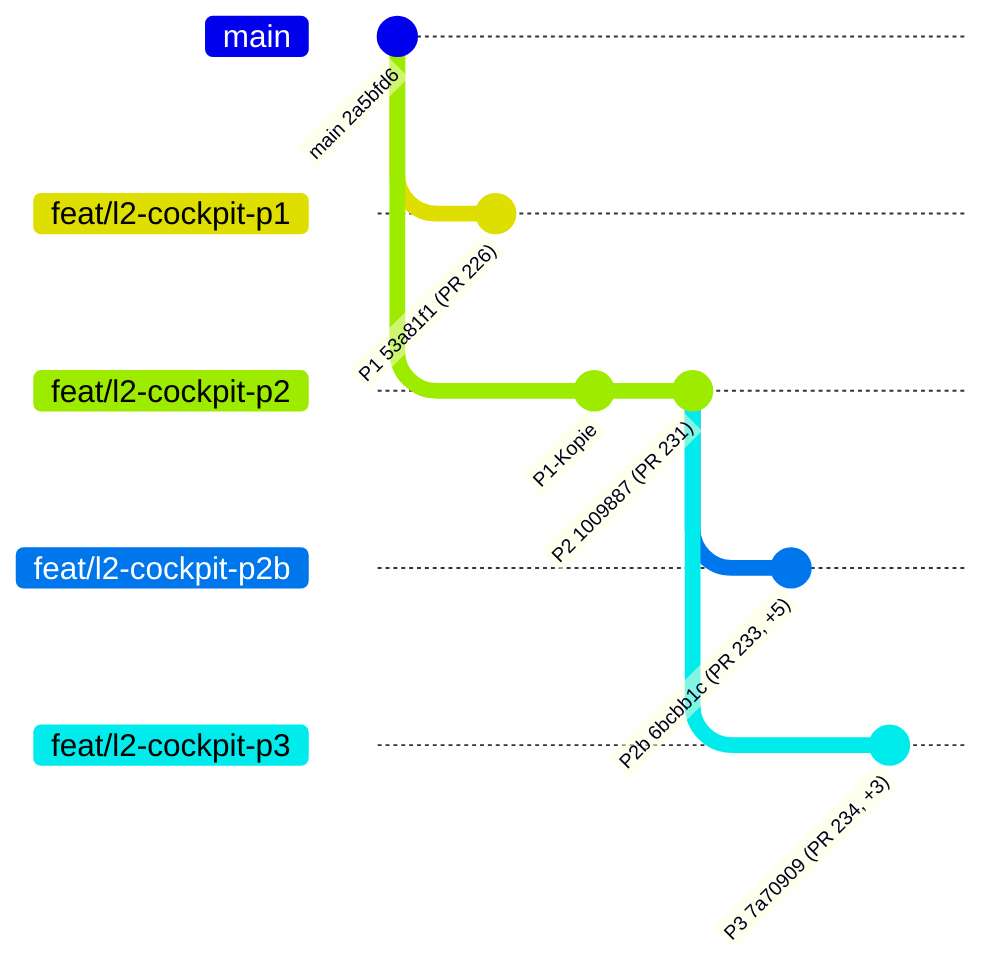

# L2-Bestandsprüfung der Draft-PRs 226, 231, 233, 234

**Datum:** 2026-11-01 · **Art:** Read-only-Bestandsaufnahme, keine Entscheidung, nur Befunde und Vorschlag
**Quelle:** GitHub REST API (Pulls, Files, Check-Runs, Compare) über die verbundene GitHub-Verbindung; Tracker und Konzept aus dem lokalen Arbeitsstand (entspricht GitHub-main `2a5bfd67`, Merge PR #259 vom 2026-10-31, plus ein lokaler „Work in progress"-Commit ohne Inhaltsänderung an den geprüften Dateien).

**Nicht ausgeführt (in der erstellenden Umgebung nicht möglich; Testläufe liefert die Cloud-Messung in `docs/L2-UMSETZUNGSPLAN.md`):** Schritt 4 (Worktree-Testläufe je Branch mit `bun install`/`vitest`) sowie Schritte 1, 8–10 (Branch `docs/2026-11-01-l2-bestandspruefung`, Push, PR, `git:hygiene`). Testzahlen unten stammen aus den PR-Beschreibungen und den CI-Check-Runs, nicht aus eigener Ausführung.

---

## 1. Übersicht je PR

| PR  | Paket              | Branch (Head)                      | Basis           | Commits | Dateien | Zeilen    | Rückstand zu main | mergeable_state     | CI (15 Checks) |
| --- | ------------------ | ---------------------------------- | --------------- | ------- | ------- | --------- | ----------------- | ------------------- | -------------- |
| 226 | P1 Composer        | `feat/l2-cockpit-p1` (`53a81f17`)  | main `11cb2dbe` | 1       | 4       | +665/−0   | **78 Commits**    | `behind` (mergebar) | 15/15 success  |
| 231 | P2 Server-Lesepfad | `feat/l2-cockpit-p2` (`10098872`)  | main `3b664452` | 4       | 12      | +1322/−6  | **69 Commits**    | `dirty` (Konflikt)  | 15/15 success  |
| 233 | P2b AVKK-Adapter   | `feat/l2-cockpit-p2b` (`6bcbb1c6`) | main `3b664452` | 9       | 15      | +2099/−9  | **69 Commits**    | `dirty` (Konflikt)  | 15/15 success  |
| 234 | P3 Route/UI        | `feat/l2-cockpit-p3` (`7a709098`)  | main `3b664452` | 7       | 26      | +2258/−16 | **69 Commits**    | `dirty` (Konflikt)  | 15/15 success  |

Alle vier PRs sind **offene Drafts**, keiner ist gemergt. Die CI auf den jeweiligen Head-Commits ist vollständig grün, einschließlich „7 · RBAC & Security", „11 · E2E (Playwright)", „12 · Accessibility" und „14 · Technical Report & Quality Gate". Die Checks liefen am 26./27.10.2026 — gegen den damaligen main, nicht gegen den heutigen.

**Tests laut PR-Beschreibungen (nicht selbst ausgeführt):**

- P1: 20 Tests nach RED-Matrix (§8), Composer 500 Projekte < 100 ms
- P2: 21 neue Tests (Scope, Cross-Customer/-Systemhouse, DENIED, Teilausfälle)
- P2b: 4 neue RED→GREEN-Tests; Backend 105/105, AVKK-/Serverfokus 31/31; Vollsuite 1203 PASS, 4 TODO, 6 Umgebungsfehler (auf unverändertem main reproduziert)
- P3: 33 neue Tests, Fokus 156/156, synthetischer Browser-Harness 10/10 (8 Rollen, 1280/820/390 px, Tastatur, Axe 0); Vollsuite 1227 PASS, 4 TODO, 5 auf main reproduzierte Fehler

## 2. Stapelstruktur



**Befund:**

- PR 231 (P2) **enthält P1 vollständig** (Composer-Dateien identisch in beiden Dateilisten), basiert aber formal auf main, damit die CI läuft.
- PR 233 (P2b) und PR 234 (P3) bauen **beide exakt auf dem P2-Head `1009887` auf** (Compare: ahead 5 bzw. 3, behind 0). Sie sind **parallele Geschwister**, keine Kette.
- **Keine doppelten Server-Lesepfade zwischen P2 und P2b:** Der Delta P2→P2b besteht aus genau einem neuen Adapter (`src/integrations/supabase/management-cockpit-avkk-adapter.ts`, +360), einem neuen Test (+266), +18 Zeilen im vorhandenen Funktionstest und +8/−4 Zeilen in `management-cockpit.functions.ts`. P2b erweitert den P2-Pfad um AVKK, statt einen zweiten zu bauen — konform zur Konzept-Entscheidung in Abschnitt 11 (Wiederverwendung von `buildRows`/`buildManagementSummary`, Risiko L2-R1 vermieden).
- P3 enthält P2b **absichtlich nicht**; AVKK bleibt dort UNAVAILABLE.

## 3. Abdeckung der L2-Abnahmepunkte

Abnahme laut Tracker (`GOLDEN-GATE-EXECUTION-TRACKER.yaml`, Paket L2) und Konzept §7/§8:

| Abnahmepunkt                                                                              | Beleg                          | Wo                                                                                                                                                                                                                     |
| ----------------------------------------------------------------------------------------- | ------------------------------ | ---------------------------------------------------------------------------------------------------------------------------------------------------------------------------------------------------------------------- |
| Berechtigter Projektmanager sieht Projekt-/AP-Kontext                                     | **belegt (Code+Test)**         | `compose.test.ts` („Projektmanager mit Scope Kunde B"), `management-cockpit.functions.test.ts`; UI: `management-cockpit-view.test.tsx` (P3)                                                                            |
| Unberechtigte Rolle sieht kein Objekt, keinen Count, keine ID                             | **belegt (Code+Test)**         | RED-Fall „Rolle Viewer, Customer, Kiosk → DENIED, kein Zähler, keine ID" in `compose.test.ts`; Serverseitig fail-closed in `management-cockpit.functions.test.ts`; `management-cockpit-access.test.tsx` (P3, 8 Rollen) |
| Zustände AVAILABLE, EMPTY, PARTIAL, UNKNOWN, UNAVAILABLE, DENIED ohne geschönte Nullwerte | **belegt (Code+Test)**         | `types.ts` (SourceResult), RED-Fälle PARTIAL/UNAVAILABLE in `compose.test.ts`; P2b: nicht zuordenbare Legacy-Dossiers brechen generisch als UNAVAILABLE ab statt falscher Nullwerte                                    |
| L2-06 keine Beträge ohne `billing.view`                                                   | **belegt (Code+Review)**       | alle PR-Beschreibungen „keine Beträge"; QS-06 (PR 222) bewusst ungemergt                                                                                                                                               |
| L2-07 Route für Viewer/Customer/Kiosk/Engineer nicht erreichbar                           | **belegt (Test)**              | `management-cockpit-access.test.tsx`, Browser-Harness 10/10 (P3)                                                                                                                                                       |
| L2-10 Composer < 100 ms für 500 Projekte                                                  | **belegt (Test, laut PR 226)** | Messung im Test, nicht im Browser                                                                                                                                                                                      |
| L2-12 Hilfe/Handbuch vor Abschluss                                                        | **offen**                      | in allen Drafts bewusst zurückgestellt bis zur Veröffentlichungsentscheidung                                                                                                                                           |
| P4 Rollenabnahme (live)                                                                   | **offen**                      | kein Live-RLS-/P4-Gesamtnachweis (PR 234 sagt das ausdrücklich)                                                                                                                                                        |

## 4. RBAC-/RLS-Prüfung der Drafts (ADR-0040)

- **Kein Draft ändert Dateien unter `src/__tests__/security/`**, keine Migration, keine Policy, keine Rolle, keine Permission. Geprüft über die vollständigen Dateilisten aller vier PRs.
- Einziger Eingriff in Bestandscode: `src/lib/avkk/work-package-work-view.ts` (+1/−1) — `berlinDate` wird exportiert (in 231, 233, 234 identisch). Keine Verhaltensänderung.
- PR 234 berührt erwartbar Routen (`dashboard.tsx`, `managementcockpit.tsx`, `verantwortungen.tsx`) und `routeTree.gen.ts`; das Rollen-Gate liegt in `ManagementCockpitAccess.tsx` über den bestehenden Management-Permissions.
- CI-Job „7 · RBAC & Security" ist auf allen vier Heads grün.
- **Fazit: Keine Lockerung von Sicherheits-, RBAC- oder RLS-Tests feststellbar.**

## 5. Abhängigkeiten laut Tracker

| Paket | Status                                                                                                     | Relevanz für L2                                                                         |
| ----- | ---------------------------------------------------------------------------------------------------------- | --------------------------------------------------------------------------------------- |
| L0    | in_progress (partial)                                                                                      | Preview läuft; veröffentlichte App unverifiziert                                        |
| L0b   | in_progress — Code gemergt, Gates und Preview bestanden (T1–T3, T6), **published_verified: not_published** | L2 hängt formal an L0b                                                                  |
| L0c   | done                                                                                                       | Demo-Mandant live (Kunde A: Bernd, Kunde B: Petra) — Voraussetzung für reale L2-Prüfung |
| L1    | done                                                                                                       | BSF-07-Vertrag integriert                                                               |

**Bewertung:** L2 ist **in der Vorschau prüfbar** — L0c hat den Demo-Mandanten geschaffen, L0b liefert den Veröffentlichungsweg für echte Daten. **Veröffentlichen ist L2 dagegen nicht:** L0b ist auf der veröffentlichten App nicht verifiziert, und Publish bleibt bis zur Klärung von R-07 (Auth-Broker/Publish-Quelle) No-Go. Der Tracker führt außerdem eine lokale Integrationsprobe (nicht gepusht): Reihenfolge P1, P2, P2b, P3 **ohne Code-Konflikte, nur Dokumentationskonflikte**.

## 6. Risiken

1. **Rückstand:** Alle Drafts liegen 69–78 Commits hinter main; 231/233/234 melden `mergeable_state: dirty`. Die Konflikte betreffen erwartbar die vier Doku-Dateien (`BACKLOG.md`, `CURRENT-STATUS.md`, `ENTWICKLUNGSTAGEBUCH.md`, `GOLDEN-GATE-EXECUTION-TRACKER.yaml`), die 231, 233 und 234 **alle drei gleichzeitig** ändern — sie konfliktieren also auch **untereinander**, nicht nur mit main.
2. **CI-Aussagekraft:** Die grünen Checks datieren vom 26./27.10. gegen den damaligen main. Nach einem Rebase muss die CI erneut vollständig laufen (inkl. „14 · Technical Report & Quality Gate"), bevor irgendein Merge erwogen wird.
3. **AVKK-Entscheidung (Konzept §11) ist noch offen:** P3 ohne P2b zeigt AVKK dauerhaft UNAVAILABLE. Das ist ehrlich, aber fachlich erst nach Nutzer-Entscheidung richtig.
4. **Doppelte P1-Codebasis:** P1 steckt identisch in 226, 231, 233, 234. Ein Merge von 226 nach 231 erzeugt keinen Konflikt, aber die Drafts sind nicht unabhängig voneinander mergebar.
5. **Kein Live-Nachweis:** P4 (Rollenabnahme live) und L2-12 (Hilfe/Handbuch) fehlen; der Tracker-Status `gates_pass: not_run` für L2 bleibt korrekt.

## 7. Vorschlag zur Integrationsreihenfolge (keine Entscheidung)

**Vorschlag: Rebase, dann Kette in der Reihenfolge 226 → 231 → 233 → 234.**

1. **Rebase aller vier Branches auf aktuelles main** (`2a5bfd6`), Doku-Konflikte je Branch einmal auflösen. Danach CI komplett neu laufen lassen.
2. **226 (P1) zuerst mergen** — kleinster Umfang (4 Dateien, +665), mergebar, bildet die Domänenbasis.
3. **231 (P2)** danach; durch den P1-Merge schrumpft der Diff auf den reinen Server-Lesepfad.
4. **233 (P2b) vor 234 (P3)**, damit die Route nicht mit dauerhaft UNAVAILABLE-AVKK live geht — sofern die AVKK-Entscheidung (§11) zugunsten von P2b fällt. Falls der Nutzer AVKK im ersten Schnitt weglassen will: 233 verwerfen und 234 direkt auf 231 rebasen.
5. **Nicht aufteilen nötig, nichts verwerfen** (außer ggf. 233 bei AVKK-Verzicht): Die Schnitte sind sauber getrennt, es gibt keine doppelte Fachlogik.
6. Erst nach allen Merges: P4-Rollenabnahme live, L2-12 Hilfe/Handbuch, dann Tracker-Status für L2 aktualisieren. Publish bleibt bis R-07-Klärung No-Go.

**Begründung:** Die lokale Integrationsprobe (Tracker, 2026-10-28) hat genau diese Reihenfolge ohne Code-Konflikte bestätigt; P2b und P3 sind Geschwister auf P2, daher ist ihre Reihenfolge frei wählbar, aber P2b-vor-P3 vermeidet einen sichtbaren Funktionsrückschritt (AVKK UNAVAILABLE) auf main.

## 8. Offene Schritte für die lokale Sitzung (C:\dev\sysingdashboard)

- Schritt 4: Worktree-Testläufe je Branch (`bun install --frozen-lockfile`, `npx vitest run <Pfade>`, Typprüfung) — in dieser Umgebung nicht möglich (kein GitHub-Git-Zugriff, kein `gh`).
- Schritte 1, 8–10: Branch `docs/2026-11-01-l2-bestandspruefung` anlegen, diesen Bericht nach `docs/BERICHT-2026-11-01-L2-BESTAND.md` übernehmen, Tracker/Tagebuch/CURRENT-STATUS pflegen, `npm run docs:check`, `npm run docs:project`, Prettier, committen, pushen, `git ls-remote` prüfen, PR anlegen (nicht mergen), `npm run git:hygiene`.

---

```yaml
Reifegrad: Entwurf (Bestandsaufnahme, keine Abnahme)
Projektstatus: L2 in_progress; vier Drafts CI-grün, aber 69-78 Commits hinter main; Publish No-Go (R-07)
Offene_Fragen:
  - AVKK-Entscheidung nach Konzept §11 (P2b integrieren oder AVKK im ersten Schnitt weglassen)
  - Wer führt Rebase und Integrationsabnahme durch (lokale Sitzung)
Roadmap:
  Sprints_bis_BSF: nicht Gegenstand dieser Prüfung
  Sprints_bis_MVP: nicht Gegenstand dieser Prüfung
```
