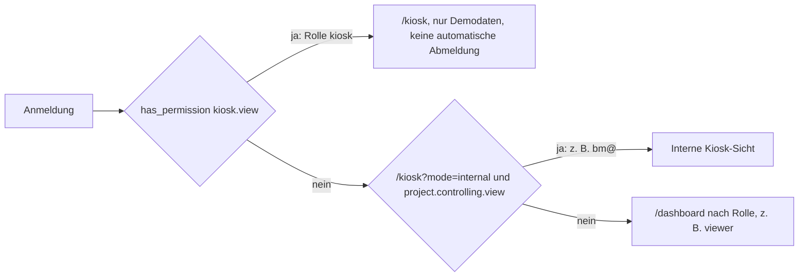

# Bericht: Kiosk-Konto kiosk@ und Rolle kiosk

**Datum:** 2026-11-04 · **Art:** Read-only-Prüfung des Codes und der Migrationen, keine Änderung am Live-System
**Stand des Codes:** Branch `docs/2026-11-04-u7-abnahme` auf Basis `main` `8efb91d1`
**Anlass:** Abnahme U7 (EV-0005): Der Anzeigemodus läuft auf dem Konto bm@ mit der Rolle Systemadministrator (Restrisiko, Backlog). Der Owner hat am 2026-11-04 das Konto kiosk@ in der Auth-Verwaltung angelegt. Die Rolle kiosk ist in der Admin-Oberfläche nicht wählbar.

Der Bericht nennt keine Zugangsdaten. Konten werden nur mit dem Teil vor dem @ genannt, wie in `docs/NACHWEISE.yaml`.

## 1 Ergebnis

1. Es ist keine Migration nötig. Die Rolle `kiosk` ist in der Datenbank vollständig vorhanden: als Wert im Enum `app_role`, mit dem Recht `kiosk.view` und mit einem Trigger, der sie zur einzigen Rolle eines Kontos macht.
2. Im Admin-Dialog fehlt `kiosk`, weil die Auswahlliste sie bewusst herausfiltert.
3. Das neue Konto kiosk@ hat beim Anlegen über den Trigger `on_auth_user_created` automatisch die Rolle **viewer** erhalten. Damit sieht das Konto das Dashboard ohne Beträge und nicht die Kiosk-Ansicht.
4. Ein Konto mit der Rolle `kiosk` wird immer auf `/kiosk` geleitet und zeigt dort nur Demodaten. Die interne Kiosk-Sicht (`/kiosk?mode=internal`) braucht `project.controlling.view`, das die Rolle `kiosk` nicht hat.
5. Empfehlung: kiosk@ löschen und über „Backend-Administration → Kiosk-Konto anlegen“ neu anlegen (Weg A, Abschnitt 4). Vorher klären, ob das Anzeigegerät Demodaten oder interne Zahlen zeigen soll (Abschnitt 5).

## 2 Befunde

| Nr. | Frage                                | Quelle            | Fundstelle                                                                                                                  | Aussage                                                                                                                                                                                                                                                                                |
| --- | ------------------------------------ | ----------------- | --------------------------------------------------------------------------------------------------------------------------- | -------------------------------------------------------------------------------------------------------------------------------------------------------------------------------------------------------------------------------------------------------------------------------------- |
| 1   | kiosk im Datenbank-Enum?             | Migration         | `supabase/migrations/20260914062000_bsf_kiosk_01_add_role.sql:5`                                                            | `ALTER TYPE public.app_role ADD VALUE IF NOT EXISTS 'kiosk'`. Die Rolle steht in der Datenbank.                                                                                                                                                                                        |
| 1   |                                      | Migration         | `supabase/migrations/20260914062100_bsf_kiosk_01_permission_and_exclusivity.sql:16, 49, 54–91`                              | `has_permission` gibt `kiosk.view` nur an `kiosk`, auch nicht an `systemadministrator`. Der Trigger `trg_enforce_kiosk_role_exclusive` (BEFORE INSERT OR UPDATE auf `user_roles`) bricht mit `KIOSK_ROLE_MUST_BE_EXCLUSIVE` ab, wenn ein Konto neben `kiosk` eine weitere Rolle hätte. |
| 1   |                                      | Migration         | `supabase/migrations/20260916072000_bsf_kiosk_01_serialize_role_exclusivity.sql`                                            | Dieselbe Prüfung ist mit einer Sperre je Konto gegen gleichzeitige Änderungen abgesichert.                                                                                                                                                                                             |
| 1   |                                      | Generierte Typen  | `src/integrations/supabase/types.ts:1637, 1774`                                                                             | `app_role` enthält `"kiosk"`.                                                                                                                                                                                                                                                          |
| 1   |                                      | Frontend und Doku | `src/lib/rbac/permissions.ts:213`, `docs/RBAC-MATRIX.md:19, 51, 80`, Tracker (Fortschritt 2026-11-04, QS6-2)                | Kiosk ist überall als Rolle geführt, nicht nur im Frontend.                                                                                                                                                                                                                            |
| 2   | Rollenauswahl im Admin-Dialog        | Oberfläche        | `src/components/UserManagementDialog.tsx:525`                                                                               | Filter `ALL_ROLES.filter((r) => r !== "kiosk")`. Die Rolle ist absichtlich nicht wählbar.                                                                                                                                                                                              |
| 2   |                                      | Dienst            | `src/lib/users-supabase-service.ts:121–143`                                                                                 | Beim Speichern werden alle Rollen des Kontos gelöscht, danach wird die neue Rolle eingefügt. Das sind zwei getrennte Aufrufe ohne gemeinsame Transaktion.                                                                                                                              |
| 2   |                                      | Oberfläche        | `src/components/BackendAdminDialog.tsx:209 ff.`, `src/lib/admin/auth-accounts.functions.ts:234–262`                         | Vorgesehener Weg: Formular „Kiosk-Konto anlegen“. Prüft `users.manage` und `roles.manage`, schreibt den Audit-Eintrag `auth_account.kiosk_create`. Legt nur **neue** Konten an.                                                                                                        |
| 2   |                                      | Server            | `src/lib/admin/auth-accounts.server.ts:198–255`                                                                             | Legt das Auth-Konto mit bestätigter Adresse an (`email_confirm: true`, keine Bestätigungs-Mail), prüft, dass genau die Startrolle `viewer` vorhanden ist, ersetzt sie durch `kiosk` und löscht das Konto wieder, wenn ein Schritt scheitert.                                           |
| 3   | Automatische Rolle für neue Konten   | Migration         | `supabase/migrations/20260720031101_f91cbc77-7151-4442-bd5d-efd315eb8790.sql:2–45`; Trigger aus `…20260717041306_….sql:187` | `handle_new_user()` legt ein Profil an und vergibt `systemadministrator`, wenn es noch keinen gibt, sonst `viewer`. Dazu kommt ein Eintrag `auth.bootstrap` in `audit_log`. **kiosk@ hat deshalb jetzt die Rolle viewer.**                                                             |
| 4   | Rechte der Rolle kiosk               | RBAC-Matrix       | `docs/RBAC-MATRIX.md:19, 51, 84`                                                                                            | Nur `kiosk.view`. Kein Recht für Dashboard, Dokumentation, Fachdaten oder Administration, kein `project.controlling.view`.                                                                                                                                                             |
| 4   | Wie erkennt die App das Kiosk-Konto? | Routenschutz      | `src/routes/_authenticated/route.tsx:60–68, 100–140`, `src/lib/kiosk/kiosk-session-policy.ts:14–36`                         | Nach der Anmeldung wird `has_permission(kiosk.view)` geprüft. Ist es wahr, wird jede Seite auf `/kiosk` umgeleitet, die automatische Abmeldung ist aus. `/kiosk?mode=internal` ist nur mit `project.controlling.view` erlaubt.                                                         |
| 4   | Welche Daten zeigt das Kiosk-Konto?  | Handbuch          | `src/lib/help-navigation-topics.ts:219`, `src/lib/help-documentation.ts:415`                                                | Nur Demodaten, gekennzeichnet mit „DEMO-DATEN — KEINE LIVE-DATEN“.                                                                                                                                                                                                                     |

## 3 Folge für das Anzeigegerät

bm@ hat die Rolle Systemadministrator und erhält `kiosk.view` ausdrücklich nicht. Der Anzeigemodus von bm@ läuft daher vermutlich über die interne Kiosk-Sicht (`/kiosk?mode=internal`). Das ist nicht geprüft. Ein Konto mit der Rolle `kiosk` zeigt dagegen nur Demodaten. Zeigt das Anzeigegerät heute interne Zahlen, ändert die Umstellung auf kiosk@ den Inhalt der Anzeige.

## 4 Wege und Empfehlung

| Weg                                                                                                                       | Aufwand                                          | Risiko                                                                                                                                                                                                                                |
| ------------------------------------------------------------------------------------------------------------------------- | ------------------------------------------------ | ------------------------------------------------------------------------------------------------------------------------------------------------------------------------------------------------------------------------------------- |
| **A (empfohlen):** kiosk@ in der Auth-Verwaltung löschen, über „Backend-Administration → Kiosk-Konto anlegen“ neu anlegen | etwa 15 Minuten, kein Code                       | Gering. Das Konto ist neu und hat keine Fachdaten. Der Rollentausch läuft über den getesteten Weg mit Audit-Eintrag. Der Eintrag `auth.bootstrap` bleibt in `audit_log`. Vorher prüfen, ob die Vorschau den Dialog anbietet.          |
| B: Datenauftrag nach ADR-0037 mit fester Konto-ID (Zeile `viewer` löschen, Zeile `kiosk` einfügen)                        | 1 bis 2 Stunden mit Preflight und zwei Freigaben | Gering bis mittel. Die Konto-ID bleibt erhalten. Erwartete Audit-Zeilen aus `audit_user_roles_change` müssen im Auftrag mit Anzahl stehen.                                                                                            |
| C: Oberflächen-PR (`kiosk` in der Auswahl erlauben, mit Warnhinweis, Löschen und Einfügen in einer Transaktion)           | 0,5 bis 1 Arbeitstag mit Tests                   | Mittel. Eine Person könnte versehentlich zum Kiosk-Konto werden und alle anderen Rollen verlieren. Scheitert das Einfügen nach dem Löschen, hat das Konto keine Rolle. Wirkt erst nach Merge und Lovable-Sync. Gehört in den Backlog. |

Eine Migration ist für keinen der Wege nötig.

## 5 Prüfung nach dem Rollenwechsel

Die Prüfpunkte aus EV-0005 (keine Umsatz-Kachel, kein Tab Abrechnung, keine Beträge in Details und Bericht) passen nicht zur Rolle `kiosk`, weil das Konto diese Seiten gar nicht erreicht. Für kiosk@ gilt:

| ID    | Prüfung                                                             | Erwartung                       |
| ----- | ------------------------------------------------------------------- | ------------------------------- |
| KK-01 | Anmeldung am Anzeigegerät                                           | öffnet automatisch `/kiosk`     |
| KK-02 | Direktaufruf `/dashboard`, ein Projektdetail und ein Projektbericht | Umleitung auf `/kiosk`          |
| KK-03 | `/kiosk?mode=internal`                                              | keine interne Sicht             |
| KK-04 | Kennzeichnung der Anzeige                                           | „DEMO-DATEN — KEINE LIVE-DATEN“ |
| KK-05 | Beträge, Personennamen, Admin-Bereich                               | nicht sichtbar                  |
| KK-06 | Anzeige nach längerer Zeit ohne Eingabe                             | keine automatische Abmeldung    |

Das Ergebnis wird als neuer Nachweis in `docs/NACHWEISE.yaml` eingetragen.

## 6 Rückbau und bm@

bm@ bleibt unverändert, bis kiosk@ nach Abschnitt 5 geprüft ist. Danach entscheidet der Owner, ob bm@ den Status „archiviert“ erhält oder eine andere Rolle. Ein Konto zu löschen ist nicht vorgesehen. Vorher ist zu prüfen, ob dann noch mindestens ein anderer aktiver Systemadministrator besteht. Oberfläche und Datenbank verhindern, den letzten zu entfernen (`users-supabase-service.ts:121–137`, Trigger `protect_last_sysadmin_roles`). `audit_log` wird nie gelöscht.

## 7 Offene Fragen an den Owner

1. Weg A oder B für den Rollenwechsel von kiosk@?
2. Soll das Anzeigegerät Demodaten zeigen (Rolle `kiosk`) oder interne Zahlen? Im zweiten Fall reicht die Rolle `kiosk` nicht. Dann ist eine eigene Entscheidung nötig, zum Beispiel ein eigenes Recht für die interne Kiosk-Sicht.
3. Wohin gehen Mails an kiosk@ (Weiterleitung, wer liest das Postfach)? Rücksetz-Mails gehen an diese Adresse.
4. Der Verweis REST-21 steht nirgends im Repo. Welches Dokument ist gemeint?
