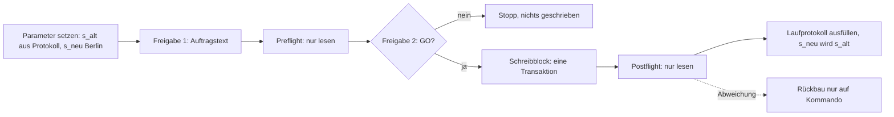

# Datenauftrag-Vorlage: Live-Demodaten monatlich nachführen (Paket 2c, DM-12)

Stand: 2026-11-05 · Status: **Vorlage, nicht freigegeben, nicht ausgeführt** · Grundlage: `docs/ADR/0037-kontrollierte-datenauftraege.md`, Muster `docs/DATENAUFTRAG-TD01-AUFFRISCHUNG.md` (Stufe b, ausgeführt 2026-10-28), Analyse `docs/BERICHT-2026-11-04-HANDBUCH-DEMODATEN.md` (DM-01 bis DM-14, ZP-01 bis ZP-06) · Entscheidungen des Owners vom 2026-11-05: Verschiebung in ganzen Tagen, Monatslauf 2c per Datenauftrag mit Vorlage.

## 1 Ziel

Die Fälligkeiten und Tätigkeitsdaten des Live-Demo-Mandanten (Kunde A und Kunde B) sollen jeden Monat um ein Vielfaches von 7 Tagen nach vorn verschoben werden. Dann bleiben Wochentage und die Verteilung überfällig, heute, künftig erhalten, und die Monatskachel zeigt Stunden im laufenden Monat. Die Vorlage wiederholt TD-01 Stufe b mit zwei Parametern statt fester Altwerte.

## 2 Umfang und Ausschlüsse

| Punkt          | Regel                                                                                                                                                                                        |
| -------------- | -------------------------------------------------------------------------------------------------------------------------------------------------------------------------------------------- |
| Tabellen       | nur `public.shared_work_package_projection.due` und `public.shared_activity_projection.activity_date`                                                                                        |
| Zeilen         | nur die festen Demo-Zeilen aus TD-01 Stufe 0 (2026-10-26): 14 offene Arbeitspakete, 47 Tätigkeiten, alle mit Präfix `demo-`, Systemhaus `…d1`, Kunden `…d2` und `…d3`                        |
| unverändert    | 4 erledigte Arbeitspakete (TB-2), 2 Arbeitspakete ohne Fälligkeit (`demo-wp-fil-monitoring`, `demo-wp-virt-betrieb`)                                                                         |
| ausgeschlossen | alle Nicht-Demo-Zeilen, `audit_log` (nur gezählt, nie geändert oder gelöscht), Konten, Rollen, Rechte, Verantwortliche, Status, Zuordnungen, Identitätsfelder, `published_at`, `source_hash` |
| Ziel-System    | Projekt `3c209338-443a-40f8-8a16-7c3c1b51da0e`, DB-Referenz `zffimqwnrsuzuozsgnlc` (TD1-11); bei Abweichung kein Lauf                                                                        |
| offene IDs     | keine. Kommen neue Demo-Zeilen hinzu (neue Veröffentlichung), muss vor dem nächsten Lauf eine neue Stufe 0 die Liste bestätigen; bis dahin bricht der Preflight ab                           |
| Zugangsdaten   | keine in diesem Dokument; Ausführung in der SQL-Konsole des Lovable-Projekts durch den Owner                                                                                                 |

## 3 Parameter je Lauf

| Parameter | Bedeutung                    | Regel                                                                                                           |
| --------- | ---------------------------- | --------------------------------------------------------------------------------------------------------------- |
| `s_alt`   | zuletzt angewandter Stichtag | aus dem Laufprotokoll (Abschnitt 10); erster Lauf: `2026-10-28` (TD-01 Stufe b)                                 |
| `s_neu`   | neuer Stichtag               | Datum in **Europe/Berlin**, nicht UTC; derselbe Wochentag wie `s_alt` (Mittwoch); spätestens der Ausführungstag |
| `a_soll`  | Anzahl `audit_log`           | aus dem Preflight, Prüfung 2                                                                                    |

Die Verschiebung beträgt `s_neu - s_alt` Tage. Der Schreibblock bricht ab, wenn sie nicht positiv oder kein Vielfaches von 7 ist oder wenn `s_neu` nach dem heutigen Berliner Datum liegt.

## 4 Ablauf



## 5 Zeitplan

| Punkt          | Regel                                                                                                                                                               |
| -------------- | ------------------------------------------------------------------------------------------------------------------------------------------------------------------- |
| Lauf           | einmal je Monat, spätestens am letzten Mittwoch vor dem Monatsende; für November 2026: `s_neu = 2026-11-25` (28 Tage nach 2026-10-28)                               |
| Dauer          | etwa 1 Stunde je Lauf (Preflight, zwei Freigaben, Schreiben, Postflight, Protokoll)                                                                                 |
| späteste Frist | 2026-11-30 (Gate „vor dem Monatswechsel“)                                                                                                                           |
| Verantwortung  | Ausführung: Owner. Freigabe 2: zweite Person nach ADR-0037; solange keine zweite Person benannt ist, gilt eine dokumentierte Abweichung wie beim Kiosk-Konto (R-04) |

## 6 Entscheidungsfelder für den Owner

| Nr.    | Frage                                                                                                                                                                                                             | Empfehlung                                                                                 | Entscheidung |
| ------ | ----------------------------------------------------------------------------------------------------------------------------------------------------------------------------------------------------------------- | ------------------------------------------------------------------------------------------ | ------------ |
| E-2c-1 | Wochentage erhalten (Vielfaches von 7) oder genau auf den Ausführungstag verschieben?                                                                                                                             | Vielfaches von 7 (DM-06); der Abstand zu „heute“ weicht dann um höchstens 6 Tage ab        | offen        |
| E-2c-2 | ZP-02 und ZP-03 (Dezember-Kachel ab 01.12. 00:00 > 0 h) sind für den Live-Mandanten nicht erfüllbar, weil Tätigkeiten immer vor dem Stichtag liegen. Akzeptieren oder zweiter Lauf am ersten Mittwoch des Monats? | akzeptieren; die Dezember-Kachel bleibt bis zum nächsten Lauf leer, das Handbuch nennt das | offen        |
| E-2c-3 | Erledigte Arbeitspakete weiter unverändert lassen (TB-2)?                                                                                                                                                         | ja                                                                                         | offen        |

## 7 Prüfpunkte

| ID    | Zeitpunkt (Europe/Berlin)  | Erwartung laut Bericht                             | Geltung für 2c                                                                                |
| ----- | -------------------------- | -------------------------------------------------- | --------------------------------------------------------------------------------------------- |
| ZP-01 | 30.11. 23:59               | Demodaten im November; Monatskachel November > 0 h | erfüllt nach Lauf mit `s_neu = 2026-11-25` (Tätigkeiten 2026-10-02 bis 2026-11-24)            |
| ZP-02 | 01.12. 00:00               | Demodaten im Dezember; Monatskachel Dezember > 0 h | nicht erfüllbar ohne zweiten Lauf (E-2c-2)                                                    |
| ZP-03 | 01.12. 00:30               | Basisdatum 01.12., nicht 30.11.                    | Prüfung 0 im Preflight zeigt das Berliner Datum; `s_neu` darf nicht aus UTC abgeleitet werden |
| ZP-04 | 28.03.2027 01:59 und 03:00 | Sommerzeit verschiebt keinen Tag                   | erfüllt: Rechnung mit Typ `date`, ohne Uhrzeit                                                |
| ZP-05 | 31.10.2027 02:00 bis 03:00 | Winterzeit verschiebt keinen Tag                   | erfüllt: wie ZP-04                                                                            |
| ZP-06 | beliebig                   | Golden-Dataset-Tests unverändert                   | nicht berührt (nur Datenbank des Demo-Mandanten)                                              |

## 8 SQL

### 8.1 Preflight (nur lesen, nach Freigabe 1)

Parameter in der Zeile `par` setzen. Jede Abweichung in der Spalte `soll` bedeutet STOPP.

```sql
-- Preflight Demodaten Monat: NUR LESEN (SELECT). Parameter wie im Schreibblock.
WITH
par AS (SELECT DATE '2026-10-28' AS s_alt, DATE '2026-11-25' AS s_neu),
ids AS (SELECT '00000000-0000-4000-8000-0000000000d1'::uuid AS sh),
wpv(cust, sid, off) AS (VALUES
      ('00000000-0000-4000-8000-0000000000d2'::uuid,'demo-wp-frei-vertrieb',-4),
      ('00000000-0000-4000-8000-0000000000d2'::uuid,'demo-wp-m365-berechtigungen',-3),
      ('00000000-0000-4000-8000-0000000000d2'::uuid,'demo-wp-fil-firewall',-2),
      ('00000000-0000-4000-8000-0000000000d2'::uuid,'demo-wp-m365-schulung',0),
      ('00000000-0000-4000-8000-0000000000d2'::uuid,'demo-wp-netz-rollout',9),
      ('00000000-0000-4000-8000-0000000000d2'::uuid,'demo-wp-m365-migration',18),
      ('00000000-0000-4000-8000-0000000000d2'::uuid,'demo-wp-fil-rollout',21),
      ('00000000-0000-4000-8000-0000000000d2'::uuid,'demo-wp-netz-doku',40),
      ('00000000-0000-4000-8000-0000000000d3'::uuid,'demo-wp-backup-test',-6),
      ('00000000-0000-4000-8000-0000000000d3'::uuid,'demo-wp-virt-migration',-5),
      ('00000000-0000-4000-8000-0000000000d3'::uuid,'demo-wp-frei-admin',0),
      ('00000000-0000-4000-8000-0000000000d3'::uuid,'demo-wp-virt-cluster',3),
      ('00000000-0000-4000-8000-0000000000d3'::uuid,'demo-wp-virt-storage',10),
      ('00000000-0000-4000-8000-0000000000d3'::uuid,'demo-wp-backup-konzept',14)
),
acv(cust, sid, off) AS (VALUES
      ('00000000-0000-4000-8000-0000000000d2'::uuid,'demo-act-26',-51),
      ('00000000-0000-4000-8000-0000000000d2'::uuid,'demo-act-56',-50),
      ('00000000-0000-4000-8000-0000000000d2'::uuid,'demo-act-28',-47),
      ('00000000-0000-4000-8000-0000000000d2'::uuid,'demo-act-23',-46),
      ('00000000-0000-4000-8000-0000000000d2'::uuid,'demo-act-25',-42),
      ('00000000-0000-4000-8000-0000000000d2'::uuid,'demo-act-20',-41),
      ('00000000-0000-4000-8000-0000000000d2'::uuid,'demo-act-55',-41),
      ('00000000-0000-4000-8000-0000000000d2'::uuid,'demo-act-27',-38),
      ('00000000-0000-4000-8000-0000000000d2'::uuid,'demo-act-22',-37),
      ('00000000-0000-4000-8000-0000000000d2'::uuid,'demo-act-17',-36),
      ('00000000-0000-4000-8000-0000000000d2'::uuid,'demo-act-24',-33),
      ('00000000-0000-4000-8000-0000000000d2'::uuid,'demo-act-1',-32),
      ('00000000-0000-4000-8000-0000000000d2'::uuid,'demo-act-19',-32),
      ('00000000-0000-4000-8000-0000000000d2'::uuid,'demo-act-21',-28),
      ('00000000-0000-4000-8000-0000000000d2'::uuid,'demo-act-16',-27),
      ('00000000-0000-4000-8000-0000000000d2'::uuid,'demo-act-11',-26),
      ('00000000-0000-4000-8000-0000000000d2'::uuid,'demo-act-18',-23),
      ('00000000-0000-4000-8000-0000000000d2'::uuid,'demo-act-15',-18),
      ('00000000-0000-4000-8000-0000000000d2'::uuid,'demo-act-2',-18),
      ('00000000-0000-4000-8000-0000000000d2'::uuid,'demo-act-10',-17),
      ('00000000-0000-4000-8000-0000000000d2'::uuid,'demo-act-8',-12),
      ('00000000-0000-4000-8000-0000000000d2'::uuid,'demo-act-4',-9),
      ('00000000-0000-4000-8000-0000000000d2'::uuid,'demo-act-9',-8),
      ('00000000-0000-4000-8000-0000000000d2'::uuid,'demo-act-57',-7),
      ('00000000-0000-4000-8000-0000000000d2'::uuid,'demo-act-5',-5),
      ('00000000-0000-4000-8000-0000000000d2'::uuid,'demo-act-7',-3),
      ('00000000-0000-4000-8000-0000000000d2'::uuid,'demo-act-3',-2),
      ('00000000-0000-4000-8000-0000000000d3'::uuid,'demo-act-54',-54),
      ('00000000-0000-4000-8000-0000000000d3'::uuid,'demo-act-35',-53),
      ('00000000-0000-4000-8000-0000000000d3'::uuid,'demo-act-30',-52),
      ('00000000-0000-4000-8000-0000000000d3'::uuid,'demo-act-32',-48),
      ('00000000-0000-4000-8000-0000000000d3'::uuid,'demo-act-53',-45),
      ('00000000-0000-4000-8000-0000000000d3'::uuid,'demo-act-29',-43),
      ('00000000-0000-4000-8000-0000000000d3'::uuid,'demo-act-52',-36),
      ('00000000-0000-4000-8000-0000000000d3'::uuid,'demo-act-14',-31),
      ('00000000-0000-4000-8000-0000000000d3'::uuid,'demo-act-13',-22),
      ('00000000-0000-4000-8000-0000000000d3'::uuid,'demo-act-41',-20),
      ('00000000-0000-4000-8000-0000000000d3'::uuid,'demo-act-36',-10),
      ('00000000-0000-4000-8000-0000000000d3'::uuid,'demo-act-37',-19),
      ('00000000-0000-4000-8000-0000000000d3'::uuid,'demo-act-39',-15),
      ('00000000-0000-4000-8000-0000000000d3'::uuid,'demo-act-34',-14),
      ('00000000-0000-4000-8000-0000000000d3'::uuid,'demo-act-12',-13),
      ('00000000-0000-4000-8000-0000000000d3'::uuid,'demo-act-40',-11),
      ('00000000-0000-4000-8000-0000000000d3'::uuid,'demo-act-31',-9),
      ('00000000-0000-4000-8000-0000000000d3'::uuid,'demo-act-38',-6),
      ('00000000-0000-4000-8000-0000000000d3'::uuid,'demo-act-33',-5),
      ('00000000-0000-4000-8000-0000000000d3'::uuid,'demo-act-6',-1)
)
SELECT '0 Datum Europe/Berlin' AS pruefung, ((now() AT TIME ZONE 'Europe/Berlin')::date)::text AS ist, '>= s_neu' AS soll
UNION ALL SELECT '1 Verschiebung in Tagen', (SELECT (s_neu - s_alt)::text FROM par), 'Vielfaches von 7, > 0'
UNION ALL SELECT '2 audit_log', (SELECT count(*) FROM public.audit_log)::text, 'Wert merken (a_soll)'
UNION ALL SELECT '3 Arbeitspakete auf s_alt + Versatz (aktiv, nicht erledigt)',
  (SELECT count(*) FROM public.shared_work_package_projection t, ids, wpv v, par
    WHERE t.systemhouse_id = ids.sh AND t.customer_id = v.cust AND t.source_id = v.sid
      AND t.is_active AND t.due = par.s_alt + v.off AND t.status <> 'erledigt')::text, '14'
UNION ALL SELECT '4 Taetigkeiten auf s_alt + Versatz (aktiv)',
  (SELECT count(*) FROM public.shared_activity_projection t, ids, acv v, par
    WHERE t.systemhouse_id = ids.sh AND t.customer_id = v.cust AND t.source_id = v.sid
      AND t.is_active AND t.activity_date = par.s_alt + v.off)::text, '47'
UNION ALL SELECT '5 Arbeitspakete schon auf s_neu (Doppellauf)',
  (SELECT count(*) FROM public.shared_work_package_projection t, ids, wpv v, par
    WHERE t.systemhouse_id = ids.sh AND t.customer_id = v.cust AND t.source_id = v.sid
      AND t.is_active AND t.due = par.s_neu + v.off)::text, '0'
UNION ALL SELECT '6 Arbeitspakete des Auftrags mit abweichendem Wert (source_id)',
  coalesce((SELECT string_agg(v.sid, ', ') FROM wpv v, ids, par
    WHERE NOT EXISTS (SELECT 1 FROM public.shared_work_package_projection t
      WHERE t.systemhouse_id = ids.sh AND t.customer_id = v.cust AND t.source_id = v.sid
        AND t.is_active AND t.due = par.s_alt + v.off AND t.status <> 'erledigt')), 'keine'), 'keine'
UNION ALL SELECT '7 Taetigkeiten des Auftrags mit abweichendem Wert (Anzahl)',
  (SELECT count(*) FROM acv v, ids, par
    WHERE NOT EXISTS (SELECT 1 FROM public.shared_activity_projection t
      WHERE t.systemhouse_id = ids.sh AND t.customer_id = v.cust AND t.source_id = v.sid
        AND t.is_active AND t.activity_date = par.s_alt + v.off))::text, '0';
```

### 8.2 Schreiben (nur nach ausdrücklichem „GO“, Freigabe 2)

Parameter `s_alt`, `s_neu` und `a_soll` setzen. Ein zweiter Lauf mit denselben Parametern bricht mit Ausnahme ab (Schutz gegen Doppelausführung).

```sql
-- Datenauftrag Demodaten Monat (DM-12): Live-Demo-Mandant in ganzen Tagen verschieben. Eine Transaktion, ADR-0037.
-- Parameter: s_alt (zuletzt angewandter Stichtag), s_neu (neuer Stichtag), a_soll (audit_log aus dem Preflight).
DO $$
DECLARE
  n integer;
  sh constant uuid := '00000000-0000-4000-8000-0000000000d1';
  ka constant uuid := '00000000-0000-4000-8000-0000000000d2';
  kb constant uuid := '00000000-0000-4000-8000-0000000000d3';
  s_alt  constant date    := DATE '2026-10-28'; -- PARAMETER: letzter Stichtag laut Laufprotokoll
  s_neu  constant date    := DATE '2026-11-25'; -- PARAMETER: neuer Stichtag (Datum in Europe/Berlin)
  a_soll constant integer := 329;               -- PARAMETER: audit_log laut Preflight
BEGIN
  IF (s_neu - s_alt) <= 0 OR (s_neu - s_alt) % 7 <> 0 THEN
    RAISE EXCEPTION 'Verschiebung % Tage: muss positiv und ein Vielfaches von 7 sein (Wochentage bleiben erhalten)', s_neu - s_alt;
  END IF;
  IF s_neu > (now() AT TIME ZONE 'Europe/Berlin')::date THEN
    RAISE EXCEPTION 'Stichtag % liegt nach dem heutigen Datum in Europe/Berlin', s_neu;
  END IF;
  SELECT count(*) INTO n FROM public.audit_log;
  IF n <> a_soll THEN RAISE EXCEPTION 'audit_log vor Lauf: erwartet %, gefunden %', a_soll, n; END IF;

  -- 14 offene Arbeitspakete: due von s_alt + Versatz auf s_neu + Versatz
  WITH v(cust, sid, off) AS (VALUES
      (ka,'demo-wp-frei-vertrieb',-4),
      (ka,'demo-wp-m365-berechtigungen',-3),
      (ka,'demo-wp-fil-firewall',-2),
      (ka,'demo-wp-m365-schulung',0),
      (ka,'demo-wp-netz-rollout',9),
      (ka,'demo-wp-m365-migration',18),
      (ka,'demo-wp-fil-rollout',21),
      (ka,'demo-wp-netz-doku',40),
      (kb,'demo-wp-backup-test',-6),
      (kb,'demo-wp-virt-migration',-5),
      (kb,'demo-wp-frei-admin',0),
      (kb,'demo-wp-virt-cluster',3),
      (kb,'demo-wp-virt-storage',10),
      (kb,'demo-wp-backup-konzept',14)
  )
  UPDATE public.shared_work_package_projection t
     SET due = s_neu + v.off
    FROM v
   WHERE t.systemhouse_id = sh AND t.customer_id = v.cust AND t.source_id = v.sid
     AND t.is_active AND t.due = s_alt + v.off AND t.status <> 'erledigt';
  GET DIAGNOSTICS n = ROW_COUNT;
  IF n <> 14 THEN RAISE EXCEPTION 'Arbeitspakete: erwartet 14, geaendert %', n; END IF;

  -- 47 Taetigkeiten: activity_date von s_alt + Versatz auf s_neu + Versatz
  WITH v(cust, sid, off) AS (VALUES
      (ka,'demo-act-26',-51),
      (ka,'demo-act-56',-50),
      (ka,'demo-act-28',-47),
      (ka,'demo-act-23',-46),
      (ka,'demo-act-25',-42),
      (ka,'demo-act-20',-41),
      (ka,'demo-act-55',-41),
      (ka,'demo-act-27',-38),
      (ka,'demo-act-22',-37),
      (ka,'demo-act-17',-36),
      (ka,'demo-act-24',-33),
      (ka,'demo-act-1',-32),
      (ka,'demo-act-19',-32),
      (ka,'demo-act-21',-28),
      (ka,'demo-act-16',-27),
      (ka,'demo-act-11',-26),
      (ka,'demo-act-18',-23),
      (ka,'demo-act-15',-18),
      (ka,'demo-act-2',-18),
      (ka,'demo-act-10',-17),
      (ka,'demo-act-8',-12),
      (ka,'demo-act-4',-9),
      (ka,'demo-act-9',-8),
      (ka,'demo-act-57',-7),
      (ka,'demo-act-5',-5),
      (ka,'demo-act-7',-3),
      (ka,'demo-act-3',-2),
      (kb,'demo-act-54',-54),
      (kb,'demo-act-35',-53),
      (kb,'demo-act-30',-52),
      (kb,'demo-act-32',-48),
      (kb,'demo-act-53',-45),
      (kb,'demo-act-29',-43),
      (kb,'demo-act-52',-36),
      (kb,'demo-act-14',-31),
      (kb,'demo-act-13',-22),
      (kb,'demo-act-41',-20),
      (kb,'demo-act-36',-10),
      (kb,'demo-act-37',-19),
      (kb,'demo-act-39',-15),
      (kb,'demo-act-34',-14),
      (kb,'demo-act-12',-13),
      (kb,'demo-act-40',-11),
      (kb,'demo-act-31',-9),
      (kb,'demo-act-38',-6),
      (kb,'demo-act-33',-5),
      (kb,'demo-act-6',-1)
  )
  UPDATE public.shared_activity_projection t
     SET activity_date = s_neu + v.off
    FROM v
   WHERE t.systemhouse_id = sh AND t.customer_id = v.cust AND t.source_id = v.sid
     AND t.is_active AND t.activity_date = s_alt + v.off;
  GET DIAGNOSTICS n = ROW_COUNT;
  IF n <> 47 THEN RAISE EXCEPTION 'Taetigkeiten: erwartet 47, geaendert %', n; END IF;

  -- Erledigte Arbeitspakete bleiben unveraendert (TB-2)
  SELECT count(*) INTO n FROM public.shared_work_package_projection t
   JOIN (VALUES
      (ka,'demo-wp-fil-design',DATE '2026-10-04'),
      (ka,'demo-wp-netz-planung',DATE '2026-10-14'),
      (ka,'demo-wp-fil-pilot',DATE '2026-10-17'),
      (kb,'demo-wp-virt-analyse',DATE '2026-09-10')
   ) AS d(cust, sid, due) ON t.customer_id = d.cust AND t.source_id = d.sid AND t.due = d.due AND t.status = 'erledigt';
  IF n <> 4 THEN RAISE EXCEPTION 'Erledigte Pakete veraendert: erwartet 4 unveraendert, gefunden %', n; END IF;

  SELECT count(*) INTO n FROM public.audit_log;
  IF n <> a_soll THEN RAISE EXCEPTION 'audit_log nach Lauf: erwartet %, gefunden %', a_soll, n; END IF;
END $$;
```

### 8.3 Postflight (nur lesen)

Denselben Preflight mit `s_alt := s_neu` ausführen. Soll: Prüfung 3 = 14, Prüfung 4 = 47, Prüfungen 6 und 7 ohne Abweichung, Prüfung 2 = `a_soll`. Die Prüfungen 1 (Verschiebung 0) und 5 (Doppellauf 14) weichen im Postflight erwartungsgemäß ab und werden dort nicht gewertet. Zusätzlich die Fälligkeitsverteilung je Kunde (überfällig, heute, nächste 7 Tage, später, ohne) ins Laufprotokoll übernehmen. Erwartung am Stichtag: wie nach TD-01 Stufe b (Kunde A 3/1/0/4, Kunde B 2/1/1/2).

### 8.4 Rückbau (nur auf ausdrückliches Kommando)

Dieselben Parameter wie im Lauf. Setzt die 61 Zeilen von `s_neu + Versatz` zurück auf `s_alt + Versatz`.

```sql
-- Rueckbau Demodaten Monat (nur auf ausdrueckliches Kommando): Werte von s_neu + Versatz zurueck auf s_alt + Versatz. Eine Transaktion, ADR-0037.
-- Parameter: s_alt (zuletzt angewandter Stichtag), s_neu (neuer Stichtag), a_soll (audit_log aus dem Preflight).
DO $$
DECLARE
  n integer;
  sh constant uuid := '00000000-0000-4000-8000-0000000000d1';
  ka constant uuid := '00000000-0000-4000-8000-0000000000d2';
  kb constant uuid := '00000000-0000-4000-8000-0000000000d3';
  s_alt  constant date    := DATE '2026-10-28'; -- PARAMETER: letzter Stichtag laut Laufprotokoll
  s_neu  constant date    := DATE '2026-11-25'; -- PARAMETER: neuer Stichtag (Datum in Europe/Berlin)
  a_soll constant integer := 329;               -- PARAMETER: audit_log laut Preflight
BEGIN
  IF (s_neu - s_alt) <= 0 OR (s_neu - s_alt) % 7 <> 0 THEN
    RAISE EXCEPTION 'Verschiebung % Tage: muss positiv und ein Vielfaches von 7 sein (Wochentage bleiben erhalten)', s_neu - s_alt;
  END IF;
  SELECT count(*) INTO n FROM public.audit_log;
  IF n <> a_soll THEN RAISE EXCEPTION 'audit_log vor Lauf: erwartet %, gefunden %', a_soll, n; END IF;

  -- 14 offene Arbeitspakete: due von s_alt + Versatz auf s_neu + Versatz
  WITH v(cust, sid, off) AS (VALUES
      (ka,'demo-wp-frei-vertrieb',-4),
      (ka,'demo-wp-m365-berechtigungen',-3),
      (ka,'demo-wp-fil-firewall',-2),
      (ka,'demo-wp-m365-schulung',0),
      (ka,'demo-wp-netz-rollout',9),
      (ka,'demo-wp-m365-migration',18),
      (ka,'demo-wp-fil-rollout',21),
      (ka,'demo-wp-netz-doku',40),
      (kb,'demo-wp-backup-test',-6),
      (kb,'demo-wp-virt-migration',-5),
      (kb,'demo-wp-frei-admin',0),
      (kb,'demo-wp-virt-cluster',3),
      (kb,'demo-wp-virt-storage',10),
      (kb,'demo-wp-backup-konzept',14)
  )
  UPDATE public.shared_work_package_projection t
     SET due = s_alt + v.off
    FROM v
   WHERE t.systemhouse_id = sh AND t.customer_id = v.cust AND t.source_id = v.sid
     AND t.is_active AND t.due = s_neu + v.off AND t.status <> 'erledigt';
  GET DIAGNOSTICS n = ROW_COUNT;
  IF n <> 14 THEN RAISE EXCEPTION 'Rueckbau Arbeitspakete: erwartet 14, geaendert %', n; END IF;

  -- 47 Taetigkeiten: activity_date von s_alt + Versatz auf s_neu + Versatz
  WITH v(cust, sid, off) AS (VALUES
      (ka,'demo-act-26',-51),
      (ka,'demo-act-56',-50),
      (ka,'demo-act-28',-47),
      (ka,'demo-act-23',-46),
      (ka,'demo-act-25',-42),
      (ka,'demo-act-20',-41),
      (ka,'demo-act-55',-41),
      (ka,'demo-act-27',-38),
      (ka,'demo-act-22',-37),
      (ka,'demo-act-17',-36),
      (ka,'demo-act-24',-33),
      (ka,'demo-act-1',-32),
      (ka,'demo-act-19',-32),
      (ka,'demo-act-21',-28),
      (ka,'demo-act-16',-27),
      (ka,'demo-act-11',-26),
      (ka,'demo-act-18',-23),
      (ka,'demo-act-15',-18),
      (ka,'demo-act-2',-18),
      (ka,'demo-act-10',-17),
      (ka,'demo-act-8',-12),
      (ka,'demo-act-4',-9),
      (ka,'demo-act-9',-8),
      (ka,'demo-act-57',-7),
      (ka,'demo-act-5',-5),
      (ka,'demo-act-7',-3),
      (ka,'demo-act-3',-2),
      (kb,'demo-act-54',-54),
      (kb,'demo-act-35',-53),
      (kb,'demo-act-30',-52),
      (kb,'demo-act-32',-48),
      (kb,'demo-act-53',-45),
      (kb,'demo-act-29',-43),
      (kb,'demo-act-52',-36),
      (kb,'demo-act-14',-31),
      (kb,'demo-act-13',-22),
      (kb,'demo-act-41',-20),
      (kb,'demo-act-36',-10),
      (kb,'demo-act-37',-19),
      (kb,'demo-act-39',-15),
      (kb,'demo-act-34',-14),
      (kb,'demo-act-12',-13),
      (kb,'demo-act-40',-11),
      (kb,'demo-act-31',-9),
      (kb,'demo-act-38',-6),
      (kb,'demo-act-33',-5),
      (kb,'demo-act-6',-1)
  )
  UPDATE public.shared_activity_projection t
     SET activity_date = s_alt + v.off
    FROM v
   WHERE t.systemhouse_id = sh AND t.customer_id = v.cust AND t.source_id = v.sid
     AND t.is_active AND t.activity_date = s_neu + v.off;
  GET DIAGNOSTICS n = ROW_COUNT;
  IF n <> 47 THEN RAISE EXCEPTION 'Rueckbau Taetigkeiten: erwartet 47, geaendert %', n; END IF;

  -- Erledigte Arbeitspakete bleiben unveraendert (TB-2)
  SELECT count(*) INTO n FROM public.shared_work_package_projection t
   JOIN (VALUES
      (ka,'demo-wp-fil-design',DATE '2026-10-04'),
      (ka,'demo-wp-netz-planung',DATE '2026-10-14'),
      (ka,'demo-wp-fil-pilot',DATE '2026-10-17'),
      (kb,'demo-wp-virt-analyse',DATE '2026-09-10')
   ) AS d(cust, sid, due) ON t.customer_id = d.cust AND t.source_id = d.sid AND t.due = d.due AND t.status = 'erledigt';
  IF n <> 4 THEN RAISE EXCEPTION 'Erledigte Pakete veraendert: erwartet 4 unveraendert, gefunden %', n; END IF;

  SELECT count(*) INTO n FROM public.audit_log;
  IF n <> a_soll THEN RAISE EXCEPTION 'audit_log nach Lauf: erwartet %, gefunden %', a_soll, n; END IF;
END $$;
```

## 9 Testnachweis der Vorlage

Lokal zweimal am 2026-11-05: gegen PostgreSQL 16.15 im Container (`postgres:16`, ohne Netzwerk, Zeitzone UTC, mit `psql`) und gegen PGlite 0.2.17 (PostgreSQL 16.4, WebAssembly). Beide mit nachgebauten Tabellen (Spalten wie in `src/integrations/supabase/types.ts`, ohne Trigger und RLS), 2026-11-05. Testparameter `s_alt = 2026-10-08`, `s_neu = 2026-11-05` (28 Tage), weil ein Stichtag in der Zukunft absichtlich abbricht.

| Fall                       | Erwartung                                                                                                 | Ergebnis (beide Läufe gleich)                                |
| -------------------------- | --------------------------------------------------------------------------------------------------------- | ------------------------------------------------------------ |
| T1 Preflight vorher        | 14, 47, 0, keine, 0                                                                                       | wie erwartet                                                 |
| T2 Schreiben               | 61 Zeilen auf `s_neu + Versatz`; erledigte Pakete und Pakete ohne Fälligkeit unverändert; `audit_log` 329 | wie erwartet                                                 |
| T3 Preflight nach Lauf     | 0, 0, Doppellauf 14, alle IDs abweichend                                                                  | wie erwartet                                                 |
| T4 zweiter Lauf            | Abbruch, nichts geändert                                                                                  | „Arbeitspakete: erwartet 14, geaendert 0“, Stand unverändert |
| T5 27 Tage                 | Abbruch                                                                                                   | „muss positiv und ein Vielfaches von 7 sein“                 |
| T6 Stichtag in der Zukunft | Abbruch                                                                                                   | „liegt nach dem heutigen Datum in Europe/Berlin“             |
| T7 Rückbau                 | Stand wie vor dem Lauf                                                                                    | wie erwartet                                                 |
| T8 `audit_log` weicht ab   | Abbruch, nichts geändert                                                                                  | „erwartet 329, gefunden 330“, Stand unverändert              |

Grenze: Trigger (`identity_guard`, `set_updated_at`) und RLS des Live-Systems sind nicht nachgebaut. Laut TD-01 Stufe 0 wirken sie nicht auf `due` und `activity_date` und erzeugen keine `audit_log`-Zeilen.

## 10 Laufprotokoll (je Lauf eine Zeile, Felder bis zum Lauf leer lassen)

| Lauf    | `s_alt`    | `s_neu` | Freigabe 1 (Person, Zeit) | Freigabe 2 (Person, Zeit) | Preflight (Zeit, Ergebnis) | Schreiben (Zeit, Ergebnis) | Postflight (Zeit, Ergebnis) | `audit_log` vorher/nachher | Nachweis (EV-Nummer) |
| ------- | ---------- | ------- | ------------------------- | ------------------------- | -------------------------- | -------------------------- | --------------------------- | -------------------------- | -------------------- |
| 2026-11 | 2026-10-28 |         |                           |                           |                            |                            |                             |                            |                      |
