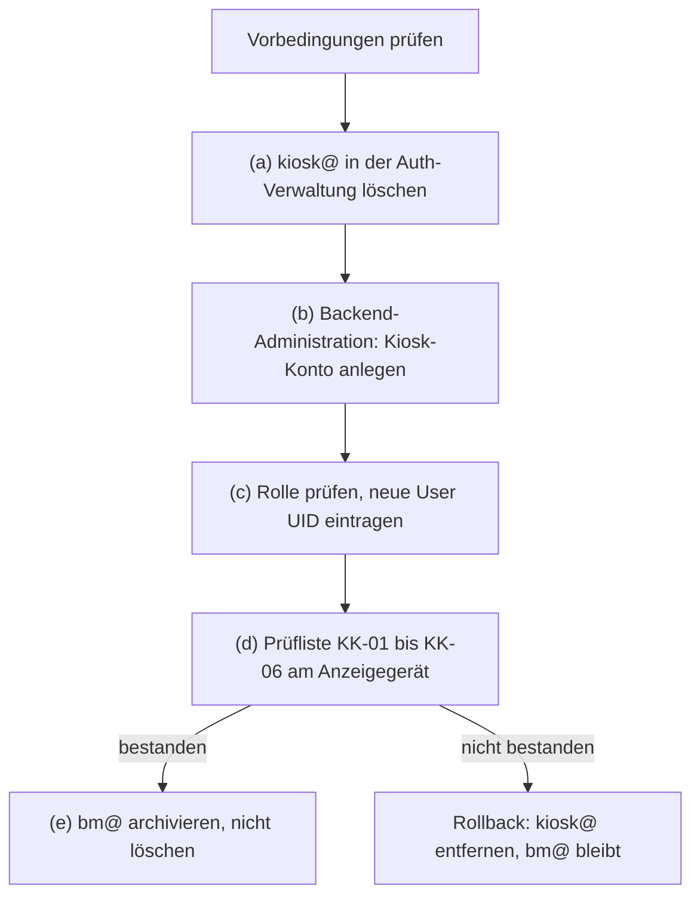

# Datenauftrag Kiosk-Konto kiosk@ (Rolle kiosk)

Stand: 2026-11-04. Grundlage: `docs/ADR/0037-kontrollierte-datenauftraege.md`, Bericht `docs/BERICHT-2026-11-04-KIOSK-KONTO.md`, Backlog-Punkt „Anzeigemodus auf Systemadministrator-Konto“, Nachweis EV-0005 (`docs/NACHWEISE.yaml`).
Status: **Freigabe 1 erteilt, Freigabe 2 mit Abweichung von ADR-0037 (Abschnitt 4), Ausführung offen.**

Konten stehen hier nur mit dem Teil vor dem @, wie in `docs/NACHWEISE.yaml`. Alle Adressen liegen in der Domain des Owners. Passwörter, Tokens und andere Zugangsdaten stehen nicht in dieser Datei und dürfen auch nicht nachgetragen werden.

## 1 Ziel

| Punkt       | Festlegung                                                                                                              |
| ----------- | ----------------------------------------------------------------------------------------------------------------------- |
| Zielzustand | Konto kiosk@ mit genau der Rolle `kiosk`. Das Anzeigegerät zeigt nur Demodaten unter `/kiosk`.                          |
| Abgrenzung  | Die interne Kiosk-Sicht (`/kiosk?mode=internal`) ist nicht Ziel; die Rolle `kiosk` hat kein `project.controlling.view`. |
| Folge       | bm@ (Systemadministrator, heute im Anzeigemodus) wird nach bestandener Prüfung archiviert, nicht gelöscht.              |

## 2 Ausgangslage (Stand 2026-11-04)

| Merkmal              | Wert                                                                            |
| -------------------- | ------------------------------------------------------------------------------- |
| Konto                | kiosk@                                                                          |
| User UID             | `35a51562-30b6-403c-adfa-566c575d1244`                                          |
| Angelegt             | 2026-11-04, 20:17:02, über die Auth-Verwaltung                                  |
| E-Mail-Bestätigung   | automatisch bestätigt                                                           |
| Letzte Anmeldung     | nie angemeldet                                                                  |
| Rolle                | `viewer`, vergeben durch den Trigger `on_auth_user_created` (`handle_new_user`) |
| Fachdaten des Kontos | keine                                                                           |

Die Rolle `kiosk` ist in der Datenbank vorhanden und muss die einzige Rolle des Kontos sein (Trigger `trg_enforce_kiosk_role_exclusive`). Im Admin-Dialog ist sie absichtlich nicht wählbar. Der vorgesehene Weg ist das Formular „Kiosk-Konto anlegen“ in der Backend-Administration. Es ersetzt die Startrolle `viewer` durch `kiosk` und schreibt den Audit-Eintrag `auth_account.kiosk_create` (Bericht, Abschnitt 2).

## 3 Mailweg

| Punkt            | Festlegung                                                                                                |
| ---------------- | --------------------------------------------------------------------------------------------------------- |
| Zustellung       | kiosk@ ist ein Alias auf info@. Rücksetz-Mails und andere Auth-Mails für kiosk@ landen im Postfach info@. |
| Bestätigungsmail | Entfällt. Das Formular legt das Konto mit bestätigter Adresse an (`email_confirm: true`).                 |
| Leser            | nur der Owner                                                                                             |
| Risiko           | R-04 (Bus-Faktor 1): Fällt der Owner aus, kann niemand das Kennwort von kiosk@ zurücksetzen lassen.       |

## 4 Freigaben

| Stufe                     | Inhalt                                                                | Wer                 | Datum              | Status                 |
| ------------------------- | --------------------------------------------------------------------- | ------------------- | ------------------ | ---------------------- |
| Freigabe 1                | Auftragstext und Weg A (Konto löschen, über das Formular neu anlegen) | Owner               | 2026-11-04, abends | erteilt im Chat        |
| Freigabe 2                | „Go“ vor der Ausführung                                               | Owner               | 2026-11-04         | erteilt mit Abweichung |
| Bestätigung zweite Person | Nachträgliche Bestätigung der Abweichung                              | Name/Rolle: _offen_ | Datum: _offen_     | offen                  |

**Abweichung von ADR-0037:** ADR-0037 verlangt zwei getrennte Freigaben, einen read-only Preflight über den Connector-Kanal und eine Zielbindung über einen Live-Fingerprint. Dieser Auftrag weicht davon ab:

- Beide Freigaben erteilt der Owner allein. Eine zweite Person gibt es heute nicht (R-04, Bus-Faktor 1).
- Es gibt keinen SQL-Lauf über den Connector. Beide Schritte laufen über Fachfunktionen der Anwendung und der Auth-Verwaltung mit Audit-Eintrag.
- Begründung: Das betroffene Konto ist ein Testkonto ohne Anmeldung und ohne Fachdaten. Der Schaden bei einem Fehler ist gering und lässt sich durch erneutes Löschen beheben.
- Die Abweichung muss nachträglich von einer zweiten Person bestätigt werden. Bis dahin steht sie im Tracker und als Hinweis bei R-04 im Risikoregister.

## 5 Schritte

| Schritt | Handlung                                                                                                                      | Wer   | Prüfung danach                                                                                              |
| ------- | ----------------------------------------------------------------------------------------------------------------------------- | ----- | ----------------------------------------------------------------------------------------------------------- |
| V       | Vorbedingungen: Konto mit der UID aus Abschnitt 2 ist weiter nie angemeldet; Backend-Administration ist in der App erreichbar | Owner | Bei Abweichung stoppen, nichts löschen                                                                      |
| (a)     | Konto `35a51562-30b6-403c-adfa-566c575d1244` in der Auth-Verwaltung löschen                                                   | Owner | Konto nicht mehr in der Kontenliste. Der Eintrag `auth.bootstrap` bleibt in `audit_log`                     |
| (b)     | Backend-Administration → „Kiosk-Konto anlegen“: Anzeigename „Info-Kiosk“, E-Mail kiosk@, Kennwort nur im Formular eingeben    | Owner | Meldung „Kiosk-Konto wurde angelegt.“                                                                       |
| (c)     | In der Kontenliste der Backend-Administration Rolle prüfen; neue User UID in Abschnitt 6 eintragen                            | Owner | Genau eine Rolle `kiosk`, keine Rolle `viewer`. Audit-Eintrag `auth_account.kiosk_create` mit der neuen UID |
| (d)     | Prüfliste KK-01 bis KK-06 (Abschnitt 7) am Anzeigegerät                                                                       | Owner | Alle sechs Punkte bestanden; Ergebnis als neuer Nachweis in `docs/NACHWEISE.yaml`                           |
| (e)     | Erst nach bestandenem (d): bm@ auf Status „archiviert“ setzen, nicht löschen                                                  | Owner | Vorher bestätigen, dass ein anderer aktiver Systemadministrator besteht (siehe Hinweis unten)               |

**Hinweis zu (e):** Der Auftrag sieht info@ als verbleibenden aktiven Systemadministrator vor. In EV-0005 (2026-11-04) ist info@ aber mit der Rolle **Administrator** geprüft worden. Ist bm@ der einzige aktive Systemadministrator, verhindert die Datenbank das Archivieren (Trigger `protect_last_sysadmin_profile`, `supabase/migrations/20260720031101_f91cbc77-7151-4442-bd5d-efd315eb8790.sql:113` ff.). Dann ist vor (e) zu entscheiden, ob info@ die Rolle Systemadministrator erhält. Das ist eine eigene Rechteänderung und nicht Teil dieses Auftrags.

## 6 Ergebnis

| Feld                                        | Wert    |
| ------------------------------------------- | ------- |
| Neue User UID kiosk@                        | _offen_ |
| Rolle nach (c)                              | _offen_ |
| Prüfung (d), Nachweis-ID                    | _offen_ |
| info@ aktiver Systemadministrator bestätigt | _offen_ |
| bm@ archiviert am                           | _offen_ |

## 7 Prüfliste am Anzeigegerät

| ID    | Prüfung                                                              | Erwartung                       | Ergebnis |
| ----- | -------------------------------------------------------------------- | ------------------------------- | -------- |
| KK-01 | Anmeldung am Anzeigegerät mit kiosk@                                 | öffnet automatisch `/kiosk`     | _offen_  |
| KK-02 | Direktaufruf `/dashboard`, ein Projektdetail und ein Projektbericht  | Umleitung auf `/kiosk`          | _offen_  |
| KK-03 | `/kiosk?mode=internal`                                               | keine interne Sicht             | _offen_  |
| KK-04 | Kennzeichnung der Anzeige                                            | „DEMO-DATEN — KEINE LIVE-DATEN“ | _offen_  |
| KK-05 | Beträge, Umsatz-Kachel, Tab Abrechnung, Personennamen, Admin-Bereich | nicht sichtbar                  | _offen_  |
| KK-06 | Anzeige nach längerer Zeit ohne Eingabe                              | keine automatische Abmeldung    | _offen_  |

## 8 Rollback

1. bm@ bleibt unverändert, bis Schritt (d) bestanden ist. Das Anzeigegerät kann bis dahin weiter mit bm@ laufen.
2. Schlägt (b), (c) oder (d) fehl, wird kiosk@ in der Auth-Verwaltung wieder entfernt. Danach entscheidet der Owner über einen neuen Versuch.
3. bm@ wird archiviert, nicht gelöscht. Ein archiviertes Konto lässt sich über den Status wieder aktivieren.
4. Zeilen in `audit_log` werden nie gelöscht, auch nicht die Einträge des gelöschten Kontos.
