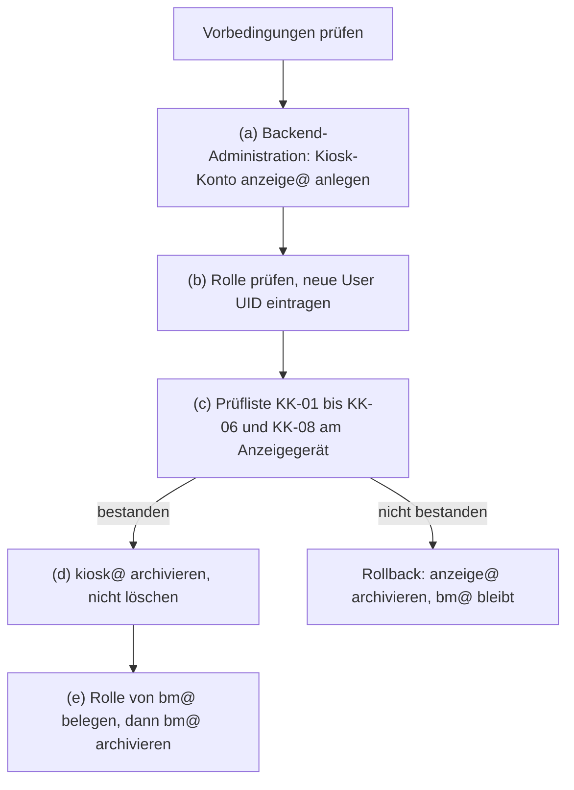

# Datenauftrag Kiosk-Konto anzeige@ (Rolle kiosk), Weg B

Stand: 2026-11-06. Grundlage: `docs/ADR/0037-kontrollierte-datenauftraege.md`, Bericht `docs/BERICHT-2026-11-04-KIOSK-KONTO.md`, Analyse A17 (`ops/reports`, `reports/A17-BERICHT.md`), Backlog-Punkt „Anzeigemodus auf Systemadministrator-Konto“, Nachweis EV-0005 (`docs/NACHWEISE.yaml`).
Status: **Weg A (Konto löschen, neu anlegen) ist nicht ausführbar. Weg B beschrieben, Freigaben für Weg B offen, Ausführung offen.**

Konten stehen hier nur mit dem Teil vor dem @, wie in `docs/NACHWEISE.yaml`. Alle Adressen liegen in der Domain des Owners. Passwörter, Tokens und andere Zugangsdaten stehen nicht in dieser Datei und dürfen auch nicht nachgetragen werden.

## 1 Ziel

| Punkt       | Festlegung                                                                                                               |
| ----------- | ------------------------------------------------------------------------------------------------------------------------ |
| Zielzustand | Neues Konto anzeige@ mit genau der Rolle `kiosk`. Das Anzeigegerät zeigt nur Demodaten unter `/kiosk`.                   |
| Abgrenzung  | Die interne Kiosk-Sicht (`/kiosk?mode=internal`) ist nicht Ziel; die Rolle `kiosk` hat kein `project.controlling.view`.  |
| Folge       | Das alte Konto kiosk@ wird danach archiviert, nicht gelöscht. bm@ wird erst danach archiviert, ebenfalls nicht gelöscht. |

## 2 Ausgangslage

| Merkmal                    | Wert                                                                                                            |
| -------------------------- | --------------------------------------------------------------------------------------------------------------- |
| Altes Konto                | kiosk@, User UID `35a51562-30b6-403c-adfa-566c575d1244`, angelegt 2026-11-04, 20:17:02 über die Auth-Verwaltung |
| Rolle des alten Kontos     | `viewer`, vergeben durch den Trigger `on_auth_user_created` (`handle_new_user`)                                 |
| Löschversuch (Weg A)       | 2026-11-05, Auth-Verwaltung: fehlgeschlagen mit „still linked to data“ (Beobachtung Owner)                      |
| Fachdaten des alten Kontos | keine; keine Zuordnungen (Viewer hat keine Bearbeitungsrechte)                                                  |

**Warum Weg A nicht geht (Analyse A17, F1):** `audit_log.actor_id` verweist ohne `ON DELETE` auf `auth.users(id)` (`supabase/migrations/20260717041306_18b7bd99-4d78-4233-a222-0e42881146d2.sql:133`). Der Trigger `handle_new_user` schreibt bei jeder Kontoanlage einen Eintrag `auth.bootstrap` mit `actor_id` gleich der neuen User UID (`supabase/migrations/20260720031101_f91cbc77-7151-4442-bd5d-efd315eb8790.sql:43-50`). Kein späterer Migrationsstand ändert das. Jedes Konto ist damit ab der Anlage an `audit_log` gebunden und lässt sich ohne Eingriff in `audit_log` nicht löschen. `audit_log` wird nie geändert oder gelöscht. Dass die Live-Meldung „still linked to data“ genau von diesem Verweis stammt, ist ohne die Postgres-Fehlermeldung nicht belegt.

Die Rolle `kiosk` ist in der Datenbank vorhanden und muss die einzige Rolle des Kontos sein (Trigger `trg_enforce_kiosk_role_exclusive`). Im Admin-Dialog ist sie absichtlich nicht wählbar. Der vorgesehene Weg ist das Formular „Kiosk-Konto anlegen“ in der Backend-Administration. Es legt das Konto an, ersetzt die Startrolle `viewer` durch `kiosk` und schreibt den Audit-Eintrag `auth_account.kiosk_create` (Bericht, Abschnitt 2).

**Rolle von bm@ ungeklärt (Analyse A17, F3):** Die Kontenliste der Backend-Administration zeigt bm@ mit Rolle `kiosk`, die Benutzerliste „System-Administrator“. Beide Listen lesen `user_roles`. Die Benutzerliste zeigt die Rolle in einem Auswahlfeld ohne die Option `kiosk`; der Browser zeigt dann die erste Option „System-Administrator“ (`src/components/UserManagementDialog.tsx:517-525`, `src/lib/user-management.ts:64-65`). bm@ hat deshalb sehr wahrscheinlich die Rolle `kiosk`. Das Auswahlfeld bei bm@ darf nicht umgestellt werden: Eine Änderung löscht alle Rollen und setzt die gewählte (`src/lib/users-supabase-service.ts:139-142`).

## 3 Mailweg

| Punkt            | Festlegung                                                                                                    |
| ---------------- | ------------------------------------------------------------------------------------------------------------- |
| Zustellung       | anzeige@ ist ein Alias auf info@ (wie kiosk@). Rücksetz-Mails und andere Auth-Mails landen im Postfach info@. |
| Bestätigungsmail | Entfällt. Das Formular legt das Konto mit bestätigter Adresse an (`email_confirm: true`).                     |
| Leser            | nur der Owner                                                                                                 |
| Risiko           | R-04 (Bus-Faktor 1): Fällt der Owner aus, kann niemand das Kennwort von anzeige@ zurücksetzen lassen.         |

## 4 Freigaben

| Stufe                     | Inhalt                                                                    | Wer                 | Datum              | Status                                  |
| ------------------------- | ------------------------------------------------------------------------- | ------------------- | ------------------ | --------------------------------------- |
| Freigabe 1 (Weg A)        | Auftragstext und Weg A (Konto löschen, über das Formular neu anlegen)     | Owner               | 2026-11-04, abends | erteilt im Chat; Weg A nicht ausführbar |
| Freigabe 1 (Weg B)        | Auftragstext und Weg B (anzeige@ neu anlegen, kiosk@ und bm@ archivieren) | Owner               | _offen_            | offen                                   |
| Freigabe 2 (Weg B)        | „Go“ vor der Ausführung                                                   | Owner               | _offen_            | offen                                   |
| Bestätigung zweite Person | Nachträgliche Bestätigung der Abweichung                                  | Name/Rolle: _offen_ | Datum: _offen_     | offen                                   |

**Abweichung von ADR-0037:** ADR-0037 verlangt zwei getrennte Freigaben, einen read-only Preflight über den Connector-Kanal und eine Zielbindung über einen Live-Fingerprint. Dieser Auftrag weicht davon ab:

- Beide Freigaben erteilt der Owner allein. Eine zweite Person gibt es heute nicht (R-04, Bus-Faktor 1).
- Es gibt keinen SQL-Lauf über den Connector. Alle Schritte laufen über Fachfunktionen der Anwendung mit Audit-Eintrag.
- Begründung: Betroffen sind Anzeige- und Testkonten ohne Fachdaten und ohne Zuordnungen. Fehler lassen sich durch Archivieren beheben.
- Die Abweichung muss nachträglich von einer zweiten Person bestätigt werden. Bis dahin steht sie im Tracker und als Hinweis bei R-04 im Risikoregister.

## 5 Schritte

| Schritt | Handlung                                                                                                                                                   | Wer   | Prüfung danach                                                                                               |
| ------- | ---------------------------------------------------------------------------------------------------------------------------------------------------------- | ----- | ------------------------------------------------------------------------------------------------------------ |
| V       | Vorbedingungen: Alias anzeige@ auf info@ eingerichtet; Backend-Administration in der App erreichbar; info@ ist aktiver Systemadministrator                 | Owner | Bei Abweichung stoppen                                                                                       |
| (a)     | Backend-Administration → „Kiosk-Konto anlegen“: Anzeigename „Info-Kiosk“, E-Mail anzeige@, Kennwort nur im Formular eingeben                               | Owner | Meldung „Kiosk-Konto wurde angelegt.“ Bei einer Fehlermeldung nicht wiederholen, sondern Abschnitt 8 Punkt 2 |
| (b)     | In der Kontenliste der Backend-Administration Rolle prüfen; neue User UID in Abschnitt 6 eintragen                                                         | Owner | Genau eine Rolle `kiosk`, keine Rolle `viewer`. Audit-Eintrag `auth_account.kiosk_create` mit der neuen UID  |
| (c)     | Prüfliste KK-01 bis KK-06 und KK-08 (Abschnitt 7) am Anzeigegerät mit anzeige@; KK-07 nur dokumentieren                                                    | Owner | Alle geforderten Punkte bestanden; Ergebnis als Nachweis EV-0006 in `docs/NACHWEISE.yaml`                    |
| (d)     | Erst nach bestandenem (c): kiosk@ auf Status „archiviert“ setzen, nicht löschen                                                                            | Owner | kiosk@ kann sich nicht mehr anmelden                                                                         |
| (e)     | Rolle von bm@ belegen (Kontenliste der Backend-Administration, nicht das Auswahlfeld der Benutzerliste); danach bm@ auf „archiviert“ setzen, nicht löschen | Owner | info@ ist aktiver Systemadministrator; Rolle von bm@ in Abschnitt 6 eingetragen                              |

**Hinweis zu (e):** info@ ist aktiver System-Administrator (Benutzerliste und Anzeige oben rechts, Owner, 2026-11-04). Der Trigger `protect_last_sysadmin_profile` (`supabase/migrations/20260720031101_f91cbc77-7151-4442-bd5d-efd315eb8790.sql:113-154`) greift nur, wenn das zu archivierende Konto Systemadministrator ist. Hat bm@ die Rolle `kiosk`, greift er nicht; ist bm@ Systemadministrator, bleibt info@ als aktiver Systemadministrator. (e) ist in beiden Fällen nicht blockiert. Die Angabe „Administrator“ für info@ in EV-0005 beschreibt die Prüferwartung „mit Rechten zum Sehen von Beträgen“, nicht die Rolle.

## 6 Ergebnis

| Feld                                        | Wert                                                                       |
| ------------------------------------------- | -------------------------------------------------------------------------- |
| Neue User UID anzeige@                      | _offen_ (trägt der Owner ein)                                              |
| Rolle nach (b)                              | _offen_                                                                    |
| Prüfung (c), Nachweis-ID                    | EV-0006 (Entwurf, offen)                                                   |
| kiosk@ archiviert am                        | _offen_                                                                    |
| Rolle von bm@ vor (e)                       | _offen_                                                                    |
| info@ aktiver Systemadministrator bestätigt | erledigt, 2026-11-04 (Beleg: Benutzerliste und Anzeige oben rechts, Owner) |
| bm@ archiviert am                           | _offen_                                                                    |

## 7 Prüfliste am Anzeigegerät

Die Ergebnisse vom 2026-11-05 sind Beobachtungen des Owners ohne Screenshot im Repository. Mit welchem Konto sie gemacht wurden, ist nicht belegt. Für Weg B werden sie mit anzeige@ wiederholt.

| ID    | Prüfung                                                                             | Erwartung                                                                                                                        | Ergebnis (Stand 2026-11-05)                                                                                       |
| ----- | ----------------------------------------------------------------------------------- | -------------------------------------------------------------------------------------------------------------------------------- | ----------------------------------------------------------------------------------------------------------------- |
| KK-01 | Anmeldung am Anzeigegerät mit dem Kiosk-Konto                                       | öffnet automatisch `/kiosk`                                                                                                      | ohne Beleg                                                                                                        |
| KK-02 | Direktaufruf `/dashboard`, ein Projektdetail und ein Projektbericht                 | Umleitung auf `/kiosk`                                                                                                           | bestanden (Beobachtung Owner)                                                                                     |
| KK-03 | `/kiosk?mode=internal`                                                              | keine interne Sicht                                                                                                              | Abweichung F-KK-01, nicht blockierend: keine internen Daten, aber Kennzeichnung „INTERNE DATEN“ und Fehlermeldung |
| KK-04 | Kennzeichnung der Anzeige                                                           | „DEMO-DATEN — KEINE LIVE-DATEN“                                                                                                  | bestanden (Beobachtung Owner)                                                                                     |
| KK-05 | Beträge, Umsatz-Kachel, Tab Abrechnung, Personennamen, Admin-Bereich                | nicht sichtbar                                                                                                                   | bestanden (Beobachtung Owner; geringe Aussagekraft ohne geladene Demodaten)                                       |
| KK-06 | Anzeige nach längerer Zeit ohne Eingabe                                             | keine automatische Abmeldung                                                                                                     | läuft (Owner meldet nach einer Stunde Leerlauf)                                                                   |
| KK-07 | Kiosk-Demodatensatz auf dem Gerät laden                                             | Kiosk zeigt Demowerte statt „Kiosk-Demodaten sind auf diesem Gerät nicht geladen.“                                               | nur dokumentiert, nicht gefordert                                                                                 |
| KK-08 | Kontowechsel am Gerät (Abmelden eines anderen Kontos, Anmelden mit dem Kiosk-Konto) | `/kiosk` öffnet; keine Inhalte oder Rechte des vorherigen Kontos sichtbar; ein bereits geladener Kiosk-Datensatz bleibt erhalten | ohne Beleg                                                                                                        |

**F-KK-01 (Analyse A17, F2):** Die Rolle `kiosk` hat nur `kiosk.view`. Die Sitzungsregel lässt Kiosk-Konten auf `/kiosk` unabhängig vom Parameter `mode` durch (`src/lib/kiosk/kiosk-session-policy.ts:20-25`). Die Server-Funktion lehnt die interne Sicht wegen fehlendem `project.controlling.view` ab (`PROJECT_CONTROLLING_DENIED`); es ist kein technischer Fehler. Die Kennzeichnung „INTERNE DATEN“ kommt ohne geladenen Datenstand aus dem URL-Parameter (`src/components/kiosk/KioskView.tsx:57-64`). Vorschlag: `/kiosk?mode=internal` für Konten mit `kiosk.view` auf `/kiosk` umleiten und die Kennzeichnung im Fehlerfall nicht aus dem Parameter ableiten (Aufwand etwa 2 bis 2,5 Stunden, Backlog).

KK-07 hängt von der geplanten Änderung „Kiosk-Demodaten über denselben Ladeweg wie alle Demodaten“ ab (Backlog). Heute lädt ein Konto mit `users.manage` den Datensatz über „Service → Demo-Datensatz…“, das Kiosk-Konto selbst kann es nicht. Bis zur Änderung wird KK-07 nur dokumentiert; ein Ergebnis „nicht geladen“ gilt nicht als Fehler dieses Auftrags.

## 8 Rollback

1. bm@ bleibt unverändert, bis Schritt (c) bestanden ist. Das Anzeigegerät kann bis dahin weiter mit bm@ laufen.
2. Schlägt (a) mit einer Fehlermeldung fehl, kann ein halb angelegtes Konto zurückbleiben: Das Formular versucht dann, das Konto wieder zu löschen. Das Löschen scheitert an `audit_log` (Abschnitt 2), und der Fehler wird nicht gemeldet (`src/lib/admin/auth-accounts.server.ts:256`). Das Konto kann ohne Rolle oder mit Rolle `viewer` bestehen bleiben. Dann den Stand in der Kontenliste prüfen, nicht erneut anlegen und den Owner entscheiden lassen (Archivieren oder Rolle per Datenauftrag).
3. Schlägt (b) oder (c) fehl, wird anzeige@ archiviert, nicht gelöscht. Danach entscheidet der Owner über einen neuen Versuch.
4. kiosk@ und bm@ werden archiviert, nicht gelöscht. Ein archiviertes Konto lässt sich über den Status wieder aktivieren.
5. Zeilen in `audit_log` werden nie gelöscht oder geändert.
