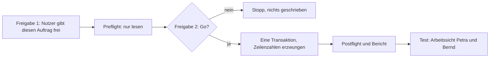

# Datenauftrag Kunde B: Verantwortliche schreiben (Stufe 1 und 2)

Stand: 2026-10-25. Grundlage: `docs/ADR/0037-kontrollierte-datenauftraege.md`, Mangel M2, Stufe-0/0b-Bericht (Work, 17:16 und 17:24 MEZ) in `docs/DATENAUFTRAG-KUNDE-B-VERANTWORTLICHE.md`.
Status: **Freigabe 1 erteilt (Nutzer, 2026-10-25, 17:41 MEZ); Preflight bestanden (Work, 2026-10-25, 17:43 MEZ, alle Sollwerte erfüllt, Pflichtspalten im Insert vollständig); Freigabe 2 erteilt (Nutzer, 2026-10-25, 17:46 MEZ, „GO“); Ausführung in Work offen.** Es wird nichts geschrieben, bevor Freigabe 2 (nach dem Preflight) vorliegt.

## 1 Ziel und Entscheidung

Nutzer 2026-10-25: Petra ist bei allen 8 Arbeitspaketen von Kunde B Verantwortliche (`owner`). Bernd ist bei 3 von 8 Paketen Stellvertretung (`deputy`). Die 3 Pakete (überfälliger Test, laufender Aufbau, wartende Migration) liefern absichtlich unterschiedliche Fälligkeitsgruppen für die Arbeitssicht.

## 2 Angelegte Datensätze (feste IDs, Präfix `00000000-0000-4000-8000-00000000` plus vierstellige Endung)

| Subject-ID | source_id                | Titel                                       | Owner (Petra) | Deputy (Bernd) |
| ---------- | ------------------------ | ------------------------------------------- | ------------- | -------------- |
| `0f11`     | `demo-wp-backup-konzept` | Wiederanlaufkonzept Entwurf                 | `0f31`        |                |
| `0f12`     | `demo-wp-backup-test`    | Wiederherstellungstest Fachverfahren        | `0f32`        | `0f39`         |
| `0f13`     | `demo-wp-frei-admin`     | Pflege Administrationskonten (ohne Projekt) | `0f33`        |                |
| `0f14`     | `demo-wp-virt-analyse`   | Lastanalyse Bestandsserver                  | `0f34`        |                |
| `0f15`     | `demo-wp-virt-betrieb`   | Betriebshandbuch                            | `0f35`        |                |
| `0f16`     | `demo-wp-virt-cluster`   | Cluster-Aufbau und Härtung                  | `0f36`        | `0f3a`         |
| `0f17`     | `demo-wp-virt-migration` | Migration Produktivserver                   | `0f37`        | `0f3b`         |
| `0f18`     | `demo-wp-virt-storage`   | Storage-Anbindung und Failover-Test         | `0f38`        |                |

Typen (`avkk_responsibility_type`): je Verantwortung eine Zeile, Owner `result` (`0f51`–`0f58` zu `0f31`–`0f38`), Deputy `coordination` (`0f59`–`0f5b` zu `0f39`–`0f3b`). Annahme: Die Zuordnung Owner zu `result` und Deputy zu `coordination` entspricht dem Kunde-A-Muster nur teilweise belegt (Bericht nennt beide Typen, nicht die Zuordnung). Sie ist fachlich unkritisch und im Postflight sichtbar.

Feste Werte aus dem Bericht:

- Systemhaus `00000000-0000-4000-8000-0000000000d1`, Kunde B `00000000-0000-4000-8000-0000000000d3`.
- Petra `d445f73a-e572-4b3e-ba38-2530b594c07f`, Bernd `5f933b60-3daf-48c3-b736-d099f9d16a11`.
- Rolle `owner` `270a6d82-e80a-4520-910d-2b1add830244` (Label „Verantwortlicher“), `deputy` `d3f812a5-739f-4d1b-81a4-1dd9d71a36dd` („Stellvertreter“).
- Typ `result` `917595fd-998c-4f56-a2e2-bf687ddf07c3` („Ergebnis“), `coordination` `4d21bd2d-0ee8-4c65-b1ff-d796495d7782` („Koordination“).

## 3 Anforderungen (SMART)

| ID     | Anforderung                                                                                                                                                                                                           |
| ------ | --------------------------------------------------------------------------------------------------------------------------------------------------------------------------------------------------------------------- |
| DKS-01 | Der Auftrag muss an Projekt `3c209338-443a-40f8-8a16-7c3c1b51da0e` und DB-Referenz `zffimqwnrsuzuozsgnlc` gebunden sein und andernfalls vor jedem Schreiben abbrechen.                                                |
| DKS-02 | Der Auftrag muss genau 8 `avkk_subject`, 11 `avkk_responsibility` und 11 `avkk_responsibility_type` anlegen, mit den festen IDs aus Abschnitt 2.                                                                      |
| DKS-03 | Der Auftrag muss in einer Transaktion laufen und bei jeder abweichenden Zeilenzahl mit Ausnahme abbrechen (Rollback ohne Rest).                                                                                       |
| DKS-04 | Der Auftrag muss `ON CONFLICT DO NOTHING` verwenden und trotzdem die erwarteten Zeilenzahlen erzwingen.                                                                                                               |
| DKS-05 | Der Auftrag muss erwartete Nebenwirkungen benennen: genau 30 neue `audit_log`-Zeilen (8 + 11 + 11), Gesamtbestand 299 auf 329.                                                                                        |
| DKS-06 | Der Auftrag darf keine bestehenden Zeilen ändern oder löschen und `audit_log` nie löschen.                                                                                                                            |
| DKS-07 | Der Preflight muss vor Freigabe 2 nur lesen und folgende Bedingungen belegen: Projektbindung, 8 aktive Projektionszeilen, 0 Subjects/Verantwortungen/Typen in den ID-Bereichen, `audit_log` = 299, Memberships aktiv. |
| DKS-08 | Der Postflight muss die Zeilenzahlen, Petra 8 Owner, Bernd 3 Deputy, Audit 329 und das Trigger-Verhalten (Scope-Guard, Target-Guard) belegen.                                                                         |
| DKS-09 | Der Rückbau darf nur über die festen IDs und nur auf ausdrückliches Kommando laufen.                                                                                                                                  |

## 4 Ablauf



## 5 Auftragstext Preflight (nur lesen, nach Freigabe 1)

```text
Datenauftrag Kunde B, Preflight (nur lesen) nach ADR-0037. Nur SELECT, nichts schreiben.
Pruefe und melde je Punkt Ergebnis und Soll:
1. Projekt-ID 3c209338-443a-40f8-8a16-7c3c1b51da0e, DB-Referenz zffimqwnrsuzuozsgnlc.
2. shared_work_package_projection: Kunde ...0d3, aktiv, genau 8 Zeilen mit source_id
   demo-wp-backup-konzept, demo-wp-backup-test, demo-wp-frei-admin, demo-wp-virt-analyse,
   demo-wp-virt-betrieb, demo-wp-virt-cluster, demo-wp-virt-migration, demo-wp-virt-storage. Soll 8.
3. avkk_subject mit ID ...0f11 bis ...0f18, avkk_responsibility ...0f31 bis ...0f3b,
   avkk_responsibility_type ...0f51 bis ...0f5b (Praefix 00000000-0000-4000-8000-00000000 plus Endung): Soll je 0.
4. avkk_subject mit (systemhouse ...0d1, subject_type workpackage, subject_id in den 8 source_id): Soll 0.
5. audit_log Gesamtzahl. Soll 299.
6. systemhouse_membership Petra und Bernd im Systemhaus ...0d1: aktiv, valid_to NULL. Soll 2.
7. reference_value-IDs 270a6d82-e80a-4520-910d-2b1add830244, d3f812a5-739f-4d1b-81a4-1dd9d71a36dd,
   917595fd-998c-4f56-a2e2-bf687ddf07c3, 4d21bd2d-0ee8-4c65-b1ff-d796495d7782 vorhanden. Soll 4.
8. Spalten ohne Default und NOT NULL in avkk_subject, avkk_responsibility, avkk_responsibility_type
   (information_schema.columns): nenne sie, damit der Insert vollstaendig ist.
9. Bericht: Tabelle Soll/Ist. Bei Abweichung: STOPP. Nichts schreiben.
```

## 6 Auftragstext Schreiben (nur nach ausdrücklichem „GO“ des Nutzers, Freigabe 2)

```sql
-- Datenauftrag Kunde B: Verantwortliche. Eine Transaktion (DO-Block), ADR-0037.
DO $$
DECLARE
  n integer;
  sh constant uuid := '00000000-0000-4000-8000-0000000000d1';
  kb constant uuid := '00000000-0000-4000-8000-0000000000d3';
  petra constant uuid := 'd445f73a-e572-4b3e-ba38-2530b594c07f';
  bernd constant uuid := '5f933b60-3daf-48c3-b736-d099f9d16a11';
  r_owner constant uuid := '270a6d82-e80a-4520-910d-2b1add830244';
  r_deputy constant uuid := 'd3f812a5-739f-4d1b-81a4-1dd9d71a36dd';
  t_result constant uuid := '917595fd-998c-4f56-a2e2-bf687ddf07c3';
  t_coord constant uuid := '4d21bd2d-0ee8-4c65-b1ff-d796495d7782';
  p constant text := '00000000-0000-4000-8000-00000000';
BEGIN
  -- Zielbindung und Ausgangslage (bricht bei Abweichung ab)
  SELECT count(*) INTO n FROM public.shared_work_package_projection
   WHERE customer_id = kb AND source_id IN ('demo-wp-backup-konzept','demo-wp-backup-test','demo-wp-frei-admin',
     'demo-wp-virt-analyse','demo-wp-virt-betrieb','demo-wp-virt-cluster','demo-wp-virt-migration','demo-wp-virt-storage');
  IF n <> 8 THEN RAISE EXCEPTION 'Projektion: erwartet 8, gefunden %', n; END IF;
  SELECT count(*) INTO n FROM public.audit_log;
  IF n <> 299 THEN RAISE EXCEPTION 'audit_log vor Lauf: erwartet 299, gefunden %', n; END IF;

  -- 8 Subjects
  INSERT INTO public.avkk_subject (id, subject_type, subject_id, subject_title_snapshot, status, version, systemhouse_id, customer_id)
  SELECT (p || v.k)::uuid, 'workpackage', v.sid, v.title, 'active', 1, sh, kb
    FROM (VALUES
      ('0f11','demo-wp-backup-konzept','Wiederanlaufkonzept Entwurf'),
      ('0f12','demo-wp-backup-test','Wiederherstellungstest Fachverfahren'),
      ('0f13','demo-wp-frei-admin','Pflege Administrationskonten (ohne Projekt)'),
      ('0f14','demo-wp-virt-analyse','Lastanalyse Bestandsserver'),
      ('0f15','demo-wp-virt-betrieb','Betriebshandbuch'),
      ('0f16','demo-wp-virt-cluster','Cluster-Aufbau und Härtung'),
      ('0f17','demo-wp-virt-migration','Migration Produktivserver'),
      ('0f18','demo-wp-virt-storage','Storage-Anbindung und Failover-Test')
    ) AS v(k, sid, title)
  ON CONFLICT DO NOTHING;
  GET DIAGNOSTICS n = ROW_COUNT;
  IF n <> 8 THEN RAISE EXCEPTION 'avkk_subject: erwartet 8, eingefuegt %', n; END IF;

  -- 11 Verantwortungen (8 Owner Petra, 3 Deputy Bernd)
  INSERT INTO public.avkk_responsibility (id, avkk_subject_id, person_id, role_value_id, role_key_snapshot, role_label_snapshot, note)
  SELECT (p || v.k)::uuid, (p || v.s)::uuid, v.person, v.role, v.rkey, v.rlabel, ''
    FROM (VALUES
      ('0f31','0f11',petra,r_owner,'owner','Verantwortlicher'),
      ('0f32','0f12',petra,r_owner,'owner','Verantwortlicher'),
      ('0f33','0f13',petra,r_owner,'owner','Verantwortlicher'),
      ('0f34','0f14',petra,r_owner,'owner','Verantwortlicher'),
      ('0f35','0f15',petra,r_owner,'owner','Verantwortlicher'),
      ('0f36','0f16',petra,r_owner,'owner','Verantwortlicher'),
      ('0f37','0f17',petra,r_owner,'owner','Verantwortlicher'),
      ('0f38','0f18',petra,r_owner,'owner','Verantwortlicher'),
      ('0f39','0f12',bernd,r_deputy,'deputy','Stellvertreter'),
      ('0f3a','0f16',bernd,r_deputy,'deputy','Stellvertreter'),
      ('0f3b','0f17',bernd,r_deputy,'deputy','Stellvertreter')
    ) AS v(k, s, person, role, rkey, rlabel)
  ON CONFLICT DO NOTHING;
  GET DIAGNOSTICS n = ROW_COUNT;
  IF n <> 11 THEN RAISE EXCEPTION 'avkk_responsibility: erwartet 11, eingefuegt %', n; END IF;

  -- 11 Typen
  INSERT INTO public.avkk_responsibility_type (id, responsibility_id, type_value_id, type_key_snapshot, type_label_snapshot)
  SELECT (p || v.k)::uuid, (p || v.r)::uuid, v.tv, v.tkey, v.tlabel
    FROM (VALUES
      ('0f51','0f31',t_result,'result','Ergebnis'),
      ('0f52','0f32',t_result,'result','Ergebnis'),
      ('0f53','0f33',t_result,'result','Ergebnis'),
      ('0f54','0f34',t_result,'result','Ergebnis'),
      ('0f55','0f35',t_result,'result','Ergebnis'),
      ('0f56','0f36',t_result,'result','Ergebnis'),
      ('0f57','0f37',t_result,'result','Ergebnis'),
      ('0f58','0f38',t_result,'result','Ergebnis'),
      ('0f59','0f39',t_coord,'coordination','Koordination'),
      ('0f5a','0f3a',t_coord,'coordination','Koordination'),
      ('0f5b','0f3b',t_coord,'coordination','Koordination')
    ) AS v(k, r, tv, tkey, tlabel)
  ON CONFLICT DO NOTHING;
  GET DIAGNOSTICS n = ROW_COUNT;
  IF n <> 11 THEN RAISE EXCEPTION 'avkk_responsibility_type: erwartet 11, eingefuegt %', n; END IF;

  -- Audit-Nebenwirkung: genau 30 neue Zeilen
  SELECT count(*) INTO n FROM public.audit_log;
  IF n <> 329 THEN RAISE EXCEPTION 'audit_log nach Lauf: erwartet 329, gefunden %', n; END IF;
END $$;
```

Hinweis zum Ausführen: Ausführung nur im freigegebenen Kanal (postgres-Kanal laut ADR-0037), ohne zusätzliche Anweisungen. Bei jeder Ausnahme wird nichts geschrieben.

## 7 Postflight (nur lesen)

```text
Postflight Kunde B (nur lesen):
1. Zaehle avkk_subject (...0f11-0f18), avkk_responsibility (...0f31-0f3b), avkk_responsibility_type (...0f51-0f5b). Soll 8, 11, 11.
2. Je person_id und role_key_snapshot aus den 11 Verantwortungen. Soll Petra owner 8, Bernd deputy 3.
3. audit_log Gesamtzahl (Soll 329) und neue Zeilen je action: avkk.avkk_subject.insert 8,
   avkk.avkk_responsibility.insert 11, avkk.avkk_responsibility_type.insert 11.
4. Keine Zeilen ausserhalb der festen IDs veraendert (Vergleich der Zeilenzahlen der drei Tabellen:
   vorher Kunde A 12/10/10 plus Altbestand, jetzt plus 8/11/11).
5. Bericht Soll/Ist, Fehler im Wortlaut.
```

## 8 Erwartete Nebenwirkungen und Rückbau

- Nebenwirkungen: 30 `audit_log`-Zeilen (8 + 11 + 11). Keine weiteren Tabellen. `avkk_people_directory` liefert im SQL-Kanal weiterhin keine Personen (kein `auth.uid()`); die Namen sind nur in der App-Sitzung prüfbar.
- Rückbau nur auf ausdrückliches Kommando: `DELETE FROM public.avkk_subject WHERE id IN (…0f11 bis …0f18)`. Verantwortungen und Typen folgen per `ON DELETE CASCADE`. Erwartet sind zusätzlich 22 `audit_log`-Zeilen (11 + 11 Löschungen; für `avkk_subject` gibt es keinen Löschtrigger). `audit_log` wird nie gelöscht.

## 9 Test nach dem Lauf

| ID  | Wer   | Erwartung                                                                                                                           |
| --- | ----- | ----------------------------------------------------------------------------------------------------------------------------------- |
| K-1 | Petra | Arbeitssicht zeigt 8 Pakete von Kunde B mit Verantwortliche = Petra.                                                                |
| K-2 | Bernd | Arbeitssicht zeigt bei 3 Paketen Stellvertretung (Backup-Test, Cluster, Migration).                                                 |
| K-3 | Petra | Gruppen: überfällig (Backup-Test, Migration), heute (Pflege Admin), künftig, erledigt (Lastanalyse), ohne Datum (Betriebshandbuch). |

## 10 Vorab-Test des SQL-Blocks (2026-10-25)

Der SQL-Block aus Abschnitt 6 wurde gegen eine lokale PostgreSQL-16-Instanz mit nachgebautem Minimalschema ausgeführt (drei AVKK-Tabellen mit den im Bericht genannten Constraints, Audit-Trigger, `audit_log` mit 299 Zeilen, Projektion mit 8 Zeilen).

| Prüfung                | Ergebnis                                                                    |
| ---------------------- | --------------------------------------------------------------------------- |
| Erster Lauf            | 8 Subjects, 11 Verantwortungen, 11 Typen; Petra 8 Owner, Bernd 3 Deputy     |
| Audit                  | 299 auf 329 (30 neue Zeilen)                                                |
| Zweiter Lauf           | bricht mit Ausnahme ab, nichts geändert (Schutz gegen Doppelausführung)     |
| Rückbau über feste IDs | Verantwortungen und Typen per Kaskade gelöscht, 22 zusätzliche Audit-Zeilen |
| Fund im Test           | ID-Präfix hatte eine Null zu viel (ungültige UUID); korrigiert              |

Grenzen: Das Minimalschema enthält nicht die echten Trigger `bsf03e_avkk_subject_scope_guard` und `bsf03e_avkk_responsibility_target_guard` sowie die Fremdschlüssel auf `customer`, `profiles` und `reference_value`. Diese Punkte deckt der Preflight (Abschnitt 5) und der Postflight ab. Der Test ersetzt sie nicht.
