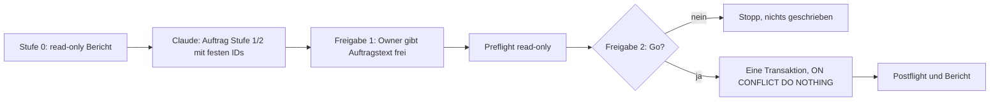

# Datenauftrag Kunde B: Verantwortliche je Arbeitspaket (Stufe 0, read-only)

Stand: 2026-10-25. Grundlage: `docs/ADR/0037-kontrollierte-datenauftraege.md`, Tracker-Mangel M2,
Testprotokoll `docs/GOLDEN-GATE-TESTPROTOKOLL-2026-10-25.md` (T6). Status: **Entwurf, nicht freigegeben.**

## 1 Ziel

Für „DEMO – Kunde B (synthetisch)“ (Beispiel Produktion AG, 8 veröffentlichte Arbeitspakete aus T6)
müssen je Arbeitspaket Verantwortliche hinterlegt werden: Petra als Verantwortliche (Owner), Bernd als
Stellvertretung. Vor jedem Schreiben muss ein read-only Bericht vorliegen (Stufe 0). Der
schreibende Auftrag (Stufe 1 und 2) wird erst aus diesem Bericht abgeleitet.

Entscheidung Nutzer 2026-10-25: Petra ist bei allen 8 Arbeitspaketen Verantwortliche (Owner); Bernd ist bei etwa 3 von 8 Paketen Stellvertretung (analog Kunde A, 3 von 10). Die genaue Auswahl der 3 Pakete legt Claude nach dem Bericht fest und nennt sie im Schreibauftrag mit festen IDs.

## 2 Ablauf



## 3 Anforderungen an Stufe 0

| ID     | Anforderung                                                                                                                                                                                    |
| ------ | ---------------------------------------------------------------------------------------------------------------------------------------------------------------------------------------------- |
| DKB-01 | Der Lauf muss ausschließlich lesen (nur `SELECT`). Bei jedem Schreibversuch muss er abbrechen.                                                                                                 |
| DKB-02 | Der Bericht muss die Zielbindung enthalten: Projekt-ID, Zeilenzahl `profiles`, letzte Migrationsversion.                                                                                       |
| DKB-03 | Der Bericht muss die 8 Arbeitspakete von Kunde B aus `shared_work_package_projection` mit `id`, Titel, `customer_id`, `systemhouse_id`, Status und `due` liefern.                              |
| DKB-04 | Der Bericht muss je Arbeitspaket melden, ob bereits ein `avkk_subject` (Typ `workpackage`, gescopt) und aktive `avkk_responsibility` existieren.                                               |
| DKB-05 | Der Bericht muss die Konto-IDs mit Anzeigenamen für Petra und Bernd liefern sowie deren Mitgliedschaft im Demo-Systemhaus und `customer_access` für Kunde B (Rolle, Status).                   |
| DKB-06 | Der Bericht muss die bei Kunde A verwendeten `reference_value`-Schlüssel für Rolle (Verantwortlich, Stellvertretung) und Typ nennen, damit Kunde B dieselben Werte nutzt.                      |
| DKB-07 | Der Bericht muss das ID-Muster der Kunde-A-Zeilen (`…0f01`–`…0f0c`, `…0f21`–`…0f2a`, `…0f41`–`…0f4a`) zeigen und prüfen, ob die vorgeschlagenen Bereiche für Kunde B frei sind.                |
| DKB-08 | Der Bericht muss das Inventar der Anwendungstrigger (`tgisinternal = false`) auf `avkk_subject`, `avkk_responsibility`, `avkk_responsibility_type` nennen und erwartete Audit-Zeilen ableiten. |
| DKB-09 | Der Bericht darf keine E-Mail-Adressen oder Zugangsdaten enthalten.                                                                                                                            |

Vorgeschlagene ID-Bereiche für Kunde B (Endung, Präfix wie Kunde A): Subjects `0f11`–`0f18`,
Verantwortungen `0f31`–`0f40` (8 Owner + bis zu 8 Stellvertretungen, abhängig von Kunde-A-Modell),
Typen `0f51`–`0f60`. Die endgültige Belegung folgt aus dem Bericht.

## 4 Auftragstext für Lovable/Work (Stufe 0)

```text
Datenauftrag Stufe 0 (nur lesen) nach ADR-0037, Projekt SysIng Dashboard.
Schreibe nichts. Verwende ausschließlich SELECT. Brich ab, falls eine Anweisung schreiben würde.

1. Zielbindung: Projekt-ID, Anzahl Zeilen in public.profiles, letzte Version in
   supabase_migrations.schema_migrations.
2. Kunde B: Ermittle customer.id und systemhouse_id für "DEMO – Kunde B (synthetisch)".
   Liste alle Zeilen aus public.shared_work_package_projection für diesen Kunden
   (id, Titel, status, due). Erwartet: 8 Zeilen.
3. Je Arbeitspaket: vorhandene public.avkk_subject-Zeile (subject_type 'workpackage',
   gleiche systemhouse_id/customer_id) und aktive public.avkk_responsibility
   (valid_to IS NULL) mit person_id und role_key_snapshot.
4. Konten: Konto-ID und Anzeigename (profiles) der Demo-Personen Petra und Bernd, ihre
   systemhouse_membership im Demo-Systemhaus und customer_access für Kunde B
   (Rolle, Status). Keine E-Mail-Adressen ausgeben.
5. Referenzwerte: Welche role_value_id/role_key_snapshot und type_value_id/type_key_snapshot
   nutzen die Kunde-A-Zeilen mit den IDs auf ...0f21 bis ...0f2a und ...0f41 bis ...0f4a?
6. ID-Muster: Zeige die vollständigen IDs von ...0f01, ...0f21, ...0f41. Prüfe, ob IDs mit
   gleichem Präfix und den Endungen 0f11-0f18, 0f31-0f40, 0f51-0f60 in den drei
   avkk-Tabellen bereits existieren.
7. Trigger: Liste Anwendungstrigger (pg_trigger.tgisinternal = false) auf avkk_subject,
   avkk_responsibility, avkk_responsibility_type und welche davon in audit_log schreiben.
   Zähle die audit_log-Zeilen, die der Kunde-A-Lauf am 2026-10-25 erzeugt hat (erwartet 32).
8. Bericht: Status, Ergebnisse 1-7 als Tabelle, Fehler im Wortlaut.
```

## 5 Rückbau

Nur auf ausdrückliches Kommando und nur über die festen IDs des späteren Schreibauftrags.
`audit_log` wird nie gelöscht.
