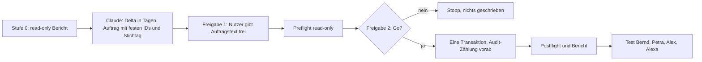
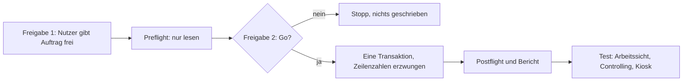

# Datenauftrag TD-01 Stufe b: Fälligkeiten im Live-Demo-Mandanten auffrischen (Stufe 0, read-only)

Stand: 2026-10-26. Grundlage: `docs/ADR/0037-kontrollierte-datenauftraege.md`, `docs/TD-01-STUFE-B-KONZEPT.md` (Abschnitt 7). Status: **Stufe 0 ausgeführt (Work, 2026-10-26, 19:58 MEZ, nur lesen). Freigabe 1 erteilt (Nutzer, 2026-10-26, 20:36 MEZ): Umfang mit Tätigkeiten (61 Änderungen). Ausführung am 2026-10-27, daher Stichtag 2026-10-27. Preflight ausstehend, Freigabe 2 (GO) ausstehend. Nichts geschrieben.**

## 1 Ziel

Die Fälligkeiten der veröffentlichten Demo-Projektionen von Kunde A und Kunde B sollen relativ zu heute so verschoben werden, dass die Verteilung der lokalen Demodaten (überfällig, heute, künftig) entsteht. Erledigte Arbeitspakete bleiben unverändert (TB-2). Vor dem Schreiben liegt ein read-only Bericht vor.

## 2 Ablauf



## 3 Anforderungen an Stufe 0

| ID     | Anforderung                                                                                                                                                                             |
| ------ | --------------------------------------------------------------------------------------------------------------------------------------------------------------------------------------- |
| TD1-01 | Der Lauf muss ausschließlich lesen (nur `SELECT`) und bei jedem Schreibversuch abbrechen.                                                                                               |
| TD1-02 | Der Bericht muss die Zielbindung enthalten: Projekt-ID, Zeilenzahl `profiles`, letzte Migrationsversion.                                                                                |
| TD1-03 | Der Bericht muss alle aktiven Zeilen der gemeinsamen Projektionen (Arbeitspakete, Projekte, Kategorien, soweit vorhanden) mit ID, Titel, Kunde, Status und allen Datumsspalten liefern. |
| TD1-04 | Der Bericht muss je Zeile Status „erledigt“ kennzeichnen und die Zahl der Zeilen nennen, die der Auftrag nicht anfassen darf.                                                           |
| TD1-05 | Der Bericht muss die Anwendungstrigger (`tgisinternal = false`) auf den Projektionstabellen nennen und erwartete Audit-Zeilen je Änderung ableiten.                                     |
| TD1-06 | Der Bericht muss die Kategorien je Projektion listen (TB-5) und den Kiosk-Befund „Infrastruktur-Spalte leer“ mit Ursache (Daten oder Anzeige) klären (TB-6).                            |
| TD1-07 | Der Bericht darf keine E-Mail-Adressen oder Zugangsdaten enthalten.                                                                                                                     |

## 4 Auftragstext für Lovable/Work (Stufe 0)

```text
Datenauftrag TD-01 Stufe 0 (nur lesen) nach ADR-0037, Projekt SysIng Dashboard.
Schreibe nichts. Verwende ausschliesslich SELECT. Brich ab, falls eine Anweisung schreiben wuerde.

1. Zielbindung: Projekt-ID, Anzahl Zeilen in public.profiles, letzte Version in
   supabase_migrations.schema_migrations, Anzahl Zeilen in public.audit_log.
2. Nenne alle Tabellen im Schema public, die zur gemeinsamen Projektion gehoeren
   (Namen mit shared_ und _projection), mit Spalten vom Typ date, timestamp oder timestamptz.
3. Je Projektionstabelle fuer die Demo-Kunden A (...0d2) und B (...0d3) im Demo-Systemhaus (...0d1):
   id, source_id, Titel, status, category_key (falls vorhanden) und alle Datumsspalten.
   Ausgabe als Tabelle, sortiert nach Kunde und Faelligkeit.
4. Zaehle je Kunde: Zeilen insgesamt, Zeilen mit Status erledigt/done (duerfen nicht veraendert werden),
   Zeilen mit Faelligkeit in der Vergangenheit, heute, in den naechsten 7 Tagen, spaeter.
5. Trigger (pg_trigger.tgisinternal = false) auf diesen Tabellen und welche davon in audit_log schreiben.
   Leite daraus die erwartete Zahl neuer audit_log-Zeilen fuer eine Aenderung von N Zeilen ab.
6. Kategorien je Projektion mit Anzahl (z. B. category_key), um die lokalen Demodaten 2.2.0 abzugleichen.
7. Kiosk: Liefere die Datenquelle der Spalte "Infrastruktur" (Tabelle, Spalte, Werte und Anzahl je Wert),
   damit unterschieden werden kann, ob die Daten fehlen oder die Anzeige.
8. Bericht: Tabelle je Punkt, Fehler im Wortlaut. Keine E-Mail-Adressen. Nichts schreiben.
```

## 5 Nächster Schritt

Aus dem Bericht leitet Claude das Delta in Tagen je Zeile ab (Stichtag als Parameter) und formuliert den schreibenden Auftrag nach ADR-0037 mit zwei Freigaben, festen IDs, einer Transaktion, exakter Audit-Zählung und Rollback über die ursprünglichen Datumswerte (die der Preflight festhält). `audit_log` wird nie gelöscht.

## 6 Ergebnis Stufe 0 (Work, 2026-10-26, 19:58 MEZ)

Zielbindung bestätigt (Projekt `3c209338-443a-40f8-8a16-7c3c1b51da0e`, DB `zffimqwnrsuzuozsgnlc`). `profiles` 7, letzte Migration `20261022090000` (30 insgesamt), `audit_log` 329. Nur `SELECT`, nichts verändert.

| Befund                                      | Ergebnis                                                                                                                                           |
| ------------------------------------------- | -------------------------------------------------------------------------------------------------------------------------------------------------- |
| Datumsspalten                               | `shared_work_package_projection.due`, `shared_activity_projection.activity_date`; `shared_project_projection` hat keine Fachdatumsspalte           |
| Zeilen                                      | Kunde A: 12 Arbeitspakete, 3 Projekte, 27 Tätigkeiten; Kunde B: 8 Arbeitspakete, 2 Projekte, 20 Tätigkeiten (alle aktiv)                           |
| Erledigte Arbeitspakete                     | 4 (3 bei Kunde A, 1 bei Kunde B), werden nicht verändert (TB-2)                                                                                    |
| Ohne Fälligkeit                             | 2 Arbeitspakete (`demo-wp-fil-monitoring`, `demo-wp-virt-betrieb`), bleiben unverändert                                                            |
| Trigger                                     | je Tabelle `identity_guard` und `set_updated_at` (BEFORE UPDATE), keine Audit-Wirkung: erwartete neue `audit_log`-Zeilen 0                         |
| Identitätsschutz (Migration 20260902031900) | schützt nur `systemhouse_id`, `customer_id`, `source_id`, `published_by`; `due` und `activity_date` sind änderbar                                  |
| Heute-Fall                                  | heute 0 Arbeitspakete fällig; nach der Auffrischung gibt es je einen Fall bei Kunde A (`demo-wp-m365-schulung`) und Kunde B (`demo-wp-frei-admin`) |

### Ableitung des Versatzes

Der Vergleich der Live-Werte mit dem lokalen Datensatz 2.2.0 (`src/lib/demo-data/dataset.ts`, Basisdatum 2026-10-26) zeigt für alle 61 Zeilen einen konstanten Versatz: Kunde A liegt 2 Tage, Kunde B 1 Tag zurück. Ursache: Die Projektionen wurden am 24.10. (Kunde A) bzw. 25.10. (Kunde B) veröffentlicht. Der Auftrag setzt daher absolute Zielwerte aus Stichtag plus festem Versatz je Zeile. Das ist wiederholbar und unabhängig vom Ausführungstag, solange der Stichtag stimmt.

### Befunde zu TB-5 und TB-6

- **TB-6 (Kiosk „Infrastruktur“):** Der Bericht schließt, die Daten fehlten in der Datenquelle (`category_key`). Der Code widerspricht: In `src/lib/kiosk/internal-kiosk-provider.ts` stammen die Bereiche Verfügbarkeit, Infrastruktur und Support (`DEMO_DOMAIN_IDS`) aus dem lokalen Kiosk-Demodatensatz des Geräts, nur Projekte, Arbeitspakete und Tätigkeiten kommen aus der Datenbank. Eine leere Spalte hat daher mit `category_key` nichts zu tun. Ursache ist ein nicht geladener oder alter Demodatensatz auf dem Gerät; die Korrektur (Kiosk-Demodaten 1.1.0) steht in 1.69.0 und wirkt erst nach dem Publish. Es ist kein Datenauftrag nötig.
- **TB-5 (Kategorien):** Alle 20 Arbeitspakete haben `category_key` leer, und der Katalog `workpackage.category` hat keine Werte. Der lokale Datensatz 2.2.0 enthält jedoch gar keine Kategorien, es gibt also keine Vorlage zum Abgleich. Empfehlung: zurückstellen (nach dem Golden Gate), dann Katalog und Zuordnung als eigener Datenauftrag.

## 7 Schreibauftrag (Stufe 1 und 2)

### Anforderungen

| ID     | Anforderung                                                                                                                                                            |
| ------ | ---------------------------------------------------------------------------------------------------------------------------------------------------------------------- |
| TD1-11 | Der Auftrag muss an Projekt `3c209338-443a-40f8-8a16-7c3c1b51da0e` und DB-Referenz `zffimqwnrsuzuozsgnlc` gebunden sein und andernfalls vor jedem Schreiben abbrechen. |
| TD1-12 | Der Auftrag muss genau 14 Arbeitspakete (ohne erledigte, ohne leere Fälligkeit) und 47 Tätigkeiten ändern, jeweils nur, wenn der erwartete alte Wert vorliegt.         |
| TD1-13 | Der Auftrag muss in einer Transaktion laufen und bei jeder abweichenden Zeilenzahl mit Ausnahme abbrechen.                                                             |
| TD1-14 | Der Auftrag darf nur `due` und `activity_date` ändern, keine Status, Zuordnungen, Identitätsfelder oder Verantwortliche.                                               |
| TD1-15 | Der Auftrag muss erwarten: 0 neue `audit_log`-Zeilen (Bestand bleibt 329). `audit_log` wird nie gelöscht.                                                              |
| TD1-16 | Die 4 erledigten Arbeitspakete müssen unverändert bleiben (Prüfung im Block).                                                                                          |
| TD1-17 | Der Rückbau darf nur auf ausdrückliches Kommando über die festen `source_id` laufen.                                                                                   |

Nebenwirkung: `updated_at` der geänderten Zeilen wird vom Trigger gesetzt. `published_at` und `source_hash` bleiben unverändert (R-TB-4: Ein späteres erneutes Veröffentlichen aus den lokalen Daten vergleicht über `source_hash`; die Daten sind danach wertgleich zum lokalen Datensatz).

Umfang: Die Tätigkeitsdaten werden mit verschoben, weil der lokale Datensatz sie ebenfalls relativ führt und Controlling-Zeiträume sonst altern. Wenn nur die Fälligkeiten verschoben werden sollen, entfällt der zweite Block (dann 14 statt 61 Änderungen); bitte bei Freigabe 1 angeben.

### Ablauf



### Preflight (nur lesen, nach Freigabe 1)

Der Preflight ist eine einzelne `SELECT`-Anweisung mit den Soll-Werten (lokal gegen PostgreSQL 16 getestet: 329, 14, 47, 4, keine Abweichung, 0). Nach einem Lauf des Schreibauftrags zeigt derselbe Preflight 0 und 0 sowie die Abweichungen, daher dient er auch als Nachweis gegen Doppelausführung.

```text
Datenauftrag TD-01 Stufe b, Preflight (nur lesen) nach ADR-0037, Projekt SysIng Dashboard.
Fuehre ausschliesslich die folgende SELECT-Anweisung aus. Schreibe nichts. Aendere nichts.
Pruefe vorab: Projekt-ID 3c209338-443a-40f8-8a16-7c3c1b51da0e, DB-Referenz zffimqwnrsuzuozsgnlc.
Melde die Ergebniszeilen (pruefung, ist, soll) unveraendert. Bei jeder Abweichung ist das Ergebnis STOPP.

-- TD-01 Stufe b, Preflight: NUR LESEN (SELECT). Soll-Werte in der Spalte soll.
WITH
ids AS (SELECT '00000000-0000-4000-8000-0000000000d1'::uuid AS sh,
               '00000000-0000-4000-8000-0000000000d2'::uuid AS ka,
               '00000000-0000-4000-8000-0000000000d3'::uuid AS kb),
wpv(cust, sid, old_due, off) AS (VALUES
      ('00000000-0000-4000-8000-0000000000d2'::uuid,'demo-wp-frei-vertrieb',DATE '2026-10-20',-4),
      ('00000000-0000-4000-8000-0000000000d2'::uuid,'demo-wp-m365-berechtigungen',DATE '2026-10-21',-3),
      ('00000000-0000-4000-8000-0000000000d2'::uuid,'demo-wp-fil-firewall',DATE '2026-10-22',-2),
      ('00000000-0000-4000-8000-0000000000d2'::uuid,'demo-wp-m365-schulung',DATE '2026-10-24',0),
      ('00000000-0000-4000-8000-0000000000d2'::uuid,'demo-wp-netz-rollout',DATE '2026-11-02',9),
      ('00000000-0000-4000-8000-0000000000d2'::uuid,'demo-wp-m365-migration',DATE '2026-11-11',18),
      ('00000000-0000-4000-8000-0000000000d2'::uuid,'demo-wp-fil-rollout',DATE '2026-11-14',21),
      ('00000000-0000-4000-8000-0000000000d2'::uuid,'demo-wp-netz-doku',DATE '2026-12-03',40),
      ('00000000-0000-4000-8000-0000000000d3'::uuid,'demo-wp-backup-test',DATE '2026-10-19',-6),
      ('00000000-0000-4000-8000-0000000000d3'::uuid,'demo-wp-virt-migration',DATE '2026-10-20',-5),
      ('00000000-0000-4000-8000-0000000000d3'::uuid,'demo-wp-frei-admin',DATE '2026-10-25',0),
      ('00000000-0000-4000-8000-0000000000d3'::uuid,'demo-wp-virt-cluster',DATE '2026-10-28',3),
      ('00000000-0000-4000-8000-0000000000d3'::uuid,'demo-wp-virt-storage',DATE '2026-11-04',10),
      ('00000000-0000-4000-8000-0000000000d3'::uuid,'demo-wp-backup-konzept',DATE '2026-11-08',14)
),
acv(cust, sid, old_date, off) AS (VALUES
      ('00000000-0000-4000-8000-0000000000d2'::uuid,'demo-act-26',DATE '2026-09-03',-51),
      ('00000000-0000-4000-8000-0000000000d2'::uuid,'demo-act-56',DATE '2026-09-04',-50),
      ('00000000-0000-4000-8000-0000000000d2'::uuid,'demo-act-28',DATE '2026-09-07',-47),
      ('00000000-0000-4000-8000-0000000000d2'::uuid,'demo-act-23',DATE '2026-09-08',-46),
      ('00000000-0000-4000-8000-0000000000d2'::uuid,'demo-act-25',DATE '2026-09-12',-42),
      ('00000000-0000-4000-8000-0000000000d2'::uuid,'demo-act-20',DATE '2026-09-13',-41),
      ('00000000-0000-4000-8000-0000000000d2'::uuid,'demo-act-55',DATE '2026-09-13',-41),
      ('00000000-0000-4000-8000-0000000000d2'::uuid,'demo-act-27',DATE '2026-09-16',-38),
      ('00000000-0000-4000-8000-0000000000d2'::uuid,'demo-act-22',DATE '2026-09-17',-37),
      ('00000000-0000-4000-8000-0000000000d2'::uuid,'demo-act-17',DATE '2026-09-18',-36),
      ('00000000-0000-4000-8000-0000000000d2'::uuid,'demo-act-24',DATE '2026-09-21',-33),
      ('00000000-0000-4000-8000-0000000000d2'::uuid,'demo-act-1',DATE '2026-09-22',-32),
      ('00000000-0000-4000-8000-0000000000d2'::uuid,'demo-act-19',DATE '2026-09-22',-32),
      ('00000000-0000-4000-8000-0000000000d2'::uuid,'demo-act-21',DATE '2026-09-26',-28),
      ('00000000-0000-4000-8000-0000000000d2'::uuid,'demo-act-16',DATE '2026-09-27',-27),
      ('00000000-0000-4000-8000-0000000000d2'::uuid,'demo-act-11',DATE '2026-09-28',-26),
      ('00000000-0000-4000-8000-0000000000d2'::uuid,'demo-act-18',DATE '2026-10-01',-23),
      ('00000000-0000-4000-8000-0000000000d2'::uuid,'demo-act-15',DATE '2026-10-06',-18),
      ('00000000-0000-4000-8000-0000000000d2'::uuid,'demo-act-2',DATE '2026-10-06',-18),
      ('00000000-0000-4000-8000-0000000000d2'::uuid,'demo-act-10',DATE '2026-10-07',-17),
      ('00000000-0000-4000-8000-0000000000d2'::uuid,'demo-act-8',DATE '2026-10-12',-12),
      ('00000000-0000-4000-8000-0000000000d2'::uuid,'demo-act-4',DATE '2026-10-15',-9),
      ('00000000-0000-4000-8000-0000000000d2'::uuid,'demo-act-9',DATE '2026-10-16',-8),
      ('00000000-0000-4000-8000-0000000000d2'::uuid,'demo-act-57',DATE '2026-10-17',-7),
      ('00000000-0000-4000-8000-0000000000d2'::uuid,'demo-act-5',DATE '2026-10-19',-5),
      ('00000000-0000-4000-8000-0000000000d2'::uuid,'demo-act-7',DATE '2026-10-21',-3),
      ('00000000-0000-4000-8000-0000000000d2'::uuid,'demo-act-3',DATE '2026-10-22',-2),
      ('00000000-0000-4000-8000-0000000000d3'::uuid,'demo-act-54',DATE '2026-09-01',-54),
      ('00000000-0000-4000-8000-0000000000d3'::uuid,'demo-act-35',DATE '2026-09-02',-53),
      ('00000000-0000-4000-8000-0000000000d3'::uuid,'demo-act-30',DATE '2026-09-03',-52),
      ('00000000-0000-4000-8000-0000000000d3'::uuid,'demo-act-32',DATE '2026-09-07',-48),
      ('00000000-0000-4000-8000-0000000000d3'::uuid,'demo-act-53',DATE '2026-09-10',-45),
      ('00000000-0000-4000-8000-0000000000d3'::uuid,'demo-act-29',DATE '2026-09-12',-43),
      ('00000000-0000-4000-8000-0000000000d3'::uuid,'demo-act-52',DATE '2026-09-19',-36),
      ('00000000-0000-4000-8000-0000000000d3'::uuid,'demo-act-14',DATE '2026-09-24',-31),
      ('00000000-0000-4000-8000-0000000000d3'::uuid,'demo-act-13',DATE '2026-10-03',-22),
      ('00000000-0000-4000-8000-0000000000d3'::uuid,'demo-act-41',DATE '2026-10-05',-20),
      ('00000000-0000-4000-8000-0000000000d3'::uuid,'demo-act-36',DATE '2026-10-15',-10),
      ('00000000-0000-4000-8000-0000000000d3'::uuid,'demo-act-37',DATE '2026-10-06',-19),
      ('00000000-0000-4000-8000-0000000000d3'::uuid,'demo-act-39',DATE '2026-10-10',-15),
      ('00000000-0000-4000-8000-0000000000d3'::uuid,'demo-act-34',DATE '2026-10-11',-14),
      ('00000000-0000-4000-8000-0000000000d3'::uuid,'demo-act-12',DATE '2026-10-12',-13),
      ('00000000-0000-4000-8000-0000000000d3'::uuid,'demo-act-40',DATE '2026-10-14',-11),
      ('00000000-0000-4000-8000-0000000000d3'::uuid,'demo-act-31',DATE '2026-10-16',-9),
      ('00000000-0000-4000-8000-0000000000d3'::uuid,'demo-act-38',DATE '2026-10-19',-6),
      ('00000000-0000-4000-8000-0000000000d3'::uuid,'demo-act-33',DATE '2026-10-20',-5),
      ('00000000-0000-4000-8000-0000000000d3'::uuid,'demo-act-6',DATE '2026-10-24',-1)
),
dv(cust, sid, due) AS (VALUES
      ('00000000-0000-4000-8000-0000000000d2'::uuid,'demo-wp-fil-design',DATE '2026-10-04'),
      ('00000000-0000-4000-8000-0000000000d2'::uuid,'demo-wp-netz-planung',DATE '2026-10-14'),
      ('00000000-0000-4000-8000-0000000000d2'::uuid,'demo-wp-fil-pilot',DATE '2026-10-17'),
      ('00000000-0000-4000-8000-0000000000d3'::uuid,'demo-wp-virt-analyse',DATE '2026-09-10')
)
SELECT '1 audit_log' AS pruefung, (SELECT count(*) FROM public.audit_log)::text AS ist, '329' AS soll
UNION ALL SELECT '2 Arbeitspakete mit erwartetem alten Wert (aktiv, nicht erledigt)',
  (SELECT count(*) FROM public.shared_work_package_projection t, ids, wpv v
    WHERE t.systemhouse_id = ids.sh AND t.customer_id = v.cust AND t.source_id = v.sid
      AND t.is_active AND t.due = v.old_due AND t.status <> 'erledigt')::text, '14'
UNION ALL SELECT '3 Taetigkeiten mit erwartetem alten Wert (aktiv)',
  (SELECT count(*) FROM public.shared_activity_projection t, ids, acv v
    WHERE t.systemhouse_id = ids.sh AND t.customer_id = v.cust AND t.source_id = v.sid
      AND t.is_active AND t.activity_date = v.old_date)::text, '47'
UNION ALL SELECT '4 erledigte Arbeitspakete mit altem Datum (bleiben ausserhalb)',
  (SELECT count(*) FROM public.shared_work_package_projection t, dv d
    WHERE t.customer_id = d.cust AND t.source_id = d.sid AND t.due = d.due AND t.status = 'erledigt')::text, '4'
UNION ALL SELECT '5 Arbeitspakete des Auftrags mit abweichendem Wert (source_id)',
  coalesce((SELECT string_agg(v.sid, ', ') FROM wpv v, ids
    WHERE NOT EXISTS (SELECT 1 FROM public.shared_work_package_projection t
      WHERE t.systemhouse_id = ids.sh AND t.customer_id = v.cust AND t.source_id = v.sid
        AND t.is_active AND t.due = v.old_due AND t.status <> 'erledigt')), 'keine'), 'keine'
UNION ALL SELECT '6 Taetigkeiten des Auftrags mit abweichendem Wert (Anzahl)',
  (SELECT count(*) FROM acv v, ids
    WHERE NOT EXISTS (SELECT 1 FROM public.shared_activity_projection t
      WHERE t.systemhouse_id = ids.sh AND t.customer_id = v.cust AND t.source_id = v.sid
        AND t.is_active AND t.activity_date = v.old_date))::text, '0';
```

### Schreiben (nur nach ausdrücklichem „GO“ des Nutzers, Freigabe 2)

Der Stichtag `s` ist ein Parameter. Der Stichtag ist auf 2026-10-27 gesetzt (Ausführung am 2026-10-27, Entscheidung des Nutzers 2026-10-26). Wird der Auftrag an einem anderen Tag als dem 2026-10-27 ausgeführt, muss `s` auf den Ausführungstag gesetzt und der Auftrag neu freigegeben werden. Die alten Werte ändern sich nach dem ersten Lauf; ein zweiter Lauf mit demselben Block bricht deshalb mit Ausnahme ab (Schutz gegen Doppelausführung).

```sql
-- Datenauftrag TD-01 Stufe b: Fälligkeiten und Tätigkeitsdaten auffrischen. Eine Transaktion (DO-Block), ADR-0037.
DO $$
DECLARE
  n integer;
  sh constant uuid := '00000000-0000-4000-8000-0000000000d1';
  ka constant uuid := '00000000-0000-4000-8000-0000000000d2';
  kb constant uuid := '00000000-0000-4000-8000-0000000000d3';
  s  constant date := DATE '2026-10-27'; -- Stichtag (Parameter)
BEGIN
  -- Ausgangslage (bricht bei Abweichung ab)
  SELECT count(*) INTO n FROM public.audit_log;
  IF n <> 329 THEN RAISE EXCEPTION 'audit_log vor Lauf: erwartet 329, gefunden %', n; END IF;

  -- 14 Arbeitspakete (ohne erledigte): due = Stichtag + Versatz, nur wenn der alte Wert stimmt
  WITH v(cust, sid, old_due, off) AS (VALUES
      (ka,'demo-wp-frei-vertrieb',DATE '2026-10-20',-4),
      (ka,'demo-wp-m365-berechtigungen',DATE '2026-10-21',-3),
      (ka,'demo-wp-fil-firewall',DATE '2026-10-22',-2),
      (ka,'demo-wp-m365-schulung',DATE '2026-10-24',0),
      (ka,'demo-wp-netz-rollout',DATE '2026-11-02',9),
      (ka,'demo-wp-m365-migration',DATE '2026-11-11',18),
      (ka,'demo-wp-fil-rollout',DATE '2026-11-14',21),
      (ka,'demo-wp-netz-doku',DATE '2026-12-03',40),
      (kb,'demo-wp-backup-test',DATE '2026-10-19',-6),
      (kb,'demo-wp-virt-migration',DATE '2026-10-20',-5),
      (kb,'demo-wp-frei-admin',DATE '2026-10-25',0),
      (kb,'demo-wp-virt-cluster',DATE '2026-10-28',3),
      (kb,'demo-wp-virt-storage',DATE '2026-11-04',10),
      (kb,'demo-wp-backup-konzept',DATE '2026-11-08',14)
  )
  UPDATE public.shared_work_package_projection t
     SET due = s + v.off
    FROM v
   WHERE t.systemhouse_id = sh AND t.customer_id = v.cust AND t.source_id = v.sid
     AND t.is_active AND t.due = v.old_due AND t.status <> 'erledigt';
  GET DIAGNOSTICS n = ROW_COUNT;
  IF n <> 14 THEN RAISE EXCEPTION 'Arbeitspakete: erwartet 14, geaendert %', n; END IF;

  -- 47 Tätigkeiten: activity_date = Stichtag + Versatz, nur wenn der alte Wert stimmt
  WITH v(cust, sid, old_date, off) AS (VALUES
      (ka,'demo-act-26',DATE '2026-09-03',-51),
      (ka,'demo-act-56',DATE '2026-09-04',-50),
      (ka,'demo-act-28',DATE '2026-09-07',-47),
      (ka,'demo-act-23',DATE '2026-09-08',-46),
      (ka,'demo-act-25',DATE '2026-09-12',-42),
      (ka,'demo-act-20',DATE '2026-09-13',-41),
      (ka,'demo-act-55',DATE '2026-09-13',-41),
      (ka,'demo-act-27',DATE '2026-09-16',-38),
      (ka,'demo-act-22',DATE '2026-09-17',-37),
      (ka,'demo-act-17',DATE '2026-09-18',-36),
      (ka,'demo-act-24',DATE '2026-09-21',-33),
      (ka,'demo-act-1',DATE '2026-09-22',-32),
      (ka,'demo-act-19',DATE '2026-09-22',-32),
      (ka,'demo-act-21',DATE '2026-09-26',-28),
      (ka,'demo-act-16',DATE '2026-09-27',-27),
      (ka,'demo-act-11',DATE '2026-09-28',-26),
      (ka,'demo-act-18',DATE '2026-10-01',-23),
      (ka,'demo-act-15',DATE '2026-10-06',-18),
      (ka,'demo-act-2',DATE '2026-10-06',-18),
      (ka,'demo-act-10',DATE '2026-10-07',-17),
      (ka,'demo-act-8',DATE '2026-10-12',-12),
      (ka,'demo-act-4',DATE '2026-10-15',-9),
      (ka,'demo-act-9',DATE '2026-10-16',-8),
      (ka,'demo-act-57',DATE '2026-10-17',-7),
      (ka,'demo-act-5',DATE '2026-10-19',-5),
      (ka,'demo-act-7',DATE '2026-10-21',-3),
      (ka,'demo-act-3',DATE '2026-10-22',-2),
      (kb,'demo-act-54',DATE '2026-09-01',-54),
      (kb,'demo-act-35',DATE '2026-09-02',-53),
      (kb,'demo-act-30',DATE '2026-09-03',-52),
      (kb,'demo-act-32',DATE '2026-09-07',-48),
      (kb,'demo-act-53',DATE '2026-09-10',-45),
      (kb,'demo-act-29',DATE '2026-09-12',-43),
      (kb,'demo-act-52',DATE '2026-09-19',-36),
      (kb,'demo-act-14',DATE '2026-09-24',-31),
      (kb,'demo-act-13',DATE '2026-10-03',-22),
      (kb,'demo-act-41',DATE '2026-10-05',-20),
      (kb,'demo-act-36',DATE '2026-10-15',-10),
      (kb,'demo-act-37',DATE '2026-10-06',-19),
      (kb,'demo-act-39',DATE '2026-10-10',-15),
      (kb,'demo-act-34',DATE '2026-10-11',-14),
      (kb,'demo-act-12',DATE '2026-10-12',-13),
      (kb,'demo-act-40',DATE '2026-10-14',-11),
      (kb,'demo-act-31',DATE '2026-10-16',-9),
      (kb,'demo-act-38',DATE '2026-10-19',-6),
      (kb,'demo-act-33',DATE '2026-10-20',-5),
      (kb,'demo-act-6',DATE '2026-10-24',-1)
  )
  UPDATE public.shared_activity_projection t
     SET activity_date = s + v.off
    FROM v
   WHERE t.systemhouse_id = sh AND t.customer_id = v.cust AND t.source_id = v.sid
     AND t.is_active AND t.activity_date = v.old_date;
  GET DIAGNOSTICS n = ROW_COUNT;
  IF n <> 47 THEN RAISE EXCEPTION 'Taetigkeiten: erwartet 47, geaendert %', n; END IF;

  -- Erledigte Arbeitspakete unverändert (TB-2): 4 Zeilen mit altem Datum
  SELECT count(*) INTO n FROM public.shared_work_package_projection t
   JOIN (VALUES
      (ka,'demo-wp-fil-design',DATE '2026-10-04'),
      (ka,'demo-wp-netz-planung',DATE '2026-10-14'),
      (ka,'demo-wp-fil-pilot',DATE '2026-10-17'),
      (kb,'demo-wp-virt-analyse',DATE '2026-09-10')
   ) AS d(cust, sid, due) ON t.customer_id = d.cust AND t.source_id = d.sid AND t.due = d.due AND t.status = 'erledigt';
  IF n <> 4 THEN RAISE EXCEPTION 'Erledigte Pakete veraendert: erwartet 4 unveraendert, gefunden %', n; END IF;

  -- Audit-Nebenwirkung: keine neuen Zeilen
  SELECT count(*) INTO n FROM public.audit_log;
  IF n <> 329 THEN RAISE EXCEPTION 'audit_log nach Lauf: erwartet 329, gefunden %', n; END IF;
END $$;
```

### Postflight (nur lesen)

```text
Postflight TD-01 Stufe b (nur lesen):
1. shared_work_package_projection: due der 14 Zeilen gleich Stichtag plus Versatz (Liste im Schreibblock). Soll 14 von 14.
2. shared_activity_projection: activity_date der 47 Zeilen gleich Stichtag plus Versatz. Soll 47 von 47.
3. Die 4 erledigten Pakete und die 2 Pakete ohne Faelligkeit unveraendert.
4. audit_log Gesamtzahl. Soll 329.
5. Faelligkeitsverteilung je Kunde nach dem Lauf (ueberfaellig, heute, naechste 7 Tage, spaeter, ohne). Erwartet bei Stichtag 2026-10-27 (Ansicht am 2026-10-27):
   Kunde A: ueberfaellig 3 (offen), heute 1; Kunde B: ueberfaellig 2, heute 1.
6. Bericht Soll/Ist, Fehler im Wortlaut.
```

### Rückbau (nur auf ausdrückliches Kommando)

```sql
-- Rückbau TD-01 Stufe b (nur auf ausdrückliches Kommando): ursprüngliche Werte über feste source_id wiederherstellen.
DO $$
DECLARE
  n integer;
  sh constant uuid := '00000000-0000-4000-8000-0000000000d1';
  ka constant uuid := '00000000-0000-4000-8000-0000000000d2';
  kb constant uuid := '00000000-0000-4000-8000-0000000000d3';
  s  constant date := DATE '2026-10-27'; -- Stichtag (Parameter)
BEGIN
  WITH v(cust, sid, old_due, off) AS (VALUES
      (ka,'demo-wp-frei-vertrieb',DATE '2026-10-20',-4),
      (ka,'demo-wp-m365-berechtigungen',DATE '2026-10-21',-3),
      (ka,'demo-wp-fil-firewall',DATE '2026-10-22',-2),
      (ka,'demo-wp-m365-schulung',DATE '2026-10-24',0),
      (ka,'demo-wp-netz-rollout',DATE '2026-11-02',9),
      (ka,'demo-wp-m365-migration',DATE '2026-11-11',18),
      (ka,'demo-wp-fil-rollout',DATE '2026-11-14',21),
      (ka,'demo-wp-netz-doku',DATE '2026-12-03',40),
      (kb,'demo-wp-backup-test',DATE '2026-10-19',-6),
      (kb,'demo-wp-virt-migration',DATE '2026-10-20',-5),
      (kb,'demo-wp-frei-admin',DATE '2026-10-25',0),
      (kb,'demo-wp-virt-cluster',DATE '2026-10-28',3),
      (kb,'demo-wp-virt-storage',DATE '2026-11-04',10),
      (kb,'demo-wp-backup-konzept',DATE '2026-11-08',14)
  )
  UPDATE public.shared_work_package_projection t SET due = v.old_due
    FROM v WHERE t.systemhouse_id = sh AND t.customer_id = v.cust AND t.source_id = v.sid
     AND t.is_active AND t.due = s + v.off AND t.status <> 'erledigt';
  GET DIAGNOSTICS n = ROW_COUNT;
  IF n <> 14 THEN RAISE EXCEPTION 'Rueckbau Arbeitspakete: erwartet 14, geaendert %', n; END IF;

  WITH v(cust, sid, old_date, off) AS (VALUES
      (ka,'demo-act-26',DATE '2026-09-03',-51),
      (ka,'demo-act-56',DATE '2026-09-04',-50),
      (ka,'demo-act-28',DATE '2026-09-07',-47),
      (ka,'demo-act-23',DATE '2026-09-08',-46),
      (ka,'demo-act-25',DATE '2026-09-12',-42),
      (ka,'demo-act-20',DATE '2026-09-13',-41),
      (ka,'demo-act-55',DATE '2026-09-13',-41),
      (ka,'demo-act-27',DATE '2026-09-16',-38),
      (ka,'demo-act-22',DATE '2026-09-17',-37),
      (ka,'demo-act-17',DATE '2026-09-18',-36),
      (ka,'demo-act-24',DATE '2026-09-21',-33),
      (ka,'demo-act-1',DATE '2026-09-22',-32),
      (ka,'demo-act-19',DATE '2026-09-22',-32),
      (ka,'demo-act-21',DATE '2026-09-26',-28),
      (ka,'demo-act-16',DATE '2026-09-27',-27),
      (ka,'demo-act-11',DATE '2026-09-28',-26),
      (ka,'demo-act-18',DATE '2026-10-01',-23),
      (ka,'demo-act-15',DATE '2026-10-06',-18),
      (ka,'demo-act-2',DATE '2026-10-06',-18),
      (ka,'demo-act-10',DATE '2026-10-07',-17),
      (ka,'demo-act-8',DATE '2026-10-12',-12),
      (ka,'demo-act-4',DATE '2026-10-15',-9),
      (ka,'demo-act-9',DATE '2026-10-16',-8),
      (ka,'demo-act-57',DATE '2026-10-17',-7),
      (ka,'demo-act-5',DATE '2026-10-19',-5),
      (ka,'demo-act-7',DATE '2026-10-21',-3),
      (ka,'demo-act-3',DATE '2026-10-22',-2),
      (kb,'demo-act-54',DATE '2026-09-01',-54),
      (kb,'demo-act-35',DATE '2026-09-02',-53),
      (kb,'demo-act-30',DATE '2026-09-03',-52),
      (kb,'demo-act-32',DATE '2026-09-07',-48),
      (kb,'demo-act-53',DATE '2026-09-10',-45),
      (kb,'demo-act-29',DATE '2026-09-12',-43),
      (kb,'demo-act-52',DATE '2026-09-19',-36),
      (kb,'demo-act-14',DATE '2026-09-24',-31),
      (kb,'demo-act-13',DATE '2026-10-03',-22),
      (kb,'demo-act-41',DATE '2026-10-05',-20),
      (kb,'demo-act-36',DATE '2026-10-15',-10),
      (kb,'demo-act-37',DATE '2026-10-06',-19),
      (kb,'demo-act-39',DATE '2026-10-10',-15),
      (kb,'demo-act-34',DATE '2026-10-11',-14),
      (kb,'demo-act-12',DATE '2026-10-12',-13),
      (kb,'demo-act-40',DATE '2026-10-14',-11),
      (kb,'demo-act-31',DATE '2026-10-16',-9),
      (kb,'demo-act-38',DATE '2026-10-19',-6),
      (kb,'demo-act-33',DATE '2026-10-20',-5),
      (kb,'demo-act-6',DATE '2026-10-24',-1)
  )
  UPDATE public.shared_activity_projection t SET activity_date = v.old_date
    FROM v WHERE t.systemhouse_id = sh AND t.customer_id = v.cust AND t.source_id = v.sid
     AND t.is_active AND t.activity_date = s + v.off;
  GET DIAGNOSTICS n = ROW_COUNT;
  IF n <> 47 THEN RAISE EXCEPTION 'Rueckbau Taetigkeiten: erwartet 47, geaendert %', n; END IF;
END $$;
```

### Vorab-Test (2026-10-26, wiederholt mit Stichtag 2026-10-27)

Beide Blöcke wurden gegen eine lokale PostgreSQL-16-Instanz mit nachgebautem Minimalschema ausgeführt (beide Projektionstabellen mit den Live-Werten aus dem Stufe-0-Bericht, `audit_log` mit 329 Zeilen).

| Prüfung      | Ergebnis                                                                                              |
| ------------ | ----------------------------------------------------------------------------------------------------- |
| Erster Lauf  | 14 Arbeitspakete und 47 Tätigkeiten geändert; erledigte und leere Fälligkeiten unverändert; Audit 329 |
| Zweiter Lauf | bricht mit Ausnahme ab („erwartet 14, geändert 0“), nichts geändert                                   |
| Rückbau      | alle ursprünglichen Werte wiederhergestellt (Tätigkeiten 2026-09-01 bis 2026-10-24), Audit 329        |

Der Lauf wurde nach der Umstellung des Stichtags auf 2026-10-27 wiederholt (Preflight vorher 329/14/47/4/keine/0, erster Lauf, zweiter Lauf bricht mit „erwartet 14, geändert 0“ ab, Verteilung Kunde A 3/1/0/4 und Kunde B 2/1/1/2, Rückbau stellt den Ausgangszustand her). Der Preflight selbst hängt nicht vom Stichtag ab.

Grenzen: Das Minimalschema enthält nicht die echten Trigger, Fremdschlüssel und Berechtigungen. Der Preflight muss sie in der echten Datenbank bestätigen.

## 8 Erwartetes Ergebnis nach dem Lauf (Stichtag 2026-10-27, Ansicht am Ausführungstag)

| Kunde | Überfällig (offen)                                    | Heute                            | Nächste 7 Tage     | Später                                         |
| ----- | ----------------------------------------------------- | -------------------------------- | ------------------ | ---------------------------------------------- |
| A     | 3 (Angebot, Berechtigungen, Firewall)                 | 1 (Anwenderschulung Pilotgruppe) | 0                  | 4 (Switch-Rollout 04.11. bis Netzdoku)         |
| B     | 2 (Wiederherstellungstest, Migration Produktivserver) | 1 (Pflege Administrationskonten) | 1 (Cluster 29.10.) | 2 (Storage 05.11., Wiederanlaufkonzept 09.11.) |
