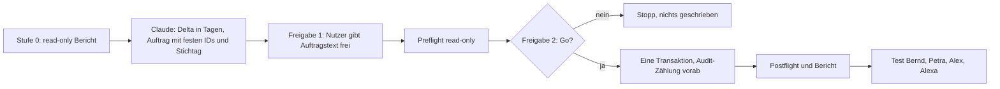

# Datenauftrag TD-01 Stufe b: Fälligkeiten im Live-Demo-Mandanten auffrischen (Stufe 0, read-only)

Stand: 2026-10-26. Grundlage: `docs/ADR/0037-kontrollierte-datenauftraege.md`, `docs/TD-01-STUFE-B-KONZEPT.md` (Abschnitt 7). Status: **Entwurf, nicht freigegeben, nichts geschrieben.**

## 1 Ziel

Die Fälligkeiten der veröffentlichten Demo-Projektionen von Kunde A und Kunde B sollen relativ zu heute so verschoben werden, dass die Verteilung der lokalen Demodaten (überfällig, heute, künftig) entsteht. Erledigte Arbeitspakete bleiben unverändert (TB-2). Vor dem Schreiben liegt ein read-only Bericht vor.

## 2 Ablauf



## 3 Anforderungen an Stufe 0

| ID     | Anforderung                                                                                                                                                                             |
| ------ | --------------------------------------------------------------------------------------------------------------------------------------------------------------------------------------- |
| TD1-01 | Der Lauf muss ausschließlich lesen (nur `SELECT`) und bei jedem Schreibversuch abbrechen.                                                                                               |
| TD1-02 | Der Bericht muss die Zielbindung enthalten: Projekt-ID, Zeilenzahl `profiles`, letzte Migrationsversion.                                                                                |
| TD1-03 | Der Bericht muss alle aktiven Zeilen der gemeinsamen Projektionen (Arbeitspakete, Projekte, Kategorien, soweit vorhanden) mit ID, Titel, Kunde, Status und allen Datumsspalten liefern. |
| TD1-04 | Der Bericht muss je Zeile Status „erledigt“ kennzeichnen und die Zahl der Zeilen nennen, die der Auftrag nicht anfassen darf.                                                           |
| TD1-05 | Der Bericht muss die Anwendungstrigger (`tgisinternal = false`) auf den Projektionstabellen nennen und erwartete Audit-Zeilen je Änderung ableiten.                                     |
| TD1-06 | Der Bericht muss die Kategorien je Projektion listen (TB-5) und den Kiosk-Befund „Infrastruktur-Spalte leer“ mit Ursache (Daten oder Anzeige) klären (TB-6).                            |
| TD1-07 | Der Bericht darf keine E-Mail-Adressen oder Zugangsdaten enthalten.                                                                                                                     |

## 4 Auftragstext für Lovable/Work (Stufe 0)

```text
Datenauftrag TD-01 Stufe 0 (nur lesen) nach ADR-0037, Projekt SysIng Dashboard.
Schreibe nichts. Verwende ausschliesslich SELECT. Brich ab, falls eine Anweisung schreiben wuerde.

1. Zielbindung: Projekt-ID, Anzahl Zeilen in public.profiles, letzte Version in
   supabase_migrations.schema_migrations, Anzahl Zeilen in public.audit_log.
2. Nenne alle Tabellen im Schema public, die zur gemeinsamen Projektion gehoeren
   (Namen mit shared_ und _projection), mit Spalten vom Typ date, timestamp oder timestamptz.
3. Je Projektionstabelle fuer die Demo-Kunden A (...0d2) und B (...0d3) im Demo-Systemhaus (...0d1):
   id, source_id, Titel, status, category_key (falls vorhanden) und alle Datumsspalten.
   Ausgabe als Tabelle, sortiert nach Kunde und Faelligkeit.
4. Zaehle je Kunde: Zeilen insgesamt, Zeilen mit Status erledigt/done (duerfen nicht veraendert werden),
   Zeilen mit Faelligkeit in der Vergangenheit, heute, in den naechsten 7 Tagen, spaeter.
5. Trigger (pg_trigger.tgisinternal = false) auf diesen Tabellen und welche davon in audit_log schreiben.
   Leite daraus die erwartete Zahl neuer audit_log-Zeilen fuer eine Aenderung von N Zeilen ab.
6. Kategorien je Projektion mit Anzahl (z. B. category_key), um die lokalen Demodaten 2.2.0 abzugleichen.
7. Kiosk: Liefere die Datenquelle der Spalte "Infrastruktur" (Tabelle, Spalte, Werte und Anzahl je Wert),
   damit unterschieden werden kann, ob die Daten fehlen oder die Anzeige.
8. Bericht: Tabelle je Punkt, Fehler im Wortlaut. Keine E-Mail-Adressen. Nichts schreiben.
```

## 5 Nächster Schritt

Aus dem Bericht leitet Claude das Delta in Tagen je Zeile ab (Stichtag als Parameter) und formuliert den schreibenden Auftrag nach ADR-0037 mit zwei Freigaben, festen IDs, einer Transaktion, exakter Audit-Zählung und Rollback über die ursprünglichen Datumswerte (die der Preflight festhält). `audit_log` wird nie gelöscht.
