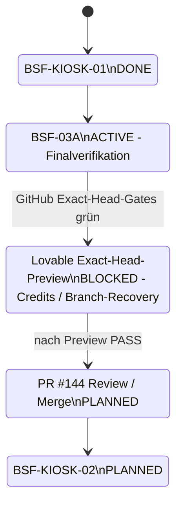

# Entwicklungstagebuch – Sysing Dashboard

Fortschreibbare Projektchronik. Diese Datei ist die **einzige Quelle** für die
Ansicht _Service → Entwicklungstagebuch_ im Dashboard.

Pflegehinweis: Pro Sprint bzw. relevantem Projektmeilenstein wird unten ein neuer
Abschnitt ergänzt. Bei produkt- oder versionswirksamen Änderungen wird zusätzlich
`CHANGELOG.md` fortgeschrieben. Reine Architektur-/Governance-Sprints erzeugen
keine künstliche Produktversion. Keine Zugangsdaten oder internen Adressen in
dieser Datei.

Stand: 2026-10-31 · Dashboard-Version 1.69.0

## 2026-10-31 — S0-06: Speicher-Zeile gegen erneutes Einfügen des Brokers

Laut Lovable-Support schreibt die Plattform `client.ts` nur um, solange die Datei dem generierten Original gleicht. Die Speicher-Zeile verwendet deshalb jetzt `window.localStorage` statt `localStorage`; die Schutzabfrage und das Verhalten bleiben gleich. Der Vertragstest erwartet genau diese Form und verbietet weiterhin Import und Datei des Brokers. Ob die Plattform den Broker danach wirklich nicht mehr einfügt, zeigt erst der Sync nach Lovable; bis dahin bleibt Publish No-Go.

## 2026-10-31 — Plan aktualisiert

Aus der Support-Antwort zu R-07 folgt ein neues Paket S0-06 (Auth-Broker aus dem Lovable-Projektstand entfernen, Weg B). Es liegt in Sprint 0, ist mit 1 bis 2 Arbeitstagen als Analogie geschätzt und in den 9 Paketen bis zur Internen Freigabe 1.0 nicht enthalten; die Zahlen bis zum BSF bleiben bei 15 Paketen und 51 bis 83 Arbeitstagen. Gearbeitet wird nur noch im Klon `C:\dev\sysingdashboard`. Die CI nutzt Node 22 und `bun install --frozen-lockfile`; die Auftragsvorlagen werden darauf umgestellt. Die Codex-ADR 0039 und 0040 dienen später als Vorlage für BSF-06 und werden nicht gemergt.

## 2026-10-31 — Arbeitsklone unter OneDrive aufgeräumt

Nach der Prüfung der Sicherung sind die drei alten Arbeitskopien unter OneDrive entfernt: der Codex-Klon, sein Worktree für S0-05 und der Klon für BSF-03. Vorher war belegt, dass jeder ihrer Branches auf GitHub liegt und keine ungesicherte Arbeit darin steckt. Gearbeitet wird jetzt nur noch im Klon unter `C:\dev`. Bericht: `docs/BERICHT-2026-10-31-AUFRAEUMEN-ONEDRIVE.md`.

## 2026-10-31 — Sicherung des Codex-Arbeitsstands geprüft

Der Arbeitsstand aus dem früheren Codex-Klon (2026-10-19/20) liegt jetzt dreifach vor: als Remote-Branch `backup/codex-2026-10-31`, als Git-Bundle und als Dateikopie mit Hashliste. Alle Prüfungen bestehen; die Dateikopie entspricht Datei für Datei dem Sicherungscommit. Der ursprüngliche Codex-Klon existiert weiterhin unter OneDrive; die erste Fassung des Berichts hatte ihn fälschlich als entfernt gemeldet. Der Branch wird nicht gemergt, weil seine ADR-Nummern 0036 bis 0039 auf `main` anders belegt sind. Über die Übernahme einzelner Inhalte entscheidet ein Backlog-Punkt. Bericht: `docs/BERICHT-2026-10-31-SICHERUNG.md`.

## 2026-10-30 — Antwort des Lovable-Supports zu R-07

Nach zwei Automatik-Antworten liegt die erste inhaltliche Antwort eines Mitarbeiters vor. Publish deployt immer den Lovable-Projektstand, nicht GitHub-`main`, und lässt sich nicht an einen Commit binden. Der Auth-Broker ist Absicht der Plattform und pro Projekt nicht abschaltbar; laut Support wirkt er nur in der Editor-Preview (von uns nicht gemessen). Der Support nennt einen Workaround (ungetestet) oder die Erlaubnis im Vertragstest. Entscheidung: Weg B zuerst (Helper entfernen), Weg A als Rückfall; keine Schreiboperation in Lovable ohne Freigabe. Der neue Sync-Branch `lovable-sync-1793295874` enthält genau die drei bekannten Dateien und wird nicht gemergt. Die Rückfrage des Supports (Lovable Cloud oder eigenes Supabase-Projekt) ist offen, die Migrationsfragen (R-10) ruhen deshalb. Die `types.ts`-Abweichung war schon am 2026-10-25 bekannt.

## 2026-10-29 — Branch verworfen, Worktree entfernt

Der Branch `docs/tracker-lovable-broker-ruecksetzung` (`28bcd15`) ist nach Freigabe des Owners verworfen. Sein Inhalt steht auf `main`; die einzige abweichende Zeile war dort bereits bewusst ersetzt. Der Commit ist als Tag `archive/docs-tracker-lovable-broker-ruecksetzung` gesichert und lässt sich wiederherstellen. Der Worktree `sysingdashboard-gg-docs` ist entfernt und sein gemergter Branch gelöscht. Nichts wurde gemergt.

## 2026-10-29 — Abschluss-PR gemergt, Backlog ergänzt

PR #247 ist nach Freigabe des Owners gemergt (Merge-Commit 8af547b, 15 von 15 CI-Checks grün). Der Bericht zu S0-05, Git-Aufräumen und den Merges wurde gegen Git geprüft: Der Branch `docs/tracker-lovable-broker-ruecksetzung` trägt nur Inhalt, der bereits auf `main` steht. Ins Backlog aufgenommen: Squash-Erkennung im Hygiene-Skript und der Test `BackendAdminDialog` unter Volllast (Ursache nicht belegt). Das Risiko R-11 (Terminrisiko durch knappe Kapazität) ist nach Freigabe des Owners in den Tracker aufgenommen.

## 2026-10-28 — Merge der Doku- und S0-05-PRs

PR #244 (Stand-Abgleich), #245 (S0-05) und #246 (Git-Aufräumen) sind nach Freigabe des Owners der Reihe nach gemergt, jeweils mit 15 von 15 grünen CI-Checks. Die erwarteten Doku-Konflikte wurden aufgelöst, ohne Inhalte zu verlieren. Der Bericht zu den drei Aufträgen steht in `docs/BERICHT-2026-10-28-S0-05-AUFRAEUMEN-MERGE.md`.

## 2026-10-28 — Git aufgeräumt

Von 13 Kandidaten mit gemergtem PR wurden 11 Remote-Branches gelöscht, deren Inhalt nachweislich in `main` steht; die Liste mit Kurz-SHA steht in `docs/GIT-AUFRAEUMEN.md`. `aqgs-pilot` bleibt als Evidenz, ein Branch mit nachträglichem Commit wird gesondert geprüft. Nichts wurde gemergt.

## 2026-10-28 — S0-05: Zeitzonen in Zeitraumberechnung

Die Tests zu `time-period` waren nur unter UTC grün. Die Testdatei formatiert lokale Kalendertage jetzt ohne `toISOString`. Im Produkt werden Datumstexte `YYYY-MM-DD` in `sumActivitiesInRange` und `buildChartBuckets` als lokaler Kalendertag ausgewertet; Zeitstempel mit Uhrzeit oder Zone bleiben unverändert. Dabei fiel auf, dass unter deutscher Zeit im Monatsdiagramm die Aktivitäten des letzten Monatstags fehlten; ein Regressionstest sichert das ab. Ergebnis: 21 von 21 in UTC, Europe/Berlin und America/New_York. PR offen, nicht gemergt.

## 2026-10-28 — Auftrag S0-05 und Korrektur zum MVP

Für S0-05 (Zeitzonen-Tests) liegt ein Auftrag für lokalen Claude Code vor (`docs/AUFTRAG-S0-05-ZEITZONEN-TESTS.md`): Unter Europe/Berlin scheitern vier Tests testseitig, unter America/New_York zwei produktseitig. Außerdem wurde der Stand zum MVP korrigiert: Die formale Baseline gilt seit PR #60 (2026-08-24); die frühere Angabe "Abnahme offen" stützte sich auf den überholten Zwischenstand vom 2026-08-21.

## 2026-10-28 — Planungsrunde und Werkzeugwechsel

Der Anzeigename des Golden Gate lautet jetzt "Interne Freigabe 1.0"; IDs, Dateinamen und Issue bleiben unverändert. Die Planungsseite nennt die Ziele beider Meilensteine und was danach zur Verfügung steht.

Die Planungsrunde hat die Pakete bis zum BSF geschätzt: BSF-06, BSF-04, BSF-04A, BSF-DOC, QS-06 und BSF-FINAL-INTERNAL mit zusammen 25 bis 40 Arbeitstagen; bis BSF insgesamt 15 Pakete und 51 bis 83 Arbeitstage (Analogieschätzung). Ein Arbeitstag ist ein Tag Gesamtaufwand. Codex ist aus Planung und Regeldokumenten genommen (ADR-0039), Claude Code übernimmt.

## 2026-10-28 — TD-01 in der App geprüft

Die Sichtprüfung als Bernd bestätigt die erwartete Verteilung (Datenstand 28.10.2026, 20 Pakete, überfällig 5, heute 2, später 7). Befund TB-7: ein Paket ohne Verantwortlichen. Die Termine in der Soll-Tabelle des Datenauftrags wurden korrigiert.

## 2026-10-28 — Meilensteine und Schätzung geklärt

Der Owner hat MVP, Golden Gate und BSF abgegrenzt (ADR-0038, am selben Tag angenommen): MVP formal abgeschlossen (PR #60, 2026-08-24), Golden Gate als Release-Meilenstein, BSF mit Cockpit, QS-06 und BSF-06; Azure/Entra und weiterer Reporting-Ausbau liegen nach dem BSF, L7 bleibt im Golden Gate. Die Schätzung wurde bottom-up hergeleitet: bis Golden Gate 9 Pakete, 26 bis 43 Arbeitstage; bis BSF fehlen Schätzfelder. Lovable hat die Nachfass-Mail mit dem offenen Ticket zusammengeführt, ohne inhaltlich zu antworten.

## 2026-10-28 — L2-Integrationsprobe und Lovable-Nachfass

Lokale Probe (nicht gepusht): P1, P2, P2b, P3 lassen sich in dieser Reihenfolge ohne Code-Konflikte zusammenführen, es treten nur Dokumentationskonflikte auf. 88 Tests, tsc, eslint und Prettier ohne Befund; der AVKK-Adapter ist im integrierten Stand verdrahtet. Die Drafts bleiben unverändert. Die Antwort des Lovable-Teams zu R-07 ist überfällig; der Nachfass wird vom Nutzer versendet. Publish bleibt No-Go.

## 2026-10-28 — Planung nach TD-01 aktualisiert

Das Paket TD-01 steht im Tracker auf done (Stufe a und b belegt, Kategorien TB-5 als eigener Datenauftrag ausgegliedert). Hash im Status und `base_main_sha` sind auf den Stand nach PR 232 gesetzt, die nächsten Schritte stehen im Wiederanlaufpunkt. Aufgeräumt: keine gemergten Branches mehr, weder remote noch lokal.

## 2026-10-28 — TD-01 Stufe b ausgeführt

Der Nutzer führte den Datenauftrag in der SQL-Konsole des Lovable-Projekts in Einzelschritten aus: Datumsprüfung, Preflight (329/14/47/4/keine/0), einmaliger Schreibblock ohne Ausnahme, Postflight (7 von 7 Zeilen gleich Soll). 14 Arbeitspakete und 47 Tätigkeiten stehen auf Stichtag 2026-10-28 plus Versatz, `audit_log` blieb bei 329, der Rückbau wurde nicht ausgelöst. Der Versuch über Work am Vortag war an der Berechtigung gescheitert und hatte nichts geschrieben. Offen bleibt die Sichtprüfung in der App.

## 2026-10-27 — TD-01 verschoben auf 2026-10-28

Der Ein-Prompt-Auftrag an Work scheiterte um 16:01 MEZ am Zugriff auf das Zielprojekt (MCP-Fehler -32600). Es wurde nichts gelesen oder geschrieben. Der Nutzer verschob den Lauf auf den 28.10.; Stichtag, Schreibblock, Rückbau und Prompt wurden umgestellt und lokal erneut getestet. Parallel liegen P2b (Draft-PR 233) und P3 (Draft-PR 234) vor, beide mit grüner CI und nicht gemergt.

## 2026-10-27 — L2 P2 und Planungsabgleich

L2 P2 (Server-Lesepfad des Management-Cockpits) liegt als Draft-PR 231 vor, nicht gemergt. Beim Test fiel ein Vertragsfehler aus P1 auf: Der Kundenkreis-Schlüssel von `myCustomerScopeKey` (zwei Doppelpunkte) passte nicht zum Composer (ein Doppelpunkt). Der Schlüsselbau liegt jetzt an einer Stelle (`cockpitScopeKey`). Die AVKK-Führungsdaten werden bisher nur im Browser geladen; das Cockpit meldet sie deshalb als UNAVAILABLE (Annahme: eigener Schnitt P2b).

Der Planungsabgleich fand vier veraltete Angaben auf `main` (Hash im Status, L2-Status `planned`, `base_main_sha`, Gesamtschätzung nur im Chat). Sie sind korrigiert; die Gesamtschätzung steht als `roadmap_schaetzung` im Tracker.

## 2026-10-26 — TD-01: Freigabe 1 erteilt, Preflight übergeben

Der Nutzer hat den Umfang mit Tätigkeiten (61 Änderungen) freigegeben und die Ausführung auf den 2026-10-27 gelegt; der Stichtag ist daher 2026-10-27 (SQL erneut lokal getestet). Der Preflight (nur lesen) liegt bei Work; der Schreibauftrag folgt nach dem Ergebnis und dem GO des Nutzers.

## 2026-10-26 — TD-01 Stufe 0 ausgewertet, Schreibauftrag vorbereitet

Der lesende Bericht liegt vor. Die Live-Daten laufen gegenüber dem lokalen Datensatz konstant 2 Tage (Kunde A) bzw. 1 Tag (Kunde B) zurück, deshalb genügt ein Auftrag mit festem Versatz je Zeile
(14 Arbeitspakete, 47 Tätigkeiten, keine Audit-Wirkung). Lokal gegen PostgreSQL 16 getestet. Der Kiosk-Befund „Infrastruktur“ ist kein Datenproblem, die Kategorien (TB-5) sind zurückgestellt.

## 2026-10-26 — Lovable Support: Eingangsbestätigung zu R-07

Der KI-Agent von Lovable bestätigt, dass das Projekt auf Lovable Cloud läuft, und hat die Fragen zu Auth-Storage-Datei, Publish aus GitHub, veröffentlichtem Commit und Migrationen an das Team weitergegeben. Eine inhaltliche Antwort steht aus; der Publish bleibt No-Go.

## 2026-10-26 — Entscheidungen: TD-01 relativ, L2 freigegeben, ADG-Standard gemergt

Der Standard zur Branch- und PR-Hygiene ist in `bmarnau-standards/ai-development-governance` gemergt (PR 15, Squash). TD-01 Stufe b: Fälligkeiten relativ zu heute,
Kunde A einbezogen; der lesende Bericht (Stufe 0) liegt als Auftragstext vor, geschrieben wird erst nach Bericht und zwei Freigaben. L2-Cockpit freigegeben:
P1 (reiner Composer, 20 Tests) als Draft-PR 226. QS-06 (PR 222) bleibt Draft bis nach dem Golden Gate.

## 2026-10-26 — PR 221, 224 und 223 gemergt, Git aufgeräumt

PR 221 (Hilfetext Passwort), PR 224 (Git-Hygiene) und PR 223 (L2-Cockpit-Konzept) sind per REST gemergt, jeweils mit 15 grünen CI-Checks. `main` steht auf `59c5e55`.
Lokal aufgeräumt: 70 Remote-Branches gelöscht (davon 27 diag/tmp vorher als Tag `archive/*` gesichert), Auto-Delete im Repository aktiviert. Lovable-Branches bleiben bis zur Klärung von R-07.

## 2026-10-26 — Git-Hygiene als Standard

Ursache für die angehäuften Branches: Auto-Delete im Repository ist aus, Löschen in der Cloud-Sitzung gesperrt, und der Abschluss prüfte den Branch-Zustand nicht.
Maßnahmen: Skript `npm run git:hygiene`, neue Regeln in `CLAUDE.md`, GitHub-Einstellung durch den Nutzer. PR 220 ist gemergt.

## 2026-10-26 — Merge-Reihenfolge gestartet, QS-06 und L2 vorbereitet

PR 219 ist gemergt (Doku und Tracker, 15 CI-Checks grün). PR 220 (M1) und PR 221 (Hilfetext Passwort) sind aktualisiert und warten auf grüne CI.
QS-06 liegt als Draft-PR 222 vor: neue Permission `billing.view`, Rollenkreis Systemadministrator, Administrator, Teamlead, Projektmanager; Engineer sieht nur Stunden.
Offen bei QS-06: serverseitige Filterung (QS6-4) und Export (QS6-5). Das L2-Cockpit-Konzept liegt als Entwurf vor und wartet auf Freigabe.

## 2026-10-26 — Kunde B: Verantwortliche gesetzt und in der App bestätigt

Der Datenauftrag für Kunde B lief am 25.10. um 17:49 (8 Subjects, 11 Verantwortungen, 11 Typen; Audit 299 auf 329). Am 26.10. zeigt die Arbeitssicht
20 von 20 Paketen; Kunde B zeigt Petra Marnau als Verantwortliche und Bernd Marnau als Stellvertretung (Test T10, teilweise). Offen: Test mit Bernd, Rest von
Kunde B, Merge von PR 220 (M1) und die Antwort des Lovable-Teams zu R-07.

## 2026-10-25 — Golden Gate: Tests mit Demodaten und Befunde

Veröffentlichen für Kunde A und Kunde B wurde in Vorschau und veröffentlichter App getestet;
die Arbeitssicht zeigt Verantwortliche (Datenauftrag nach ADR-0037 für Kunde A ausgeführt, Kunde B
folgt). Tests T1–T8 bestanden, T9 (Alexa, Viewer) teilweise. Befunde: M1 erledigte Pakete als
„Überfällig“ (Fix in Draft-PR #220), M2 fehlende Verantwortliche, M3 Auth-Broker-Abweichung
der Lovable-Arbeitskopie (Support-Anfrage, Publish No-Go), M4 Viewer sieht Abrechnungsdaten
(QS-06, nach dem Golden Gate). Entscheidungen: QS-04 nach dem Golden Gate; Teamlead sieht
Beträge, Engineer nur Stunden; PW-01 (Passwort in der App ändern) geplant.
Neue Dokumente: Testprotokoll, Merge-Checkliste, PW-01, QS-06, TD-01-Stufe-b-Konzept,
Lovable-Publish-Prüfung.

Nachtrag (Wiederanlauf): Die Lovable-Antwort steht aus, der Publish bleibt gesperrt. Für Kunde B
liegt der read-only Berichtsauftrag als Entwurf vor (`docs/DATENAUFTRAG-KUNDE-B-VERANTWORTLICHE.md`);
geschrieben wird erst nach Bericht und zwei Freigaben.

## 2026-10-21 — Golden-Gate-Vorbereitung: Veröffentlichungsweg und Release 1.69.0

Der Golden-Gate-Plan ist als `docs/GOLDEN-GATE-EXECUTION-TRACKER.yaml` im Repository
hinterlegt. L0 prüfte den Produktstand und deckte einen Befund auf: Die Funktion zum
Veröffentlichen in die gemeinsame Projektion wurde von keiner Oberfläche aufgerufen,
sodass „Verantwortungen → Arbeitspakete“ leer blieb. Mit PR #200 (L0b) gibt es dafür die
Aktion „An Team veröffentlichen“ mit Vorschau, Gründen und Bestätigung vor Zurückziehungen.

Weitere Korrekturen seit 1.68.0: Fälligkeit und Kategorie gehen beim Veröffentlichen nicht
mehr verloren (#192), Kiosk-Demodaten 1.1.0 (#196), Fehlergrund in der GitHub-Statusanzeige
(#197). Die Version wird auf 1.69.0 angehoben; der Produktname „SysIng Dashboard“ gilt in
allen sichtbaren Titeln, „Golden Gate“ bleibt interner Projektname. Ein veröffentlichter
GitHub-Release oder Deploy entsteht dadurch nicht; beides bleibt eigene Freigaben.

## 2026-10-15 — BSF-03E P5-Gesamtabnahme abgeschlossen

PR #185 wurde als GitHub-verifizierter Squash-Commit
`008c798af1c6901c23526eaab1cf1b8e0242676a` nach `main` gemergt. Ein
unabhängiger Review schloss zuvor eine Regression bei der Revalidierung
desselben Kontos; der UI-Zustand bleibt nun montiert, während Kontowechsel,
Signout und überholte Antworten weiterhin fail-closed behandelt werden.

Exact-Head-CI #1403 und Security #1401 sowie Post-Merge-CI #1404 und Security
#1402 sind vollständig PASS, einschließlich Schema Drift, Backend, API,
RBAC/Security, Import/Export, Backup/Restore, Production Build, Playwright,
Accessibility, Technical Debt und Abschlussgate. Lovable bestätigte read-only
den unveränderten Supabase-Stack bis Migration `20260929053733`, RLS, Policies,
Funktionen, Trigger, Index und Due-Projektion.

Damit ist BSF-03E nach P5 abgeschlossen. P4-Bulk bleibt bewusst optional und
nicht freigegeben. Handbuch 1.24.1 und alle laufenden Statusflächen wurden
synchronisiert. Es erfolgte kein Release und kein Deployment; nächster
geplanter Fachsprint ist BSF-07. Abschlussnachweis:
`docs/BSF-03E-CLOSURE-2026-10-15.md`.

## 2026-10-14/15 — Zwischenstand: GG-01 und P3b-Restack

Die drei bereits freigegebenen BSF-03E-Migrationen wurden über den in ADR-0035
definierten Work-/Lovable-Connector-Pfad 3/3 atomar auf die exakt gebundene,
vollständig von Lovable verwaltete Supabase-Datenbank angewendet. Die Migration
History endet bei `20260929053733`. Der read-only Postflight bestätigte RLS,
Policies, Funktionen, Trigger, Indizes und Berechtigungen; die fachlichen
Bestandszahlen blieben unverändert. Der offizielle Advisor meldet 0 ERROR und
weiterhin nur die zwei bekannten WARN. Issues #177 und #179 sind geschlossen.
Der dauerhafte Nachweis steht in
`docs/BSF-03E-DATABASE-SYNC-2026-10-14.md`.

Danach wurde der P3b-UI-Kandidat aus PR #171 konfliktfrei auf den aktuellen
`main`-Stand nach PR #183 restackt. Die vier zentralen Work-View-Suiten bestehen
mit 27/27 Tests. README, Projektstatus, Sprintplanung und integriertes Handbuch
werden gemeinsam auf Kandidat 1.68.0 / Handbuch 1.24.0 fortgeschrieben. Zu
diesem Zwischenstand blieben Review, Exact-Head-CI/Security und P5 offen; der
spätere Abschluss desselben Tages ist im vorstehenden Abschnitt dokumentiert.

## 2026-10-13 — Lovable-verwaltete DB: kontrollierter Connector-Fallback

Der in ADR-0034 definierte lokale Supabase-CLI-Fallback erwies sich für das
tatsächliche Betriebsmodell als nicht ausführbar: Die Datenbank wird vollständig
von Lovable verwaltet; der Projekt-Owner besitzt absichtlich keinen separaten
Supabase-Zugang. Gleichzeitig ist der Work-/Lovable-Projektconnector eindeutig an
die produktive Projektdatenbank gebunden und besitzt die benötigten
Transaktions-, DDL- und Migration-History-Rechte.

ADR-0035 ersetzt deshalb den CLI-Fallback durch einen ausdrücklich
freizugebenden, fail-closed Connector-Pfad. Er gilt ausschließlich für bereits
freigegebene Git-Migrationen mit dokumentierten Datei-Hashes, exakter
Lovable-Projektbindung, eindeutigem Pending-Set, statischer
Transaktionsprüfung, atomarem History-Eintrag und vollständigem read-only
Postflight. Ad-hoc SQL, Ersatzmigrationen, nachträgliche History-Reparaturen,
Business-Datenkorrekturen und andere Supabase-Projekte bleiben verboten.

## 2026-10-12 — Database-Governance: kontrollierter Supabase-CLI-Fallback

Issue #177 zeigte eine technische Governance-Lücke: GitHub-`main` enthält drei bereits freigegebene BSF-03E-Migrationen, während die veröffentlichte Supabase-Umgebung noch auf BSF-03B steht. Der Lovable-Preflight bestätigte die Dateien, stoppte aber ohne Write, weil die verwaltete Arbeitsfläche die vorhandenen Supabase-Migrationen nicht unverändert mit korrekter Migration History anwenden kann.

Die bisherige Lovable-only-Regel hätte damit den kanonischen Git-Migrationsvertrag von der technischen Fähigkeit eines einzelnen Entwicklungswerkzeugs abhängig gemacht. ADR-0034 erlaubt deshalb einen fail-closed Supabase-CLI-Fallback ausschließlich für bereits versionierte Migrationen und nur bei exakt geprüftem Projektbezug, sauberem Git-Stand, eindeutigem Pending-Set und anschließendem read-only Postflight einschließlich Security Advisor.

Nicht erlaubt bleiben Raw-SQL, Connector-Writes, `--include-all`, History-Reparaturen, ungeplante Datenmigrationen oder Secrets in Logs/Prompts. Lovable bleibt bevorzugter regulärer DB-Pfad; der Fallback verhindert lediglich eine unersetzbare Tool-Abhängigkeit.

## Vision

Das Sysing Dashboard ist das Arbeits- und Steuerungswerkzeug für die
Systemingenieurs-Projektabwicklung: Projekte, Arbeitspakete, Tätigkeiten und
Zeiten an einer Stelle, mit belastbaren Auswertungen für Leistungsnachweis,
Projektsteuerung und Führung.

Leitplanken von Anfang an:

- **Nachvollziehbarkeit vor Funktionsumfang.** Jede Änderung ist in der dafür
  maßgeblichen Dokumentation und – bei Architekturrelevanz – in einer ADR
  dokumentiert.
- **Betriebsfähigkeit statt Demo.** Prüfberichte, Qualitätstore und
  Sicherheitsprüfungen laufen automatisiert in der CI.
- **Datenhoheit.** Lokale Arbeitsfähigkeit, Exporte in offene Formate und
  austauschbare Provider bleiben Teil des Zielbilds.
- **Sicherheit als Standardzustand.** Rollenmodell, serverseitig erzwungene
  Regeln, keine Geheimnisse im Client, Protokollierung ohne sensible Inhalte.
- **Providerneutralität.** Supabase trägt den MVP/BSF-Ausbau, ohne Entra ID,
  Azure SQL, Azure Storage oder autonomen Docker-Betrieb architektonisch zu
  verbauen.

## Managementübersicht

<!-- prettier-ignore -->
| Frage               | Antwort                                                                                                                                                 |
| ------------------- | ------------------------------------------------------------------------------------------------------------------------------------------------------- |
| Was ist entstanden? | Ein produktionsnahes Projekt-Dashboard mit Authentifizierung, Rollenmodell, AVKK, Backup/Restore, Import/Export, Reporting und integriertem Handbuch.   |
| Zeitraum            | Mai 2026 bis September 2026                                                                                                                             |
| Aktueller Stand     | BSF-03E ist mit P0–P3b auf `main` integriert und nach Exact-Head-, Post-Merge- sowie Lovable-DB-Nachweis in P5 abgeschlossen. Dashboard 1.68.0 bleibt Kandidat; kein Release oder Deploy. |
| Größte Hürden       | Der operative CRUD-Bestand ist noch teilweise user-scoped lokal; die Shared Projection trägt bereits Mehrbenutzer-Lesesichten, die vollständige Zentralisierung bleibt BSF-04. |
| Nächster Nutzen     | BSF-07 / #140: Managementcockpit 2 auf den bestehenden Customer-, Responsibility- und Leistungsgrundlagen vorbereiten. |

Das Projekt ist von einer einzelnen Auswertungsseite zu einer strukturierten
Anwendung mit Anmeldung, Rechteverwaltung, AVKK, Prüfpfad und automatisierter
Qualitätssicherung gewachsen. Nach der formalen MVP-Baseline verschiebt sich der
Schwerpunkt auf das **Betriebsfähige Systemhaus-Fundament (BSF)**: belastbare
Kundenbeziehungen, rollenübergreifende Leistungssichten, Dokumentationsqualität,
Betreiberhoheit und spätere Integrationen.

## BSF-03B — Teamlead-Leistungsnachweis FINAL DONE (2026-09-21)

BSF-03B / Issue #107 ist fachlich und technisch abgeschlossen. Die neue Teamlead-Sicht trennt die operative Shared Activity vom revisionsgebundenen Billable-Review. Finalisierung erzeugt atomar unveränderbare Statement-/Item-Snapshots und Activity-Claims; Replacement legt eine neue Version an und lässt den Vorgänger unverändert.

Die Kundenfassung ist ausdrücklich ein **Leistungsnachweis, keine Rechnung**. PDF, CSV und JSON werden aus demselben finalen Snapshot erzeugt und enthalten keine automatische Leistungserbringer-/Engineer-ID, keine Source-Hashes und keine Euro-/Fakturalogik. Backup/Restore und administrativer JSON-Export wurden um die BSF-03B-Cloud-Daten erweitert.

Funktionaler Abschluss-Head `ffbf3641c2187a738b853fb050aa4e5f1b6541a0`: Security #1247 PASS und CI #1252 vollständig PASS, darunter Golden Dataset Required Gate, 147 Testdateien / 1009 PASS + 4 TODO, BSF-02C/03A/03B-Datenbankregression, Schema Drift, Backend, API, RBAC/Security, Import/Export, Backup/Restore, Production Build, Playwright E2E, Accessibility, Technical Debt und Quality Gate.

Der offizielle Supabase Security Advisor ist BASELINE_ONLY: 0 ERROR, 0 CRITICAL, zwei bekannte AVKK-Warnungen und keine neuen BSF-03B-Findings. Beide BSF-03B-SECURITY-DEFINER-Funktionen verwenden `search_path=""` und sind für authenticated/anon/PUBLIC nicht direkt ausführbar; RLS ist auf allen fünf BSF-03B-Tabellen aktiv.

Die Lovable-Arbeitsfläche konnte nicht identitätsgebunden auf den GitHub-Exact-Head geschaltet werden. Deshalb wird keine visuelle Exact-Head-Preview als PASS behauptet. Diese Tool-/Plattformgrenze ist im Abschlussnachweis dokumentiert und wird nicht zur fachlichen Laufzeitabhängigkeit erhoben.

Abschlussnachweis: `docs/BSF-03B-CLOSURE-2026-09-21.md`. PR #149 bleibt bis zur separaten Freigabe ungemergt; kein Deploy. Nächster Sprint: BSF-03E / #63.

## Patch 1.65.1 — Versionsanzeige und evidenzkalibrierter Systemstatus (2026-09-20/21)

Landing-/Anmeldeseite, Auth-Seite und das angemeldete Dashboard erhalten eine kompakte Anzeige der aktuellen Produktversion mit Versionsdatum. Version und Datum stammen aus dem obersten `CHANGELOG.md`-Eintrag; es gibt keine zweite hartcodierte Versionsquelle.

Der anschließende AQGS-Systemstatus-Audit trennt Konfiguration, Erreichbarkeit, funktionale Prüfung und aktuelle Synchronität. Ein früherer erfolgreicher Git-SHA-Vergleich bleibt bei einem fehlgeschlagenen aktuellen Status-API-Check nur historische Evidenz und wird nicht weiter als `SYNCHRON` angezeigt. Repository-URL und Build-Commit sind neutrale Metadaten; ein grüner Git-Status entsteht ausschließlich aus dem aktuellen SHA-Vergleich. Lovable-, Azure-, Security-, Backup-, Local-Storage- und RBAC-Aussagen wurden auf ihre tatsächlich vorhandene Evidenzstufe geprüft.

Die erste Lovable-Exact-Tree-Abnahme meldete `FRESH_REFRESH = FAIL`. Die Root-Cause-Analyse zeigte, dass der synthetische Test nur `**/api/status` interceptete, während `Jetzt prüfen` korrekt `/api/status?refresh=1` aufruft. Der korrigierte read-only Exact-Head-Retest mit `**/api/status*` bestätigt die tatsächliche Sequenz `/api/status → /api/status?refresh=1 → /api/status?refresh=1` sowie `SYNCHRON → ABWEICHEND → NICHT PRÜFBAR`. Der frühere FAIL ist damit als Harness-False-Negative bestätigt. Auch der echte Fail-closed-Randfall bei komplett nicht erreichbarer Status-API ist erfolgreich verifiziert.

Handbuch und kontextsensitive Hilfe stehen danach auf Version **1.23.1**. DB-, Auth-, RBAC- und RLS-Grenzen wurden durch diese Änderungen nicht verändert.

## BSF-03B — DB-Vertrag live, Regression PASS (2026-09-21)

Die Migration `20260921095742_bsf03b_performance_statement` ist live aufgezeichnet. RLS/ACL der fünf BSF-03B-Tabellen, die nicht direkt ausführbaren SECURITY-DEFINER-Triggerfunktionen sowie der offizielle Supabase Security Advisor sind geprüft; der Advisor zeigt ausschließlich die bekannte AVKK-Baseline und keine neuen BSF-03B-Findings. Der frühere BSF-03B-Vertragslauf T01–T30 bleibt PASS-Evidenz.

Der kombinierte Regressionslauf ist inzwischen auf Exact Head `798b7000e168aac4030986f12059c05536c810db` in der Owner-fähigen CI-Supabase/PostgreSQL-17-Instanz reproduziert: BSF-02C T01–T30, BSF-03A T01–T20 und BSF-03B T01–T30 PASS; `DATABASE_SCHEMA_DRIFT: NONE`, `DATABASE_TYPES_DRIFT: NONE`, Security #1148 und CI #1153 vollständig PASS. Die produktive Lovable-`sandbox_exec`-Rolle kann denselben Owner-Level-Lauf technisch nicht identisch wiederholen; diese Umgebungsgrenze wird nicht als Produktblocker gewertet. Details: `docs/BSF-03B-VERIFICATION-2026-09-21.md`.

## BSF-KIOSK-02 — interner Read-/Hybrid-Provider (2026-09-19)

BSF-03A wurde mit PR #144 vollständig abgenommen und nach `main` integriert. Darauf aufbauend bindet BSF-KIOSK-02 den vorhandenen Info-Kiosk an denselben serverseitig abgesicherten Projektcontrolling-Vertrag an, ohne zweite KPI-/Stundenlogik und ohne neue Datenbank- oder Permission-Grenze.

Umgesetzt sind:

- `mode=demo|hybrid|internal` sowie `sourceKind=demo|internal|unavailable`,
- interne Projekte, Arbeitspakete und Tätigkeiten aus dem BSF-03A-Read-Vertrag,
- weiterhin synthetische Demo-Domänen für Verfügbarkeit, Infrastruktur und Support,
- sichtbare Quellenbadges INTERN/DEMO/NICHT VERFÜGBAR,
- Source-Freshness statt Renderzeit als interner Datenstand,
- serverseitige `project.controlling.view`-/Systemhouse-/Customer-/RLS-Grenze,
- kein stiller Demo-Fallback bei Ausfall interner Leistungsdaten,
- datenminimierte Großbildsicht ohne Tätigkeitstitel, Personennamen, Engineer-IDs oder Eurobeträge.

Der zunächst verbleibende E2E-Fehler war ein Test-Harness-Befund: `getByText("INTERN")` zählte als Teiltext zusätzlich „INTERNE DATEN“ und „Interner Datenstand“. Der Locator wurde auf exakte Badge-Texte gehärtet und prüft zusätzlich drei DEMO-Badges. Produktive Fachlogik wurde dafür nicht verändert.

Code-tragender Implementierungs-Head `8c69ccac189f00d1d61e93674a61ebb7cbc64fc4`:
Security #1075 **PASS**, CI #1081 **PASS**, Unit/Components **135 Dateien / 949 PASS / 4 TODO**, E2E **98/98 PASS**, Database Schema Drift, Backend, API, RBAC/Security, Import/Export, Backup/Restore, Production Build, Accessibility, Technical Debt und Quality Gate **PASS**.

Die finale K02-L1-Abnahme wurde am 20.09.2026 gegen den exakten Kandidaten `528b5bc8373a51b7c3e946241b07467bd3245dd9` durchgeführt. Git tree EXPECTED und ACTUAL stimmen mit `ab0a5655485c50f9b7be5f3c8fa0a36166aeb949` überein. 11 targeted Vitest-Dateien / 69 Tests, Golden Dataset V1, 9/9 Kiosk-E2E/Security-Specs sowie die Responsive-Previews 1920×1080 und 1366×768 sind PASS. Exakt drei INTERN- und drei DEMO-Badges, Zeitraum, Source-Freshness, Datenminimierung, Read-only UI, Console/Network und Fail-closed sind bestätigt. Keine versionierte Datei, DB-, Auth-, RBAC- oder RLS-Grenze wurde verändert. KIOSK-02 ist damit **FINAL DONE**; PR #147 wartet nur noch auf den final grünen Dokumentations-Head und separate Merge-Freigabe.

## Zeitstrahl: Idee → Prototyp → MVP → Betriebsreife → BSF

<!-- prettier-ignore -->
| Phase         | Zeitraum                  | Versionen | Ergebnis                                                                                      |
| ------------- | ------------------------- | --------- | --------------------------------------------------------------------------------------------- |
| Idee          | 2026-05                   | –         | Dashboard für Systemingenieur als einzelne Auswertungsansicht                                 |
| Prototyp      | 2026-06-05 bis 2026-06-16 | 1.0–1.9   | Persistenz, Druckansicht, Arbeitszeitmodell, Handbuch, Backup                                 |
| MVP           | 2026-06-17 bis 2026-07-02 | 1.10–1.19 | Downloads, JSON-Schnittstelle, Betriebsmodi, Backend-Routen, RBAC, Azure-Bereich              |
| Härtung       | 2026-07-04 bis 2026-07-16 | 1.20–1.38 | Tests, Logger, Store, ADRs, Prüfbericht, Qualitätstore                                        |
| Betriebsreife | 2026-07-17 bis 2026-08-24 | 1.39–1.59 | Anmeldung, AVKK, Reporting, Mehrbenutzer-/Rollenabnahme, formale MVP-Baseline                |
| BSF           | ab 2026-08-25             | 1.59.6+   | Kundenmodell, Kundensicht, Leistungssichten, Dokumentation und Betriebsfundament              |

## Sprintübersicht

<!-- prettier-ignore -->
| Version       | Datum                | Schwerpunkt               | Ergebnis                                                                |
| ------------- | -------------------- | ------------------------- | ----------------------------------------------------------------------- |
| 1.7.0         | 2026-06-14           | Arbeitszeitmodell         | Engineurprofil übernimmt Modellwerte                                    |
| 1.8.0         | 2026-06-14           | Handbuch                  | Integriertes, suchbares Benutzerhandbuch                                |
| 1.8.1         | 2026-06-15           | Sprache                   | Deutsch als Standard, i18n vorbereitet                                  |
| 1.9.0         | 2026-06-15           | Backup                    | Tägliches ZIP-Backup mit Protokoll                                      |
| 1.9.1         | 2026-06-16           | Doku-Sync                 | `CHANGELOG.md` als Single Source, `docs:check`                          |
| 1.10–1.13     | 2026-06-16 bis 06-19 | Downloadbereich           | PDF/CSV/JSON-Exporte, Vorschau, Aufbewahrungsregeln                     |
| 1.14.0        | 2026-06-20           | JSON-Import               | Vierstufiger Assistent mit Vorschau, Snapshot und Rollback              |
| 1.15–1.16     | 2026-06-22           | Betrieb & Backend         | Betriebsmodi, Secret-Verwaltung, Server-Routen                          |
| 1.17.x        | 2026-06-23 bis 06-27 | Systemstatus & Sicherheit | Statusprüfung, Sicherheitsscan in CI, Env-Validierung                   |
| 1.18.x        | 2026-06-28 bis 07-01 | RBAC v1                   | Sieben Rollen, Rechtematrix, Handbuchkapitel, globale Suche             |
| 1.19.0        | 2026-07-02           | Azure                     | Servicebereich für Azure-Daten                                          |
| 1.20–1.23     | 2026-07-04 bis 07-07 | Qualität                  | Tests, Logger mit IndexedDB, zentraler Store, Barrierefreiheit          |
| 1.24–1.26     | 2026-07-08 bis 07-11 | Architektur               | ADR-Prozess, Performance, Log Viewer                                    |
| 1.27–1.29     | 2026-07-12 bis 07-13 | RBAC v2 & Testinstanz     | Akteurskontext, zentrale Testinstanz, Technical-Debt-Scanner            |
| 1.30–1.34     | 2026-07-13           | Prüfsuiten                | API-Vertragstests, E2E, Correlation-ID, Security-Suite, API-Discovery   |
| 1.35–1.37     | 2026-07-13 bis 07-15 | Betrieb                   | Restore-Tests, Ops-Baselines, zentraler technischer Prüfbericht         |
| 1.38.0        | 2026-07-16           | CI                        | Qualitätstore in 14 Stufen                                              |
| 1.39.0        | 2026-07-17           | Anmeldung                 | Auth über Lovable Cloud, geschützter Bereich, DB-gestützte Rollen       |
| 1.40.x        | 2026-07-18 bis 07-19 | Benutzerverwaltung        | Rollen aus der Oberfläche, robuster App-Start                           |
| 1.41.x        | 2026-07-20 bis 07-25 | Auth-Inbetriebnahme       | Konfigurationsprüfung, Laufzeit-Fallback, kritische Befunde geschlossen |
| 1.42.x        | 2026-07-26 bis 07-28 | Compliance & Regression   | Compliance-Bericht, Open-Redirect-Schutz, Guard-Fehler behoben          |
| 1.43.0        | 2026-07-29           | Prüfbericht 2.0           | Schema 2.0, SHA-256-Integrität, Release-Gate                            |
| 1.44.x        | 2026-07-30 bis 08-01 | Refactoring               | Dashboard und Export modularisiert, Logger-Bereinigung, PDF-Druck       |
| 1.45.0        | 2026-08-02           | Sitzung                   | Automatische Abmeldung bei Inaktivität                                  |
| 1.46.0        | 2026-08-03           | Chronik                   | Entwicklungstagebuch im Servicebereich                                  |
| 1.47.0        | 2026-08-03           | Wartbarkeit               | Backup-/Restore-Service modularisiert (ADR-0021)                        |
| 1.50.0        | 2026-08-07           | Plattformabschluss        | Phase 1 technische Plattform finalisiert, 381 Tests grün                |
| 1.51.0        | 2026-08-08           | AVKK-Architektur          | Führungsmodell, Reference-Data-Architektur                              |
| 1.52.0        | 2026-08-09           | AVKK-Datenbank            | AVKK-Entitäten, RBAC/RLS, Local-First-Übergang                          |
| 1.53.0        | 2026-08-11           | Persönlicher AVKK-Platz   | Mein AVKK-Workspace mit Filtern und Risikoindikatoren                   |
| 1.54.0        | 2026-08-12           | AVKK-Backup/Export        | AVKK in Backup/Restore, JSON-Schema v1.1.0, Löschstrategie (ADR-0026)   |
| 1.55.0        | 2026-08-13           | AVKK-Cockpit              | Rollenbasierte Führungssicht, Action-Need, Verteilung (ADR-0027)        |
| 1.56.0        | 2026-08-13           | Reporting                 | Corporate Templates, TDF-Ausgabe, Demo-Daten-Seed (ADR-0028)           |
| 1.57.0        | 2026-08-13           | Demo-Schulung             | Idempotenter AVKK-Demo-Datensatz, UI-Steuerung, soft retirement         |
| 1.58.0        | 2026-08-13           | MVP-Freigabe              | Release-Candidate, MVP-Acceptance-Report (**GO WITH FINDINGS**)         |
| 1.58.1–1.58.4 | 2026-08-14           | AVKK-UI-Härtung           | Detaildialog-Zustand, Tooltips, Textlängen, Rollenabnahme vorbereitet   |
| 1.58.5        | 2026-08-14           | Sichtbares Abmelden       | Logout-Button im Header                                                 |
| 1.58.6        | 2026-08-14           | Fachliche Begrüßung       | Anzeigename zentral aus Profil, Auth-Metadaten, kein E-Mail-Fallback    |
| 1.58.7        | 2026-08-14           | Backend-Administration    | Auth-Konten im Service-Menü, keine Supabase-Dashboard-Links (F-15)      |
| 1.58.8        | 2026-08-14           | Passwort-Recovery         | Serverseitiger Recovery-Pfad je Konto mit Audit-Log                     |
| 1.58.9        | 2026-08-14           | Demo-Personenzuordnung    | Nachrüstbare Verantwortungszuweisung, Local-First-Hinweis (F-11)        |
| 1.58.10       | 2026-08-15           | Begrüßung mit Vorname     | Dashboard-Anrede nur noch mit Vorname, normalisiert                     |
| 1.59.0        | 2026-08-16           | Zentraler Daten-Refresh   | Kontrollierter Read-Refresh ohne Seiten-Reload                          |
| 1.59.2        | 2026-08-18           | Passwortadministration    | Administratives Passwortsetzen serverseitig kontrolliert und auditiert  |
| 1.59.3–1.59.4 | 2026-08-18 bis 08-21 | Viewer-/CRUD-Härtung      | Local-First-Schreibpfade und Dialoggrenzen fail-closed                  |
| 1.59.5–1.59.6 | 2026-08-21 bis 08-24 | F-11 / MVP-Abschluss      | Rollen-/Negativtests abgeschlossen; MVP 100 % / BASELINE READY          |
| 1.60.0        | 2026-09-13           | BSF-03 „Meine Kunden“     | Read-only Liste/Detail, E2E-/Security-/A11y-Abdeckung; P5 offen         |
| 1.61.0        | 2026-09-13           | Kundenverantwortung       | Management-Zuweisung/Wechsel/Beenden mit engem Systemhaus-Scope         |
| 1.62.0        | 2026-09-13           | Arbeitspaket-Kategorien   | Systemhausweiter Reference-Data-Katalog, Import/Backup fail-safe        |
| 1.63.0        | 2026-09-17           | Info-Kiosk Demo-Pilot     | Read-only Full-HD-Wallboard mit exklusiver Kiosk-Rolle und Demo-Vertrag |
| 1.64.0        | 2026-09-18           | Projektcontrolling        | Read-only BSF-03A-Leistungssicht, Golden Dataset, Scope-/IDOR-Gates     |

## Schwierigkeiten und ihre Lösung

### Anmeldung meldete „noch nicht konfiguriert" (1.41.x)

Nach der Umstellung auf echte Authentifizierung erschien im veröffentlichten
Build hartnäckig der Hinweis, die Anmeldung sei nicht konfiguriert. Ursache war
nicht der Code, sondern die Art des Variablenzugriffs: nur statische Zugriffe
werden beim Bauen ersetzt. Lösung in drei Schritten — statische Zugriffe, eine
Startprüfung der erforderlichen Werte und zusätzlich ein Laufzeit-Fallback, der
die öffentliche Konfiguration vom Server nachlädt.

**Lehre:** Bei Build-Zeit-Ersetzung ist die Schreibweise Teil der Funktion.

### Leerer PDF-Ausdruck des Prüfberichts (1.44.3)

Der Bericht wurde innerhalb eines Dialogs gerendert; dessen Positionierung und
Überlauf schnitten den Ausdruck ab. Lösung: Rendern über ein eigenes Portal
direkt am Dokumentkörper plus eine Druckklasse, die die Anwendungshülle
ausblendet, statt den Berichtscontainer indirekt zu verstecken.

**Lehre:** Drucken ist ein eigener Renderpfad und braucht eine eigene Prüfung
(siehe `docs/PRINT-VERIFICATION.md`).

### Fehlerhafter Guard nach Auth-Umstellung (1.42.2)

Ein Fehler beim Serialisieren des Rücksprungziels legte den geschützten Bereich
lahm. Behoben durch eine geprüfte Hilfsfunktion für interne Sprungziele, die
zugleich offene Weiterleitungen ausschließt.

### Wachsende Dateien (1.44.0)

Die Dashboard-Route war auf über 3200 Zeilen gewachsen. Der Umbau in Teilviews,
Dialoge und Hooks reduzierte sie auf unter 1000 Zeilen, ohne das Verhalten zu
ändern — abgesichert durch die vorhandene Testsuite.

### Abhängigkeiten in der CI (1.17.2)

Die Pipeline scheiterte an unterschiedlichen Abhängigkeitsdateien. Vereinheitlicht
auf einen Paketmanager mit fixierter Sperrdatei.

### Protokolle ohne Geheimnisse (1.42.1, 1.44.2)

Protokolleinträge konnten Verbindungszeichenfolgen enthalten. Die Redaktionsregeln
wurden erweitert und die Konsolennutzung projektweit auf den zentralen Logger
umgestellt, überwacht durch ein CI-Tor.

### Organisatorische Git-Regel ohne technischen Schutz (2026-08-24/25)

Ein ausdrücklich als Lovable-Plan-/Analyseauftrag formulierter Lauf schrieb trotz
des erwarteten Read-only-Verhaltens direkt auf den ungeschützten `main` und
änderte unbeauftragt Supabase-Auth-/Preview-Dateien. Die technische Recovery
wurde über PR #66 vollständig auf den akzeptierten Dateibaum zurückgeführt.

Die Lehre wurde nicht nur dokumentiert, sondern technisch erzwungen: Das
GitHub-Ruleset `main-release-governance` verlangt Pull Request, die beiden
Required Checks, einen aktuellen Branch und blockiert Löschung sowie Force
Pushes. PR #70 war der erste vollständig unter diesem Schutz gemergte
Governance-Nachlauf.

**Lehre:** Ein Werkzeugmodus mit dem Namen „Plan“ ist kein Sicherheitsnachweis;
Source-of-Truth- und Merge-Grenzen müssen technisch durchgesetzt werden.

## Architekturentscheidungen

<!-- prettier-ignore -->
| ADR  | Entscheidung                                                  |
| ---- | ------------------------------------------------------------- |
| 0001 | TanStack Start als Framework                                  |
| 0002 | Rechteprüfung im Frontend als Spiegel der Serverregeln        |
| 0003 | Lokale Datenhaltung zuerst                                    |
| 0004 | Eigener Publish/Subscribe-Store statt zusätzlicher Bibliothek |
| 0005 | Eigener Logger statt externem Fehlerdienst                    |
| 0006 | Kein virtuelles Scrollen                                      |
| 0007 | RBAC v2 mit Geltungsbereichen und Ressourcen                  |
| 0008 | Zuweisungsarchitektur für Rollen                              |
| 0009 | Zentrale Testinstanz                                          |
| 0010 | Hybrides Vorgehen bei technischen Schulden                    |
| 0011 | Vertragstests für API-Endpunkte                               |
| 0012 | Umfang der E2E-Tests                                          |
| 0013 | Sicherheits-Release-Gate                                      |
| 0014 | API-Discovery per statischer Analyse                          |
| 0015 | Backup- und Restore-Tests                                     |
| 0016 | Betriebs-Baselines                                            |
| 0017 | Technischer Prüfbericht                                       |
| 0018 | Qualitätstore in der CI                                       |
| 0019 | Refactoring-Plan für zu große Module                          |
| 0020 | Providerneutrale Abmeldung bei Inaktivität                    |
| 0021 | Modularisierung des Backup-/Restore-Service                   |
| 0022 | Backupformat 2.0 und manifestbasierte Restore-Zuordnung       |
| 0023 | Phasen-/Governance-Grenze nach Plattformabschluss             |
| 0024 | AVKK-Führungsmodell und Reference-Data-Architektur            |
| 0025 | AVKK-Datenbank, Reference Data und Local-First-Grenze         |
| 0026 | AVKK Backup/Restore/Export und Historisierungsgrenze          |
| 0027 | AVKK-Management und Kontextindikatoren                        |
| 0028 | Reporting-Architektur und Corporate Templates                 |
| 0029 | Providerneutraler Systemhaus- und Customer-Scope              |

## Offene Punkte und Ausblick

- **Serverseitige Sitzungsdurchsetzung.** Die Abmeldung bei Inaktivität wirkt
  clientseitig; ein bereits entwendetes Zugriffstoken bleibt bis zum Ablauf
  gültig (ADR-0020).
- **Mehrsprachigkeit.** Vorbereitet, aber nur Deutsch gepflegt.
- **Eigene Produktdomain/Auth-Mail.** Für BSF ist ein kontrollierter Mailpfad mit
  eigener Domain, SPF, DKIM und DMARC vorgemerkt.
- **Gemeinsame operative Datenbasis.** Kundenverantwortung und eine echte
  Projektmanager-Leistungssicht benötigen einen kontrollierten gemeinsamen
  Read-/Datenpfad; BSF-02 zieht nur das fachlich notwendige Minimum vor,
  BSF-04 behandelt die vollständige Datenhaltungsstrategie.
- **Betreiberhoheit.** Docker-/On-Premises-Betrieb und der Exit-Pfad aus
  plattformverwalteter Laufzeit bleiben BSF-Pflicht.

## Meilenstein: Abschluss der Infrastrukturphase (1.50.0, 2026-08-07)

**Wichtigste Ergebnisse.** Mit Sprint 06B endet Phase 1 „Technische Plattform".
Erreicht wurden: Supabase-Authentifizierung mit Profilen, Rollentabelle, RLS und
Grants; RBAC in zwei Ebenen mit CI-geprüfter Spiegelung; Backupformat 2.0 mit
manifestbasierter Restore-Zuordnung und Prüfsummen; technischer Prüfbericht nach
Schema 2.0 mit kanonischem Hash, unveränderlicher Historie und Release-Gate;
Project Governance und ein maschinengeprüftes Projektmanifest; CI mit gestaffelten
Qualitätsgates (Lint, Typecheck, Doku, Manifest, Tests, Sicherheit, Tech-Debt, Build).

**Erreichte Architektur.** Fünf klar getrennte Schichten (Routen/UI → Hooks/Facades
→ Services → Persistenz/Repository → Plattform), deren Grenzen automatisiert geprüft
werden. Local-First-Datenhaltung mit user-scoped Schlüsseln, serverseitige Aufrufe
ausschließlich über TanStack-Server-Routes auf dem Cloudflare Worker. Anbieterdetails
sind aus der Fachlogik herausgehalten — Voraussetzung für den späteren Wechsel nach
Docker, Entra ID und Azure. Vollständig beschrieben in `docs/ARCHITECTURE.md`.

**Technische Reife.** Die Plattform ist test- und nachweisgestützt: automatisierte
Suiten für Backup/Restore, API-Vertrag, Sicherheit, RBAC, Barrierefreiheit und
Manifest-Validierung; Prüfbericht und Tech-Debt-Scanner erzeugen bei jedem Lauf
vergleichbare Artefakte. Offene Restpunkte sind benannt statt verschwiegen: die
serverseitige Sitzungsdurchsetzung und der echte Supabase-E2E-Test mit kontrollierter
Testsession bleiben als technische Grenzen dokumentiert.

**Übergang zur Fachentwicklungsphase.** Infrastrukturarbeit ist ab Version 1.50.0 nur
noch als Wartung, Fehlerbehebung oder ausdrücklich begründete Voraussetzung eines
Fachsprints zulässig (ADR-0023). Phasen werden im Manifest geführt und vom Validator
geprüft.

**Beginn AVKK.** Phase 2 startet mit dem AVKK-Datenmodell (Sprint 07): fachliche
Erweiterung der Arbeitspakete, Migration mit RLS und Grants, Berücksichtigung in
Import, Export und Backupformat. Erst danach folgt die AVKK-Arbeitsansicht (Sprint 08).

## Meilenstein: Formale MVP-Baseline und Übergang zu BSF (2026-08-24/25)

Die manuelle F-11-Rollenabnahme, die Viewer-/CRUD-Negativpfade und die formalen
Release-Gates sind abgeschlossen. PR #60 etablierte die wirksame MVP-Baseline;
Dashboard-Version 1.59.6 bleibt der Produktstand. F-18 und F-11 sind
**CLOSED / PASS**, der MVP ist **100 % / BASELINE READY**.

Nach dem Lovable-Incident wurde der Dateibaum über PR #66 exakt auf den zuvor
akzeptierten Stand zurückgeführt. PR #68 schrieb den isolierten Lovable-Arbeitsmodus
fest. Am 25.08.2026 wurde das Ruleset `main-release-governance` aktiviert und
technisch verifiziert; PR #70 synchronisierte die laufende Governance-Dokumentation.

PR #74 schreibt die operative BSF-Prioritätenfolge fest. Sie richtet den weiteren
Ausbau am unmittelbaren Nutzwert aus:

`Kunde → Kundenverantwortung → Projektmanager-Leistungssicht → Teamlead-Leistungsnachweis → Dokumentationskonsolidierung → SYSING-001/TDF → Board-Zugriff`

Die täglich verfügbaren Lovable-Credits werden pro Sprint geplant und nur für
UI-/Preview-/Runtime-Nutzen eingesetzt. Architektur-, Datenmodell- und
Sicherheitsentscheidungen bleiben außerhalb Lovable.

---

## Sprintprotokoll

### Sprint 06B – Governance, Manifest und Abschluss der Plattform (1.49.0 / 1.50.0, 2026-08-06/07)

Ziel: Steuerungsebene über dem Code etablieren und die Infrastrukturphase sauber
abschließen.
Ergebnis: `docs/PROJECT-GOVERNANCE.md`, Projektmanifest mit JSON Schema und
Validator (`bun run project-status:check`, jetzt durch dreizehn Tests abgesichert),
CI-Gate, Layer-Facade für die Store-Hydration (Finding `td-layer-d1e551ce`),
vollständig neu aufgebautes Architekturdokument, Dialog-Referenz im Handbuch
(zehn zuvor undokumentierte Dialoge) und neu erzeugter Prüfbericht. Phasenmodell
nach ADR-0023.
Bewertung: Go für Sprint 07 (AVKK-Datenmodell).

### Sprint 06A – Backupformat 2.0 (1.48.0, 2026-08-05)

Ziel: Zuordnung der Backup-Inhalte vom Dateinamen lösen.
Ergebnis: Manifest 2.0 mit `entries[]` (Storage-Key, Speicheradresse,
SHA-256-Prüfsumme, Größe, Dateityp). Restore arbeitet ausschließlich über das
Manifest; Originalschlüssel werden unmaskiert zurückgeschrieben. Manipulierte
Archive werden vor dem ersten Schreibvorgang abgelehnt. Altformate bleiben über
eine rein lesende Migration einspielbar. ADR-0022.
Bewertung: Go — Voraussetzung für spätere Speicherziele (Objektspeicher,
Mandantenablagen) ist damit geschaffen.

### Sprint 05E – Modularisierung Backup-Service (1.47.0, 2026-08-03)

Ziel: verhaltensneutrales Refactoring des Backup-/Restore-/Import-Service.
Ergebnis: `backup-service.ts` (1083 Zeilen) aufgeteilt in dreizehn Module unter
`src/lib/backup/`; die alte Datei bleibt als Fassade, die öffentliche
Schnittstelle ist unverändert. Secret-Filterung und Rollback sind nun isoliert
prüfbar. Absicherung ausschließlich über die bestehende Regressionssuite.
Bewertung: Go.

### Sprint 05D – Entwicklungstagebuch (1.46.0, 2026-08-03)

Ziel: dauerhaft fortschreibbare Projektchronik im Dashboard.
Ergebnis: diese Datei plus die Ansicht _Service → Entwicklungstagebuch_ mit
eigenem, sicherem Markdown-Renderer ohne zusätzliche Abhängigkeit.
Bewertung: Go für Sprint 05E.

### Sprint 05C – Automatische Abmeldung (1.45.0, 2026-08-02)

Ziel: konfigurierbare Abmeldung bei Inaktivität.
Ergebnis: Überwachung, Vorwarndialog, tabübergreifende Synchronisierung,
Systemeinstellung mit serverseitiger Regel, ADR-0020.
Bewertung: Go, mit dokumentierter E2E-Grenze.

### Sprint 05B – Refactoring-Abschluss und Druck (1.44.3, 2026-08-01)

Ziel: Logger-Bereinigung und vollständiger PDF-Druck.
Ergebnis: Druck über eigenes Portal, Konsolennutzung bereinigt, `typecheck`
als eigener Prüfschritt.

### Sprint 05 – Modularisierung (1.44.0, 2026-07-30)

Ziel: zu große Module aufteilen.
Ergebnis: Dashboard 3281 → 978 Zeilen, Export 807 → 308 Zeilen.

### Sprint 04 – Prüfbericht 2.0 (1.43.0, 2026-07-29)

Ziel: manipulationssicherer, versionierter Prüfbericht.
Ergebnis: Schema 2.0.0, kanonische Hashbildung, unveränderliche Historie,
Release-Gate.

## Sprint 07A – Start der Fachmodellphase (Version 1.51.0)

Mit Abschluss der technischen Plattform (Version 1.50.0) beginnt Phase 2. Der
erste Sprint dieser Phase liefert bewusst **keinen** Code, sondern das
fachliche Fundament: AVKK.

AVKK steht für Aufgabe, Verantwortung, Kompetenz und Konsequenz. Es ist eine
Führungsmethodik, kein Datenmodell mit hübschem Namen. Der entscheidende
Unterschied zu einer Aufgabenliste: Eine Aufgabe kann eindeutig zugewiesen und
trotzdem gefährdet sein, weil Zeit, Material, Budget oder eine Berechtigung
fehlen. Genau diese Aussage — „zugeordnet, aber gefährdet" — war bisher nirgends
abbildbar und ist der wichtigste Frühindikator des Modells.

Bewusst getroffene Entscheidungen:

- AVKK erweitert die bestehenden Objekte (Projekt, Arbeitspaket, Tätigkeit) und
  ersetzt sie nicht. Neu ist lediglich der Aufgabentyp „Maßnahme".
- Kontextindikatoren wie Belastung oder Stimmung sind **nicht** Teil von AVKK.
  Sie kommen später als eigene, getrennt berechtigte Ebene mit
  Aggregationspflicht — sonst hätte die Datenschutzprüfung das gesamte
  Fachmodell blockiert.
- Referenzdaten werden ein allgemeiner Plattformdienst, kein AVKK-Anhängsel.
  Auswahlwerte sollen ohne Softwarerelease pflegbar, versioniert und
  historisiert sein.
- AVKK ist ausdrücklich kein Instrument zur Leistungsüberwachung. Eine
  Kompetenzlücke beschreibt die Aufgabe, nicht die Person.

Offene Punkte für Sprint 07B: Migrationen für Kataloge und AVKK-Tabellen,
RBAC-Permissions und RLS-Policies, Reference-Data-Service mit Cache sowie die
wertegleiche Migration der heutigen Statuswerte.

Dokumentation: `docs/AVKK.md`, `docs/REFERENCE-DATA.md`, ADR-0024.

## Sprint 07B — AVKK-Datenbank und Reference Data (1.52.0)

AVKK und Reference Data sind in der Datenbank produktiv: Tabellen mit Grants,
RLS, Audit-Triggern und Historie, dazu Fachdienste mit Katalog-Cache und dem
abgeleiteten Frühindikator. Sechs neue Berechtigungen sind in Datenbank,
Frontend und Server gespiegelt.

Bewusst offen geblieben: Es gibt keine Fremdschlüsselbeziehung zwischen
AVKK-Datensätzen und den weiterhin lokal geführten Aufgabenobjekten. Verwaiste
Zuordnungen werden erkannt, nicht verhindert (ADR-0025). Die Ausführbarkeit von
`avkk_can_write` für angemeldete Benutzer ist geprüft und als begründete
Ausnahme dokumentiert. Eine Oberfläche entsteht erst in Sprint 08.

## Sprint 08 — Persönlicher AVKK-Arbeitsplatz (1.53.0)

AVKK ist erstmals bedienbar: neuer Dashboard-Tab „Mein AVKK" mit Aufgabenliste,
Suche, Filtern und Kennzahlen sowie einer Detailansicht entlang der vier
Dimensionen. Auswahlwerte kommen aus den Referenzdaten, gespeichert wird
ausschließlich über den AVKK-Dienst; die Ableitungslogik liegt bewusst in einem
reinen Modul und ist ohne Oberfläche testbar.

Bewusst offen geblieben: weiche Kontextfaktoren werden nicht erfasst, und
AVKK-Daten sind noch nicht Teil des lokalen Backups bzw. JSON-Exports. Beides
ist als Aufgabe für Sprint 09 festgehalten.

## Sprint 09 — AVKK-Management-Cockpit und Führungssicht (1.55.0)

Der persönliche Arbeitsplatz beantwortete die Frage „was betrifft mich?". Für
Steuerung fehlte die Gegenfrage: „wo besteht Handlungsbedarf?". Die neue
Registerkarte „AVKK Management" verdichtet alle sichtbaren Aufgaben zu
Kennzahlen, Handlungskategorien und Auswertungen zu Verantwortung, Kompetenz
und Konsequenz.

Zwei Entwurfsentscheidungen prägen das Ergebnis. Erstens: keine zweite
Fachlogik. Die Aggregation baut ausschließlich auf den bestehenden
Arbeitsplatz-Zeilen auf, Gefährdung und Vollständigkeit werden nicht neu
berechnet. Zweitens: keine verborgene Bewertung. Jede Kennzahl ist anklickbar
und führt auf genau die Aufgaben, aus denen sie entstanden ist; jede
Handlungskategorie nennt ihre Regel im Klartext.

Bewusst ausgeschlossen bleibt die personenbezogene Leistungsbewertung.
Verantwortung erscheint nur als Zuordnungsstatus, Kompetenz nur je Dimension
(„Voraussetzung fehlt bei sechs Aufgaben"). Die geforderten weichen Faktoren
sind als getrennte Kontextebene konzipiert, aber nicht erhoben — das Zielmodell
mit Zweckbindung, Mindestgruppengröße und Aufbewahrung steht in
`docs/AVKK-CONTEXT-INDICATORS.md` und ADR-0027.

Offene Grenze: `listDossiers()` lädt je Sachverhalt ein Aggregat. Bei stark
wachsendem Bestand ist eine serverseitige Verdichtung nötig.

## Sprint 08B — AVKK in Backup, Restore und JSON-Export (1.54.0)

AVKK war bis hierhin ein blinder Fleck der Sicherung: die Führungsdaten liegen
serverseitig, das Backup arbeitete rein lokal. Jetzt enthält jedes Archiv
`avkk.json` und `reference-data.json` als reguläre Manifest-Einträge mit
Prüfsumme, und der JSON-Export kennt den optionalen Block `avkk` (Schema
1.1.0).

Bewusst offen geblieben: Der Restore prüft diese Daten vollständig, schreibt
sie aber nicht in die Datenbank zurück. Ein Rückschreiben aus dem Browser wäre
nicht transaktional zum lokalen Teil und würde die Audit-Kette verfälschen —
für Cloud-Datenverlust bleibt die Datenbankwiederherstellung zuständig
(ADR-0026). Datensätze ohne lokalen Aufgabenbezug landen sichtbar in
Quarantäne statt still durchzurutschen.

Die drei offenen Sicherheitswarnungen sind bewertet: fehlende Löschregeln sind
Absicht (Historisierung statt Hard Delete), der Lesezugriff auf
`app_settings` betrifft ausschließlich unkritische Laufzeitkonfiguration.

## Sprint 09A — Reporting, Corporate Templates und Demodaten (1.56.0)

Bis hierhin gab es Exporte, aber keine Berichte: Der PDF-Export war fest an den
Leistungsnachweis gebunden, jede neue Auswertung hätte eine weitere Kopie der
Layoutlogik bedeutet. Sprint 09A trennt daher konsequent in drei Schichten —
Datenauswahl, neutrales Dokumentmodell (`ReportDocument`) und Renderer. Ein
Bericht beschreibt nur noch, welche Abschnitte er hat; ob daraus PDF, Druck,
JSON, CSV oder Word wird, entscheidet erst die Fassade.

Drei Berichte sind fachlich freigegeben: persönlich, Projekt und Management.
Sie folgen ADR-0027 — keine personenbezogenen Ranglisten, Kompetenz nur je
Dimension, Verantwortung nur als Zuordnungsstatus.

Corporate Templates sind austauschbar (Dateisystem vor Default), aber nie
blockierend: fehlt eine externe Vorlage, greift die mitgelieferte neutrale
Vorlage. Die tatsächlich verwendete Quelle steht in den Berichtsmetadaten und
ist damit im Nachweis prüfbar.

Bewusst offen: Excel bleibt als geplante Erweiterung dokumentiert; CSV mit
Semikolon und BOM deckt den Excel-Bedarf des MVP ab. Der Demo-Datensatz ist
rein lokal (Präfix `demo-`, idempotent, rückstandsfrei entfernbar) — AVKK-Stände
für die Demodaten müssen weiterhin bewusst erfasst werden, damit keine
synthetischen Führungsdaten in die Datenbank gelangen.

## Sprint 09B — Demo-Datensatz für Schulung und Abnahme (1.57.0)

Der Demo-Datensatz aus Sprint 09A war rein lokal — für eine MVP-Abnahme des
Führungsmodells reichte das nicht: Ohne AVKK-Stände lässt sich weder die
Führungssicht noch der Managementbericht sinnvoll vorführen. Sprint 09B ergänzt
deshalb sieben zusammenhängende AVKK-Abnahmefälle, die jede Bewertungslage
genau einmal abdecken, und macht sie über Service → „Demo-Datensatz…"
bedienbar.

Zwei Entscheidungen prägen den Sprint. Erstens ist der Stichtag jetzt der
aktuelle Tag statt eines festen Datums: Ein fixer Stichtag hätte die Fälle mit
der Zeit entwertet, weil „im Plan" irgendwann überfällig geworden wäre. Für
reproduzierbare Testläufe lässt sich der Stichtag weiterhin fest setzen; der
verwendete Wert wandert in den Datensatz und damit in den Abnahmebericht.

Zweitens der Seed-Weg: Das Einspielen läuft über den regulären Fachdienst unter
den Rechten des angemeldeten Benutzers — kein privilegierter Schlüssel, keine
Umgehung der Datenbankregeln.

Bewusst offen und keine Nachlässigkeit: AVKK-Demofälle lassen sich nur
stilllegen, nicht löschen (ADR-0026). Eine Instanz mit eingespielten Demodaten
ist damit dauerhaft keine saubere Produktivinstanz mehr. Diese Grenze ist in
`docs/DEMO-DATA.md` und im Release-Candidate-Scope festgehalten, statt sie
durch eine Ausnahme im Löschschutz aufzuweichen.

## Sprint 09B, Teil 2 — MVP-Gesamtabnahme und Release Candidate (1.58.0)

Am Ende einer MVP-Phase zählt nicht, was gebaut wurde, sondern was belegbar
funktioniert. Sprint 09B schließt deshalb mit einer vollständigen Abnahme statt
mit einer weiteren Funktion: alle Qualitätstore frisch ausgeführt, jeder Befund
benannt, bewertet und einem Folgesprint oder einer bewussten Grenze zugeordnet.
Das Ergebnis steht in `docs/MVP-ACCEPTANCE-REPORT.md` und lautet
**GO WITH FINDINGS** — kein offener kritischer Befund, der einzige offene
High-Befund betrifft Wartbarkeit, nicht Funktion oder Sicherheit.

Drei inhaltliche Korrekturen ergaben sich aus der Prüfung. Der Demo-Datensatz
hatte eine Lücke: Die in der Praxis häufigste AVKK-Lage „Wissen oder
Information fehlt" war nicht abgedeckt. Sie ist jetzt als Fall H enthalten, und
ein Test hält die Abdeckung aller Abnahmelagen dauerhaft fest, damit sie nicht
still wegbricht. Zweitens gab es zwei ADR-Verzeichnisse, die sich nur in der
Groß-/Kleinschreibung unterschieden — auf einem Windows-Arbeitsplatz ist das
kein Schönheitsfehler, sondern eine Kollision. Sie sind zusammengeführt, der
Index ist lückenlos. Drittens war die Produktübersicht SYSING-001 nur ein
Platzhalter; sie ist jetzt ein Dokument, das Idee, Nutzen je Rolle,
Informationshoheit und Zukunftsbild beschreibt und dabei jede Aussage als
umgesetzt, geplant oder Idee kennzeichnet, statt Absicht und Realität zu
vermischen.

Die wichtigste Betriebsregel des Sprints ist bewusst unbequem formuliert:
Demodaten dürfen nicht in Produktivinstanzen. Da AVKK-Daten historisiert und
nicht gelöscht werden, bleibt eine so verunreinigte Instanz dauerhaft
verunreinigt. Diese Regel steht jetzt im Dialog selbst, im Handbuch und im
Abnahmebericht.

## Sprint 09B – Finaler Release-Candidate-Check (v1.58.1)

Der letzte Durchgang vor der MVP-Entscheidung war ausdrücklich kein
Feature-Sprint, sondern eine Nachprüfung: Stimmt das, was der Bericht behauptet,
mit dem überein, was im Repository steht? Zwei Abweichungen kamen dabei ans
Licht, und beide lagen nicht im Produkt, sondern in den Prüfwerkzeugen. Der
API-Prüfer meldete einen schreibenden Endpoint „ohne Validierung", obwohl das
Zod-Schema seit Langem vorhanden ist — der Suchausdruck scheiterte schlicht an
der von der Formatierung eingefügten Zeilenumbruchstelle. Der Zyklus-Prüfer
meldete eine zyklische Abhängigkeit zwischen der generierten Routendatei und
dem Router; dieser Ring ist vom Framework vorgegeben und nicht auflösbar.
Beide Prüfer sind jetzt korrigiert, statt die Befunde stehenzulassen oder
wegzuerklären.

Ehrlich bleibt festzuhalten, was nicht nachgewiesen ist: Die manuelle
Rollenabnahme für Systemingenieur, Projektmanager, Geschäftsführer und
Administrator ist in den Checklisten nicht abgezeichnet, und von der
Produktübersicht SYSING-001 existiert nur die geprüfte PDF-Fassung, keine
Word-Fassung. Beides steht als eigener Befund im Abnahmebericht und nicht als
stillschweigende Annahme.

Die Freigabeentscheidung bleibt GO WITH FINDINGS. Kein offener Befund betrifft
Authentifizierung, Rechtevergabe, Datenbankabsicherung oder Datenverlust; der
verbleibende High-Befund ist die Größe der Dashboard-Route und damit reine
Wartbarkeit. Für die AVKK-Wiederherstellung wurde bewusst entschieden: Die
Daten sind im Backup enthalten und geprüft, nur das Zurückschreiben in die
Cloud bleibt manuell — das ist für den MVP akzeptiert, weil ein automatischer
Rückschreibpfad ohne Löschstrategie Historie überschreiben würde.

## Sprint 09C – MVP Hardening und manuelle Abnahme (v1.58.2)

Zwei offene Punkte aus dem Release-Candidate-Check standen noch im Weg, und
beide waren Dokumentation, nicht Funktion. Für die Produktübersicht SYSING-001
gab es nur eine PDF-Fassung. Statt eine Word-Datei danebenzulegen und damit
zwei Wahrheiten zu schaffen, erzeugt jetzt ein Skript Word direkt aus der
Markdown-Quelle; die PDF-Fassung entsteht aus derselben Datei. Inhalt,
Reihenfolge und Statuskennzeichnungen können so nicht mehr auseinanderlaufen.
Beim ersten Durchlauf zerriss ein Seitenumbruch eines der ASCII-Diagramme —
die Diagrammzeilen werden nun zusammengehalten, und jede Seite wurde einzeln
angesehen, bevor die Fassung als geprüft gilt.

Der zweite Punkt war die fachliche Rollenabnahme. Hier war die ehrliche
Antwort, dass ein Werkzeug sie nicht ersetzen kann. Die neue Checkliste trennt
deshalb sauber: Was serverseitig belegbar ist — Route-Guards, abgewiesene
Datenzugriffe ohne Anmeldung, wirkungslose Rollenmanipulation im Browser,
Role Preview ohne Rechteerweiterung — steht als Nachweis mit Quelle darin und
braucht keine Unterschrift. Was jemand tatsächlich in der Oberfläche gesehen
haben muss, steht als abzuzeichnender Schritt je Rolle darin, inklusive
Negativtest ohne Berechtigung. Solange die Unterschriften fehlen, bleibt der
Befund offen, nur eben mit geringerem Gewicht, weil kein Sicherheitsnachweis
davon abhängt.

Die Freigabeempfehlung bleibt GO WITH FINDINGS. Die Modulgröße der
Dashboard-Route bleibt bewusst als dokumentierte Schuld nach ADR-0019 stehen;
sie in einem Hardening-Sprint anzufassen hätte mehr Risiko erzeugt als gelöst.

## Sprint 09C – Zentraler Daten-Refresh (v1.59.0)

**Anlass.** Die Aktualität der Anzeige hing bisher an einzelnen Hooks: Kataloge über einen
Service-Refresh, AVKK über lokale Zähler, Profil und Rolle gar nicht. Ein Neuladen der Seite
war der einzige verlässliche Weg — mit dem Risiko, die Anmeldung zu verlieren.

**Lösung.** Ein `RefreshCoordinator` (`src/lib/refresh/`) hält eine Registry von
Refresh-Schritten, arbeitet sie stufenweise ab und erhöht danach eine Generation. Hooks
abonnieren diese Generation über `useRefreshSignal()` und laden über ihre bestehende Fassade
neu — es entsteht keine zweite Ladelogik. Der Knopf in der Kopfzeile nutzt ausschließlich die
Fassade `useRefresh()`.

**Entscheidungen.**

- Kein `window.location.reload()`; der Refresh ist ein kontrollierter Anwendungsvorgang.
- Nur Lesepfade: keine Schreiboperation, keine RBAC-Änderung, kein Provider-Import im Koordinator.
- Single-Flight statt Sperrlogik in der UI: Mehrfachklick nutzt den laufenden Vorgang.
- Teilfehler isolieren statt abbrechen; bereits gültige Daten bleiben sichtbar.
- Der lokale Arbeitsbestand wird nur erneut eingelesen — Local-First (ADR-0003) bleibt unangetastet.

**Grenze.** Es gibt bewusst keinen Intervall-Refresh und keine Synchronisation des lokalen
Bestands mit der Datenbank.

## Sprint 09C – Nachprüfung F-11: Mehrbenutzer-Demoszenario (v1.58.3)

Die Rollenabnahme scheiterte bisher an einer unscheinbaren Stelle im Seed: alle
Verantwortungen wurden dem einspielenden Konto zugeordnet. Damit sah jede
Anmeldung dasselbe, und die Frage „stimmen die persönlichen Sichten?" war gar
nicht beantwortbar. Der Datensatz verteilt seine acht Sachverhalte nun auf vier
fiktive Personen — zwei Systemingenieure mit klar getrennten Themen, eine
Projektleitung über zwei Projekte und eine Führungssicht über das Portfolio.
Die Zuordnung hängt an der Objektkennung, nicht an der Fallnummer, damit
lokaler Bestand und AVKK-Fälle zusammenpassen, auch wenn Fälle später
umsortiert werden.

Im Demo-Dialog wird je Person ein vorhandenes Anmeldekonto gewählt. Ohne
Zuordnung bleibt das alte Verhalten bestehen, was für Einzelvorführungen
weiterhin richtig ist. Die Erwartungswerte für die Abnahme werden aus dem
Datensatz abgeleitet statt gepflegt: eine Checkliste, die nach der nächsten
Datensatzänderung falsch dasteht, wäre schlimmer als keine.

Zwei Dinge mussten dabei ehrlich benannt statt kaschiert werden. Erstens prüfen
die Leseregeln der AVKK-Tabellen nur das Leserecht — wer lesen darf, sieht
alles; „Mein AVKK" trennt in der Sicht, nicht in der Datenbank. Zweitens liegen
Projekte, Arbeitspakete und Tätigkeiten weiterhin lokal im Browser und kennen
überhaupt keine Personentrennung. Beides steht jetzt als Befund im
Abnahmebericht, statt durch schnell nachgezogene Policies verdeckt zu werden.
Die fehlenden Unterschriften wurden in den nachfolgenden F-11-Abnahmeschritten
vollständig nachgezogen; F-11 ist inzwischen CLOSED/PASS.

## AVKK UI Quick Check – Behebung der Anzeigefehler (v1.58.4)

Die manuelle Sichtprüfung der AVKK-Oberflächen förderte einen Widerspruch
zutage: Das Auswahlfeld einer Kompetenzdimension zeigte „— nicht bewertet —",
während direkt darunter ein gespeicherter Wert stand. Ursache war keine
Datenfrage, sondern die Reihenfolge: Der Dialog baute seine Eingabefelder auf,
bevor der Serverstand eintraf, und führte sie danach nicht mehr nach. Wer in
dieser Lage erneut speicherte, überschrieb still Notiz und
Unterstützungsbedarf. Die Bewertung selbst war nie gefährdet, weil ein leeres
Feld gar nicht speicherbar ist — das Muster war trotzdem falsch und wurde vor
der MVP-Baseline behoben, indem die Abschnitte erst nach dem Laden erscheinen
und an den geladenen Datensatz gebunden sind.

Zwei Beschriftungen waren zusätzlich irreführend. „Gespeichert: nicht
vorhanden" liest sich wie „nichts gespeichert", meinte aber den Katalogwert der
Bewertung; und das leere Personenfeld unter einer bereits gefüllten
Verantwortungsliste sah wie eine Korrekturmöglichkeit aus, obwohl es
ausschließlich ergänzt. Beides ist nun ausgeschrieben. Die Aufgabenliste zeigt
lange Titel per Tooltip vollständig; in der Kartenansicht werden sie
umgebrochen statt abgeschnitten. Weiterführende Vertretungs-/Personensichten
sind als Post-MVP-/BSF-Thema in Issue #63 gesichert.

## Sichtbares Abmelden im Kopfbereich (v1.58.5)

Die manuelle Rollenabnahme verlangt häufige Benutzerwechsel. Bisher lag die
Abmeldung nur im Servicemenü und war damit im angemeldeten Zustand nicht
unmittelbar erkennbar. Der Kopfbereich zeigt nun neben dem Benutzerbereich ein
Abmelde-Symbol mit Tooltip und Accessible Name „Abmelden", per Tastatur
erreichbar. Bewusst wurde keine zweite Abmeldelogik gebaut: Die Schaltfläche
ruft denselben zentralen Pfad (`performLogout`, ADR-0020) auf, der Session
beendet, lokalen Session-State bereinigt und zur Anmeldeseite zurückführt.

## Fachlicher Anzeigename statt Login-Kennung (v1.58.6)

Die Begrüßung im Kopfbereich zeigte den lokalen Teil der Anmeldeadresse, weil
der Anzeigename bei fehlendem Profileintrag auf die E-Mail-Adresse zurückfiel
und zusätzlich am ersten Leerzeichen abgeschnitten wurde. Die Ermittlung liegt
nun zentral in `src/lib/user-display-name.ts` und folgt einer festen Reihenfolge:
fachlicher Anzeigename aus dem Benutzerprofil, andernfalls Vor- und Nachname,
danach ein sinnvoller Name aus der Auth-Metadatenstruktur und erst zuletzt ein
neutraler Wert. E-Mail-artige Werte gelten grundsätzlich nicht als Name, damit
keine Adresse unnötig in der Oberfläche erscheint. Begrüßung und Benutzeranzeige
nutzen dieselbe Quelle; ein Benutzerwechsel aktualisiert den Namen sofort, und
die Rollenvorschau verändert ihn nicht. Umlaute, Leerzeichen und lange Namen
sind durch Tests abgedeckt.

## Backend- und Auth-Administration im Dashboard (v1.58.7)

Bei der Rollenabnahme fehlte ein Weg, unbestätigte oder fehlerhaft angelegte
Anmeldekonten zu bereinigen. Die Betriebsplattform stellt dem Betreiber keine
externe Administrationsoberfläche bereit; ein Verweis dorthin wäre ins Leere
gegangen. Statt Plattform-Zugangsdaten im Dashboard zu speichern — das ist
ausdrücklich ausgeschlossen — wurde ein eigener Servicebereich ergänzt:
_Backend & Auth-Konten…_, sichtbar nur mit der Berechtigung `users.manage`.

Er zeigt den Verbindungszustand und den Auth-Konfigurationsstatus ohne
Schlüssel, Adressen oder Projektkennungen und erlaubt drei Kontoaktionen:
bestätigen, Bestätigungsmail erneut senden, Konto löschen. Die Aktionen laufen
über Serverfunktionen, die zunächst das Zugriffstoken prüfen, danach im
Benutzerkontext die Berechtigung verifizieren und erst dann privilegiert
arbeiten. Der letzte aktive Systemadministrator und das eigene Konto sind gegen
Löschung geschützt; jede Aktion wird im Prüfprotokoll erfasst. Der fehlende
externe Betreiberzugang bleibt als Befund F-15 (medium, kein MVP-Blocker)
dokumentiert.

## Passwort-Reset in der Kontoverwaltung (v1.58.8)

Für die manuelle Mehrbenutzer-Abnahme fehlte ein sicherer Weg, ein vergessenes
Passwort zurückzusetzen. Bewusst _nicht_ umgesetzt wurde das direkte Setzen
eines Passworts durch Administratoren: Damit entstünde ein Kennwort, das eine
zweite Person kennt. Stattdessen löste diese Ausbaustufe den regulären
Wiederherstellungsablauf aus. Die spätere administrative Passwortsetzung wurde
als eigener, serverseitig geschützter Betriebsweg ergänzt und ist unten als
v1.59.2 dokumentiert.

Die Zieladresse wird serverseitig aus dem Konto aufgelöst; ein vom Browser
gelieferter Wert wird nicht verwendet. Vor der Ausführung prüft die
Serverfunktion Sitzung und Berechtigung `users.manage`, danach die Existenz des
Kontos. Protokolliert werden Aktion, Zielkonto, ausführendes Konto, Zeitpunkt
und Ergebnis — kein Token, kein Passwort. Gleichzeitig wurde die Hilfslogik der
Kontoverwaltung in ein reines Servermodul ausgelagert, damit das
Serverfunktionsmodul ein dünner Wrapper bleibt und privilegierter Code nie in
den Browser gelangen kann.

## Demo-Personenzuordnung greift nachträglich (v1.58.9)

Die manuelle Mehrbenutzer-Abnahme zeigte einen reproduzierbaren Befund: Nach
der Zuordnung der Demo-Personen zu echten Anmeldekonten blieb „Mein AVKK" für
ein Systemingenieur-Konto leer. Ursache waren zwei unabhängige Punkte.

Erstens war die Idempotenz des Seeds zu grob: Ein bereits vorhandener, offener
Demofall wurde vollständig übersprungen — samt Verantwortungszuweisung. Wer die
Fälle einmal ohne Zuordnung eingespielt hatte, konnte die Zuordnung danach nie
mehr wirksam machen. Der Seed gleicht die Verantwortung jetzt ab: Weicht die
gültige Verantwortung von der gewählten Person ab, wird sie beendet
(historisiert, kein Löschen nach ADR-0026) und neu gesetzt. Stimmt sie bereits,
geschieht nichts — die Idempotenz bleibt erhalten. Fehlt das Recht zum
Umhängen, erscheint das als Fehlermeldung im Protokoll statt als stiller
Erfolg; ein Seed, der schweigend nichts tut, ist die schlechtere Variante.

Zweitens ist der Aufgabenbestand local-first (ADR-0003) und damit an Browser
und Profil gebunden. Ein zweites Demo-Konto sieht die Demo-Aufgaben nicht,
solange es sie nicht selbst einspielt — die AVKK-Fälle in der Datenbank finden
dann keine passende Aufgabe. Das ist keine Fehlfunktion, sondern die bekannte
Architekturgrenze; der Demo-Dialog benennt sie jetzt ausdrücklich, statt sie
den Prüfenden zu überlassen.

## Begrüßung nur mit Vorname (v1.58.10)

Die Dashboard-Anrede zeigte bisher den vollständigen fachlichen Anzeigenamen.
Das war inhaltlich korrekt, wirkte aber unaufgeräumt, wenn die Schreibweise der
Daten nicht gepflegt war. Ab v1.58.10 wird ausschließlich der Vorname verwendet
und dabei normalisiert. Zusammengesetzte Namen bleiben erhalten, wenn sie
bereits korrekt geschrieben sind; einheitlich falsche Schreibweise wird sanft
korrigiert.

Die Priorität folgt bewusst der Datenquelle: zuerst das echte Profilfeld
`first_name`, dann das erste Wort des fachlichen Anzeigenamens, dann die
Auth-Metadaten. Erst als allerletzter Fallback greift der Local-Part der
E-Mail-Adresse — und selbst dann wird niemals die vollständige E-Mail-Adresse
angezeigt. Header und Profilanzeige verwenden weiterhin den vollständigen Namen.

## Administratives Passwort setzen (v1.59.2)

Die Recovery-Mails der plattformverwalteten Auth-Komponente erreichen externe
Adressen ohne eigene Absenderdomäne nicht zuverlässig. Für die laufende Abnahme
war damit kein verlässlicher Weg zurück in ein bestehendes Konto vorhanden.
Statt eine zweite Auth-Administration aufzubauen, wurde die vorhandene
Infrastruktur erweitert: dieselbe Serverfunktionsschicht, dieselbe
Berechtigungsprüfung, dasselbe Prüfprotokoll.

Bewusst nicht umgesetzt wurde die Bezeichnung „temporäres Passwort" — der
Auth-Dienst kennt keinen erzwungenen Wechsel bei der nächsten Anmeldung. Die
Oberfläche formuliert deshalb als Empfehlung, nicht als technische
Zusicherung. Die Drosselung nutzt vorhandene Auditdaten statt neuer
Rate-Limit-Persistenz.

## Read-only-Rollen im lokalen Bestand (v1.59.3)

Die manuelle Rollenabnahme (F-11) legte offen, dass die Local-First-Fachobjekte
nie an die dokumentierte Berechtigungsmatrix angeschlossen waren: ein Viewer
konnte über das globale Menü „+ Neu" eine Tätigkeit buchen. Die Rechte selbst
waren korrekt definiert, nur nicht ausgewertet.

Die Korrektur ist bewusst klein gehalten und arbeitet auf zwei Ebenen. Sichtbar
werden Schreibaktionen nur noch bei passender Berechtigung angeboten; unsichtbar
prüft jeder Speicher- und Löschpfad die Berechtigung erneut, bevor der lokale
Bestand verändert wird. Die Zuordnung Fachobjekt → Permission liegt einmalig in
`src/lib/rbac/crud-guards.ts`; es entsteht keine zweite Rechtelogik neben
`can()`. Die Rollenmatrix und die Engineer-Eigentumssemantik bleiben unberührt
(F-18).

## v1.59.4 – F-18 Restfix: Abrechnung, globale Suche, Dialoggrenzen

Der manuelle Viewer-Retest nach v1.59.3 zeigte zwei verbliebene UI-Pfade zum
Schreibdialog: die Abrechnungsansicht erhielt die Berechtigungsangabe nicht und
fiel auf einen stillen Standardwert zurück, und die globale Suche öffnete
Fachobjekte direkt im Editor. Beide Pfade sind nun an dieselben bestehenden
Permissions gebunden. Die vier sicherheitsrelevanten Fachansichten verlangen die
Berechtigungsangabe verpflichtend (fail-closed statt fail-open), und die drei
Bearbeitungsdialoge besitzen zusätzlich ein zentrales Render-Gate. Die Suche
bleibt für lesende Rollen unverändert nutzbar: Treffer werden gefunden und
navigieren in die Fachansicht, nur der Editor bleibt verschlossen. Die
defensiven Handler aus v1.59.3 bleiben unverändert bestehen (F-18).

## v1.59.5–1.59.6 — F-11-Abschluss und formale MVP-Baseline

Die letzten realen Rollen- und Negativtests wurden abgeschlossen. Viewer bleibt
read-only, administrative Funktionen sind serverseitig geschützt und die
Mehrbenutzerabnahme wurde mit realen Konten statt über eine künstliche
Role-Preview-Abkürzung durchgeführt. `Role Preview` ist für den aktuellen MVP
N/A und kein Produktbestandteil.

Mit PR #60 wurde der finale MVP-Stand vollständig durch Security- und CI-Gates
geführt und als Baseline gemergt. Seitdem gilt: **F-18 CLOSED/PASS, F-11
CLOSED/PASS, MVP 100 % / BASELINE READY.** Produktversion bleibt 1.59.6.

## Post-MVP — Recovery, Branch Protection und Arbeitsprozess (2026-08-24/25)

Nach dem unbeauftragten Lovable-Main-Write wurde der technische Dateibaum über
PR #66 exakt auf den zuvor vollständig akzeptierten Stand zurückgeführt.
PR #68 dokumentierte anschließend den isolierten Lovable-Arbeitsmodus.

Am 25.08.2026 wurde `main` mit dem Ruleset `main-release-governance` technisch
geschützt: PR-Pflicht, Required Security-/Quality-Gates, aktueller Branch,
Löschschutz und Force-Push-Schutz. Die Schutzschicht ersetzt nicht den
kontrollierten Prozess, verhindert aber reguläre ungeprüfte Direktwrites.

PR #74 führte zusätzlich die kompakte operative BSF-Prioritätenliste ein. Nach
jedem abgeschlossenen Punkt wird diese Liste aktualisiert und im Abschlussbericht
vollständig gezeigt; der geplante Lovable-Einsatz steht direkt am jeweiligen
Arbeitspaket.

## BSF-01 — Planungs- und Architekturbaseline (2026-08-25)

BSF startet bewusst mit Architektur statt mit einer Oberfläche. Die Prüfung des
bestehenden Daten- und Berechtigungsmodells zeigte zwei entscheidende Grenzen:

1. Kundenidentität darf nicht an einen Microsoft-Tenant oder einen anderen
   Provider gekoppelt sein. Kanonisch ist `(systemhouseId, customerId)`.
2. Projekte, Arbeitspakete und Tätigkeiten sind heute user-scoped lokal. Eine
   echte Kundenverantwortung und eine Projektmanager-Leistungssicht über mehrere
   Personen benötigen deshalb vor ihrer Umsetzung einen minimalen gemeinsamen
   bzw. synchronisierten Read-/Datenpfad.

ADR-0029 legt den providerneutralen Systemhaus-/Customer-Scope fest. Die ältere
`tenant`-Terminologie aus den vorbereitenden RBAC-v2-ADRs bleibt historische
Evidenz und wird nicht stillschweigend als Microsoft-Tenant-Scope
uminterpretiert.

BSF-02 zieht nur die **minimal notwendige** gemeinsame Datenbasis vor. Die
vollständige zentrale/synchronisierte Datenhaltungsstrategie bleibt BSF-04.
Kundenverantwortung bleibt eine fachliche Beziehung/Scope und keine globale
Rolle; Projektmanager-Controlling bleibt read-only; der Teamlead-Leistungsnachweis
behält einen getrennten Write-/Finalisierungs-/Audit-Scope.

Lovable-Einsatz in BSF-01: **0 Credits**. Die täglich verfügbaren Lovable-Credits
werden erst nach dieser Baseline gezielt für Kundenkontext, `Meine Kunden`,
Leistungssichten und spätere Hilfe-/Dokumentationsnavigation eingesetzt.

Dokumentation: `docs/BSF-01-ARCHITECTURE-BASELINE.md`, ADR-0029,
`docs/BSF-CURRENT-PRIORITIES.md` und `docs/BSF-CONCEPT-REGISTER.md`.

## BSF-03 — „Meine Kunden“ Runtime/UI (v1.60.0, 2026-09-13)

Auf dem in P1/P2 abgenommenen Datenbank-/Sicherheitsfundament (Issue #105) ist
der erste kundenbezogene Arbeitspfad im Produkt:

`Meine Kunden -> Kunde öffnen -> Projekte -> Arbeitspakete -> Tätigkeiten`

Umsetzung ohne Datenbank-, RLS- oder Grant-Änderung: providerneutrale Fachlogik,
Supabase-Adapter im Benutzerkontext, zwei authentifizierte Serverfunktionen,
eigene Routen mit beiden Scope-IDs in der URL und eine rein lesende Oberfläche.
Ein Kunde erscheint nur, wenn aktives Konto, Systemhaus-Zugehörigkeit, aktive
Verantwortung, Kundenzugriff und `dashboard.view` gleichzeitig gegeben sind; die
Datenbank bestätigt das je Kunde (`is_my_customer`). Fremde oder unbekannte
Kunden liefern einheitlich „Kunde nicht verfügbar“.

Der Read-/Write-Indikator ist umgesetzt und dient ausschließlich der Anzeige;
eine Responsibility erzeugt weder Schreibberechtigung noch zusätzliche
Datenrechte. P4 ergänzt 15 BSF-03-E2E-Fälle für Sichtbarkeit, Negativpfade,
Security und Barrierefreiheit. Der lokale P4-Nachweis umfasst die vollständige
Chromium-Suite mit 69/69 bestandenen Tests sowie 696 bestandene und 4 als `todo`
markierte Vitest-Tests. Diese lokalen Ergebnisse sind keine Aussage zum
abschließenden Status der GitHub-CI für PR #128.

Bewusst offen bleibt P5, die Verantwortungsverwaltung. Sie benötigt den separat
definierten, engen Manager-Read-Vertrag und erweitert keine bestehende
Sicherheitsgrenze. Eine gebündelte Auswertung von `is_my_customer` bleibt ein
optionaler Performance-Folgepunkt und ist kein P3/P4-Blocker.

Dokumentation: `docs/BSF-03-RUNTIME-UI-MEINE-KUNDEN-2026-09-13.md`.

## 2026-09-13 — Version 1.61.0 — BSF-03 P5 / Kundensicht abgeschlossen

- Separate Managementsicht **Kundenverantwortung** für Systemadministrator, Administrator und Teamlead.
- Systemhausweite Responsibility-Verwaltung ohne impliziten operativen Customer Access.
- Kandidaten auf ID + Anzeigename minimiert; bestehende Personen-RLS nicht verbreitert.
- Wechsel atomar/historisiert; ungültige Ziele rollen vollständig zurück.
- Migration, Grants und RLS live read-only geprüft; R19–R31 sowie Unit-/Security-/E2E-Schutz ergänzt.
- UI-Shell-Titel nach unabhängigem Review test-first korrigiert.
- Abschlussnachweis: `docs/BSF-03-CLOSURE-2026-09-13.md`.
- Nächster Sprint nach finalem Merge: **BSF-03D — Arbeitspaket-Kategorien**.

## 2026-09-13 — Version 1.62.0 — BSF-03D Arbeitspaket-Kategorien (final verifiziert, Paket Q)

- Arbeitspaket-Kategorien als editierbare, systemhausweite Referenzdaten (`workpackage.category`, Scope `systemhouse`, keine Seed-Werte, Key unveränderlich, deaktivieren statt löschen).
- `WorkPackage.categoryKey?: string | null`; Default keine Kategorie, maximal eine; Tags unabhängig; keine Ableitung von billable/priority/status.
- Reference Data um `scope_type`/`systemhouse_id`, partielle Unique-Indizes, Scope-Trigger und History-Scope erweitert; AVKK-Kataloge bleiben global.
- JSON-Schema 1.2.0, Import/Export/Backup rückwärtskompatibel und fail-safe bei unbekannter/deaktivierter Kategorie.
- Paket V: SQL-Artefakt T01–T16 16/16 PASS (eine Transaktion, Rollback, DB dauerhaft unverändert), Live-Schema PASS, Security Advisor ERROR 0 / CRITICAL 0 / WARN 2 (nur SEC-01-Baseline).
- Review-Fix-Runden: strukturelle Unique-Ablösung, conrelid-qualifizierte FK-Prüfung, Cache-Normalisierung alter Snapshots, gehärtete statische Migrationsverträge.
- Offen: vollständiger Gate-Lauf (Paket Q) und finaler Governance-Cleanup des erneut eingespielten Preview-Auth-Brokers. Nachweis: `docs/BSF-03D-VERIFICATION-2026-09-13.md`.

### Nachtrag Paket Q (2026-09-13)

Governance-Cleanup: Preview-Auth-Broker entfernt, `client.ts` bytegleich zu `425fbed`, Contract-Test 3/3. Gate-Lauf komplett grün: Typecheck, Lint, Prettier, No-Console, Vitest 101/765, A11y 4/4, Security 112/112 (CRIT/HIGH/MED 0), Technical Debt 0 Critical, Docs, Projektstatus, Bundle, CI-Gate-Tests 12/12, Build, E2E 77/77 (Kategorie 4/4), Beispieldateien, API-Gate, Security-Gate, Technical Report v15, Quality Gate 0 Blocker. DB/Auth-Semantik unverändert, kein Merge/Deploy. Abschluss: `docs/BSF-03D-CLOSURE-2026-09-13.md`.

## BSF-KIOSK-01 — Info-Kiosk Demo-Pilot (2026-09-15)

Der Kiosk-Pilot ist im Draft-PR #141 technisch vollständig implementiert und bleibt bis zur formalen Endabnahme **IMPLEMENTATION COMPLETE / FINAL ACCEPTANCE PENDING**. Er ist bewusst kein zweites Fachsystem: Die Oberfläche liest über die providerneutrale `KioskDataProvider`-Grenze ausschließlich einen synthetischen Demo-Snapshot. Ein produktiver Graph-, SharePoint-, Exchange-, PRTG-, MCP- oder Agentenpfad ist in KIOSK-01 nicht enthalten.

Umgesetzt sind:

- Route `/kiosk` als read-only Fullscreen-Ansicht mit dauerhaft sichtbarer Kennzeichnung **DEMO-DATEN — KEINE LIVE-DATEN**,
- lokaler, versionierter und idempotenter Demo-Datensatz einschließlich validiertem JSON-Import und Last-Good-/Fail-Closed-Verhalten,
- technische Rolle `kiosk` mit ausschließlich der atomaren Berechtigung `kiosk.view` und Rollenexklusivität,
- Kiosk-Routenbeschränkung, reguläre Supabase-Anmeldung, manueller Logout und Session-Watchdog,
- eng begrenzte Idle-Ausnahme nur für ein Kiosk-Konto auf `/kiosk`; Konto-/Token-Sicherheitsprüfungen bleiben aktiv,
- geschützte administrative Kiosk-Provisionierung; das Kiosk-Konto selbst besitzt keine Seed-, Import-, Admin- oder Schreibrechte.

Konsolidierter Branch-Head vor der Dokumentationssynchronisierung: `847db830e245ee1941d03a5619aca7266d37f4c4`.

Nachweise auf diesem Head:

- Security #765 / Run `34929256947`: **PASS**,
- CI #771 / Run `34929256983`: **PASS** einschließlich E2E, Accessibility, Technical Debt sowie Technical Report & Quality Gate,
- branch-genauer Lovable Runtime-/Visual-Check auf dem geprüften Implementierungs-Head: **PASS** (Kiosk-E2E 2/2, 1920×1080, kein horizontaler Overflow, keine Console-/Page-Errors, Info-Kiosk/Demo-Warnung/Logout sichtbar).

Der offizielle Supabase Security Advisor auf der unveränderten verbundenen Live-Baseline ist ebenfalls PASS. Er meldet exakt die zwei bekannten SEC-01-WARN vom Typ `0029_authenticated_security_definer_function_executable` für `public.avkk_can_write(_subject uuid)` und `public.avkk_people_directory()`; keine ERROR / CRITICAL / HIGH und keine neuen WARN.

**Noch offen:** Die Kiosk-Migrationen sind auf der verbundenen Supabase-Instanz nicht angewendet. Deshalb ist der Advisor-Lauf ein Baseline-Nachweis, aber noch kein Kiosk-spezifischer Post-Migration-Nachweis. Vor FINAL PASS/DONE müssen die Migrationen kontrolliert auf einer geeigneten Ziel-/Staging-Umgebung angewendet und der offizielle Security Advisor dort erneut ohne neue Findings gegenüber SEC-01 ausgeführt werden.

Bis dahin bleiben Issue #135 offen und PR #141 Draft. Es erfolgten kein Merge, kein Deploy und kein realer DB-Write. **BSF-03A startet erst nach formaler KIOSK-01-Endabnahme.**

## 2026-09-18 — Version 1.64.0 — BSF-03A Projektcontrolling

BSF-03A / Issue #106 ist auf Draft-PR #144 technisch vollständig umgesetzt und auf dem code-tragenden Exact Head `ffc28901c3017d9459c89a9fe68c030da0f07386` vollständig gegatet.

Umgesetzt wurden die atomare Permission `project.controlling.view`, die rückwärtskompatible Kategoriebrücke in die Shared Projection, der providerneutrale Controlling-Vertrag mit reproduzierbarer Dezimalaggregation und 5.000-Zeilen-Fail-closed-Grenze, der Supabase-Read-Adapter im User-JWT-Kontext, serverseitige Scope-/IDOR-/BOLA-Prüfungen sowie die read-only Route `/projektcontrolling` mit Filterkaskade, KPIs, Tagestrend und Drill-down.

GDS-01 V1 ist als synthetische Referenzbasis integriert. Die verbindlichen Grundwerte sind 8 Tätigkeiten, 2 Kunden, 3 Projekte, 5 Arbeitspakete, 25.0 h gesamt, 20.0 h billable, 5.0 h non-billable und 80.0 % Billable-Quote. Golden-Validator und unabhängige Expected Results sind PASS.

Exact-Head-Evidenz: Security #956 PASS; CI #962 PASS; 131 Unit-/Component-Testdateien mit 917 PASS / 4 TODO; E2E 91/91 PASS; Accessibility 7/7 PASS; BSF-02C T01–T30 PASS; BSF-03A DB-Vertrag T01–T20d PASS; DATABASE_SCHEMA_DRIFT NONE; DATABASE_TYPES_DRIFT NONE; Technical Report v17 `passed-with-findings`; Quality Gate 0 Blocker.

Der offizielle Supabase Security Advisor im verifizierten Sysingdashboard-Kontext meldet 0 ERROR, 0 CRITICAL und exakt die zwei bekannten SEC-01-WARN für `public.avkk_can_write(_subject uuid)` und `public.avkk_people_directory()`; neue BSF-03A-Findings: keine. `public.has_permission(uuid,text)` und `public.bsf02c_publish_shared_projection_snapshot` bleiben SECURITY INVOKER.

Der Lovable-L2-Precheck wurde analyse-only ausgeführt und zeigte einen vom PR-Head abweichenden erreichbaren Lovable-Stand. Ein späterer branch-genauer Reachability-/Preview-Recheck war wegen ausgeschöpfter Lovable-Credits nicht möglich. Deshalb bleibt ausschließlich dieser visuelle/branch-genaue Nachweis offen; keine Lovable-Datei- oder DB-Änderung wurde übernommen.

Abschlussnachweis: `docs/BSF-03A-CLOSURE-2026-09-14.md`. PR #144 bleibt Draft. Kein Merge, kein Deploy. Nächster Sprint nach formaler BSF-03A-Abnahme: BSF-KIOSK-02 / #136.

## 2026-09-18 — Dokumentations-, Handbuch- und Hilfe-Audit

Nach dem vollständig grünen BSF-03A-GitHub-Head `d9b1645a6529aeec2cadd7bc6223f36e7bc71b71` wurden die vier Dokumentationsflächen gezielt gegen den tatsächlichen Code- und Sprintstand geprüft.

Festgestellte und behobene Drifts:

- Benutzerhandbuch und kontextsensitive Hilfe besaßen noch kein eigenes Kapitel für die neue Route `/projektcontrolling`.
- Die Routenhilfe priorisierte generische `/`-Kapitel vor spezifischen Routen; spezifischere Treffer werden nun zuerst geliefert und per Regressionstest abgesichert.
- Handbuchversion zunächst auf 1.21.0 und nach dem vollständigen Handbuchabgleich auf **1.22.0** fortgeschrieben.
- Die Hilfe „Meine Kunden“ enthielt noch die veraltete Aussage, die Verwaltung von Kundenverantwortungen sei nicht Teil der Oberfläche; sie verweist nun korrekt auf die getrennte Managementsicht mit `customer.responsibility.manage`.
- Das RBAC-Handbuch war noch auf sieben Rollen und 14 Permissions eingefroren; es dokumentiert nun acht Rollen, 23 atomare Rechte sowie die BSF-/Kiosk-Grenzen.
- „Lokaler Betrieb ohne Azure“ wurde korrigiert: Azure bleibt optional, der heutige vollständige Mehrbenutzer-/BSF-MVP benötigt jedoch Supabase für Auth, RLS und gemeinsame Datenpfade.
- `ARCHITECTURE.md` beschrieb die Domänenpersistenz noch zu pauschal als Local-First; dokumentiert ist jetzt das reale Übergangsmodell aus lokalen CRUD-Pfaden und serverseitiger BSF-Shared-Projection.
- `DATA-SCHEMA.md` führte seinen Supabase-Abschnitt noch als Stand 1.52.0, obwohl BSF-Systemhaus-/Customer-/Shared-Projection-Strukturen bereits enthalten sind.
- `API.md` nannte noch Lovable-Cloud-Auth und behauptete fälschlich, es gebe keine `/api/public/*`-Route; der aktuelle Supabase-Auth-/`auth-config`-Stand ist nun dokumentiert.
- `roadmap.md` wurde vom alten KIOSK-01-Abnahmestand auf KIOSK-01 DONE / BSF-03A Finalverifikation / KIOSK-02 NEXT gebracht.
- Entwicklungstagebuch-Kopf, Managementübersicht und Sprintübersicht waren noch auf Version 1.62/1.63 stehen geblieben und wurden auf 1.64.0 fortgeschrieben.
- `RBAC-MATRIX.md` enthielt die neue Kiosk-Rolle nur im Fließtext und ließ `customer.responsibility.manage`/`kiosk.view` in der eigentlichen Matrix aus; die Matrix ist nun vollständig auf acht Rollen und 23 Permissions synchronisiert.
- `ARCHITECTURE.md` nannte weiterhin sieben Rollen und wurde auf den aktuellen RBAC-Vertrag korrigiert.
- Der untere „BSF aktiv“-Abschnitt in `CURRENT-STATUS.md` verwies noch auf die KIOSK-01-Finalabnahme; er bildet nun KIOSK-01 DONE / BSF-03A Finalverifikation ab.
- Die KIOSK-02-Planungsdokumente wurden mit Issue #136 synchronisiert: technische Kiosk-Sessions bleiben Demo-only mit `kiosk.view`; interne Daten laufen nur in normalen Leitungs-Sessions über `project.controlling.view`; Freshness wird ohne DB-Migration additiv aus vorhandenen Projection-`published_at`-Werten ergänzt.

Historische, datierte Abschlussberichte bleiben als Evidenz ihres damaligen Prüfzeitpunkts unverändert. Maßgeblich für den laufenden Stand bleiben `CURRENT-STATUS.md`, `PROJECT-STATUS.yaml`, `BSF-CURRENT-PRIORITIES.md`, `roadmap.md` und der aktive PR-/CI-Nachweis.

## 2026-09-18 — TIECS Strict Continuity Pilot / Tool-Pause

Während der temporären Lovable-Credit-Pause wurde der neue TDF-Ansatz
**Tool-Independent Engineering Continuity Standard (TIECS)** in diesem Chat
erstmals auf das Sysing Dashboard angewendet. Maßgebliche Quelle blieb GitHub,
nicht der vorherige Chat oder ein Tool-Workspace.

Der read-only Kontext-Wiederanlauf bestätigte:

- aktiver Sprint: **BSF-03A / Issue #106**,
- aktiver Draft-PR: **#144** auf `feat/bsf-03a-project-controlling`,
- letzter vollständig grüner Exact Head vor dieser TIECS-Pilotänderung:
  `0ce0e5a5f6e43835292d59587e0a6ae5b1ced7df`,
- Security #977: **PASS**,
- CI #983: **PASS**,
- verbleibender fachlicher Abnahmeblocker: branch-genauer Lovable-Exact-Head-
  Preview-/Driftnachweis,
- keine offene DB-, RBAC-, RLS- oder Fachlogik-Korrektur.

Der Maintenance-Window-Check fand zusätzlich zwei dokumentationsbezogene Punkte:

- die grammatisch falsche Form „aktuelle Kalendermonat“ war erneut in
  Handbuch/Test synchronisiert und wird auf „aktueller Kalendermonat“ korrigiert,
- ein TIECS-Mikrostatus und ein Makro-Statusboard waren noch nicht vorhanden.

Für diesen Chat wird das **TIECS Strict Continuity Profile** angewendet. Das
Statusboard ist eine reine Ableitung aus `roadmap.md`, `PROJECT-STATUS.yaml`,
`CURRENT-STATUS.md`, `ARCHITECTURE.md`, Entwicklungstagebuch und
PR-/CI-Evidenz. Es ersetzt keine dieser Quellen.

### Mikro-Statusboard

Makro-Snapshot: `docs/status-board.html`.

Governance dieses Maintenance Windows:

- Runtime geändert: **NEIN**,
- Datenbank/RLS/Grants/Auth geändert: **NEIN**,
- Merge: **NEIN**,
- Deploy: **NEIN**,
- fehlender Lovable-Nachweis bleibt ausdrücklich **offen**.

## 2026-10-04 – BSF-03E P3b operative AP-Arbeitssicht (Kandidat 1.68.0)

Basis: GitHub main b5acf3d nach Merge von PR #170; Post-Merge CI 37183668646 und Security 37183668658 PASS. Die bestehende Verantwortungsroute wurde um eine lesende AP-Arbeitssicht erweitert. Alle drei Gruppierungen verwenden denselben serverseitig autorisierten Read Contract; Fälligkeit und Datenstand behalten die Kalenderbasis Europe/Berlin. Sortierung/Filter bleiben unabhängig, Owner/Deputy/UNASSIGNED sichtbar. Gleichnamige Kunden und Personen werden anhand stabiler IDs getrennt gruppiert.

Domain-/Hook-Verträge 16/16 und UI-Verträge 6/6 PASS; Typecheck/Build PASS, ESLint 0 Fehler mit bestehender Warnungsbaseline. Die lokale Vollsuite unter TZ=UTC bleibt mit zwei unveränderten API-Status-Harness-Timeouts ausdrücklich nicht vollständig grün. Browserabnahme 10/10 PASS, 1280/640/390 ohne Overflow und Axe ohne Verstöße; gezielte Regression 46/46 PASS und statische Docs-/Manifest-/RBAC-/Golden-/Security-Checks PASS. Exact-Head-Abnahme und Final-Head-Signatur bleiben gesonderte Gates. Keine Schema-/RLS-/RBAC-/Provideränderung, kein Merge/Deploy dieses Kandidaten.

Dauerhafter Plan: docs/superpowers/plans/2026-10-04-bsf-03e-p3b-work-view-ui.md. Tatsächliche Ergebnisse und offene Gates: docs/BSF-03E-P3B-UI-VERIFICATION-2026-10-04.md. P5/BSF-03E-Gesamtabnahme, Windows-Runtime und Lovable-Preview bleiben offen.

## 2026-10-10 – BSF-03E P3b: Wiederaufnahme und echte Sessiongrenze

Der vorhandene UI-Kandidat wurde übernommen und unabhängig geprüft. Eine echte
Lücke zwischen asynchronem Profilread und AP-Hook wurde mit fünf Tests der
unveränderten Produktionshooks RED reproduziert und über sofortige
Identitätsinvalidierung sowie Read-Generationen behoben. 25 gezielte Tests und
10 Playwright-Fälle bestehen; Responsive 1280/640/390 und Axe bestehen. Die
Vollsuite liefert 1076 PASS / 3 externe API-Timeouts / 4 TODO. Der unveränderte
main-Vergleich reproduziert zwei dieser Timeouts. Die Vollsuite wird nicht als
grün behauptet.

Aktueller Nachweis: `docs/BSF-03E-P3B-UI-REVIEW-2026-10-10.md`. Draft-PR,
Exact-Head-CI/Security und Signaturnachweis bilden das nächste Gate. Kein Merge,
kein Deploy; Windows-/Lovable-/P5-Abnahme bleiben offen.
