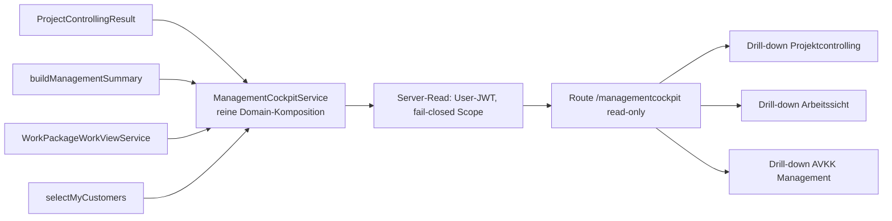

# L2 – Erster nutzbarer Cockpit-Schnitt (Konzept)

Stand: 2026-10-26 · Status: **Konzept (Entwurf), keine Implementierung** · Grundlage: `docs/BSF-07-MANAGEMENT-COCKPIT-DESIGN.md` (P0-Vertrag), Tracker-Paket L2 · Abhängigkeiten: L0, L0b (Datenbasis), L1 (Vertrag integriert)

## 1 Ziel und Nutzungsfall

Frage, die L2 beantwortet: **„Welche meiner autorisierten Projekte benötigen Aufmerksamkeit, weshalb, und wohin führt der Drill-down?“** (BSF-07 §16).

L2 ist der kleinste Schnitt, der diese Frage mit ehrlichen Datenzuständen beantwortet. Er bündelt vorhandene, abgesicherte Read-Modelle und erzeugt keine zweite Fachlogik, keine neue Rolle und keine neue Tabelle.

## 2 Abgrenzung

| Im Schnitt L2                                                               | Nicht in L2 (später)                                         |
| --------------------------------------------------------------------------- | ------------------------------------------------------------ |
| Liste „Handlungsbedarf“ je autorisiertem Projekt mit Gründen                | Fünf vollständige Rollenperspektiven (L3)                    |
| Datenzustände AVAILABLE, EMPTY, PARTIAL, UNKNOWN, UNAVAILABLE, DENIED       | Kiosk auf Cockpit-Daten (L4), Kunden-PDF (L5)                |
| Drill-down in bestehende Ansichten (Projektcontrolling, Arbeitssicht, AVKK) | Personenranking, Mitarbeiterscore, Top/Flop (ausgeschlossen) |
| Rollen: Projektmanager, Teamlead, Systemadministrator/Administrator         | Beträge ohne Berechtigung (siehe Abhängigkeit QS-06)         |

## 3 Datenquellen (vorhanden, nicht neu zu bauen)

| Quelle             | Modul                                                      | Liefert für L2                                                                  |
| ------------------ | ---------------------------------------------------------- | ------------------------------------------------------------------------------- |
| Projektcontrolling | `src/lib/project-controlling` (`ProjectControllingResult`) | Stunden, Lücken (`completeness`), Aktualität (`freshness`)                      |
| AVKK Management    | `src/lib/avkk/management.ts` (`buildManagementSummary`)    | Schweregrade (hoch/kritisch), Aktionskategorien                                 |
| Arbeitssicht       | `src/lib/avkk/work-package-work-view.ts`                   | überfällige offene Pakete, nicht zugeordnete Pakete (Gruppe `DONE` zählt nicht) |
| Meine Kunden       | `src/lib/customer-data/my-customers.ts`                    | autorisierter Kundenkreis (`selectMyCustomers`)                                 |

Capability-Vertrag unverändert (BSF-07 §4): `project.controlling.view`, `avkk.management.view`, CustomerPortfolio. Keine pauschale `managementcockpit.view`.

## 4 Aufmerksamkeitsgründe (Katalog, ableitbar aus vorhandenen Signalen)

| Code                    | Bedeutung                                          | Quelle                              | Drill-down                       |
| ----------------------- | -------------------------------------------------- | ----------------------------------- | -------------------------------- |
| `WP_OVERDUE`            | offene Arbeitspakete über Fälligkeit               | Arbeitssicht (ohne `DONE`)          | `/verantwortungen` Arbeitspakete |
| `WP_UNASSIGNED`         | Arbeitspakete ohne Verantwortliche                 | Arbeitssicht                        | `/verantwortungen` Arbeitspakete |
| `AVKK_HIGH_OR_CRITICAL` | AVKK-Befunde mit Schwere hoch oder kritisch        | AVKK Management                     | Reiter „AVKK Management“         |
| `CONTROLLING_GAP`       | Projekt ohne Arbeitspaket oder Kategorie unbekannt | Projektcontrolling (`completeness`) | `/projektcontrolling`            |
| `DATA_STALE`            | Veröffentlichungsstand zu alt                      | Projektcontrolling (`freshness`)    | `/projektcontrolling`            |

Jeder Grund trägt den Datenzustand der Quelle. Ein fehlender Wert wird nie als 0 dargestellt (BSF-07 §7).

## 5 Zielarchitektur



Schichten: **P1** reine Komposition (kein React, kein Supabase), **P2** Server-Read mit User-JWT, **P3** schreibgeschützte Oberfläche, **P4** Rollenabnahme.

## 6 Schnittstellen

| Schnittstelle    | Art      | Vertrag                                                                                                                      |
| ---------------- | -------- | ---------------------------------------------------------------------------------------------------------------------------- |
| Composer-Eingabe | logisch  | vier vorhandene Ergebnistypen plus Benutzer-Capabilities; keine Datenbankzugriffe im Composer                                |
| Composer-Ausgabe | logisch  | Liste `AttentionItem { projectKey, customerKey, reasons[], dataState, drilldown }`, Aggregat nur als Zähler mit Datenzustand |
| Server-Funktion  | physisch | TanStack-Server-Function mit User-JWT, Scope serverseitig, Antwort enthält Datenzustand statt Fehlerrohtext                  |
| Datenbank        | physisch | keine neuen Tabellen, keine neuen Policies; vorhandene RLS bleibt maßgeblich                                                 |

## 7 Anforderungen (SMART)

| ID    | Anforderung                                                                                                                                                    |
| ----- | -------------------------------------------------------------------------------------------------------------------------------------------------------------- |
| L2-01 | Der Composer muss rein funktional sein (keine React-, Supabase- oder Zeitabhängigkeit; Stichtag als Parameter).                                                |
| L2-02 | Das Cockpit muss nur Objekte zeigen, die der Server für den Benutzer autorisiert; ein nicht autorisiertes Objekt darf weder Zähler noch ID noch Titel liefern. |
| L2-03 | Jeder angezeigte Wert muss einen Datenzustand tragen (AVAILABLE, EMPTY, PARTIAL, UNKNOWN, UNAVAILABLE, DENIED); fehlende Daten dürfen nicht als 0 erscheinen.  |
| L2-04 | Erledigte Arbeitspakete dürfen nicht als überfällig zählen.                                                                                                    |
| L2-05 | Jeder Aufmerksamkeitsgrund muss einen nachvollziehbaren Drill-down in eine bestehende Ansicht haben.                                                           |
| L2-06 | Das Cockpit darf keine Beträge und keine Personenbewertung zeigen, solange `billing.view` (QS-06) nicht existiert; Stunden sind erlaubt.                       |
| L2-07 | Die Route `/managementcockpit` muss für Rollen ohne Management-Capability nicht erreichbar sein (Viewer, Customer, Kiosk, Engineer ohne Capability).           |
| L2-08 | Die Oberfläche muss schreibgeschützt sein (keine Aktionen, die Daten ändern).                                                                                  |
| L2-09 | Der Handlungsbedarf muss vor Kennzahlen stehen (Reihenfolge der Darstellung).                                                                                  |
| L2-10 | Der Composer sollte für 500 Projekte unter 100 ms bleiben (Messung im Test, nicht im Browser).                                                                 |
| L2-11 | Die Golden-Daten (Kunde A und B, Fälligkeiten, Verantwortliche) müssen als Testbasis dienen; die Erwartungen stehen vorab in der RED-Matrix.                   |
| L2-12 | Hilfe und Handbuch müssen den neuen Bereich beschreiben, bevor der Schnitt als abgeschlossen gilt.                                                             |

## 8 RED-Testmatrix (vor Produktcode)

| Fall                                               | Erwartung                                                                 |
| -------------------------------------------------- | ------------------------------------------------------------------------- |
| Projektmanager mit Scope Kunde B                   | nur Kunde-B-Projekte; Petra sieht „Wiederherstellungstest“ als überfällig |
| Erledigtes Paket „Lastanalyse“                     | erscheint nicht als Grund                                                 |
| Paket ohne Verantwortliche (Kunde A, 5 Fälle)      | `WP_UNASSIGNED`                                                           |
| Quelle liefert PARTIAL (Projekt ohne Arbeitspaket) | Zustand PARTIAL, kein Nullwert                                            |
| Rolle Viewer, Customer, Kiosk                      | DENIED, kein Zähler, keine ID                                             |
| Fremder Kunde (Cross-Customer, Cross-Systemhouse)  | nicht im Ergebnis                                                         |
| Alle Quellen UNAVAILABLE                           | Zustand UNAVAILABLE, keine „alles gut“-Darstellung                        |

## 9 Risiken

| ID    | Risiko                                                                                 | Gegenmaßnahme                                                           |
| ----- | -------------------------------------------------------------------------------------- | ----------------------------------------------------------------------- |
| L2-R1 | Zweite Rechte- oder KPI-Logik entsteht im Composer (R-03: größter offener Block)       | Composer konsumiert nur vorhandene Ergebnistypen; Review gegen §3.1/3.2 |
| L2-R2 | Beträge werden ohne `billing.view` angezeigt (QS-06 offen)                             | L2-06; QS-06 vor L3 oder Beträge ausschließen                           |
| L2-R3 | Fehlende Daten wirken wie „alles in Ordnung“                                           | L2-03, RED-Fälle PARTIAL/UNAVAILABLE                                    |
| L2-R4 | Publish-Weg unklar (R-07): Code bleibt auf `main` ohne Auslieferung                    | L2 auf `main` bauen, Auslieferung nach Lovable-Klärung                  |
| L2-R5 | Single Point of Failure Server-Read: ein Composer-Fehler blendet das ganze Cockpit aus | je Quelle eigener Datenzustand, Teilausfall zeigt PARTIAL               |

## 10 Reihenfolge und Auftragstext P1

1. P0 ist integriert (BSF-07-Vertrag). Dieses Konzept freigeben.
2. P1: RED-Tests schreiben, dann Composer (reine Domäne). Nur Dateien unter `src/lib/management-cockpit/` und `src/__tests__/lib/management-cockpit/`.
3. P2: Server-Read mit User-JWT und Scope-Tests (IDOR, Cross-Customer, Cross-Systemhouse).
4. P3: schreibgeschützte Route, Handlungsbedarf vor Statistik, Datenzustände sichtbar.
5. P4: Rollenabnahme (Projektmanager, Teamlead, Administration; Negativ: Viewer, Customer, Kiosk, Engineer).

```text
Auftrag P1 (Claude Code, Branch feat/l2-cockpit-p1, Draft-PR, nicht mergen):
Lies docs/BSF-07-MANAGEMENT-COCKPIT-DESIGN.md (Kap. 3, 4, 7, 13, 14) und docs/L2-COCKPIT-SCHNITT-KONZEPT.md.
1. Schreibe zuerst RED-Tests gemaess Abschnitt 8 unter src/__tests__/lib/management-cockpit/.
2. Implementiere dann src/lib/management-cockpit/ (ManagementCockpitService, reine Funktionen, Stichtag als Parameter,
   keine React-/Supabase-Importe). Konsumiere nur ProjectControllingResult, buildManagementSummary,
   WorkPackageWorkViewService-Ergebnisse und selectMyCustomers.
3. Keine neue Rolle, Permission, Tabelle, Migration. Keine Beträge.
4. Vor Abschluss: npm test (betroffene Tests), tsc, eslint, Prettier, npm run docs:check, npm run docs:project; Tracker und Tagebuch nachziehen.
5. Commit, push, Remote-Stand pruefen, Draft-PR. Bericht mit YAML-Block.
```

## 11 Ergebnis P2 (2026-10-27, Draft-PR 231)

Umgesetzt: `src/lib/management-cockpit-runtime/management-cockpit.functions.ts` (TanStack-Server-Function, User-JWT, keine Service Role, keine Schreibzugriffe) und 21 Tests unter `src/__tests__/backend/management-cockpit.functions.test.ts`.

| Entscheidung                    | Inhalt                                                                                                                                                                                        |
| ------------------------------- | --------------------------------------------------------------------------------------------------------------------------------------------------------------------------------------------- |
| Anfrage                         | leer (`strict`); Scope, Stichtag und Rollen kommen nie vom Client                                                                                                                             |
| Capabilities                    | `is_account_active` und `dashboard.view` als Grundlage; Controlling über `project.controlling.view`; Arbeitssicht und AVKK über `avkk.management.view` (wie der vorhandene Arbeitssicht-Pfad) |
| Kundenkreis                     | `listMyCustomers` (RLS plus `is_my_customer`); nicht ermittelbar ergibt UNAVAILABLE für alle Quellen, nie eine leere Erfolgsansicht                                                           |
| Fehler der Berechtigungsprüfung | generischer Fehler (fail-closed), nichts wird gelesen                                                                                                                                         |
| Teilausfall                     | je Quelle UNAVAILABLE statt Rohfehler; die übrigen Quellen liefern weiter (L2-R5)                                                                                                             |
| Controlling-Fenster             | 90 Tage bis zum Stichtag, alle Abrechnungsarten; Parameter `COCKPIT_CONTROLLING_WINDOW_DAYS`                                                                                                  |
| Befund P1, behoben              | Kundenkreis-Schlüssel: `myCustomerScopeKey` trennt mit `::`, der Composer erwartet `:`; Schlüsselbau jetzt nur in `cockpitScopeKey`                                                           |

**Offene Entscheidung (AVKK):** Die AVKK-Führungsdaten (`listDossiers`, `useAvkkManagement`) werden bisher nur im Browser mit dem Client-Supabase-Objekt geladen; es gibt keinen Server-Lesepfad und keine serverseitige Ableitung der Schweregrade je Kunde. Bis dahin liefert das Cockpit AVKK als UNAVAILABLE (ehrlich, kein Nullwert). Für `AVKK_HIGH_OR_CRITICAL` ist ein eigener Schnitt P2b nötig: ein Server-Adapter, der die vorhandene Ableitung (`buildRows`, `buildManagementSummary`) wiederverwendet statt nachzubauen (Risiko L2-R1). Alternative: AVKK im ersten nutzbaren Schnitt weglassen und den Grund erst mit P2b ergänzen.
