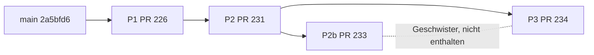

# L2 – Umsetzungsplan (Start 2026-11-02)

Stand: 2026-11-01 · Status: **Entwurf zur Freigabe durch den Owner** · Grundlage: `docs/L2-COCKPIT-SCHNITT-KONZEPT.md`, `docs/BERICHT-2026-11-01-L2-BESTAND.md`, Tracker-Paket L2, ADR-0040 (Testziel-Abgleich je Arbeitspaket).

## 1 Zweck

Der Plan macht aus dem freigegebenen Konzept (2026-10-26) und den vier Draft-PRs einen Ablauf, der am 2026-11-02 mit der Umsetzung beginnen kann. Er enthält den gemessenen Bestand, einen Vorschlag zur Reihenfolge, die Testziele je Paket, die Entscheidungen des Owners und den ersten Auftragstext.

## 2 Bestand (gemessen 2026-11-01)

Messung in der Cloud-Sitzung: `bun install --frozen-lockfile`, Node 22.22, `vitest run` der Cockpit-Testdateien, `tsc --noEmit`. Quelle der Branch-Beziehungen: `git merge-base`, `git rev-list`, `git merge-tree` gegen `origin/main` (2a5bfd6).

| PR  | Paket                                      | Commits vor / hinter `main` | Dateien, Zeilen         | Messung am Branch                                                          |
| --- | ------------------------------------------ | --------------------------- | ----------------------- | -------------------------------------------------------------------------- |
| 226 | P1 Composer (reine Komposition)            | 1 / 78                      | 4 Dateien, +665         | nicht einzeln gemessen, Tests laufen in P2b und P3 mit; konfliktfrei       |
| 231 | P2 Server-Lesepfad (User-JWT, Scope)       | 4 / 69                      | 12 Dateien, +1322 / −6  | nicht einzeln gemessen, Tests laufen in P2b und P3 mit                     |
| 233 | P2b AVKK-Server-Lesepfad                   | 9 / 69                      | 15 Dateien, +2099 / −9  | 3 Testdateien, 51 Tests bestanden; `tsc` ohne Fehler                       |
| 234 | P3 schreibgeschützte Route mit Rollen-Gate | 7 / 69                      | 26 Dateien, +2258 / −16 | 6 Testdateien, 74 Tests bestanden; `tsc` ohne Fehler; E2E nicht ausgeführt |



Befunde:

- **Stapel:** P2 enthält P1. P2b und P3 bauen beide auf P2 auf, P3 enthält P2b nicht. Die Code-Dateien beider Zweige überschneiden sich nicht; P2b ändert `management-cockpit.functions.ts` und den Adapter, P3 die Route, die Komponenten und drei bestehende Dateien (`dashboard.tsx`, `verantwortungen.tsx`, `CustomerPageShell.tsx`).
- **Konflikte gegen `main`:** P1 keine. P2, P2b und P3 je vier, ausschließlich in `docs/BACKLOG.md`, `docs/CURRENT-STATUS.md`, `docs/ENTWICKLUNGSTAGEBUCH.md` und `docs/GOLDEN-GATE-EXECUTION-TRACKER.yaml`. P2b gegen P3 ebenfalls nur diese vier Dateien.
- **Sicherheitstests:** Keine Änderung an `src/__tests__/security` und `src/__tests__/rls` in P3 gefunden (Stichprobe per `git diff --stat`).
- **Alter:** Die Drafts sind 69 bis 78 Commits hinter `main` und stammen vom 26. und 27.10.

Nicht gemessen: ESLint, die gesamte Testsuite, E2E-Spec von P3, die einzelnen Tests von P1 und P2, CI-Lauf der Drafts auf aktuellem `main`, Vorschau in Lovable.

Ergänzung aus dem Bericht `docs/BERICHT-2026-11-01-L2-BESTAND.md` (lesende Bestandsaufnahme über die GitHub-Schnittstelle, 2026-11-01):

- Die CI war auf den Head-Commits aller vier Drafts vollständig grün (15 von 15, am 26. und 27.10., gegen den damaligen `main`). Nach dem Neuaufbau muss sie erneut laufen.
- `mergeable_state`: PR 226 `behind`, PR 231, 233 und 234 `dirty` (nur die vier Doku-Dateien).
- Einziger Eingriff in Bestandscode außerhalb der Cockpit-Pfade: `src/lib/avkk/work-package-work-view.ts` (+1/−1, `berlinDate` wird exportiert, ohne Verhaltensänderung). U2 muss ihn mitnehmen; er gilt nicht als Verstoß gegen die Pfadgrenze von U1.
- P2b ersetzt den P2-Pfad nicht, sondern erweitert ihn um AVKK (ein Adapter, +360 Zeilen); P3 enthält P2b absichtlich nicht, AVKK ist dort UNAVAILABLE. Wird P3 vor P2b integriert, geht ein sichtbarer Funktionsrückschritt auf `main`. Deshalb die Reihenfolge P2b vor P3.
- Offen laut Bericht: L2-12 (Hilfe und Handbuch) und P4 (Rollenabnahme live).

## 3 Vorschlag: Integration in vier PRs

Die Drafts werden nicht gemergt. Je Paket entsteht ein neuer Branch von `main`, der nur die Code-Commits (ohne die Doku-Commits der Drafts) per Cherry-Pick übernimmt. Die Dokupflege wird je PR einmal neu geschrieben. So entfallen die vier Konfliktdateien, und jeder PR durchläuft die vollständige CI (15 Checks).

| Schritt | PR-Inhalt                                | Quelle                            | Erwartung                                                                                   |
| ------- | ---------------------------------------- | --------------------------------- | ------------------------------------------------------------------------------------------- |
| U1      | P1 Composer                              | Commit `53a81f1` aus PR 226       | konfliktfrei; RED-Tests und Composer; Tests des Pakets bestehen                             |
| U2      | P2 Server-Lesepfad                       | Code-Commit `f8199b7` aus PR 231  | Scope-, IDOR- und Cross-Customer-Tests bestehen                                             |
| U3      | P2b AVKK-Server-Lesepfad                 | Code-Commits aus PR 233           | 51 Tests aus der Messung bestehen weiterhin                                                 |
| U4      | P3 Route `/managementcockpit`            | Code-Commits `a02ab26`, `a565a21` | 74 Tests aus der Messung bestehen; E2E-Spec wird ausgeführt                                 |
| U5      | P4 Rollenabnahme in der Lovable-Vorschau | neuer Ablauf, kein Code           | Projektmanager, Teamlead, Administration positiv; Viewer, Customer, Kiosk, Engineer negativ |

Merge nur per REST nach `update-branch` und grüner CI, je auf Ihren Befehl „Merge #N“. Vor einem Merge Lovable-Stand abgleichen (Sync-Dialog „Repository-Version behalten“ danach).

## 4 Testziele je Paket (ADR-0040, `AQGS-TCA-01`)

| Paket | Testziel                                                                                                          | Geschützt, nie lockern                            |
| ----- | ----------------------------------------------------------------------------------------------------------------- | ------------------------------------------------- |
| U1    | Composer rein funktional (L2-01), Datenzustände ohne Nullwerte (L2-03), erledigte Pakete nicht überfällig (L2-04) | RED-Matrix aus Konzept §8                         |
| U2    | Scope serverseitig, Fail-closed bei Fehler der Berechtigungsprüfung (L2-02), je Quelle eigener Zustand (L2-R5)    | RBAC-, RLS-, IDOR- und Cross-Customer-Tests       |
| U3    | AVKK-Schweregrade je Kunde serverseitig, keine Service-Rolle, keine Schreibzugriffe                               | Sicherheitstests                                  |
| U4    | Route nur für Management-Capability (L2-07), schreibgeschützt (L2-08), Handlungsbedarf vor Kennzahlen (L2-09)     | Zugriffstests der Route, `src/__tests__/security` |
| U5    | Rollenabnahme aus der Konzept-Abnahme; Hilfe und Handbuch beschreiben den Bereich (L2-12)                         | blockierte Gates bleiben blockiert                |

## 5 Entscheidungen des Owners vor dem Start

| ID  | Entscheidung                                                                                                | Empfehlung                                                                                |
| --- | ----------------------------------------------------------------------------------------------------------- | ----------------------------------------------------------------------------------------- |
| E1  | Integrationsweg: Neuaufbau mit Cherry-Pick (Abschnitt 3) oder die Drafts nach Konfliktlösung mergen         | Neuaufbau, weil die Drafts 69 bis 78 Commits hinter `main` liegen und nur Doku kollidiert |
| E2  | P2b als Antwort auf die in P2 offene AVKK-Entscheidung bestätigen (Server-Lesepfad über Adapter)            | bestätigen, nachdem U3 die Sicherheitstests bestanden hat                                 |
| E3  | L0b (Veröffentlichungsweg) ist offen: L2 zunächst nur in der Lovable-Vorschau prüfen, nicht veröffentlichen | bestätigen; Publish bleibt No-Go                                                          |
| E4  | Beträge und Personenbewertung bleiben ausgeschlossen (L2-06, QS-06 offen)                                   | bestätigen                                                                                |
| E5  | Zeitrahmen: 7 bis 12 Claude-Code-Aufträge, 4 bis 7 Lovable-Prompts, 3 bis 5 Arbeitstage (Analogieschätzung) | bei 1 bis 2 Tagen pro Woche etwa 2 bis 4 Wochen Laufzeit                                  |

## 6 Risiken

| ID    | Risiko                                                                                  | Gegenmaßnahme                                                       |
| ----- | --------------------------------------------------------------------------------------- | ------------------------------------------------------------------- |
| L2-R1 | Zweite Rechte- oder KPI-Logik im Composer                                               | Review gegen Konzept §3; nur vorhandene Ergebnistypen               |
| L2-R3 | Fehlende Daten wirken wie „alles in Ordnung“                                            | RED-Fälle PARTIAL und UNAVAILABLE                                   |
| L2-R5 | Single Point of Failure im Server-Read                                                  | je Quelle eigener Datenzustand                                      |
| R-07  | Lovable überschreibt `main`-Stand, wenn Merges und Lovable-Aufträge gleichzeitig laufen | Reihenfolge: erst Merge, dann Sync-Dialog beantworten; nie parallel |
| R-10  | Migrationsfragen offen; Cockpit darf keine Migration voraussetzen                       | keine neuen Tabellen, keine Migrationen (Konzept §6)                |
| NEU   | Drafts veraltet, Commit-Reihenfolge unklar                                              | Neuaufbau je Schritt U1 bis U4, vollständige CI je PR               |

## 7 Auftrag U1 (Claude Code, 2026-11-02)

```text
Arbeitsverzeichnis: C:\dev\sysingdashboard. Sprache Deutsch. Lies CLAUDE.md, docs/CURRENT-STATUS.md, docs/L2-UMSETZUNGSPLAN.md und docs/L2-COCKPIT-SCHNITT-KONZEPT.md.
Ziel: P1 (reiner Composer) als neuer PR von main. Keine Draft-PRs mergen, keine Branches löschen, keine Zugangsdaten in Dateien oder Commits.
1. git fetch --prune, dann Branch feat/l2-u1-composer von origin/main.
2. Übernimm per Cherry-Pick nur den Code-Commit 53a81f1 aus origin/feat/l2-cockpit-p1 (ohne Doku-Commits). Bei Konflikten: melden, nicht raten.
3. Prüfe: Nur Dateien unter src/lib/management-cockpit/ und src/__tests__/lib/management-cockpit/; keine neue Rolle, Permission, Tabelle oder Migration; keine Beträge; keine Importe von React oder Supabase im Composer.
4. Betroffene Tests, npm run typecheck, npm run lint, Prettier. Ergebnisse nur mit Beleg melden (Zahl bestandener Tests).
5. Dokupflege: Tracker (fortschritt), CURRENT-STATUS, ENTWICKLUNGSTAGEBUCH, BACKLOG; npm run docs:check und docs:project.
6. Committen, pushen, mit git ls-remote --heads origin feat/l2-u1-composer den Remote-Stand prüfen. PR anlegen (kein Draft), nicht mergen. CI abwarten. Hygiene-Zeile melden.
```

Weitere Aufträge U2 bis U4 folgen nach demselben Muster, je nach Ergebnis von U1.
