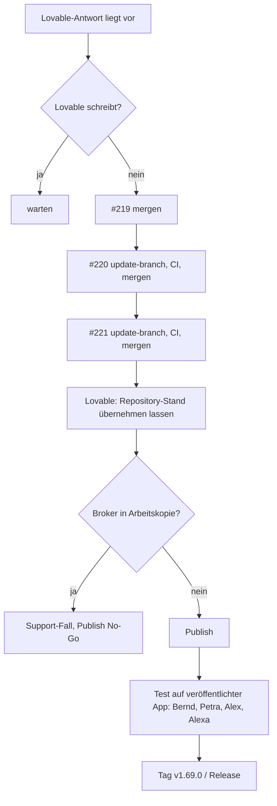

# Merge-Checkliste Golden Gate (Stand 2026-10-25)

Zweck: reproduzierbare Reihenfolge, damit Merges nicht in laufende Lovable-Arbeit greifen (R-07) und der Publish erst nach Prüfung erfolgt.

## 1 Offene Pull Requests

| PR   | Inhalt                                                      | Art  | Merge-Bedingung                 |
| ---- | ----------------------------------------------------------- | ---- | ------------------------------- |
| #219 | Tracker, Testprotokoll, PW-01, QS-06, Publish-Prüfung       | Doku | Lovable schreibt nicht; CI grün |
| #220 | Fix: erledigte Arbeitspakete nie „Überfällig“ (Gruppe DONE) | Code | wie #219; nach #219             |
| #221 | Hilfetext Passwort ohne Widerspruch                         | Text | wie #219; nach #220             |

## 2 Voraussetzungen vor jedem Merge

1. Das muss gelten: Lovable führt keinen schreibenden Auftrag aus (Rückfrage beim Nutzer).
2. Alle 15 CI-Checks sind grün.
3. Der Branch ist aktuell zur Basis (`update-branch`), sonst blockiert der Schutz.
4. Der Merge erfolgt per REST: `gh api -X PUT repos/bmarnau/sysingdashboard/pulls/N/merge -f merge_method=merge`.
5. Es darf kein `lovable-sync-*`-Branch gemergt werden.

## 3 Ablauf

## 4 Test nach dem Publish (veröffentlichte App)

| ID  | Rolle | Erwartung                                                  |
| --- | ----- | ---------------------------------------------------------- |
| N1  | Bernd | Anmeldung, Arbeitssicht, Veröffentlichen für Kunde A und B |
| N2  | Petra | Kunde B, Veröffentlichen, Verantwortliche sichtbar         |
| N3  | Alex  | kein Veröffentlichen, keine Kunden                         |
| N4  | Alexa | nur Ansicht; Abrechnung (M4) bleibt bis QS-06 offen        |
| N5  | alle  | erledigte Pakete nicht „Überfällig“ (Fix #220)             |

## 5 Rücknahme

- Publish zurücksetzen über die Versionsverwaltung von Lovable; kein Löschen von `audit_log`.
- Datenjobs nur nach ADR-0037 (feste IDs für Rollback).
