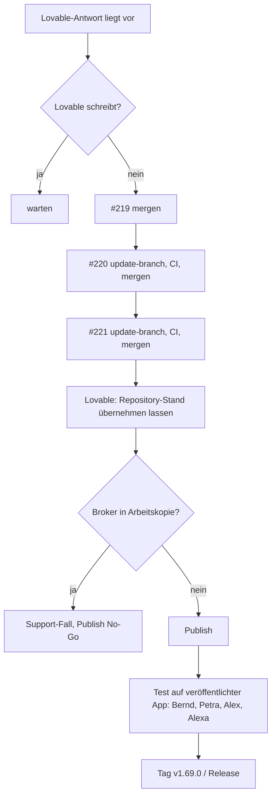

# Merge-Checkliste Golden Gate (Stand 2026-10-25)

Zweck: reproduzierbare Reihenfolge, damit Merges nicht in laufende Lovable-Arbeit greifen (R-07) und der Publish erst nach Prüfung erfolgt.

## 1 Offene Pull Requests

| PR   | Inhalt                                                      | Art  | Merge-Bedingung                 |
| ---- | ----------------------------------------------------------- | ---- | ------------------------------- |
| #219 | Tracker, Testprotokoll, PW-01, QS-06, Publish-Prüfung       | Doku | Lovable schreibt nicht; CI grün |
| #220 | Fix: erledigte Arbeitspakete nie „Überfällig“ (Gruppe DONE) | Code | wie #219; nach #219             |
| #221 | Hilfetext Passwort ohne Widerspruch                         | Text | wie #219; nach #220             |

## 2 Voraussetzungen vor jedem Merge

1. Das muss gelten: Lovable führt keinen schreibenden Auftrag aus (Rückfrage beim Nutzer).
2. Alle 15 CI-Checks sind grün.
3. Der Branch ist aktuell zur Basis (`update-branch`), sonst blockiert der Schutz.
4. Der Merge erfolgt per REST: `gh api -X PUT repos/bmarnau/sysingdashboard/pulls/N/merge -f merge_method=merge`.
5. Es darf kein `lovable-sync-*`-Branch gemergt werden.

## 3 Ablauf

## 4 Test nach dem Publish (veröffentlichte App)

| ID  | Rolle | Erwartung                                                  |
| --- | ----- | ---------------------------------------------------------- |
| N1  | Bernd | Anmeldung, Arbeitssicht, Veröffentlichen für Kunde A und B |
| N2  | Petra | Kunde B, Veröffentlichen, Verantwortliche sichtbar         |
| N3  | Alex  | kein Veröffentlichen, keine Kunden                         |
| N4  | Alexa | nur Ansicht; Abrechnung (M4) bleibt bis QS-06 offen        |
| N4a | Alexa | Netzwerkprüfung Viewer, siehe unten                        |
| N5  | alle  | erledigte Pakete nicht „Überfällig“ (Fix #220)             |

N4a (Owner 2026-11-06, D4; QS6-4 als „kein Serverbefund“ geschlossen): Mit dem Viewer-Konto in der veröffentlichten App die Entwicklerwerkzeuge öffnen, Reiter Netzwerk, Seite neu laden und die Antwort der Server-Funktion zum Lesen der gemeinsamen Projektion (`shared-projection.functions.ts`) öffnen. Erwartung: Die Antwort muss frei von Satz- und Betragsfeldern sein (Felder `hourly`, `rate`, `amount` und Varianten wie `hourlyRate`). Prüfung per Suche im Antworttext nach `hourly`, `rate` und `amount`; Treffer in Namen ohne Satz- oder Betragsbezug (z. B. `generatedAt`) sind kein Befund. Beleg: Screenshot mit Uhrzeit, nur Feldnamen, keine Werte und keine Tokens. Ein Fund ist ein Befund QS6-4 und löst die Bewertung nach `docs/NOTFALL-HANDBUCH.md` N1a aus.

## 5 Rücknahme

- Vor dem Publish: bisher veröffentlichte Version (Kennzeichen „Published“ im Lovable-Verlauf) mit Datum notieren und als Bookmark markieren; nach dem Publish die neue Version als Bookmark mit `main`-SHA markieren.
- Die Rücknahme muss innerhalb von 60 Minuten nach Feststellung eingeleitet sein (Ablauf `docs/NOTFALL-HANDBUCH.md`, N1a).
- Code: Revert im Lovable-Verlauf auf die zuletzt gute Version, danach erneut „Publish changes“; ein Revert allein ändert die veröffentlichte App nicht (zu belegen, RB-01 bis RB-04).
- Sofortmaßnahme bei akutem Schaden oder fehlender Rücknahme-Version: Unpublish (zu belegen, RB-07).
- Revert setzt Daten und Schema nicht zurück. Datenjobs nur nach ADR-0037 (feste IDs für Rollback), Datenbank-Wiederherstellung nach N5; kein Löschen von `audit_log`.
