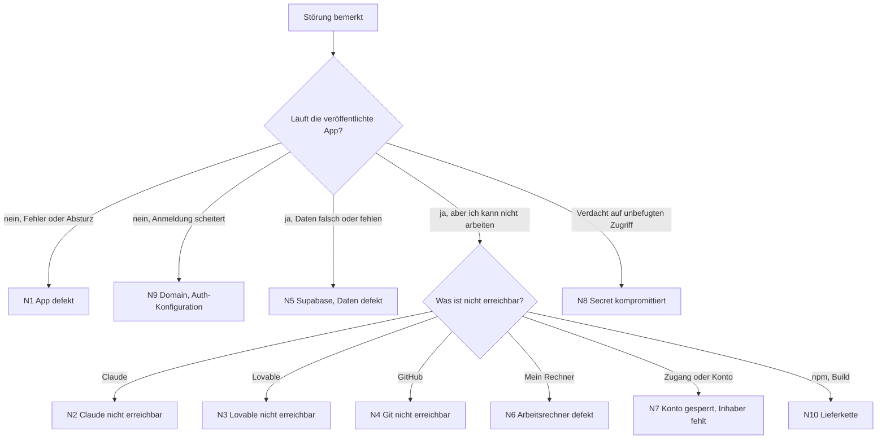
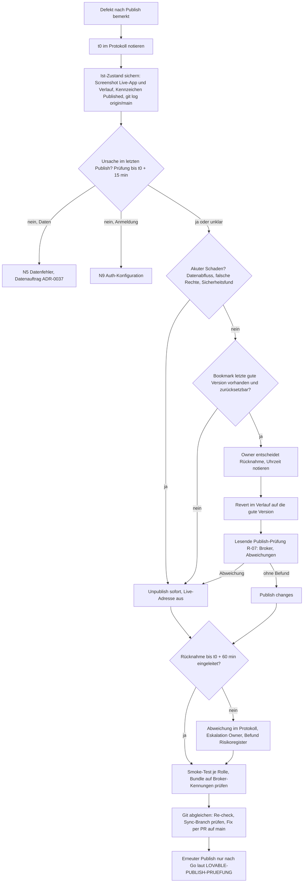

# Notfallhandbuch SysIng Dashboard

Stand: Entwurf 2026-11-03, ergänzt 2026-11-07 (A32 Rücknahme eines Publish, A31 Lücken, A40 Lücke 2) · Verantwortlich: Owner · Grundlage: `docs/standards/STANDARD-WIEDERHERSTELLBARKEIT.md` (Abschnitte 12 bis 14, Szenarien N1 bis N10, Risikobewertung, Bezug BSI-Standard 200-4)

Bezugsdokumente (alle Entwurf, nichts davon beschlossen oder bestanden):

| Dokument                                 | Inhalt                                                                                                              | Stand                                                          |
| ---------------------------------------- | ------------------------------------------------------------------------------------------------------------------- | -------------------------------------------------------------- |
| `docs/ADR/0042-rto-rpo-schutzklassen.md` | Schutzklassen, Ziel-RTO und Ziel-RPO je Szenario N1 bis N10, Optionen je Klasse                                     | Proposed, Entscheidungsfelder D1 ff. offen                     |
| `docs/ZUGAENGE-UND-NOTFALLKONTO.md`      | Kontenübersicht je Dienst ohne Werte, Mail-Aliase, Prüfliste Notfallmappe ZN-01 bis ZN-18 (führend für Abschnitt 3) | Entwurf A09, 2026-11-06                                        |
| `docs/PLAN-RESTORE-PROBE-LOKAL.md`       | lokale Restore-Probe S1 bis S4 und Teil S6, Abnahmekriterien, Protokollvorlage EV-0004                              | Entwurf A30, nichts ausgeführt, Entscheidungen E1 bis E7 offen |
| `docs/DATENAUFTRAG-RESTORE-PROBE.md`     | lesende Datenaufträge RP-01 (ausgeführt 2026-11-06), RP-02 (ausgeführt 2026-11-07), RP-03 (Entwurf)                 | RP-01 und RP-02 mit Ergebnis, RP-03 offen                      |

Die RTO- und RPO-Werte in ADR-0042 gelten bis zur Entscheidung des Owners nur als Empfehlung und bis zur ersten bestandenen Restore-Probe (EV-0004 neu) als vorläufig; bis REST-20 erfüllt ist, gelten sie nur bei Verfügbarkeit des Owners.

Einordnung: Das Handbuch ist am Gedanken des [BSI-Standards 200-4](https://www.bsi.bund.de/DE/Themen/Unternehmen-und-Organisationen/Standards-und-Zertifizierung/IT-Grundschutz/BSI-Standards/BSI-Standard-200-4-Business-Continuity-Management/bsi-standard-200-4_Business_Continuity_Management_node.html) (Wiederanlauf- und Wiederherstellungspläne, Übungen, Notfallorganisation) ausgerichtet, ohne Anspruch auf Konformität und ohne Zertifizierungsziel. Es ist ein projektbezogener Teil und ersetzt kein Notfallmanagement der Organisation. Begriffszuordnung: Standard-Entwurf, Abschnitt 14.

Dieses Handbuch muss ohne Claude, ohne Chatverlauf und ohne Lovable-Zugang lesbar und ausführbar sein. Es gehört deshalb als Datei in Git (`docs/NOTFALL-HANDBUCH.md`) **und** als lokale Kopie außerhalb von OneDrive und GitHub (Notfallmappe, Abschnitt 4).

Kennzeichnung: „zu belegen“ steht bei jeder Aussage zu Plattformfunktionen (Lovable, Supabase), die im Projekt noch nicht durch ein Probe-Protokoll bestätigt ist. Diese Schritte erst nach der Bestätigung als sicher betrachten.

Keine Zugangsdaten, Schlüssel oder Passwörter in diese Datei schreiben. Sie stehen im Passwort-Tresor (Abschnitt 3).

## 1 Erste Hilfe: Was ist ausgefallen?



Grundregeln für jeden Notfall:

1. **Nicht überstürzt schreiben.** Vor jeder Wiederherstellung den aktuellen Zustand sichern (Dump, Bundle, Screenshot), auch wenn er fehlerhaft ist.
2. **Nichts löschen.** Insbesondere nie `audit_log` löschen und keine `lovable*`-, `backup/*`- oder `audit/*`-Branches.
3. **Keine Datenänderung am Live-System ohne Datenauftrag** nach ADR-0037 (zwei Freigaben, feste IDs, Rollback), außer im dokumentierten Notfall mit Begründung im Protokoll.
4. **Kein Publish im Notfall**, solange die Ursache nicht verstanden ist. Vorschlag A32 (Entscheidung des Owners offen): Ausnahme für den Rücknahme-Publish einer per Bookmark markierten, vorher veröffentlichten Version nach N1a.
5. **Protokoll führen:** Uhrzeit, Beobachtung, Maßnahme, Ergebnis. Vorlage Abschnitt 5.

## 2 Szenarien

### N1 App defekt

Symptome: Seite lädt nicht, weiße Seite, Fehlermeldungen, falsche Anzeige nach einem Publish.

Erste Stunde:

1. Prüfen, ob die Preview (Editor) dasselbe Verhalten zeigt wie die veröffentlichte App. Unterschied notieren.
2. Letzten Publish und letzte Änderungen im Git ansehen (`git log --oneline -20 origin/main`).
3. Eingrenzen: Codefehler (Fehler nur in der Oberfläche), Datenfehler (Werte falsch) oder Anmeldefehler (siehe N9).

Wiederherstellung:

- **Codefehler:** Rücknahme nach N1a (innerhalb von 60 Minuten eingeleitet: Unpublish oder Revert auf die zuletzt gute Version und erneuter Publish; Revert allein ändert die Live-App nicht; zu belegen, RB-01 ff.). Danach Fix per PR auf `main`, Re-check der Git-Seite in Lovable („In sync with GitHub“) und erneuter Publish nur nach Freigabe des Owners.
- **Datenfehler:** Weiter bei N5.

Rückkehr in den Normalbetrieb: Smoke-Test mit je einem Konto der Rollen Projektmanager, Teamleiter, Viewer; Cockpit und Dashboard öffnen.

### N1a Rücknahme eines Publish

Gilt, wenn ein Defekt nach N1 auf den letzten Publish zurückgeht (Codefehler in der veröffentlichten App). Datenfehler laufen über N5, Anmeldefehler über N9.

Entscheidungskriterium: Die Rücknahme **muss innerhalb von 60 Minuten** nach der Feststellung (Zeitpunkt t0 im Protokoll, Abschnitt 5) **eingeleitet** sein. Eingeleitet heißt: Unpublish ausgeführt **oder** Revert auf die zuletzt gute Version ausgeführt und „Publish changes“ ausgelöst. Wird t0 + 60 Minuten erreicht, ohne dass der Revert-Weg bereit ist, gilt Unpublish als Pflichtmaßnahme, sofern der Owner nicht dokumentiert anders entscheidet.

Plattformverhalten laut öffentlicher Lovable-Dokumentation (abgerufen 2026-11-07), **am Projekt zu belegen** (Belegplan RB-01 ff.):

- Publish liefert einen Schnappschuss der **aktuellen** Projektversion aus; spätere Änderungen gehen erst mit „Publish changes“ live ([Publish](https://docs.lovable.dev/features/publish), [Hosting](https://docs.lovable.dev/features/hosting)). Das deckt sich mit der Support-Aussage „kein Pinning auf Commit oder Branch“ (`docs/LOVABLE-PUBLISH-PRUEFUNG.md`).
- Eine Funktion „frühere Veröffentlichung wiederherstellen“ (Instant Rollback) ist nicht dokumentiert. Rücknahme heißt daher: Projektstand auf die gute Version zurücksetzen und erneut veröffentlichen.
- Revert im Verlauf (History) setzt nur den **Code** zurück und stellt Edge Functions passend neu bereit; Datenbankdaten und bereits ausgeführte Migrationen bleiben ([History](https://docs.lovable.dev/features/projects/history)). Ob die Neubereitstellung der Edge Functions die veröffentlichte App **vor** dem erneuten Publish trifft, ist zu belegen (RB-08).
- Die gerade veröffentlichte Version trägt im Verlauf das Kennzeichen „Published“. Versionsnummern gibt es nicht, Versionen erscheinen mit Datum. Sehr alte Versionen lassen sich ansehen, aber nicht mehr zurücksetzen („Cannot revert this far back in history“, Grenze nicht beziffert) ([History](https://docs.lovable.dev/features/projects/history)).
- Unpublish macht die Live-Adresse unerreichbar, das Projekt bleibt im Editor; Recht wie beim Publish ([Publish](https://docs.lovable.dev/features/publish)).
- GitHub: Ein Push oder Merge ändert die Live-App nicht; sie ändert sich nur mit einem Publish aus Lovable. Rücknahme über Git erfolgt mit einem Revert-Commit, kein Force-Push ([Git-Sync](https://docs.lovable.dev/integrations/git-sync-overview)). Ob ein Revert in Lovable einen Commit nach GitHub schreibt, ist nicht dokumentiert (RB-05).
- Datenbank (Lovable Cloud): tägliche Sicherung, etwa 14 Tage, kein Point-in-Time, Wiederherstellung unumkehrbar und mit Schema, wenige Minuten Ausfall ([Backups](https://docs.lovable.dev/features/database-backups)). Das ist **kein** Teil der Publish-Rücknahme, sondern N5 mit Datenauftrag nach ADR-0037.

#### Vorbereitung vor jedem Publish (Pflicht)

1. Die bisher veröffentlichte Version (Kennzeichen „Published“) mit Datum und Uhrzeit notieren und als Bookmark „Live bis JJJJ-MM-TT“ markieren.
2. Die neue Version nach dem Publish als Bookmark „Publish JJJJ-MM-TT, main <SHA>“ markieren.
3. Prüfen, dass die Rücknahme-Version nicht gegen ADR-0036 verstößt (Auth-Broker). Hinweis: Die am 2026-10-31 veröffentlichte Version 1.69.0 enthält den Broker; eine Rücknahme auf diesen Stand stellt den Verstoß wieder her und braucht eine dokumentierte Entscheidung des Owners.

#### Ablauf



#### Nach der Rücknahme

1. Git-Seite in Lovable prüfen (Re-check). Entstandene `lovable-sync-*`-Branches nicht mergen, nur lesen und im Tracker festhalten.
2. Den Fehler über einen PR auf `main` beheben (CI grün, Merge per REST). Danach Sync, Publish-Prüfung, Go des Owners.
3. Daten und Schema bleiben vom Revert unberührt. Hat der fehlerhafte Stand Daten geschrieben oder Migrationen ausgeführt: weiter bei N5.
4. Protokoll abschließen: t0, Uhrzeit Entscheidung, Uhrzeit Unpublish oder Publish, Dauer bis eingeleitet, Ergebnis Smoke-Test.

#### Belegplan RB (nur Wegwerfprojekt oder lesende Sicht, nie Produktion)

Voraussetzung: ein **neu angelegtes** Lovable-Wegwerfprojekt (kein Remix des Produktivprojekts), eigenes eingebautes Backend ohne echte Daten, für RB-05 und RB-06 ein privates Wegwerf-Repository außerhalb von `bmarnau/sysingdashboard`. Keine Produktiv-Secrets. Beleg je Schritt: Screenshot mit sichtbarem Datum und Uhrzeit, Versionsdatum aus dem Verlauf (Lovable hat keine Versionsnummern), sichtbare Markierung in der App (Text „Version A“ oder „Version B“), bei Git der Commit-SHA. Ablage im Nachweisregister `docs/NACHWEISE.yaml` (neue EV-Nummer).

```yaml
belegplan_ruecknahme:
  owner: Owner (Bernd)
  umgebung: Lovable-Wegwerfprojekt, nie Produktion
  schritte:
    - id: RB-01
      schritt: Wegwerfprojekt neu anlegen, Version A mit Text "Version A", Bookmark setzen, Publish
      beleg: Screenshot Verlauf mit Kennzeichen Published und Datum; Screenshot Live-Adresse mit "Version A"
      dauer_min: 15
    - id: RB-02
      schritt: Version B mit Text "Version B fehlerhaft", Publish changes
      beleg: Screenshot Verlauf (Published an B), Live-Adresse zeigt B
      dauer_min: 10
    - id: RB-03
      schritt: Revert auf Bookmark A, noch kein Publish
      beleg: Live-Adresse zeigt weiter B; Punkt am Publish-Button sichtbar; Verlauf zeigt Published weiter an B
      dauer_min: 10
    - id: RB-04
      schritt: Publish changes nach dem Revert; Zeit von Entscheidung bis Live-Anzeige A messen
      beleg: Screenshots mit Uhrzeit vor und nach; Messwert in Minuten (Ziel deutlich unter 60)
      dauer_min: 10
    - id: RB-05
      schritt: Wegwerfprojekt mit privatem Wegwerf-Repo verbinden, Version C, dann Revert auf B
      beleg: git log des Repos; entsteht ein Commit auf main, ein lovable-sync-Branch oder nichts
      dauer_min: 20
    - id: RB-06
      schritt: Rücknahme über Git, git revert auf main des Wegwerf-Repos pushen
      beleg: Commit-SHA; Lovable übernimmt; Live-Adresse ändert sich erst nach Publish
      dauer_min: 20
    - id: RB-07
      schritt: Unpublish, Live-Adresse prüfen, erneut Publish
      beleg: Screenshot Fehlerseite mit Uhrzeit; danach gleiche Adresse wieder erreichbar; Dauer
      dauer_min: 10
    - id: RB-08
      schritt: Tabelle und Edge Function in Version D, Datensatz anlegen, Revert auf C ohne Publish
      beleg: Datensatz und Spalte bleiben; Antwort der Edge Function vor dem Publish (Wirkung auf Live)
      dauer_min: 30
    - id: RB-09
      schritt: Revert auf eine alte Version versuchen (Grenze "Cannot revert this far back")
      beleg: Screenshot Tooltip und Alter der Version; nur beobachtbar, wenn ein alter Stand existiert
      dauer_min: 5
    - id: RB-10
      schritt: Produktivprojekt nur ansehen, Verlauf öffnen, keine Aktion
      beleg: Screenshot Kennzeichen Published (welche Version, Datum); Revert-Schaltfläche aktiv oder gesperrt
      dauer_min: 5
      hinweis: nur lesen, keine Klicks auf Revert oder Publish, nur nach Freigabe
  summe_min: 135
```

Gilt als belegt, wenn RB-01 bis RB-04 und RB-07 mit Beleg vorliegen und der Messwert aus RB-04 unter 60 Minuten liegt. RB-05, RB-06 und RB-08 klären das Verhältnis zu GitHub und zu den Edge Functions; bis dahin bleiben diese Punkte „zu belegen“. Danach REST-10 (Teil Rücknahme) im Standard und Lücke 7 in Abschnitt 6 aktualisieren.

### N2 Claude nicht mehr erreichbar

Wirkung: Keine Aufträge, Reviews, Dokupflege und Planung durch Claude. Die laufende App ist nicht betroffen.

Erste Stunde: Keine Hektik, die App läuft weiter.

Weiterarbeit allein aus Git:

1. Aktuellen Stand klonen oder aktualisieren: `git clone` bzw. `git pull origin main`.
2. Zum Wiederanlauf lesen: `CLAUDE.md`, `docs/CURRENT-STATUS.md`, `docs/GOLDEN-GATE-EXECUTION-TRACKER.yaml`, `docs/MERGE-CHECKLISTE-GOLDEN-GATE.md`, `docs/DOKU-PFLEGE-AUFTRAG.md`, `docs/L2-UMSETZUNGSPLAN.md`.
3. Prüfungen von Hand: `bun install --frozen-lockfile` (wie CI, `.github/workflows/ci.yml`), `npm run docs:check`, `npm run docs:project`, Tests und Lint nach `package.json`.
4. Merge nur per REST nach Checkliste (siehe `CLAUDE.md`), nur nach grünen CI-Checks.
5. Arbeit durch einen Menschen oder einen anderen Assistenten fortsetzen. Als Auftragsgrundlage dienen Tracker, ADRs und die Dateien `docs/AUFTRAG-*.md` und `docs/DATENAUFTRAG-*.md`.

Bekannte Lücken (REST-14): Auftragstexte U1 bis U7, die Planungsseite und das Projekt-Memory liegen nicht in Git. Bis zur Übernahme in Git gilt: Entscheidungen stehen im Tracker (`fortschritt`), Auftragsinhalte lassen sich aus den PR-Beschreibungen rekonstruieren.

### N3 Lovable nicht mehr erreichbar

Symptome: Editor, Preview oder Publish nicht erreichbar. Ob die veröffentlichte App weiterläuft, ist zu belegen.

Vorübergehend:

1. Lovable-Statusseite und Support prüfen, nicht publizieren.
2. In Git lokal weiterarbeiten und testen (`bun install --frozen-lockfile`, `npm run dev`, `npm test`). Änderungen nur per PR nach `main`. Der spätere Abgleich mit Lovable erfolgt über Re-check und Sync-Dialog (Auswahl „Repository-Version behalten“).

Dauerhaft:

1. Letzten bekannten Stand aus Git klonen.
2. App an anderer Stelle hosten (Container-Portabilität ist Architekturziel; **Runbook für das Zielhosting fehlt noch**).
3. Backend (Supabase) und Auth-Konfiguration neu anbinden, Rollenabnahme je Rolle (Stufe S5, S6 des Standards).
4. **Daten:** Bei dauerhaftem Ausfall von Lovable entfällt W4 (Plattform-Backup am selben Konto) und ein neuer Export über Lovable „Export data“ ist nicht mehr möglich. Einziger Datenweg ist der zuletzt außerhalb von Lovable abgelegte Export (W2, Stand und Grenzen siehe N5, „Stand der Datenwege“). Der Datenverlust entspricht dem Abstand zwischen diesem Export und dem Ausfall (RPO). Wiederherstellung nach `docs/PLAN-RESTORE-PROBE-LOKAL.md` (Schema und Daten aus dem pg_dump, Auth-Konten nach Abschnitt 8 des Plans mit denselben UUIDs neu anlegen, falls der Export sie nicht enthält).
5. Das Schema darf nicht allein aus `supabase/migrations` aufgebaut werden: Live und Repository weichen in der Migrationshistorie ab (RP-01: 30 Einträge live, davon 10 ohne `statements`; 4 Dateien nur im Repository, 1 Eintrag nur live). Maßstab für die Struktur ist RP-02 (Teile A bis H, Ergebnis 2026-11-07).

### N4 Git (GitHub) nicht mehr erreichbar

Wirkung: Keine PRs, kein CI, keine Merges, Lovable-Sync gestört.

1. Lokalen Klon verwenden. Er ist vollständig. Prüfen: `git status`, `git log --oneline -5`.
2. Offline-Stand sichern: `git bundle create ../sysingdashboard.bundle --all`, danach `git bundle verify ../sysingdashboard.bundle`, SHA-256 notieren.
3. Neuen Remote setzen (Mirror oder anderer Anbieter): `git remote add mirror <URL>` und `git push mirror --all`, dann `git push mirror --tags`.
4. Merges pausieren, bis CI wieder läuft. Tests lokal ausführen. Entscheidungen im Protokoll festhalten.
5. Nach Rückkehr von GitHub: Abgleich beider Remotes, Konflikte klären, Lovable erneut mit `main` abgleichen.

### N5 Supabase nicht erreichbar, Daten defekt oder fehlerhafte Migration

1. **Schreibzugriffe stoppen:** Nutzer informieren, keine Datenaufträge, kein Publish.
2. **Ist-Zustand sichern,** auch wenn er fehlerhaft ist (Dump nach Standard Weg W2).
3. Ursache eingrenzen: Migration, Datenauftrag oder Plattformproblem. Letzte Migrationen in `supabase/migrations/` ansehen.
4. **Wiederherstellung:**
   - Plattform-Backup (Weg W4) zum letzten Sicherungsstand vor dem Fehler. Laut öffentlicher Lovable-Dokumentation (abgerufen 2026-11-07, [Backups](https://docs.lovable.dev/features/database-backups)) gibt es eine tägliche Sicherung mit etwa 14 Tagen Aufbewahrung, **kein Point-in-Time**; die Wiederherstellung ist unumkehrbar, umfasst das Schema und verursacht wenige Minuten Ausfall. Ob sie in ein **neues** Projekt möglich ist oder nur über den Ist-Stand, ist zu belegen. Vor einer W4-Wiederherstellung muss deshalb der Ist-Stand nach Schritt 2 als Export außerhalb von Lovable gesichert sein. Datenauftrag nach ADR-0037.
   - Alternativ Export aus der Notfallmappe (Weg W2) in ein leeres Backend wiederherstellen (`pg_restore`, Ablauf und Abnahme nach `docs/PLAN-RESTORE-PROBE-LOKAL.md`, Abschnitte 7 bis 9).
5. Nach der Wiederherstellung: Zeilenzahl und Prüfsumme je Tabelle gegen die Soll-Werte prüfen (Muster: RP-02 Teil J2, für einen bestimmten Export RP-03 Teil D), `audit_log` vollständig, 0 verwaiste Fremdschlüssel, Rollenabnahme je Rolle (RLS darf nie weiter öffnen als im Betrieb, REST-11).

**Stand der Datenwege (2026-11-07, Belege RP-01, RP-02, A37):**

```yaml
stand_datenwege:
  stand: 2026-11-07T06:00+01:00
  live:
    beleg: RP-01 (2026-11-06 19:21 bis 19:23 +01:00, nur SELECT), RP-02 (2026-11-07 05:44 bis 05:45 +01:00, nur SELECT)
    postgres: 17.6 (Lovable-Anzeige 17.6.1.147, Region Europa Irland)
    tabellen_public: 25
    groesse: 0,27 GB von 2 GB
    storage: 0 Buckets, 0 Objekte (Storage muss derzeit nicht gesichert werden; vor jedem Export neu prüfen)
    auth_users: 9
    audit_log: 336
    soll_werte: RP-02 Teil J2, Zeilenzahl und md5 je Tabelle zum 2026-11-07 05:45:08 +01:00 (queue/anlagen/RP-02-ergebnis-2026-11-07.md)
  w2_backup:
    stand: erster Export liegt vor, Wiederherstellung nicht belegt
    quelle: Lovable "Export data", ausgelöst vom Owner am 2026-11-06 abends (Datei 19:06 +01:00)
    format: pg_dump Custom-Format (Dateikopf PGDMP), ein Eintrag im ZIP, 664586 Bytes; Wiederherstellung mit pg_restore
    ablage: lokal außerhalb von OneDrive und Git; nicht in TeamDrive; Verschlüsselung nicht belegt
    inhalt: nicht gelesen; ob Auth-Schema und auth.users enthalten sind, ist offen (Klärung mit pg_restore --list, nur Verzeichnis)
    pruefsumme: SHA-256 nicht dokumentiert (Plan Restore-Probe, Stufe S0)
    nachweis: EV-0004 weiter "nicht bestanden"; Probe nach docs/PLAN-RESTORE-PROBE-LOKAL.md (Entscheidungen E1 bis E7 offen)
    grenze: Der Export entsteht über Lovable; bei Ausfall von Lovable ist kein neuer Export möglich (N3)
  w4_plattform_backup:
    stand: zu belegen
    laut_dokumentation: täglich, etwa 14 Tage, kein Point-in-Time, unumkehrbar, mit Schema (öffentliche Lovable-Doku, abgerufen 2026-11-07)
    grenze: gleiches Konto wie Produktion, bei Kontoverlust oder Ausfall von Lovable nicht verfügbar; kein unabhängiger Weg nach REST-02
  kein_w2:
    - weg: App-Backup Format 2.0 (Einstellungen der App)
      befund: A37, 2026-11-07
      grund: 5 von 25 Tabellen vollständig, 7 teilweise, 13 nicht gesichert (u. a. audit_log); Restore schreibt nicht in die Datenbank
      ausnahme: hourlyRate hat keine Datenbankspalte; das App-Backup ist die einzige Sicherung dieses Werts (Lücke 14)
```

### N6 Arbeitsrechner oder lokaler Klon defekt

1. Neuer Arbeitsordner **außerhalb von OneDrive** (zum Beispiel `C:\dev`).
2. `git clone` von GitHub oder Mirror, andernfalls Bundle einspielen: `git clone sysingdashboard.bundle sysingdashboard`.
3. Startdatei `start-sysingboard.ps1` aus der Notfallmappe holen (liegt noch nicht in Git, Backlog-Punkt).
4. `bun install --frozen-lockfile`, `npm test`, Anmeldung bei den Diensten über den Passwort-Tresor.

### N7 Kontoinhaber nicht verfügbar oder Konto gesperrt

Betrifft GitHub, Lovable, Supabase, Claude, Domain-Anbieter.

1. Zweite berechtigte Person oder Notfallzugang laut Kontenübersicht (Abschnitt 3) kontaktieren. **Derzeit ist nur eine Person eingetragen (Bus-Faktor 1), das ist eine offene Lücke.**
2. Gesperrte Konten beim jeweiligen Support melden, Ticketnummern im Protokoll festhalten.
3. Übergangsweise nur lesen und sichern (Bundle, Dump), nichts Neues veröffentlichen.

### N8 Secret kompromittiert oder Sicherheitsvorfall

1. Betroffene Zugänge **sofort rotieren** (Reihenfolge: Datenbank-Schlüssel, Auth-Schlüssel, GitHub-Token, Lovable- und Supabase-Zugang). Verfahren je Secret: N8a.
2. Laufende Sitzungen ungültig machen, Rollenrechte und Konten prüfen. Achtung (Befund A22, 2026-11-07): `has_permission` prüft den Kontostatus nicht. Ein archiviertes Konto behält mit einem noch gültigen Token seine Rechte. Archivieren allein sperrt ein kompromittiertes App-Konto deshalb nicht sofort; zusätzlich müssen die Sitzungen beendet werden (Weg zu belegen, N8a Zeile S-06).
3. `audit_log` sichern, nie löschen. Zeitfenster des Vorfalls dokumentieren.
4. Vorfall im Tracker festhalten, Meldepflichten (Datenschutz) prüfen. Rechtliche Bewertung ist nicht Teil dieses Handbuchs.

### N8a Rotation je Secret (Verfahren ohne Werte, REST-05)

Diese Liste ist das Secret-Inventar nach REST-05: nur Namen, Fundort und Neubeschaffungsweg, **keine Werte**. Zugangsdaten stehen im Passwort-Tresor; Konten, Inhaber und Support-Wege in `docs/ZUGAENGE-UND-NOTFALLKONTO.md`. Namen der Umgebungsvariablen nach `.env.example` und `src/integrations/supabase/`. Schritte an Lovable Cloud und Supabase sind **zu belegen**, solange kein Probe-Protokoll vorliegt (Lücke 7); der Projektstand ist: kein eigenes Supabase-Konto, Zugang nur über das Lovable-Projekt.

Reihenfolge: wie N8, Schritt 1. **Ausnahme:** Besteht Verdacht, dass das Lovable-Konto selbst oder der Passwort-Tresor betroffen ist, muss zuerst dieser Zugang erneuert werden (S-10 oder S-12), weil alle übrigen neuen Werte sonst über ihn erneut abfließen können (Vorschlag, Owner-Bestätigung offen).

Allgemeines Verfahren je Secret:

1. Vorfallzeitpunkt und betroffene Secrets im Protokoll (Abschnitt 5) notieren. Ist-Zustand sichern (Grundregel 1); bei S-01 bis S-03 vorher einen Export nach W2.
2. Neuen Wert beim Aussteller erzeugen. Den alten Wert erst widerrufen, wenn alle Verbraucher den neuen haben, außer bei bestätigtem Missbrauch: dann sofort widerrufen und den Ausfall in Kauf nehmen.
3. Neuen Wert nur im Passwort-Tresor und am Verbraucher hinterlegen, nie in Git, Chat, Ticket oder Datei.
4. Prüfschritt danach (muss, mit Uhrzeit im Protokoll): Der neue Wert funktioniert (Anmeldung je Rolle oder erwarteter Aufruf erfolgreich); der alte Wert wird abgelehnt (Fehlermeldung im Protokoll, ohne den Wert); `audit_log` und die Anmeldeprotokolle des Zeitfensters sind gesichert; CI auf `main` grün; Lovable meldet „In sync with GitHub“.
5. Tracker-Eintrag (`fortschritt`) mit Datum, Secret-Name (ohne Wert), Ergebnis des Prüfschritts.

| ID   | Secret (nur Name)                                                                      | Verbraucher                                                      | Aussteller und Neubeschaffung                                                                                           | Folge der Rotation                                                | Prüfschritt danach                                                                 | Stand      |
| ---- | -------------------------------------------------------------------------------------- | ---------------------------------------------------------------- | ----------------------------------------------------------------------------------------------------------------------- | ----------------------------------------------------------------- | ---------------------------------------------------------------------------------- | ---------- |
| S-01 | Datenbank-Passwort der Datenbankrolle (Direktzugang)                                   | nur Plattform; im Repository kein Verbraucher belegt             | Lovable Cloud, Weg zu belegen (Lovable-Support)                                                                         | direkte Datenbankverbindungen brechen ab                          | App liest Daten je Rolle; Connector-Abfrage `SELECT 1` durch den Owner             | zu belegen |
| S-02 | `SUPABASE_SERVICE_ROLE_KEY` (serverseitig, umgeht RLS)                                 | Server-Funktionen (`src/integrations/supabase/client.server.ts`) | Lovable Cloud injiziert den Wert (`.env.example`); Rotation über Lovable Cloud, Weg zu belegen                          | privilegierte Server-Aufrufe scheitern bis zur Neuinjektion       | Server-Funktion mit Rechteprüfung je Rolle aufrufen; alter Schlüssel abgelehnt     | zu belegen |
| S-03 | Signaturschlüssel der Auth-Token (JWT)                                                 | Auth-Dienst der Plattform                                        | Lovable Cloud, Weg zu belegen                                                                                           | alle Sitzungen ungültig, alle Konten müssen sich neu anmelden     | Anmeldung je Rolle; alte Sitzung abgewiesen                                        | zu belegen |
| S-04 | `VITE_SUPABASE_PUBLISHABLE_KEY`, `SUPABASE_PUBLISHABLE_KEY` (öffentlich)               | Browser-Build, Server                                            | Lovable Cloud injiziert den Wert; Rotation nur bei Missbrauch, Weg zu belegen                                           | neuer Publish nötig, damit der Browser-Build den neuen Wert trägt | veröffentlichte App lädt und meldet an; Publish nur nach Go (R-07)                 | zu belegen |
| S-05 | Kennwörter der App-Konten (9 Konten laut RP-01)                                        | Nutzer der App                                                   | Rücksetzung per Mail an das Wiederherstellungspostfach (`docs/ZUGAENGE-UND-NOTFALLKONTO.md`, Abschnitt 4)               | betroffenes Konto muss neues Kennwort setzen                      | Anmeldung des Kontos mit neuem Kennwort; Rolle unverändert                         | Verfahren  |
| S-06 | laufende Sitzungen eines App-Kontos                                                    | Browser der Nutzer                                               | Sitzungen beenden über die Auth-Verwaltung der Plattform, Weg zu belegen; Archivieren genügt nicht (A22)                | Konto wird abgemeldet                                             | Aufruf mit dem alten Token scheitert (lesend, Wegwerfprojekt oder Probe)           | zu belegen |
| S-07 | GitHub: Anmeldung, zweiter Faktor, persönliche Tokens des Owners, `gh`-Anmeldung lokal | Owner, lokale Werkzeuge, Claude Code                             | GitHub-Einstellungen: Kennwort und zweiten Faktor erneuern, Tokens widerrufen und neu erzeugen, `gh auth login`         | lokale Werkzeuge müssen neu angemeldet werden                     | `gh auth status`; `git ls-remote origin`; alter Token abgelehnt                    | Verfahren  |
| S-08 | GitHub-Verbindung von Lovable (App-Installation)                                       | Lovable-Sync                                                     | GitHub, Einstellungen der installierten Apps: Zugriff prüfen, entziehen und neu verbinden; Ablauf in Lovable zu belegen | Sync unterbrochen bis zur Neuverbindung                           | Lovable meldet „In sync with GitHub“; kein neuer `lovable-sync-*`-Branch ungeprüft | zu belegen |
| S-09 | `GITHUB_TOKEN` in CI                                                                   | GitHub Actions (`.github/workflows/`)                            | wird je Lauf neu ausgegeben, keine Rotation nötig; bei Vorfall Rechte der Workflows prüfen                              | keine                                                             | nächster CI-Lauf grün                                                              | Verfahren  |
| S-10 | Lovable-Konto: Anmeldung, zweiter Faktor, aktive Sitzungen                             | Owner                                                            | Lovable-Kontoeinstellungen, Weg zu belegen; danach S-02 bis S-04 prüfen, weil das Konto Lovable Cloud steuert           | Editor-Sitzungen enden                                            | Anmeldung mit neuem Kennwort; Projektmitglieder unverändert                        | zu belegen |
| S-11 | Verbindungen von Claude zu Diensten (Lovable-Connector, weitere Connectoren)           | Claude-Sitzungen                                                 | Verbindung in den Claude-Einstellungen trennen und neu herstellen                                                       | Datenaufträge über den Connector erst nach Neuverbindung          | lesender Aufruf durch den Owner                                                    | Verfahren  |
| S-12 | Passwort-Tresor (Hauptkennwort, Notfallzugang)                                         | Owner, Notfallkonto                                              | im Tresorprodukt (Produkt offen, `docs/ZUGAENGE-UND-NOTFALLKONTO.md`, Abschnitt 6)                                      | alle Geräte melden sich neu an                                    | Tresor auf zweitem Gerät öffnen                                                    | offen      |
| S-13 | Schlüssel zur Verschlüsselung der Dumps                                                | Owner, Restore                                                   | neuen Schlüssel erzeugen, im Tresor ablegen, vorhandene Dumps neu verschlüsseln oder als kompromittiert kennzeichnen    | alte Dumps nur mit altem Schlüssel lesbar                         | Probe-Entschlüsselung eines Dumps, SHA-256 unverändert                             | Verfahren  |
| S-14 | Zugänge Domain und DNS (Registrar), Mail-Postfach, TeamDrive                           | Owner                                                            | beim jeweiligen Anbieter (`docs/ZUGAENGE-UND-NOTFALLKONTO.md`, Abschnitt 3)                                             | je Dienst                                                         | Anmeldung; Wiederherstellungsadresse unverändert                                   | Verfahren  |
| S-15 | `AZURE_*` laut `.env.example` (nur Produktion vorgesehen)                              | Nutzung im Betrieb nicht belegt                                  | Azure-Portal, falls genutzt                                                                                             | je Dienst                                                         | Nutzung klären oder Einträge als nicht genutzt kennzeichnen                        | offen      |

Nicht rotiert werden: Test- und E2E-Werte (`e2e/fixtures/`, synthetisch, kein echter Schlüssel). Eine Restore-Probe nutzt nur lokale Schlüssel aus `supabase status`, nie einen Produktivschlüssel (REST-22, `docs/PLAN-RESTORE-PROBE-LOKAL.md`, Stufe S2).

### N9 Domain, DNS, Zertifikat oder Auth-Konfiguration verloren

1. Symptome: Zertifikatswarnung, Anmeldung leitet falsch um, „Redirect URL“-Fehler.
2. Konfiguration aus dem Inventar (Stufe S2 und S5 des Standards) neu setzen: Domain, Redirect-URLs, Auth-Provider, Lovable-Verbindung.
3. Danach Anmeldung je Rolle prüfen. **Inventar S5 ist noch nicht dokumentiert.**

### N10 Lieferkette: npm-Registry oder Paket nicht verfügbar oder kompromittiert

1. `bun.lock` ist der Maßstab, Installation mit `bun install --frozen-lockfile` wie in CI (`.github/workflows/ci.yml`); `package-lock.json` gibt es im Projekt nicht.
2. Bei Ausfall: Offline-Cache oder Mirror verwenden (**noch nicht eingerichtet**).
3. Bei Verdacht auf ein kompromittiertes Paket: Version sperren, Abhängigkeiten prüfen, Befund im Tracker festhalten, Build nicht publizieren, bis die Lage geklärt ist.

## 3 Konten und Zugänge (Felder ohne Werte)

Führende Übersicht ist `docs/ZUGAENGE-UND-NOTFALLKONTO.md` (Abschnitt 3, Tabelle und YAML je Dienst; Abschnitt 4 Mail-Aliase; Abschnitt 5 Prüfliste ZN-01 bis ZN-18). Dieses Handbuch führt nur die Felder und den Ist-Stand in Kurzform, damit beide Dateien nicht auseinanderlaufen. Eine datierte Kopie der Übersicht gehört in die Notfallmappe (ZN-01).

| Feld              | Bedeutung                                                 | Form (keine Werte)                                    | Pflicht                  |
| ----------------- | --------------------------------------------------------- | ----------------------------------------------------- | ------------------------ |
| Dienst            | betroffener Dienst                                        | Name des Dienstes                                     | muss                     |
| Zweck             | wofür das Projekt den Dienst braucht                      | Stichworte                                            | muss                     |
| Konto             | Konto des Projekts                                        | Rolle oder lokaler Teil vor dem @, nie vollständig    | muss                     |
| Wiederherstellung | Weg zur Kontowiederherstellung, Wiederherstellungsadresse | Rolle oder lokaler Teil, Weg in Stichworten           | muss (Lücke 12)          |
| Notfallkonto      | getrennter Zugang (Break-Glass) nach Kontenregel 2        | vorhanden ja oder nein, Ort im Tresor                 | muss für Klasse kritisch |
| Zweite Person     | zweite berechtigte Person                                 | Rolle; Person erst nach Annahme der Rolle (ZN-03)     | muss für Klasse kritisch |
| Zugang (Ort)      | wo die Zugangsdaten liegen                                | „Passwort-Tresor, Eintrag: …“, Eintragsname ohne Wert | muss                     |
| Zweiter Faktor    | Ort der Wiederherstellungscodes                           | nur Ort (ZN-05)                                       | muss                     |
| Support           | Support-Weg, offene Vorgänge                              | Weg und Vorgangsbezug, keine Inhalte                  | sollte                   |
| Schutzklasse      | Einstufung nach ADR-0042                                  | normal, hoch, kritisch (Vorschlag, D1 offen)          | muss                     |
| Rotation          | Verweis auf das Verfahren                                 | ID aus N8a                                            | muss                     |

Ist-Stand in Kurzform (Quelle `docs/ZUGAENGE-UND-NOTFALLKONTO.md`, Stand 2026-11-06):

| Dienst                            | Schutzklasse (Vorschlag) | Zweite Person       | Notfallkonto | Rotation (N8a)      |
| --------------------------------- | ------------------------ | ------------------- | ------------ | ------------------- |
| GitHub                            | kritisch                 | Rolle, Person offen | offen        | S-07, S-08, S-09    |
| Lovable                           | kritisch                 | Rolle, Person offen | offen        | S-10                |
| Lovable Cloud (Backend, Supabase) | kritisch                 | Rolle, Person offen | offen        | S-01 bis S-04, S-06 |
| Anwendung (Auth-Konten)           | kritisch                 | Rolle, Person offen | offen        | S-05, S-06          |
| Domain und DNS                    | kritisch                 | Rolle, Person offen | offen        | S-14                |
| Mail (Postfach)                   | kritisch                 | Rolle, Person offen | offen        | S-14                |
| TeamDrive                         | kritisch                 | Rolle, Person offen | offen        | S-14                |
| Passwort-Tresor                   | kritisch                 | Rolle, Person offen | offen        | S-12                |
| Claude                            | nicht eingestuft         | nicht erforderlich  | offen        | S-11                |

Folge: Für keinen Dienst der Klasse kritisch besteht ein zweiter unabhängiger Zugangsweg (REST-20, R-04, Bus-Faktor 1).

## 4 Notfallmappe (lokale Kopie außerhalb von OneDrive und GitHub)

Inhalt, jeweils mit Datum und SHA-256:

- dieses Handbuch und der Standard-Entwurf,
- Git-Bundle des aktuellen `main` (`git bundle verify` bestanden),
- aktueller Datenbank-Export (verschlüsselt) mit Zeilenzahl und Prüfsumme je Tabelle (Muster RP-02 Teil J2); das App-Backup Format 2.0 ersetzt ihn nicht (A37),
- Startdatei `start-sysingboard.ps1`,
- Secret-Inventar (nur Namen und Fundort, keine Werte; N8a) und Kontenübersicht (`docs/ZUGAENGE-UND-NOTFALLKONTO.md`),
- Liste der Kontakte und Support-Wege.

Aktualisierung: nach jedem Release und mindestens einmal im Quartal. Das Datum der letzten Aktualisierung steht oben im Protokoll.

Ablage: Die Notfallmappe liegt in einem TeamDrive-Bereich (Entscheidung des Owners 2026-11-03: datenschutzkonformes Backupmedium) und zusätzlich als lokale Kopie auf einem Datenträger außerhalb von OneDrive. Regeln:

- Datenbank-Dumps vor dem Ablegen mit einem eigenen Schlüssel verschlüsseln. Der Schlüssel liegt im Passwort-Tresor, **nicht** im selben TeamDrive-Bereich.
- Der Notfallzugang zu TeamDrive muss auch von einem zweiten Gerät oder einer zweiten Person möglich sein (siehe N7).
- Versionierung oder schreibgeschützte Stände nutzen, damit ein fehlerhafter oder gelöschter Stand nicht alle Kopien überschreibt (zu belegen).
- Eignung nach Standard REST-15 belegen: Vertrag zur Auftragsverarbeitung, Serverstandort, Verschlüsselung, Zugriffs- und Löschkonzept.

## 5 Protokollvorlage für einen Notfall

| Zeit | Beobachtung | Maßnahme | Ergebnis | Verantwortlich |
| ---- | ----------- | -------- | -------- | -------------- |
|      |             |          |          |                |

Abschluss: Ursache, Dauer der Störung, Datenverlust (ja oder nein, Umfang), Folgemaßnahmen (Tracker, Backlog, Risikoregister).

## 6 Offene Lücken (Stand 2026-11-07)

Klassen: **sofort schließbar** (im Repository ohne Plattformbeleg und ohne Owner-Entscheidung lösbar), **braucht Beleg** (Probe, Probe-Protokoll, Lovable-Aussage), **braucht Owner-Entscheidung**. Eine Lücke gilt als geschlossen, wenn ihr Ergebnis im Handbuch steht; Plattformschritte darin bleiben „zu belegen“ und laufen unter Lücke 7. Die Lücken 1 bis 12 stammen aus dem Entwurf vom 2026-11-03, 13 bis 17 sind am 2026-11-07 hinzugekommen.

| Nr. | Lücke                                                                                                           | Klasse                     | Status                                                                                                                                                                                                                                                                                                                                                                                                       | Bezug                      |
| --- | --------------------------------------------------------------------------------------------------------------- | -------------------------- | ------------------------------------------------------------------------------------------------------------------------------------------------------------------------------------------------------------------------------------------------------------------------------------------------------------------------------------------------------------------------------------------------------------ | -------------------------- |
| 1   | Runbook für alternatives Hosting fehlt                                                                          | braucht Owner-Entscheidung | offen: Zielhosting nicht gewählt; Daten- und Schemateil für den Ausfall von Lovable am 2026-11-07 ergänzt (N3, Schritte 4 und 5)                                                                                                                                                                                                                                                                             | N3, ADR-0042               |
| 2   | Zweite berechtigte Person und Notfallkonto fehlen                                                               | braucht Owner-Entscheidung | offen: **Rolle benannt, Umschlag und Zugang offen** (Owner 2026-11-07, Planer-Auftrag A40: zweite Vertrauensperson in der Rolle Familie/Lebenspartner, Name nur im Notfallumschlag); Notfallkonto fehlt; ADR-0037-Abweichung kiosk@ offen bis zur Bestätigung durch diese Person (ZN-18); Kontenübersicht als Felder mit Verweis auf `docs/ZUGAENGE-UND-NOTFALLKONTO.md` am 2026-11-07 ergänzt (Abschnitt 3) | N7, REST-20, REST-21, R-04 |
| 3   | Rotationsanleitung je Secret fehlt                                                                              | sofort schließbar          | **geschlossen 2026-11-07** (N8a, Verfahren ohne Werte, Secret-Inventar S-01 bis S-15); Plattformschritte S-01 bis S-04, S-06, S-08, S-10 zu belegen (Lücke 7)                                                                                                                                                                                                                                                | N8, REST-05                |
| 4   | Auth-, Domain- und Hosting-Inventar (S5) fehlt                                                                  | braucht Beleg              | offen: Angaben aus den Lovable-Einstellungen nur durch den Owner lesbar; lokal nicht belegbar (`docs/PLAN-RESTORE-PROBE-LOKAL.md`, Abschnitt 2)                                                                                                                                                                                                                                                              | N9, ZN-09                  |
| 5   | Offline-Cache oder Mirror für Pakete fehlt                                                                      | braucht Owner-Entscheidung | offen: einrichten oder Verzicht begründen (Szenario-Stufe niedrig); Maßstab `bun.lock` am 2026-11-07 korrigiert                                                                                                                                                                                                                                                                                              | N10                        |
| 6   | Auftragstexte, Planungsseite und Startdatei liegen nicht in Git                                                 | braucht Owner-Entscheidung | offen: Startdatei liegt beim Owner; Übernahme in Git ohne Werte freigeben                                                                                                                                                                                                                                                                                                                                    | N2, N6, REST-14            |
| 7   | Plattformfunktionen (Rücksetzen, Backup, Export, Rotation, Neuanbindung) nicht durch ein Probe-Protokoll belegt | braucht Beleg              | offen; Belegplan Rücknahme N1a (RB-01 bis RB-10); Export liegt vor, Wiederherstellung nach `docs/PLAN-RESTORE-PROBE-LOKAL.md` geplant, EV-0004 weiter „nicht bestanden“                                                                                                                                                                                                                                      | N1a, N5, N8a, REST-10, G03 |
| 8   | Keine Planübung (Tabletop)                                                                                      | braucht Beleg              | offen: Termin durch den Owner; Bündelung N1, N3, N5, N7, N8 empfohlen (ADR-0042)                                                                                                                                                                                                                                                                                                                             | REST-13                    |
| 9   | Eignung und Konfiguration von TeamDrive nicht belegt                                                            | braucht Beleg              | offen; der erste Export liegt noch nicht in TeamDrive                                                                                                                                                                                                                                                                                                                                                        | REST-15, Abschnitt 4       |
| 10  | Bewertung der Szenarien und Schutzklassen nicht bestätigt                                                       | braucht Owner-Entscheidung | offen; Verweis auf ADR-0042 (Proposed, Entscheidungsfelder D1 ff.) am 2026-11-07 ergänzt                                                                                                                                                                                                                                                                                                                     | REST-16, REST-17, ADR-0042 |
| 11  | Trennung von Test-, Probe- und Produktivumgebung nicht belegt                                                   | braucht Beleg              | offen; die lokale Restore-Probe belegt die Trennung für die Probe (Stufe S2, keine Produktivschlüssel), sobald sie läuft                                                                                                                                                                                                                                                                                     | REST-22, R-10              |
| 12  | Wiederherstellungsadresse der Konten und Verfügbarkeit des Postfachs nicht dokumentiert                         | braucht Owner-Entscheidung | offen; Feld „Wiederherstellung“ in Abschnitt 3 und in `docs/ZUGAENGE-UND-NOTFALLKONTO.md` (ZN-06, ZN-07) vorhanden, Angaben offen                                                                                                                                                                                                                                                                            | N9, R-04                   |
| 13  | Archivieren sperrt ein App-Konto nicht sofort (`has_permission` ohne Statusprüfung, Befund A22, 2026-11-07)     | braucht Owner-Entscheidung | offen (neu): Korrektur der Funktion oder Verfahren „Sitzungen beenden“ (N8a, S-06)                                                                                                                                                                                                                                                                                                                           | N8, BACKLOG                |
| 14  | `hourlyRate` hat keine Datenbankspalte, einzige Sicherung ist das App-Backup (Befund A37, 2026-11-07)           | braucht Owner-Entscheidung | offen (neu): Wert in die Datenbank aufnehmen oder App-Backup in die Notfallmappe aufnehmen                                                                                                                                                                                                                                                                                                                   | N5, A27                    |
| 15  | Erster Export (W2): Inhalt, SHA-256, Verschlüsselung und Wiederherstellbarkeit nicht belegt                     | braucht Beleg              | offen (neu): `pg_restore --list` (Auth-Schema enthalten?), SHA-256, verschlüsselte Ablage, Probe nach Plan                                                                                                                                                                                                                                                                                                   | N5, REST-04, G03           |
| 16  | Ziel-RTO und Ziel-RPO nicht im Handbuch verankert                                                               | sofort schließbar          | **geschlossen 2026-11-07** (Bezugsdokumente am Anfang, Verweis auf ADR-0042; Werte bleiben Empfehlung)                                                                                                                                                                                                                                                                                                       | REST-09, ADR-0042          |
| 17  | Restore-Probe nicht verlinkt; Stand von W2 und W4 nicht abgeglichen                                             | sofort schließbar          | **geschlossen 2026-11-07** (N3 und N5 mit „Stand der Datenwege“ nach RP-01, RP-02, A37)                                                                                                                                                                                                                                                                                                                      | REST-01, REST-04, G04      |

## 7 Risikobewertung und Kontenregeln

**Bewertung der Szenarien (Vorschlag, vom Owner zu bestätigen).** Skala 1 bis 3, Score = Eintritt × Auswirkung; ab 6 hoch, 3 bis 4 mittel, bis 2 niedrig. Szenarien der Stufe hoch brauchen ein Runbook und eine halbjährliche Planübung.

| ID  | Szenario                           | Eintritt (1–3) | Auswirkung (1–3) | Score | Stufe   | Folge                                   |
| --- | ---------------------------------- | -------------- | ---------------- | ----- | ------- | --------------------------------------- |
| N1  | App defekt                         | 3              | 2                | 6     | hoch    | Runbook und Planübung Pflicht           |
| N2  | Claude nicht erreichbar            | 2              | 2                | 4     | mittel  | Runbook, Planübung jährlich             |
| N3  | Lovable nicht erreichbar           | 2              | 3                | 6     | hoch    | Runbook und Planübung Pflicht           |
| N4  | Git nicht erreichbar               | 1              | 3                | 3     | mittel  | Runbook, Planübung jährlich             |
| N5  | Supabase, Daten, Fehlmigration     | 2              | 3                | 6     | hoch    | Runbook und Planübung Pflicht           |
| N6  | Arbeitsrechner defekt              | 2              | 2                | 4     | mittel  | Runbook, Planübung jährlich             |
| N7  | Kontoinhaber fehlt, Konto gesperrt | 2              | 3                | 6     | hoch    | Runbook und Planübung Pflicht           |
| N8  | Secret kompromittiert              | 2              | 3                | 6     | hoch    | Runbook und Planübung Pflicht           |
| N9  | Domain, DNS, Auth-Konfiguration    | 1              | 3                | 3     | mittel  | Runbook, Planübung jährlich             |
| N10 | Lieferkette (npm)                  | 1              | 2                | 2     | niedrig | Beschreibung genügt, Verzicht begründen |

**Kontenregeln:**

1. Je kritischem Dienst muss es zwei voneinander unabhängige Zugangswege geben: eine zweite berechtigte Person (Rolle Familie/Lebenspartner benannt am 2026-11-07, Umschlag und Zugang offen) **und** ein Notfallkonto, solange die zweite Person fehlt. Derzeit besteht nur ein Zugang (Bus-Faktor 1).
2. Das Notfallkonto liegt getrennt vom Alltagszugang: anderer Tresor, anderes Gerät, andere Wiederherstellungsadresse, anderer zweiter Faktor. Jede Nutzung wird im Protokoll (Abschnitt 5) vermerkt, danach werden Passwörter und Schlüssel erneuert.
3. Die E-Mail-Adresse zur Kontenwiederherstellung darf nicht die einzige sein; Ausfall von Postfach oder Domain trifft sonst alle Konten gleichzeitig (N9).
4. Test, Probe und Produktion verwenden getrennte Konten, Schlüssel und Secrets. Eine Restore-Probe nutzt nie einen Produktivschlüssel.
