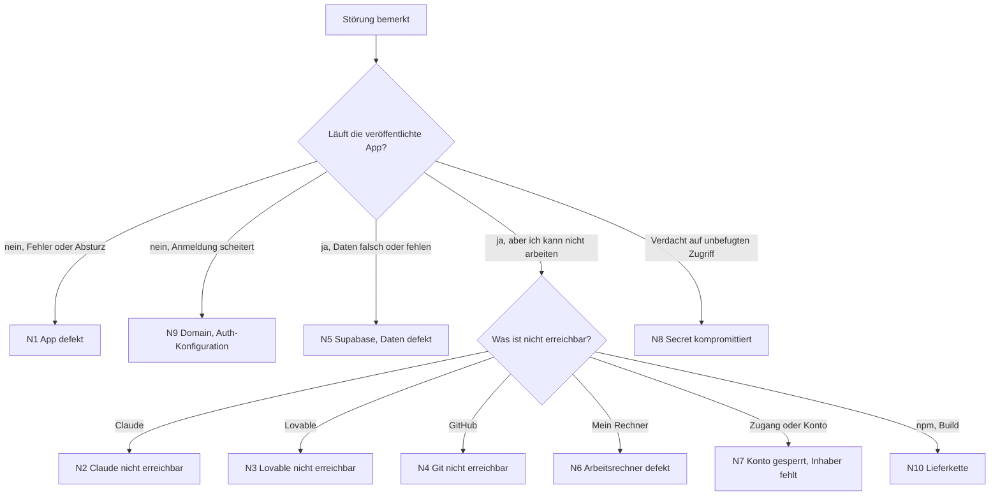
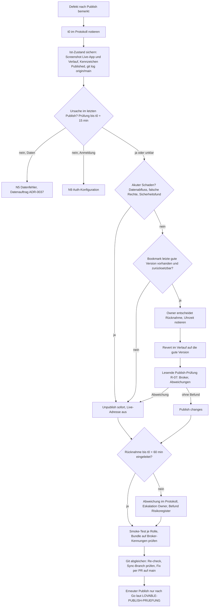

# Notfallhandbuch SysIng Dashboard

Stand: Entwurf 2026-11-03 · Verantwortlich: Owner · Grundlage: `STANDARD-ENTWURF-WIEDERHERSTELLBARKEIT.md` (Abschnitte 12 bis 14, Szenarien N1 bis N10, Risikobewertung, Bezug BSI-Standard 200-4)

Einordnung: Das Handbuch ist am Gedanken des [BSI-Standards 200-4](https://www.bsi.bund.de/DE/Themen/Unternehmen-und-Organisationen/Standards-und-Zertifizierung/IT-Grundschutz/BSI-Standards/BSI-Standard-200-4-Business-Continuity-Management/bsi-standard-200-4_Business_Continuity_Management_node.html) (Wiederanlauf- und Wiederherstellungspläne, Übungen, Notfallorganisation) ausgerichtet, ohne Anspruch auf Konformität und ohne Zertifizierungsziel. Es ist ein projektbezogener Teil und ersetzt kein Notfallmanagement der Organisation. Begriffszuordnung: Standard-Entwurf, Abschnitt 14.

Dieses Handbuch muss ohne Claude, ohne Chatverlauf und ohne Lovable-Zugang lesbar und ausführbar sein. Es gehört deshalb als Datei in Git (`docs/NOTFALL-HANDBUCH.md`) **und** als lokale Kopie außerhalb von OneDrive und GitHub (Notfallmappe, Abschnitt 4).

Kennzeichnung: „zu belegen“ steht bei jeder Aussage zu Plattformfunktionen (Lovable, Supabase), die im Projekt noch nicht durch ein Probe-Protokoll bestätigt ist. Diese Schritte erst nach der Bestätigung als sicher betrachten.

Keine Zugangsdaten, Schlüssel oder Passwörter in diese Datei schreiben. Sie stehen im Passwort-Tresor (Abschnitt 3).

## 1 Erste Hilfe: Was ist ausgefallen?



Grundregeln für jeden Notfall:

1. **Nicht überstürzt schreiben.** Vor jeder Wiederherstellung den aktuellen Zustand sichern (Dump, Bundle, Screenshot), auch wenn er fehlerhaft ist.
2. **Nichts löschen.** Insbesondere nie `audit_log` löschen und keine `lovable*`-, `backup/*`- oder `audit/*`-Branches.
3. **Keine Datenänderung am Live-System ohne Datenauftrag** nach ADR-0037 (zwei Freigaben, feste IDs, Rollback), außer im dokumentierten Notfall mit Begründung im Protokoll.
4. **Kein Publish im Notfall**, solange die Ursache nicht verstanden ist. Vorschlag A32 (Entscheidung des Owners offen): Ausnahme für den Rücknahme-Publish einer per Bookmark markierten, vorher veröffentlichten Version nach N1a.
5. **Protokoll führen:** Uhrzeit, Beobachtung, Maßnahme, Ergebnis. Vorlage Abschnitt 5.

## 2 Szenarien

### N1 App defekt

Symptome: Seite lädt nicht, weiße Seite, Fehlermeldungen, falsche Anzeige nach einem Publish.

Erste Stunde:

1. Prüfen, ob die Preview (Editor) dasselbe Verhalten zeigt wie die veröffentlichte App. Unterschied notieren.
2. Letzten Publish und letzte Änderungen im Git ansehen (`git log --oneline -20 origin/main`).
3. Eingrenzen: Codefehler (Fehler nur in der Oberfläche), Datenfehler (Werte falsch) oder Anmeldefehler (siehe N9).

Wiederherstellung:

- **Codefehler:** Rücknahme nach N1a (innerhalb von 60 Minuten eingeleitet: Unpublish oder Revert auf die zuletzt gute Version und erneuter Publish; Revert allein ändert die Live-App nicht; zu belegen, RB-01 ff.). Danach Fix per PR auf `main`, Re-check der Git-Seite in Lovable („In sync with GitHub“) und erneuter Publish nur nach Freigabe des Owners.
- **Datenfehler:** Weiter bei N5.

Rückkehr in den Normalbetrieb: Smoke-Test mit je einem Konto der Rollen Projektmanager, Teamleiter, Viewer; Cockpit und Dashboard öffnen.

### N1a Rücknahme eines Publish

Gilt, wenn ein Defekt nach N1 auf den letzten Publish zurückgeht (Codefehler in der veröffentlichten App). Datenfehler laufen über N5, Anmeldefehler über N9.

Entscheidungskriterium: Die Rücknahme **muss innerhalb von 60 Minuten** nach der Feststellung (Zeitpunkt t0 im Protokoll, Abschnitt 5) **eingeleitet** sein. Eingeleitet heißt: Unpublish ausgeführt **oder** Revert auf die zuletzt gute Version ausgeführt und „Publish changes“ ausgelöst. Wird t0 + 60 Minuten erreicht, ohne dass der Revert-Weg bereit ist, gilt Unpublish als Pflichtmaßnahme, sofern der Owner nicht dokumentiert anders entscheidet.

Plattformverhalten laut öffentlicher Lovable-Dokumentation (abgerufen 2026-11-07), **am Projekt zu belegen** (Belegplan RB-01 ff.):

- Publish liefert einen Schnappschuss der **aktuellen** Projektversion aus; spätere Änderungen gehen erst mit „Publish changes“ live ([Publish](https://docs.lovable.dev/features/publish), [Hosting](https://docs.lovable.dev/features/hosting)). Das deckt sich mit der Support-Aussage „kein Pinning auf Commit oder Branch“ (`docs/LOVABLE-PUBLISH-PRUEFUNG.md`).
- Eine Funktion „frühere Veröffentlichung wiederherstellen“ (Instant Rollback) ist nicht dokumentiert. Rücknahme heißt daher: Projektstand auf die gute Version zurücksetzen und erneut veröffentlichen.
- Revert im Verlauf (History) setzt nur den **Code** zurück und stellt Edge Functions passend neu bereit; Datenbankdaten und bereits ausgeführte Migrationen bleiben ([History](https://docs.lovable.dev/features/projects/history)). Ob die Neubereitstellung der Edge Functions die veröffentlichte App **vor** dem erneuten Publish trifft, ist zu belegen (RB-08).
- Die gerade veröffentlichte Version trägt im Verlauf das Kennzeichen „Published“. Versionsnummern gibt es nicht, Versionen erscheinen mit Datum. Sehr alte Versionen lassen sich ansehen, aber nicht mehr zurücksetzen („Cannot revert this far back in history“, Grenze nicht beziffert) ([History](https://docs.lovable.dev/features/projects/history)).
- Unpublish macht die Live-Adresse unerreichbar, das Projekt bleibt im Editor; Recht wie beim Publish ([Publish](https://docs.lovable.dev/features/publish)).
- GitHub: Ein Push oder Merge ändert die Live-App nicht; sie ändert sich nur mit einem Publish aus Lovable. Rücknahme über Git erfolgt mit einem Revert-Commit, kein Force-Push ([Git-Sync](https://docs.lovable.dev/integrations/git-sync-overview)). Ob ein Revert in Lovable einen Commit nach GitHub schreibt, ist nicht dokumentiert (RB-05).
- Datenbank (Lovable Cloud): tägliche Sicherung, etwa 14 Tage, kein Point-in-Time, Wiederherstellung unumkehrbar und mit Schema, wenige Minuten Ausfall ([Backups](https://docs.lovable.dev/features/database-backups)). Das ist **kein** Teil der Publish-Rücknahme, sondern N5 mit Datenauftrag nach ADR-0037.

#### Vorbereitung vor jedem Publish (Pflicht)

1. Die bisher veröffentlichte Version (Kennzeichen „Published“) mit Datum und Uhrzeit notieren und als Bookmark „Live bis JJJJ-MM-TT“ markieren.
2. Die neue Version nach dem Publish als Bookmark „Publish JJJJ-MM-TT, main <SHA>“ markieren.
3. Prüfen, dass die Rücknahme-Version nicht gegen ADR-0036 verstößt (Auth-Broker). Hinweis: Die am 2026-10-31 veröffentlichte Version 1.69.0 enthält den Broker; eine Rücknahme auf diesen Stand stellt den Verstoß wieder her und braucht eine dokumentierte Entscheidung des Owners.

#### Ablauf



#### Nach der Rücknahme

1. Git-Seite in Lovable prüfen (Re-check). Entstandene `lovable-sync-*`-Branches nicht mergen, nur lesen und im Tracker festhalten.
2. Den Fehler über einen PR auf `main` beheben (CI grün, Merge per REST). Danach Sync, Publish-Prüfung, Go des Owners.
3. Daten und Schema bleiben vom Revert unberührt. Hat der fehlerhafte Stand Daten geschrieben oder Migrationen ausgeführt: weiter bei N5.
4. Protokoll abschließen: t0, Uhrzeit Entscheidung, Uhrzeit Unpublish oder Publish, Dauer bis eingeleitet, Ergebnis Smoke-Test.

#### Belegplan RB (nur Wegwerfprojekt oder lesende Sicht, nie Produktion)

Voraussetzung: ein **neu angelegtes** Lovable-Wegwerfprojekt (kein Remix des Produktivprojekts), eigenes eingebautes Backend ohne echte Daten, für RB-05 und RB-06 ein privates Wegwerf-Repository außerhalb von `bmarnau/sysingdashboard`. Keine Produktiv-Secrets. Beleg je Schritt: Screenshot mit sichtbarem Datum und Uhrzeit, Versionsdatum aus dem Verlauf (Lovable hat keine Versionsnummern), sichtbare Markierung in der App (Text „Version A“ oder „Version B“), bei Git der Commit-SHA. Ablage im Nachweisregister `docs/NACHWEISE.yaml` (neue EV-Nummer).

```yaml
belegplan_ruecknahme:
  owner: Owner (Bernd)
  umgebung: Lovable-Wegwerfprojekt, nie Produktion
  schritte:
    - id: RB-01
      schritt: Wegwerfprojekt neu anlegen, Version A mit Text "Version A", Bookmark setzen, Publish
      beleg: Screenshot Verlauf mit Kennzeichen Published und Datum; Screenshot Live-Adresse mit "Version A"
      dauer_min: 15
    - id: RB-02
      schritt: Version B mit Text "Version B fehlerhaft", Publish changes
      beleg: Screenshot Verlauf (Published an B), Live-Adresse zeigt B
      dauer_min: 10
    - id: RB-03
      schritt: Revert auf Bookmark A, noch kein Publish
      beleg: Live-Adresse zeigt weiter B; Punkt am Publish-Button sichtbar; Verlauf zeigt Published weiter an B
      dauer_min: 10
    - id: RB-04
      schritt: Publish changes nach dem Revert; Zeit von Entscheidung bis Live-Anzeige A messen
      beleg: Screenshots mit Uhrzeit vor und nach; Messwert in Minuten (Ziel deutlich unter 60)
      dauer_min: 10
    - id: RB-05
      schritt: Wegwerfprojekt mit privatem Wegwerf-Repo verbinden, Version C, dann Revert auf B
      beleg: git log des Repos; entsteht ein Commit auf main, ein lovable-sync-Branch oder nichts
      dauer_min: 20
    - id: RB-06
      schritt: Rücknahme über Git, git revert auf main des Wegwerf-Repos pushen
      beleg: Commit-SHA; Lovable übernimmt; Live-Adresse ändert sich erst nach Publish
      dauer_min: 20
    - id: RB-07
      schritt: Unpublish, Live-Adresse prüfen, erneut Publish
      beleg: Screenshot Fehlerseite mit Uhrzeit; danach gleiche Adresse wieder erreichbar; Dauer
      dauer_min: 10
    - id: RB-08
      schritt: Tabelle und Edge Function in Version D, Datensatz anlegen, Revert auf C ohne Publish
      beleg: Datensatz und Spalte bleiben; Antwort der Edge Function vor dem Publish (Wirkung auf Live)
      dauer_min: 30
    - id: RB-09
      schritt: Revert auf eine alte Version versuchen (Grenze "Cannot revert this far back")
      beleg: Screenshot Tooltip und Alter der Version; nur beobachtbar, wenn ein alter Stand existiert
      dauer_min: 5
    - id: RB-10
      schritt: Produktivprojekt nur ansehen, Verlauf öffnen, keine Aktion
      beleg: Screenshot Kennzeichen Published (welche Version, Datum); Revert-Schaltfläche aktiv oder gesperrt
      dauer_min: 5
      hinweis: nur lesen, keine Klicks auf Revert oder Publish, nur nach Freigabe
  summe_min: 135
```

Gilt als belegt, wenn RB-01 bis RB-04 und RB-07 mit Beleg vorliegen und der Messwert aus RB-04 unter 60 Minuten liegt. RB-05, RB-06 und RB-08 klären das Verhältnis zu GitHub und zu den Edge Functions; bis dahin bleiben diese Punkte „zu belegen“. Danach REST-10 (Teil Rücknahme) im Standard und Lücke 7 in Abschnitt 6 aktualisieren.

### N2 Claude nicht mehr erreichbar

Wirkung: Keine Aufträge, Reviews, Dokupflege und Planung durch Claude. Die laufende App ist nicht betroffen.

Erste Stunde: Keine Hektik, die App läuft weiter.

Weiterarbeit allein aus Git:

1. Aktuellen Stand klonen oder aktualisieren: `git clone` bzw. `git pull origin main`.
2. Zum Wiederanlauf lesen: `CLAUDE.md`, `docs/CURRENT-STATUS.md`, `docs/GOLDEN-GATE-EXECUTION-TRACKER.yaml`, `docs/MERGE-CHECKLISTE-GOLDEN-GATE.md`, `docs/DOKU-PFLEGE-AUFTRAG.md`, `docs/L2-UMSETZUNGSPLAN.md`.
3. Prüfungen von Hand: `npm ci`, `npm run docs:check`, `npm run docs:project`, Tests und Lint nach `package.json`.
4. Merge nur per REST nach Checkliste (siehe `CLAUDE.md`), nur nach grünen CI-Checks.
5. Arbeit durch einen Menschen oder einen anderen Assistenten fortsetzen. Als Auftragsgrundlage dienen Tracker, ADRs und die Dateien `docs/AUFTRAG-*.md` und `docs/DATENAUFTRAG-*.md`.

Bekannte Lücken (REST-14): Auftragstexte U1 bis U7, die Planungsseite und das Projekt-Memory liegen nicht in Git. Bis zur Übernahme in Git gilt: Entscheidungen stehen im Tracker (`fortschritt`), Auftragsinhalte lassen sich aus den PR-Beschreibungen rekonstruieren.

### N3 Lovable nicht mehr erreichbar

Symptome: Editor, Preview oder Publish nicht erreichbar. Ob die veröffentlichte App weiterläuft, ist zu belegen.

Vorübergehend:

1. Lovable-Statusseite und Support prüfen, nicht publizieren.
2. In Git lokal weiterarbeiten und testen (`npm ci`, `npm run dev`, Tests). Änderungen nur per PR nach `main`. Der spätere Abgleich mit Lovable erfolgt über Re-check und Sync-Dialog (Auswahl „Repository-Version behalten“).

Dauerhaft:

1. Letzten bekannten Stand aus Git klonen.
2. App an anderer Stelle hosten (Container-Portabilität ist Architekturziel; **Runbook für das Zielhosting fehlt noch**).
3. Backend (Supabase) und Auth-Konfiguration neu anbinden, Rollenabnahme je Rolle (Stufe S5, S6 des Standards).

### N4 Git (GitHub) nicht mehr erreichbar

Wirkung: Keine PRs, kein CI, keine Merges, Lovable-Sync gestört.

1. Lokalen Klon verwenden. Er ist vollständig. Prüfen: `git status`, `git log --oneline -5`.
2. Offline-Stand sichern: `git bundle create ../sysingdashboard.bundle --all`, danach `git bundle verify ../sysingdashboard.bundle`, SHA-256 notieren.
3. Neuen Remote setzen (Mirror oder anderer Anbieter): `git remote add mirror <URL>` und `git push mirror --all`, dann `git push mirror --tags`.
4. Merges pausieren, bis CI wieder läuft. Tests lokal ausführen. Entscheidungen im Protokoll festhalten.
5. Nach Rückkehr von GitHub: Abgleich beider Remotes, Konflikte klären, Lovable erneut mit `main` abgleichen.

### N5 Supabase nicht erreichbar, Daten defekt oder fehlerhafte Migration

1. **Schreibzugriffe stoppen:** Nutzer informieren, keine Datenaufträge, kein Publish.
2. **Ist-Zustand sichern,** auch wenn er fehlerhaft ist (Dump nach Standard Weg W2).
3. Ursache eingrenzen: Migration, Datenauftrag oder Plattformproblem. Letzte Migrationen in `supabase/migrations/` ansehen.
4. **Wiederherstellung:**
   - Plattform-Backup oder Point-in-Time zum Zeitpunkt vor dem Fehler (Weg W4; Plan und Aufbewahrung zu belegen). Wiederherstellung bevorzugt in ein **neues** Projekt, nicht über den Ist-Stand.
   - Alternativ Dump aus der Notfallmappe (Weg W2) in ein leeres Backend importieren.
5. Nach der Wiederherstellung: Zeilenzahlen je Tabelle gegen das Backup-Protokoll prüfen, Audit-Tabellen vollständig, Rollenabnahme je Rolle (RLS darf nie weiter öffnen als im Betrieb).

### N6 Arbeitsrechner oder lokaler Klon defekt

1. Neuer Arbeitsordner **außerhalb von OneDrive** (zum Beispiel `C:\dev`).
2. `git clone` von GitHub oder Mirror, andernfalls Bundle einspielen: `git clone sysingdashboard.bundle sysingdashboard`.
3. Startdatei `start-sysingboard.ps1` aus der Notfallmappe holen (liegt noch nicht in Git, Backlog-Punkt).
4. `npm ci`, Tests, Anmeldung bei den Diensten über den Passwort-Tresor.

### N7 Kontoinhaber nicht verfügbar oder Konto gesperrt

Betrifft GitHub, Lovable, Supabase, Claude, Domain-Anbieter.

1. Zweite berechtigte Person oder Notfallzugang laut Kontenübersicht (Abschnitt 3) kontaktieren. **Derzeit ist nur eine Person eingetragen (Bus-Faktor 1), das ist eine offene Lücke.**
2. Gesperrte Konten beim jeweiligen Support melden, Ticketnummern im Protokoll festhalten.
3. Übergangsweise nur lesen und sichern (Bundle, Dump), nichts Neues veröffentlichen.

### N8 Secret kompromittiert oder Sicherheitsvorfall

1. Betroffene Zugänge **sofort rotieren** (Reihenfolge: Datenbank-Schlüssel, Auth-Schlüssel, GitHub-Token, Lovable- und Supabase-Zugang). Rotationsanleitung je Secret fehlt noch (REST-05).
2. Laufende Sitzungen ungültig machen, Rollenrechte und Konten prüfen.
3. `audit_log` sichern, nie löschen. Zeitfenster des Vorfalls dokumentieren.
4. Vorfall im Tracker festhalten, Meldepflichten (Datenschutz) prüfen. Rechtliche Bewertung ist nicht Teil dieses Handbuchs.

### N9 Domain, DNS, Zertifikat oder Auth-Konfiguration verloren

1. Symptome: Zertifikatswarnung, Anmeldung leitet falsch um, „Redirect URL“-Fehler.
2. Konfiguration aus dem Inventar (Stufe S2 und S5 des Standards) neu setzen: Domain, Redirect-URLs, Auth-Provider, Lovable-Verbindung.
3. Danach Anmeldung je Rolle prüfen. **Inventar S5 ist noch nicht dokumentiert.**

### N10 Lieferkette: npm-Registry oder Paket nicht verfügbar oder kompromittiert

1. `package-lock.json` ist der Maßstab, Build mit `npm ci`.
2. Bei Ausfall: Offline-Cache oder Mirror verwenden (**noch nicht eingerichtet**).
3. Bei Verdacht auf ein kompromittiertes Paket: Version sperren, Abhängigkeiten prüfen, Befund im Tracker festhalten, Build nicht publizieren, bis die Lage geklärt ist.

## 3 Konten und Zugänge (Vorlage ohne Werte)

| Dienst     | Zweck                               | Inhaber                                     | Zweite Person | Notfallzugang (Break-Glass) | Zugang im Tresor unter | Support-Weg                   |
| ---------- | ----------------------------------- | ------------------------------------------- | ------------- | --------------------------- | ---------------------- | ----------------------------- |
| GitHub     | Git, CI                             | Owner                                       | [offen]       | [offen]                     | [Eintrag]              | [Link]                        |
| Lovable    | Editor, Preview, Publish            | Owner                                       | [offen]       | [offen]                     | [Eintrag]              | Ticket im bestehenden Vorgang |
| Supabase   | Daten, Auth                         | [Lovable Cloud oder eigenes Projekt, offen] | [offen]       | [offen]                     | [Eintrag]              | [Link]                        |
| Claude     | Aufträge, Review                    | Owner                                       | [offen]       | [offen]                     | [Eintrag]              | [Link]                        |
| Domain/DNS | Erreichbarkeit                      | [offen]                                     | [offen]       | [offen]                     | [Eintrag]              | [Link]                        |
| TeamDrive  | Ablage von Backups und Notfallmappe | Owner                                       | [offen]       | [offen]                     | [Eintrag]              | [Link]                        |

## 4 Notfallmappe (lokale Kopie außerhalb von OneDrive und GitHub)

Inhalt, jeweils mit Datum und SHA-256:

- dieses Handbuch und der Standard-Entwurf,
- Git-Bundle des aktuellen `main` (`git bundle verify` bestanden),
- aktueller Datenbank-Dump (verschlüsselt) mit Zeilenzahlen je Tabelle,
- Startdatei `start-sysingboard.ps1`,
- Secret-Inventar (nur Namen und Fundort, keine Werte),
- Liste der Kontakte und Support-Wege.

Aktualisierung: nach jedem Release und mindestens einmal im Quartal. Das Datum der letzten Aktualisierung steht oben im Protokoll.

Ablage: Die Notfallmappe liegt in einem TeamDrive-Bereich (Entscheidung des Owners 2026-11-03: datenschutzkonformes Backupmedium) und zusätzlich als lokale Kopie auf einem Datenträger außerhalb von OneDrive. Regeln:

- Datenbank-Dumps vor dem Ablegen mit einem eigenen Schlüssel verschlüsseln. Der Schlüssel liegt im Passwort-Tresor, **nicht** im selben TeamDrive-Bereich.
- Der Notfallzugang zu TeamDrive muss auch von einem zweiten Gerät oder einer zweiten Person möglich sein (siehe N7).
- Versionierung oder schreibgeschützte Stände nutzen, damit ein fehlerhafter oder gelöschter Stand nicht alle Kopien überschreibt (zu belegen).
- Eignung nach Standard REST-15 belegen: Vertrag zur Auftragsverarbeitung, Serverstandort, Verschlüsselung, Zugriffs- und Löschkonzept.

## 5 Protokollvorlage für einen Notfall

| Zeit | Beobachtung | Maßnahme | Ergebnis | Verantwortlich |
| ---- | ----------- | -------- | -------- | -------------- |
|      |             |          |          |                |

Abschluss: Ursache, Dauer der Störung, Datenverlust (ja oder nein, Umfang), Folgemaßnahmen (Tracker, Backlog, Risikoregister).

## 6 Offene Lücken (Stand 2026-11-03)

1. Runbook für alternatives Hosting (N3) fehlt.
2. Zweite berechtigte Person für Konten: Rolle benennbar, Person offen; Notfallkonto (Break-Glass) fehlt (N7, REST-20, REST-21).
3. Rotationsanleitung je Secret fehlt (N8).
4. Auth-, Domain- und Hosting-Inventar (S5) fehlt (N9).
5. Offline-Cache oder Mirror für npm fehlt (N10).
6. Auftragstexte, Planungsseite und Startdatei liegen nicht in Git (N2, N6).
7. Plattformfunktionen (Rücksetzen, Supabase-Backup, Neuanbindung) sind nicht durch ein Probe-Protokoll belegt. Belegplan für die Rücknahme eines Publish: N1a, RB-01 bis RB-10.
8. Das Handbuch wurde noch nicht in einer Planübung (Tabletop) erprobt (REST-13).
9. Eignung und Konfiguration von TeamDrive als Ablagemedium (Vertrag, Standort, Versionierung, Rechte) sind nicht belegt (REST-15).
10. Bewertung der Szenarien und Schutzklassen ist ein Vorschlag und noch nicht vom Owner bestätigt (REST-16, REST-17).
11. Trennung von Test-, Probe- und Produktivumgebung ist nicht belegt (REST-22; abhängig von R-10).
12. Wiederherstellungsadresse der Konten und Verfügbarkeit des Postfachs sind nicht dokumentiert (N9).

## 7 Risikobewertung und Kontenregeln

**Bewertung der Szenarien (Vorschlag, vom Owner zu bestätigen).** Skala 1 bis 3, Score = Eintritt × Auswirkung; ab 6 hoch, 3 bis 4 mittel, bis 2 niedrig. Szenarien der Stufe hoch brauchen ein Runbook und eine halbjährliche Planübung.

| ID  | Szenario                           | Eintritt (1–3) | Auswirkung (1–3) | Score | Stufe   | Folge                                   |
| --- | ---------------------------------- | -------------- | ---------------- | ----- | ------- | --------------------------------------- |
| N1  | App defekt                         | 3              | 2                | 6     | hoch    | Runbook und Planübung Pflicht           |
| N2  | Claude nicht erreichbar            | 2              | 2                | 4     | mittel  | Runbook, Planübung jährlich             |
| N3  | Lovable nicht erreichbar           | 2              | 3                | 6     | hoch    | Runbook und Planübung Pflicht           |
| N4  | Git nicht erreichbar               | 1              | 3                | 3     | mittel  | Runbook, Planübung jährlich             |
| N5  | Supabase, Daten, Fehlmigration     | 2              | 3                | 6     | hoch    | Runbook und Planübung Pflicht           |
| N6  | Arbeitsrechner defekt              | 2              | 2                | 4     | mittel  | Runbook, Planübung jährlich             |
| N7  | Kontoinhaber fehlt, Konto gesperrt | 2              | 3                | 6     | hoch    | Runbook und Planübung Pflicht           |
| N8  | Secret kompromittiert              | 2              | 3                | 6     | hoch    | Runbook und Planübung Pflicht           |
| N9  | Domain, DNS, Auth-Konfiguration    | 1              | 3                | 3     | mittel  | Runbook, Planübung jährlich             |
| N10 | Lieferkette (npm)                  | 1              | 2                | 2     | niedrig | Beschreibung genügt, Verzicht begründen |

**Kontenregeln:**

1. Je kritischem Dienst muss es zwei voneinander unabhängige Zugangswege geben: eine zweite berechtigte Person (Rolle benennbar, Person noch offen) **und** ein Notfallkonto, solange die zweite Person fehlt. Derzeit besteht nur ein Zugang (Bus-Faktor 1).
2. Das Notfallkonto liegt getrennt vom Alltagszugang: anderer Tresor, anderes Gerät, andere Wiederherstellungsadresse, anderer zweiter Faktor. Jede Nutzung wird im Protokoll (Abschnitt 5) vermerkt, danach werden Passwörter und Schlüssel erneuert.
3. Die E-Mail-Adresse zur Kontenwiederherstellung darf nicht die einzige sein; Ausfall von Postfach oder Domain trifft sonst alle Konten gleichzeitig (N9).
4. Test, Probe und Produktion verwenden getrennte Konten, Schlüssel und Secrets. Eine Restore-Probe nutzt nie einen Produktivschlüssel.
