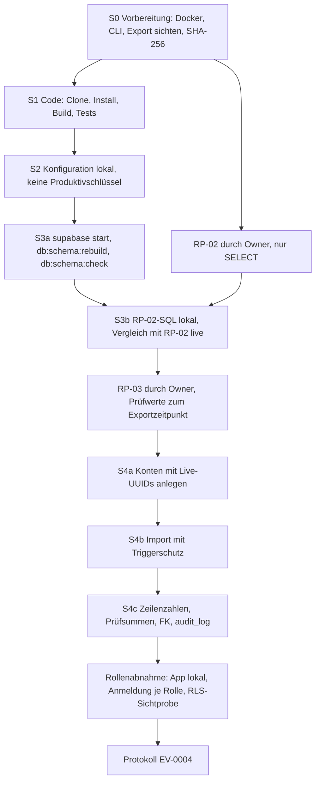
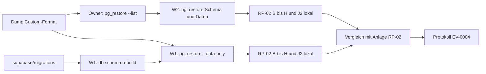

# Plan: lokale Restore-Probe im Docker-Container (Minimalprobe S1 bis S4)

Stand: 2026-11-07, 07:10 +01:00. Auftrag A30 (Warteschlange `ops/queue`), Entwurf durch Claude Code; Nachtrag A30/A38 mit Abnahmekriterien aus RP-02 in Abschnitt 15.
Status: **Entwurf, keine Freigabe. RP-02 ist ausgeführt (Owner, 2026-11-07 05:44 bis 05:45 +01:00); die Probe selbst ist nicht ausgeführt.** Code und Skripte entstehen erst nach Freigabe durch den Owner (Abschnitt 13).

Grundlage: Owner-Entscheidung D1 und D1a vom 2026-11-06 (`queue/A30.yaml`, Feld `ziel`), `docs/standards/STANDARD-WIEDERHERSTELLBARKEIT.md` (REST-04, REST-06, REST-07, REST-11, REST-22, Stufen S1 bis S6, Abschnitt 8), `docs/ADR/0037-kontrollierte-datenauftraege.md`, ADR-0042 (Entwurf, Proposed, Branch `docs/2026-11-06-tagesbuendel`), `docs/NOTFALL-HANDBUCH.md` (Branch `docs/2026-11-06-tagesbuendel`), `docs/NACHWEISE.yaml` (EV-0004), Datenaufträge RP-01 und RP-02 (`docs/DATENAUFTRAG-RESTORE-PROBE.md`).

## 1 Ziel

| Punkt       | Festlegung                                                                                                                                                                                                                        |
| ----------- | --------------------------------------------------------------------------------------------------------------------------------------------------------------------------------------------------------------------------------- |
| Zielzustand | Eine lokale, leere Supabase-Umgebung im Docker-Container wird aus Git (Schema) und aus einem Lese-Export (Daten) aufgebaut. Schema und Daten stimmen nachweisbar mit der Live-Datenbank überein, die App meldet sich je Rolle an. |
| Nachweis    | Probe-Protokoll nach Standard Abschnitt 8, Eintrag EV-0004 in `docs/NACHWEISE.yaml` (Abschnitt 11).                                                                                                                               |
| Gate        | G03 (R-14) vor dem ersten Publish. Der Standard verlangt vor dem ersten Publish S1 bis S6 (`STANDARD-WIEDERHERSTELLBARKEIT.md:59`, `:194`); diese Probe deckt S1 bis S4 und einen Teil von S6 ab.                                 |
| Ausführung  | Datenaufträge (RP-02, RP-03) führt der Owner über den Lovable-Connector aus. Claude Code führt keinen Datenauftrag aus und berührt die Produktion nicht.                                                                          |

## 2 Abgrenzung

- Die Probe muss vollständig lokal laufen. Sie darf keinen Produktivschlüssel verwenden (REST-22) und keine Verbindung zur Live-Datenbank aufbauen.
- **S5 (Auth-Provider, Redirect-URLs, Domain, Hosting, Lovable-Verbindung) ist lokal nicht belegbar** und bleibt eine dokumentierte Lücke. Das Inventar S5 fehlt (`NOTFALL-HANDBUCH.md:135`, `:187`).
- S6 wird nur teilweise abgedeckt: Anmeldung je Rolle und Rollenabnahme lokal, ohne E2E-Hauptpfade gegen eine veröffentlichte Umgebung.
- Storage ist nicht Gegenstand: RP-01 meldet 0 Buckets und 0 Objekte.
- Kein Publish, kein Merge, keine Schemaänderung an der Live-Datenbank.

## 3 Ausgangslage (belegt)

| Merkmal                          | Wert                                                                                                                                                                                                                                                                 | Beleg                                                                                 |
| -------------------------------- | -------------------------------------------------------------------------------------------------------------------------------------------------------------------------------------------------------------------------------------------------------------------- | ------------------------------------------------------------------------------------- |
| Live-Version                     | PostgreSQL 17.6, Lovable-Anzeige 17.6.1.147, Region Europa (Irland)                                                                                                                                                                                                  | RP-01, 2026-11-06 19:21 bis 19:23 +01:00                                              |
| Erweiterungen live               | pg_stat_statements 1.11, pgcrypto 1.3, plpgsql 1.0, supabase_vault 0.3.1, uuid-ossp 1.1                                                                                                                                                                              | RP-01                                                                                 |
| Objektzahlen live (`public`)     | 25 Tabellen, 302 Spalten, 66 FK, 21 Unique, 41 Check, 74 Indizes, 41 Trigger, 41 Funktionen, 65 Policies, RLS auf 25 Tabellen, kein FORCE RLS, Enums 8 und 4                                                                                                         | RP-01                                                                                 |
| Objektzahlen Git-Snapshot        | 25 Tabellen, 302 Spalten, 66 FK, 21 Unique, 41 Check, 74 Indizes (23 + 5 + 25 PK + 21 Unique), 41 Trigger, 41 Funktionen, 65 Policies, 25 × RLS, Enums 8 und 4                                                                                                       | Zählung in `supabase/schema/public-schema.sql` auf main `7dc4699d`                    |
| Zeilen live (Auszug)             | profiles 9, user_roles 9, auth.users 9, audit_log 336, shared_activity_projection 47, shared_work_package_projection 20, shared_project_projection 5                                                                                                                 | RP-01                                                                                 |
| Migrationshistorie               | 30 Einträge live (10 mit `statements` NULL), 33 Dateien im Repo; 4 nur im Repo, 1 nur live                                                                                                                                                                           | RP-01 (Feld `eingaenge`)                                                              |
| Datenexport                      | Über Lovable „Export data“ am 2026-11-06 ausgelöst (Datei 19:06 +01:00): `sysingdashboard_261106.backup.zip` mit einem Eintrag `sysingdashboard_261106.backup` (664586 Bytes), Dateikopf `PGDMP` = pg_dump Custom-Format; Inhalt (u. a. Schema `auth`) nicht gelesen | Angabe Owner (`queue/A30.yaml`, Feld `eingaenge`); Inhalt zu belegen (Abschnitt 15.5) |
| Struktur und Prüfwerte live      | RP-02 vollständig, nur SELECT, 2026-11-07 05:44 bis 05:45 +01:00; Soll-Werte Abschnitt 15.1                                                                                                                                                                          | Anlage `queue/anlagen/RP-02-ergebnis-2026-11-07.md` (Branch `ops/queue`)              |
| FK von `public` auf `auth.users` | 19 Fremdschlüssel                                                                                                                                                                                                                                                    | `public-schema.sql`, `REFERENCES "auth"."users"`                                      |
| Trigger auf `auth.users`         | `on_auth_user_created` (AFTER INSERT) ruft `public.handle_new_user()`; legt Profil, Rolle (erstes Konto `systemadministrator`, sonst `viewer`) und eine Zeile `audit_log` an                                                                                         | `supabase/migrations/20260717041306_…sql:187`, `public-schema.sql:1434`               |

**Befund:** Alle neun Objektzahlen aus RP-01 stimmen mit dem aus den Git-Migrationen erzeugten Snapshot überein. Das ist ein starkes Indiz, aber kein Nachweis der Gleichheit; Definitionen (Funktionskörper, Policies, Defaults) prüft erst RP-02 über Prüfsummen.

## 4 Umgebung und Image-Wahl

### 4.1 Optionen

| Option | Umgebung                                                                                                                 | Vorteile                                                                                                                                                                                             | Nachteile                                                                                                                                                                                                                                                        |
| ------ | ------------------------------------------------------------------------------------------------------------------------ | ---------------------------------------------------------------------------------------------------------------------------------------------------------------------------------------------------- | ---------------------------------------------------------------------------------------------------------------------------------------------------------------------------------------------------------------------------------------------------------------- |
| A      | Supabase CLI lokal (`supabase start`), Image `supabase/postgres` in der vom CLI gewählten Version, CLI 2.117.0 wie in CI | Auth-Schema, GoTrue (Anmeldung), PostgREST (App-Zugriff), Rollen `anon`, `authenticated`, `service_role`, `supabase_vault`; identisch zum CI-Job „Database Schema Drift“; vorhandene Skripte nutzbar | Image-Tag folgt der CLI-Version; ob 2.117.0 genau 17.6.1.147 zieht, ist zu belegen. Mehrere Container, mehr Speicher                                                                                                                                             |
| B      | Reines `postgres:17`                                                                                                     | Ein Container, schnell, Version frei wählbar                                                                                                                                                         | Kein Schema `auth`, keine Funktion `auth.uid()`, keine Rollen `anon`/`authenticated`/`service_role`, kein `supabase_vault`. Migrationen laufen nur mit handgebauten Stubs. Keine Anmeldung, keine Rollenabnahme. Erfüllt REST-06 („neues, leeres Backend“) nicht |
| C      | Einzelcontainer `supabase/postgres:17.6.1.147` ohne CLI-Stack                                                            | Exakter Tag wählbar, Rollen und Erweiterungen vorhanden                                                                                                                                              | Ohne GoTrue und PostgREST keine Anmeldung; ob das Schema `auth` ohne GoTrue angelegt ist, ist zu belegen. Nur für S3/S4 tauglich                                                                                                                                 |

### 4.2 Empfehlung

Option A muss die Basis sein. Begründung: Nur der vollständige lokale Stack liefert Auth, API und Rollen, ohne die weder die Migrationen unverändert laufen noch die Rollenabnahme möglich ist. Option A entspricht dem CI-Job, der dieselben Migrationen bei jedem Push und Pull Request auf `main` aufbaut (Abschnitt 5).

Versionsregel:

- Die Hauptversion muss 17 sein. `supabase/config.toml` enthält nur `project_id` und keinen Abschnitt `[db]` mit `major_version`; die CLI-Vorgabe gilt. Welche Version CLI 2.117.0 dann startet, ist zu belegen (Ausgabe `select version()` und `docker ps` im Protokoll).
- Der genaue Tag sollte 17.6.1.147 sein. Weicht der Tag ab, muss das Protokoll beide Tags nennen; eine Abweichung innerhalb 17.6.x gilt als zulässig mit Vermerk, eine Abweichung der Neben- oder Hauptversion als Abweichung mit Auflage.
- Ob sich der Tag über eine lokale Datei `supabase/.temp/postgres-version` festlegen lässt, ohne `supabase link` (der Produktivzugang bräuchte), ist zu belegen. `supabase link` ist für die Probe verboten (REST-22).
- Der tatsächlich in CI genutzte Image-Tag steht im Log des Schritts „Start local Supabase“ und sollte als kostenloser Vorab-Beleg gelesen werden.

Option C bleibt Rückfall, falls Option A keine Version 17.6.x startet; dann deckt die Probe S3 und S4 ab, die Rollenabnahme entfällt und wird als Abweichung geführt.

### 4.3 Rechner

Docker Desktop mit WSL 2 auf dem Owner-Rechner, Arbeitsverzeichnis außerhalb von OneDrive (`C:\dev\restore-probe`). Supabase CLI 2.117.0, Bun und Node in den Versionen aus `.github/workflows/ci.yml`. Mindestens 8 GB freier Arbeitsspeicher für den Stack (Schätzung, zu belegen).

## 5 Vorhandene Werkzeuge

| Werkzeug                                                                  | Leistung                                                                                           | Deckt ab                            | Fehlt für die Probe                                                                  |
| ------------------------------------------------------------------------- | -------------------------------------------------------------------------------------------------- | ----------------------------------- | ------------------------------------------------------------------------------------ |
| `npm run db:schema:rebuild` (`supabase db reset --local --no-seed`)       | Baut die lokale Datenbank aus `supabase/migrations` neu auf                                        | S3 Aufbau                           | Nichts; nur lokal, `--local` ist gesetzt                                             |
| `npm run db:schema:snapshot` (`supabase db dump --local --schema public`) | Schreibt `supabase/schema/public-schema.generated.sql` (nicht eingecheckt, `.gitignore`)           | S3 Struktur lokal                   | Kein Live-Gegenstück; Live-Dump ist ohne Produktivzugang nicht möglich               |
| `npm run db:schema:check` (`scripts/database-schema/check-drift.mjs`)     | Vergleicht Snapshot und Typen mit den kanonischen Dateien, fail-closed                             | Reproduzierbarkeit Git-Schema       | Vergleich mit Live; laut `supabase/schema/README.md` ausdrücklich kein Live-Nachweis |
| CI-Job „Database Schema Drift“ (`ci.yml`, `db_schema`)                    | `supabase start`, Rebuild, neun DB-Vertragstests, Snapshot, Typen, Drift-Prüfung, Artefakt 14 Tage | S3 Aufbau aus Git je CI-Lauf belegt | Daten, Auth-Konten, Live-Vergleich                                                   |
| `supabase/tests/*.sql`                                                    | Vertragstests für RLS und Rollen; Muster zum Anlegen von `auth.users` mit festen IDs               | Muster für Konten (S4/S6)           | Schreiben Testdaten; nur auf einer separat neu aufgebauten Instanz laufen lassen     |
| Playwright (`npm run test:e2e`, `e2e/`)                                   | E2E- und API-Smoke-Tests                                                                           | S6 teilweise, optional              | Konfiguration gegen lokale URL und Probe-Konten, zu prüfen                           |

Fehlt und muss nach Freigabe entstehen (Abschnitt 13, Folgeauftrag):

1. Katalog-Abfragen von RP-02 als feste SQL-Datei, die live (über den Connector) und lokal (über `psql`) wörtlich gleich läuft. Ohne denselben SQL-Text sind die Prüfsummen nicht vergleichbar.
2. Vergleichsskript: Ergebnis RP-02 live gegen Ergebnis lokal, Ausgabe Unterschiede je Teil.
3. Import-Skript für den Lese-Export (Format nach Sichtung, Abschnitt 6) mit Triggerschutz und FK-Reihenfolge.
4. Konten-Skript: 9 `auth.users` mit den Live-UUIDs, Probe-Adressen und lokalen Testkennwörtern, die nicht in Dateien stehen.
5. RLS-Sichtprobe je Rolle (Zeilenzahlen sichtbar je Tabelle unter `authenticated` mit gesetzter `sub`) als SQL.

## 6 Eingänge

| Eingang     | Quelle                                                                             | Verwendung                       | Status                                                                              |
| ----------- | ---------------------------------------------------------------------------------- | -------------------------------- | ----------------------------------------------------------------------------------- |
| Schema      | `supabase/migrations` auf dem geprüften Commit (heute main `7dc4699d`)             | S3 Aufbau                        | vorhanden                                                                           |
| Schema live | RP-02 (Katalog und Prüfsummen, ohne Werte)                                         | S3 Vergleich                     | ausgeführt 2026-11-07, Anlage `RP-02-ergebnis-2026-11-07.md`                        |
| Daten       | Lovable „Export data“ unter `C:\dev\restore-probe` (pg_dump Custom-Format)         | S4 Import                        | Format belegt (`PGDMP`); Inhalt per `pg_restore --list` zu belegen (Abschnitt 15.5) |
| Prüfwerte   | RP-02 Teil J2 (Zeilenzahl, md5 je Tabelle, Stand 05:45:08 +01:00); RP-03 (Entwurf) | S4 Abnahme                       | J2 liegt vor; RP-03 offen                                                           |
| Auth-Konten | RP-03 Teil C (IDs und Metadaten ohne E-Mail und Hash)                              | Konten neu anlegen (Abschnitt 8) | offen                                                                               |

Die Migrationshistorie weicht ab (4 Dateien nur im Repo, 1 Eintrag nur live, 10 Einträge ohne `statements`). Das Schema darf deshalb nicht allein mit dem Aufbau aus `supabase/migrations` als gleich gelten; Gleichheit muss über RP-02 belegt werden.

## 7 Ablauf



## 8 Auth-Konten

**Empfehlung: Die 9 Konten müssen in der Probe neu angelegt werden, mit denselben UUIDs wie live, aber ohne Passwort-Hashes aus der Produktion.**

Begründung:

- 19 Fremdschlüssel in `public` zeigen auf `auth.users(id)`. Konten mit neuen UUIDs würden den Import von `audit_log`, `profiles`, `user_roles` und weiteren Tabellen brechen. Die UUIDs müssen deshalb übernommen werden.
- Passwort-Hashes sind Geheimnisse. Ihr Export verstößt gegen REST-22 (keine Produktivschlüssel in der Probe) und gegen RP-02 („keine Passwort-Hashes“). Ob sie über den Connector technisch lesbar wären, ist zu belegen, aber nicht anzustreben.
- E-Mail-Adressen sollten in der Probe durch Probe-Adressen ersetzt werden (Muster `<rolle>-<n>@probe.invalid`, wie in `supabase/tests`). `profiles.email` und `profiles.phone` werden beim Import entsprechend ersetzt, falls der Export sie enthält.

Ablauf (nach Freigabe als Skript):

1. Vor dem Import `auth.users` mit den 9 Live-UUIDs, Probe-Adressen, `aud`/`role` = `authenticated` und den Metadaten aus RP-03 Teil C anlegen, **während der Trigger `on_auth_user_created` nicht feuert** (Abschnitt 9, Triggerschutz). Sonst entstehen 9 zusätzliche Zeilen in `audit_log`, Standardrollen in `user_roles` und Profile, die mit dem Import kollidieren.
2. Kennwörter lokal setzen, über die lokale Auth-Admin-Schnittstelle (lokaler Service-Schlüssel aus `supabase status`, kein Produktivschlüssel) oder über `crypt()` mit `gen_salt('bf')`. Ob für die Anmeldung zusätzlich `auth.identities` je Konto nötig ist, ist zu belegen. Kennwörter stehen in keiner Datei; der Owner gibt sie zur Laufzeit ein.
3. Rollen kommen aus dem Import von `user_roles` (9 Zeilen) und `profiles` (9 Zeilen, Status `user_status`), nicht aus dem Trigger.

## 9 Stufen und Abnahmekriterien

| Stufe     | Schritte                                                                                                                                                                                                                                                                          | Abnahmekriterium (muss)                                                                                                                                                                                                                                                                                                                                             | Dauer (Schätzung) |
| --------- | --------------------------------------------------------------------------------------------------------------------------------------------------------------------------------------------------------------------------------------------------------------------------------- | ------------------------------------------------------------------------------------------------------------------------------------------------------------------------------------------------------------------------------------------------------------------------------------------------------------------------------------------------------------------- | ----------------- |
| S0        | Docker Desktop und CLI 2.117.0 bereit; Export sichten: Dateiliste, Format, Größe, SHA-256 (`Get-FileHash`); Ablage verschlüsselt (Abschnitt 12, R4)                                                                                                                               | Dateiliste mit SHA-256 im Protokoll; Format bestimmt; Export enthält alle 25 Tabellen oder die Lücke ist benannt                                                                                                                                                                                                                                                    | 1–3 h             |
| S1        | Frischer Clone des geprüften Commits in leeres Verzeichnis, `bun install --frozen-lockfile`, `npm run build`, `npm test`                                                                                                                                                          | Build und Tests ohne Fehler; Commit-SHA und CI-Lauf des Commits grün                                                                                                                                                                                                                                                                                                | 0,5–1 h           |
| S2        | `.env.local` nur mit lokalen Werten aus `supabase status`; Abgleich gegen Secret-Inventar (`docs/ZUGAENGE-UND-NOTFALLKONTO.md`, ohne Werte)                                                                                                                                       | `VITE_SUPABASE_URL` zeigt auf `127.0.0.1`; kein Produktivschlüssel; fehlende Inventarposten benannt                                                                                                                                                                                                                                                                 | 0,5 h             |
| S3        | `supabase start`, `npm run db:schema:rebuild`, `db:schema:snapshot`, `db:schema:check`; RP-02-SQL lokal ausführen und mit RP-02 live vergleichen                                                                                                                                  | `DATABASE_SCHEMA_DRIFT: NONE`; Objektzahlen = RP-01; RP-02 Teile A bis I ohne Unterschied oder jeder Unterschied einzeln bewertet; A1 bis A10 für die vier Repo-Migrationen „vorhanden“ mit gleichen Prüfsummen; Version und Image-Tag im Protokoll                                                                                                                 | 2–7 h             |
| S4        | Konten anlegen (Abschnitt 8); Import in einer Transaktion in FK-Reihenfolge mit Triggerschutz (`session_replication_role = replica`, falls die lokale Rolle das darf, sonst `ALTER TABLE … DISABLE TRIGGER USER` je Tabelle); danach Trigger wieder an; Waisenprüfung aller 66 FK | Zeilenzahl je Tabelle = Exportstand (RP-03 Teil D); Prüfsumme je Tabelle = RP-03 Teil D; `audit_log` mit gleicher Zeilenzahl (RP-01: 336, Exportstand maßgeblich) und gleicher Prüfsumme einschließlich `payload`; keine zusätzliche Zeile in `audit_log` durch den Import; 0 verwaiste FK; `auth.users` = 9 mit Live-UUIDs; 3 Stichproben je Kerntabelle feldweise | 5–12 h            |
| S6 (Teil) | App lokal (`npm run dev`) gegen die Probe; Anmeldung je Konto; Sicht je Rolle nach `docs/RBAC-MATRIX.md`; RLS-Sichtprobe je Rolle als SQL                                                                                                                                         | Anmeldung für alle 9 Konten; je Rolle sichtbare Zeilen entsprechen der Erwartung (z. B. `viewer` ohne Beträge, `kiosk` nur `/kiosk`); keine Rolle sieht mehr als im Betrieb (REST-11)                                                                                                                                                                               | 1–3 h             |
| Protokoll | Protokoll nach Abschnitt 11, EV-0004 fortschreiben, Export nach Löschfrist löschen                                                                                                                                                                                                | Protokoll im Git, Beleg im Tracker                                                                                                                                                                                                                                                                                                                                  | 1 h               |

Die Abnahmekriterien für S3 und S4 sind seit RP-02 konkret: Abschnitt 15.3 ist für S3 und S4 maßgeblich und ersetzt die allgemeinen Kriterien oben, soweit sie sich widersprechen.

Hinweise zu S4:

- Prüfsummen sind nur vergleichbar, wenn live und lokal derselbe SQL-Text und dieselben Sitzungseinstellungen gelten (`TimeZone`, `DateStyle`, `IntervalStyle`, `extra_float_digits`, Sortierung). RP-02 und RP-03 müssen diese Werte ausgeben (Änderungsvorschläge, Abschnitt 10).
- Liegen zwischen Export (2026-11-06 abends) und RP-03 Anmeldungen oder Änderungen, weichen Zeilenzahlen ab, besonders in `audit_log`. RP-03 sollte deshalb direkt nach einem erneuten Export laufen, ohne Anmeldungen dazwischen; Teil D liefert zusätzlich den jüngsten Zeitstempel je Tabelle.
- Die DB-Vertragstests in `supabase/tests` schreiben Testdaten. Sie dürfen nicht auf der Probe-Datenbank mit importierten Daten laufen, sondern nur auf einer separat neu aufgebauten Instanz.

## 10 Prüfung von RP-02

Ergebnis: Der Auftragstext ist **lesend** (nur SELECT, Abbruchregel bei Schreiben) und **ohne Geheimnisse** (keine E-Mail-Adressen, Hashes, Tokens, `app_settings`-Werte; nur Prüfsummen von Definitionen und Zeilen). Er ist für den Strukturvergleich **weitgehend vollständig**, hat aber Lücken bei Reproduzierbarkeit, Zielbindung und Auth. Die Anlage `queue/anlagen/RP-02-datenauftrag.txt` bleibt unverändert; die Vorschläge gelten für eine Fassung RP-02a, falls der Owner sie freigibt.

| Nr.  | Befund                                                                                                                                                                                                              | Vorschlag                                                                                                                                                                                                      | Gewicht |
| ---- | ------------------------------------------------------------------------------------------------------------------------------------------------------------------------------------------------------------------- | -------------------------------------------------------------------------------------------------------------------------------------------------------------------------------------------------------------- | ------- |
| V-01 | Der Connector formuliert die SQL selbst. Ohne den SQL-Text lässt sich keine Prüfsumme lokal nachrechnen.                                                                                                            | Je Teil die verwendete SQL-Anweisung im Wortlaut ausgeben lassen; besser: feste SQL-Datei vorgeben, die auch lokal läuft.                                                                                      | hoch    |
| V-02 | Zielbindung nach ADR-0037 Nr. 2 fehlt.                                                                                                                                                                              | Teil 0: Lovable-Projekt-ID (wie im Connector angezeigt), `current_database()`, `current_user`, `version()`, letzte Version in `supabase_migrations.schema_migrations`, Zeilenzahl `profiles`, `now()`.         | hoch    |
| V-03 | Prüfsummen hängen von Sitzungseinstellungen ab (`to_jsonb` von `timestamptz` nutzt `TimeZone`; Sortierung von Text nutzt die Kollation).                                                                            | In Teil 0 `TimeZone`, `DateStyle`, `IntervalStyle`, `extra_float_digits`, `lc_collate` ausgeben; Sortierung mit `COLLATE "C"`.                                                                                 | hoch    |
| V-04 | J1 schließt alle `json`/`jsonb`-Spalten aus. Damit fehlen `audit_log.payload`, `reference_value.attributes` und `reference_value_history.snapshot` in der Prüfsumme; „audit_log vollständig“ ist so nicht belegbar. | Nur `app_settings.value` ausschließen. `jsonb::text` ist kanonisch; die Ausgabe ist nur ein md5, kein Wert. Alternativ J3: eigene md5 je Tabelle nur über die jsonb-Spalten.                                   | hoch    |
| V-05 | Schema `auth` fehlt ganz; für 19 FK auf `auth.users` und für das Neuanlegen der Konten nötig.                                                                                                                       | Teil L: Anzahl `auth.users`, md5 der sortierten ID-Liste, Anzahl je `aud`/`role`, bestätigt, gesperrt, gelöscht, `is_anonymous`, `is_sso_user`; Anzahl `auth.identities` je Provider. Keine E-Mail, kein Hash. | mittel  |
| V-06 | Teil F nur für `public`. Der Trigger `on_auth_user_created` liegt auf `auth.users`.                                                                                                                                 | F um Trigger mit `tgisinternal = false` auf `auth.users` ergänzen.                                                                                                                                             | mittel  |
| V-07 | Kein gemeinsamer Snapshot (J2 weist darauf hin).                                                                                                                                                                    | Alle Teile in einer Transaktion `BEGIN ISOLATION LEVEL REPEATABLE READ READ ONLY` ausführen, falls der Connector das kann (zu belegen); das sichert zugleich „nur lesen“ technisch ab.                         | mittel  |
| V-08 | Enum-Werte und Reihenfolge fehlen (RP-01 nennt nur Anzahl).                                                                                                                                                         | Teil M: `enum_range` für `app_role` und `user_status`.                                                                                                                                                         | niedrig |
| V-09 | Teil G ohne Kennzeichen permissive/restrictive.                                                                                                                                                                     | Spalte `permissive` ergänzen.                                                                                                                                                                                  | niedrig |
| V-10 | Teil I liefert laut Git-Snapshot 0 Zeilen (keine Sequenzen, keine Identitätsspalten).                                                                                                                               | Beibehalten als Bestätigung; erwartetes Ergebnis „0 Zeilen“ in den Text aufnehmen.                                                                                                                             | niedrig |
| V-11 | Views und materialisierte Views werden nicht abgefragt (Git-Snapshot: 0).                                                                                                                                           | Zählung in Teil 0 aufnehmen.                                                                                                                                                                                   | niedrig |
| V-12 | Migrationshistorie nur in RP-01 erfasst.                                                                                                                                                                            | Optional Teil N: `version`, `name`, `statements IS NULL`, md5(`statements`) je Eintrag.                                                                                                                        | niedrig |
| V-13 | Teil B hat 302 Zeilen, also 3 Blöcke.                                                                                                                                                                               | Erwartete Zeilenzahl je Teil nennen (B 302, C 25 PK + 66 + 21 + 41, D 74, E 41, F 41, G 65, H 75 bei 3 Rollen), damit Kürzungen auffallen.                                                                     | niedrig |

Nachtrag 2026-11-07: RP-02 lief in der ursprünglichen Fassung, nicht als RP-02a. V-01 (SQL-Text), V-02 (Zielbindung), V-03 (Sitzungseinstellungen) und V-04 (`jsonb` in J2) sind damit nicht umgesetzt; die Folgen für die Abnahme stehen in Abschnitt 15.6. H lieferte 59 statt der in V-13 angenommenen 75 Zeilen, weil `anon` nur auf 9 von 25 Tabellen Rechte hat (Abschnitt 15.1).

## 11 Protokollvorlage EV-0004

Das Protokoll muss die Inhalte aus Standard Abschnitt 8 enthalten. Vorlage für `docs/NACHWEISE.yaml` (Werte in spitzen Klammern ersetzen):

```yaml
- id: EV-0004
  titel: Restore-Probe lokal, Minimalprobe S1 bis S4 mit Rollenabnahme
  datum: <JJJJ-MM-TT>
  umgebung: lokal, Docker Desktop <Version>, Supabase CLI 2.117.0, Image supabase/postgres:<Tag>
  version: main <Commit-SHA>
  bezug: [REST-06, REST-07, REST-11, S1..S4, S6 teilweise, R-14, G03]
  pruefer: Owner
  art: Probe-Protokoll
  backup_stand:
    quelle: Lovable Export data
    zeitpunkt: <JJJJ-MM-TTThh:mm+01:00>
    dateien_sha256: <Verweis auf Protokolltabelle>
    pruefwerte: RP-03 <Zeitpunkt>
  stufen:
    - stufe: S1
      ergebnis: <bestanden | nicht bestanden>
      dauer_min: <n>
      beleg: <CI-Lauf-URL>
    - stufe: S2
      ergebnis: <...>
      dauer_min: <n>
      abweichungen: []
    - stufe: S3
      ergebnis: <...>
      dauer_min: <n>
      postgres_live: 17.6.1.147
      postgres_probe: <Tag>
      rp02_unterschiede: <Anzahl, Verweis>
    - stufe: S4
      ergebnis: <...>
      dauer_min: <n>
      tabellen_gleich: <n von 25>
      audit_log: { live: <n>, probe: <n>, pruefsumme_gleich: <ja | nein> }
      auth_users: { live: 9, probe: <n>, uuids_gleich: <ja | nein> }
      fk_waisen: <n>
    - stufe: S5
      ergebnis: nicht geprüft
      abweichungen: [lokal nicht belegbar, dokumentierte Lücke]
    - stufe: S6
      ergebnis: <teilweise>
      dauer_min: <n>
      rollen_geprueft: <Liste>
  ergebnis: <bestanden | bestanden mit Auflagen | nicht bestanden>
  einschraenkungen:
    - S5 lokal nicht belegbar.
    - Konten mit Probe-Adressen und lokalen Kennwörtern, nicht mit Produktiv-Hashes.
  beleg: <Pfad Protokoll im Git, PR>
```

Zusätzlich gehört ein Markdown-Protokoll mit Zeitmessung je Schritt (Beginn, Ende, Dauer), Dateiliste mit SHA-256, Tabellenvergleich (25 Zeilen: Tabelle, Zeilen live, Zeilen Probe, Prüfsumme gleich) und Abweichungsliste ins Repo (Vorschlag `docs/PROBE-PROTOKOLL-<Datum>.md`). Keine Datenwerte, keine E-Mail-Adressen im Protokoll.

## 12 Risiken

| Nr. | Risiko                                                                                                                   | Wirkung                                                 | Maßnahme                                                                                                             |
| --- | ------------------------------------------------------------------------------------------------------------------------ | ------------------------------------------------------- | -------------------------------------------------------------------------------------------------------------------- |
| R1  | Lovable „Export data“ ist unvollständig (z. B. ohne `auth`, ohne `audit_log`) oder in einem schwer importierbaren Format | S4 nicht möglich                                        | S0 klärt Umfang zuerst; Rückfall RP-03 Variante V2 (SELECT-Export)                                                   |
| R2  | Image-Tag lokal weicht von 17.6.1.147 ab                                                                                 | Prüfsummen von Funktionsdefinitionen weichen ab         | Tag im CI-Log vorab lesen; Abweichung im Protokoll; Option C als Rückfall                                            |
| R3  | Lokale Rolle darf `session_replication_role` nicht setzen                                                                | Trigger feuern beim Import, Zusatzzeilen in `audit_log` | `DISABLE TRIGGER USER` je Tabelle, FK-Reihenfolge; Zusatzzeilen zählen und als Abbruchkriterium nutzen               |
| R4  | Personenbezogene Daten liegen unverschlüsselt auf dem Entwicklungsrechner                                                | Datenschutz, REST-04                                    | Ablage verschlüsselt (BitLocker oder Container), keine Kopie in Git oder OneDrive, Löschung nach Protokoll mit Datum |
| R5  | Connector kürzt Ausgaben                                                                                                 | Unvollständiger Vergleich                               | Blockregel aus RP-02; erwartete Zeilenzahl je Teil (V-13)                                                            |
| R6  | Prüfsummen nicht reproduzierbar (SQL-Text, Einstellungen)                                                                | Vergleich S3/S4 nicht aussagefähig                      | V-01, V-03                                                                                                           |
| R7  | Daten ändern sich zwischen Export und RP-03                                                                              | Scheinbare Abweichungen                                 | Export und RP-03 in einem Fenster ohne Anmeldungen; jüngster Zeitstempel je Tabelle                                  |
| R8  | Probe zeigt versehentlich auf die Produktion                                                                             | Schreiben auf Live-Daten                                | `.env.local` nur `127.0.0.1`; Prüfschritt in S2; kein `supabase link`                                                |
| R9  | Owner-Zeit (R-11, R-04)                                                                                                  | Verzögerung G03                                         | Probe in zwei Sitzungen teilen (S0 bis S3, S4 bis Protokoll)                                                         |
| R10 | Docker/WSL 2 auf Windows instabil oder zu wenig Speicher                                                                 | Abbruch                                                 | Ressourcen vorab prüfen; Stack nach Probe stoppen (`supabase stop --no-backup`)                                      |

## 13 Aufwand

| Block                                               | Owner (h)    | Claude Code (h) |
| --------------------------------------------------- | ------------ | --------------- |
| S0 Vorbereitung, Export sichten                     | 1–3          | 0               |
| RP-02 (oder RP-02a) ausführen und ablegen           | 0,5–1,5      | 0,5 (Ablage)    |
| Skripte nach Freigabe (Abschnitt 5, Punkte 1 bis 5) | 0,5 (Review) | 4–8             |
| S1 bis S3                                           | 1–3          | 1–3 (Vergleich) |
| RP-03 ausführen                                     | 0,5–1        | 0               |
| S4 Konten und Import                                | 1–3          | 1–3             |
| Rollenabnahme                                       | 1–3          | 0               |
| Protokoll, EV-0004, Doku                            | 0,5          | 1               |
| **Summe**                                           | **6–18**     | **8–19**        |

Gesamt 14 bis 37 Stunden, erwartet etwa 20 Stunden. Der Gate-Bericht schätzt G03 mit 8 bis 32 Stunden (`docs/PUBLISH-GATE-BERICHT.md:27`); die obere Spanne liegt darüber, weil Import- und Vergleichsskripte neu entstehen müssen. Die Owner-Zeit liegt im Rahmen.

## 14 Entscheidungsvorlage

| Nr. | Frage                                              | Optionen                                                                                       | Empfehlung                                                                                            |
| --- | -------------------------------------------------- | ---------------------------------------------------------------------------------------------- | ----------------------------------------------------------------------------------------------------- |
| E1  | Umgebung und Image                                 | A Supabase CLI lokal, B `postgres:17`, C Einzelcontainer `supabase/postgres:17.6.1.147`        | A, C als Rückfall                                                                                     |
| E2  | Auth-Konten                                        | a neu mit Live-UUIDs, Probe-Adressen, lokalen Kennwörtern; b Export samt Hashes; c ohne Konten | a                                                                                                     |
| E3  | Datenquelle S4                                     | V1 Lovable „Export data“ plus RP-03 als Prüfwerte; V2 Export über SELECT                       | V1, V2 nur bei Lücke in S0                                                                            |
| E4  | RP-02                                              | unverändert ausführen; Fassung RP-02a mit V-01 bis V-07                                        | erledigt: RP-02 unverändert ausgeführt (2026-11-07); Lücken über RP-02b nach Abschnitt 15.6 schließen |
| E8  | Weg für die Struktur                               | W1 Aufbau aus Migrationen plus Datenimport; W2 `pg_restore` aus dem Dump; beide                | beide, W2 führend für R-14 (Abschnitt 15.4)                                                           |
| E5  | Ablage und Löschfrist des Exports                  | lokal verschlüsselt mit Löschung nach Protokoll; TeamDrive nach REST-15                        | lokal verschlüsselt, Löschung spätestens 14 Tage nach Protokoll                                       |
| E6  | Umfang Rollenabnahme                               | alle 9 Konten; je Rolle ein Konto (8 Rollen, soweit belegt)                                    | alle 9 Konten                                                                                         |
| E7  | Freigabe für Skripte (Abschnitt 5, Punkte 1 bis 5) | jetzt als Folgeauftrag; nach RP-02                                                             | jetzt, damit RP-02a die feste SQL-Datei nutzt                                                         |

Ohne Entscheidung zu E1, E2, E7 und E8 darf die Probe nicht beginnen.

## 15 Nachtrag 2026-11-07: Abnahmekriterien aus RP-02 (A30, A38)

Grundlage: Ergebnis RP-02 (Owner, 2026-11-07 05:44 bis 05:45 +01:00, nur SELECT, alle Teile vollständig), Anlage `queue/anlagen/RP-02-ergebnis-2026-11-07.md` auf Branch `ops/queue` (873 Zeilen). Dieser Abschnitt übernimmt nur Zählwerte und Verweise, keine Rohdaten. Maßgeblich für jeden Einzelwert ist die Anlage.

Begriffe: Der Auftragstext A30 nennt die Struktur „S1/S2“ und die Daten „S3“. Dieser Plan behält die Stufen des Standards (`STANDARD-WIEDERHERSTELLBARKEIT.md`): Struktur ist **S3**, Daten sind **S4**.

### 15.1 Soll-Werte aus RP-02 (Stand live 2026-11-07)

| Teil | Objekt                                              | Soll live                                                                                                               | Fundstelle in der Anlage                      |
| ---- | --------------------------------------------------- | ----------------------------------------------------------------------------------------------------------------------- | --------------------------------------------- |
| A    | Objekte der vier Repo-Migrationen ohne Live-Eintrag | A1 bis A10 alle vorhanden, FK validiert, `has_permission` SECURITY INVOKER                                              | Teil A                                        |
| B    | Spalten                                             | 302 (25 Tabellen)                                                                                                       | Teil B, 3 Blöcke                              |
| C    | Constraints                                         | 153 = 25 PK + 66 FK + 21 Unique + 41 Check, alle validiert                                                              | Teil C, 2 Blöcke                              |
| D    | Indizes                                             | 74                                                                                                                      | Teil D                                        |
| E    | Funktionen                                          | 41, je ein md5 von `pg_get_functiondef`; 15 SECURITY DEFINER                                                            | Teil E                                        |
| E    | Funktionsrechte                                     | 109 Zeilen; `postgres` und `service_role` bei 41; `authenticated` bei 21; `anon` und PUBLIC bei 2                       | Teil E, Absatz „Funktionsrechte“              |
| F    | Trigger (nicht intern)                              | 41, alle aktiviert (`O`)                                                                                                | Teil F                                        |
| G    | Policies                                            | 65, Rollen durchgehend `{authenticated}`; je Policy md5 und Länge von `qual` und `with_check`                           | Teil G                                        |
| H    | Tabellenrechte                                      | 59 Zeilen: `service_role` 25, `authenticated` 25, `anon` 9; RLS 25 von 25, FORCE RLS 0                                  | Teil H                                        |
| I    | Sequenzen, Identität                                | 0                                                                                                                       | Teil I                                        |
| J1   | Ausgeschlossene Spalten                             | 12 (alle `jsonb`, Namen mit `hash`, `email`, `phone`)                                                                   | Teil J1                                       |
| J2   | Zeilen und md5 je Tabelle                           | 25 Tabellen, 728 Zeilen gesamt, 5 Tabellen leer (md5 von `'LEER'`); z. B. `audit_log` 336, `profiles` 9, `user_roles` 9 | Teil J2, Zeitpunkt 2026-11-07 05:45:08 +01:00 |

Hinweis zur Vergleichbarkeit: Die md5-Werte von `pg_get_functiondef` sind nur bei **gleicher Postgres-Hauptversion (17)** vergleichbar, weil die Ausgabe der Funktion zwischen Hauptversionen abweichen kann. Die md5-Werte von J2 hängen zusätzlich von der Sitzungszeitzone ab (`to_jsonb` von `timestamptz`). RP-02 gibt `now()` mit `+00` aus; die Sitzung lief also in UTC. Lokal muss deshalb `SET TimeZone = 'UTC'` gelten.

### 15.2 Vorabvergleich Git-Snapshot gegen RP-02 (ohne lokalen Aufbau)

Claude Code hat die Anlage gegen `supabase/schema/public-schema.sql` (Rekonstruktion aus den Migrationen, Stand Tagesbündel `72a85f49`) abgeglichen. Das ist ein Textvergleich, kein Probelauf.

| Prüfung                                                                 | Ergebnis                                                                                                                                                                                                                                                                                    |
| ----------------------------------------------------------------------- | ------------------------------------------------------------------------------------------------------------------------------------------------------------------------------------------------------------------------------------------------------------------------------------------- |
| Spalten (Tabelle, Position, Name, NULL)                                 | 302 von 302 gleich                                                                                                                                                                                                                                                                          |
| Constraint-, Index-, Trigger-, Policy-, Funktionsnamen                  | 153, 74, 41, 65, 41 gleich; zwei Constraint-Namen unterscheiden sich nur durch die Kürzung auf 63 Zeichen in der Anzeige                                                                                                                                                                    |
| Policy-Ausdrücke (md5 von `qual` und `with_check`)                      | 65 von 65 gleich, nach Entfernen der Anführungszeichen und des Präfixes `public.` aus dem Dump                                                                                                                                                                                              |
| Funktions-md5 (Text von `pg_get_functiondef` aus dem Dump nachgebildet) | 37 von 41 gleich; **ungleich: `customer_responsibility_management_candidates`, `customer_responsibility_management_overview`, `end_customer_responsibility`, `set_customer_responsibility`** (alle aus `20260913150000_bsf03_p5_responsibility_management.sql`, live mit `statements` NULL) |
| Funktionsrechte                                                         | `anon`/PUBLIC bei denselben 2 Funktionen; `reference_value_validate_scope`: Git-Snapshot mit EXECUTE für `authenticated`, live ohne                                                                                                                                                         |
| Tabellenrechte `anon`                                                   | dieselben 9 Tabellen im Git-Snapshot (`GRANT ALL`) und live (SELECT, INSERT, UPDATE, DELETE); TRUNCATE, REFERENCES, TRIGGER fragt RP-02 nicht ab                                                                                                                                            |

Die vier abweichenden Funktions-md5 sind ein **Befund (Drift Repo gegen Live), kein Fehler der Probe**. Ob nur Leerzeichen oder auch Logik abweichen, ist ohne den Funktionstext nicht belegbar; der lokale Aufbau W1 liefert den Repo-Text, RP-02b (Abschnitt 15.6) sollte für diese vier Funktionen die Länge und einen zeilenweisen md5 liefern.

### 15.3 Abnahmekriterien

| Stufe | Prüfung                                                                                                                                                    | Abnahmekriterium (muss)                                                                                                                                                                                                                                                        |
| ----- | ---------------------------------------------------------------------------------------------------------------------------------------------------------- | ------------------------------------------------------------------------------------------------------------------------------------------------------------------------------------------------------------------------------------------------------------------------------ |
| S3    | Dieselben Katalogabfragen wie RP-02 Teile B bis H lokal mit `psql` (feste SQL-Datei, Abschnitt 5 Punkt 1), Postgres 17                                     | Zählwerte = Abschnitt 15.1; jede Zeile aus B bis H gleich der Anlage oder als Unterschied einzeln bewertet; Funktions-md5 41 von 41 gleich bei W2; bei W1 sind genau die vier Funktionen aus 15.2 als bekannter Befund zugelassen, jede weitere Abweichung ist neu zu bewerten |
| S3    | Teil H und Funktionsrechte                                                                                                                                 | Tabellenrechte und EXECUTE-Rechte je Rolle gleich der Anlage; Abweichungen (z. B. `reference_value_validate_scope` bei W1) einzeln vermerkt                                                                                                                                    |
| S3    | Version                                                                                                                                                    | `select version()` lokal mit Hauptversion 17; sonst sind die Funktions-md5 nicht vergleichbar und S3 gilt nur für Zählwerte                                                                                                                                                    |
| S4    | J2 lokal: `md5(coalesce(jsonb_agg(to_jsonb(t) - <Ausschluss J1> ORDER BY <Primärschlüssel>)::text, 'LEER'))` und Zeilenzahl je Tabelle, `TimeZone = 'UTC'` | 25 von 25 Tabellen mit gleicher Zeilenzahl und gleichem md5 wie J2. Gleichheit belegt zugleich, dass Export (2026-11-06 19:06 +01:00) und RP-02 (2026-11-07 05:45 +01:00) denselben Datenstand hatten                                                                          |
| S4    | Abweichung in J2                                                                                                                                           | Ungleiche Tabellen einzeln klären: Datenänderung zwischen Export und RP-02 (jüngster Zeitstempel, RP-03 Teil B) oder Importfehler. Ohne Klärung gilt S4 als nicht bestanden                                                                                                    |
| S4    | Nicht durch J2 gedeckt                                                                                                                                     | `jsonb`-Spalten (u. a. `audit_log.payload`), Spalten mit `hash`, `email`, `phone`: über RP-02b oder RP-03 Teil D prüfen; bis dahin „audit_log vollständig“ nur für Zeilenzahl und übrige Spalten belegt                                                                        |
| S4    | Auth                                                                                                                                                       | `auth.users` = 9 mit den Live-UUIDs (RP-01); Herkunft nach Abschnitt 15.5 (aus dem Dump oder neu angelegt)                                                                                                                                                                     |

### 15.4 Zwei Wege für die Struktur

| Merkmal             | W1: Aufbau aus `supabase/migrations` (`npm run db:schema:rebuild`), danach Daten aus dem Dump (`pg_restore --data-only`) | W2: `pg_restore` aus dem Dump (Schema und Daten)                                                                                                                    |
| ------------------- | ------------------------------------------------------------------------------------------------------------------------ | ------------------------------------------------------------------------------------------------------------------------------------------------------------------- |
| Belegt              | Git ist als Quelle des Schemas tragfähig (REST-06)                                                                       | Die Sicherung selbst ist wiederherstellbar (R-14, G03)                                                                                                              |
| Erwartung S3        | 4 Funktions-md5 und 1 Funktionsrecht ungleich (15.2); übrige Teile gleich                                                | alle Teile gleich, falls der Dump vollständig ist                                                                                                                   |
| Risiken             | Datenimport scheitert, wenn Spalten oder Constraints abweichen; Trigger feuern beim Import ohne Triggerschutz            | Konflikte mit plattformverwalteten Objekten (Schemas `auth`, `storage`, `extensions`, Rollen, Eigentümer `supabase_admin`); Version von `pg_restore` muss ≥ 17 sein |
| Optionen            | `--data-only --schema=public` und Triggerschutz (Abschnitt 9)                                                            | `--schema=public` (und ggf. `--schema=auth --data-only`), `--no-owner`; **nicht** `--no-privileges`, sonst fehlen die Rechte aus Teil H                             |
| Aufwand (Schätzung) | wie Abschnitt 13                                                                                                         | zusätzlich 1 bis 3 h für Konfliktbehandlung                                                                                                                         |

Empfehlung: Beide Wege sollten laufen, W2 zuerst und führend für R-14. W1 läuft danach auf einer neu aufgebauten Instanz. Unterschiede zwischen W1 und W2 in S3 sind Drift zwischen Repo und Live und gehen als Befund in das Protokoll, nicht als Fehler der Probe.



### 15.5 Owner-Schritt: Verzeichnis des Dumps lesen

Claude Code öffnet den Export nicht. Der Owner muss vor S3 das Inhaltsverzeichnis lesen, ohne Daten auszugeben:

1. ZIP in ein verschlüsseltes Arbeitsverzeichnis außerhalb von OneDrive entpacken; SHA-256 von ZIP und `.backup` mit `Get-FileHash` notieren.
2. `pg_restore` in Version 17 nutzen, z. B. im Container: `docker run --rm -v C:\dev\restore-probe:/probe:ro postgres:17 pg_restore --list /probe/sysingdashboard_261106.backup > C:\dev\restore-probe\auftraege\rp-dump-list.txt`. Die Liste enthält nur Objektnamen, keine Datenwerte.
3. Ins Protokoll übernehmen (nur Zählwerte): Kopfzeilen „Dumped from database version“, „Dumped by pg_dump version“, „Format“, „TOC Entries“; Anzahl `TABLE DATA public` (Soll 25); ob `SCHEMA - auth` und `TABLE DATA auth users`, `auth identities` vorhanden sind; Anzahl `ACL`-Einträge und `DEFAULT ACL`; Anzahl `FUNCTION public` (Soll 41), `POLICY` (Soll 65), `TRIGGER` (Soll 41).
4. Ergebnis entscheidet E2 (Abschnitt 14): Enthält der Dump `auth.users` samt Hashes, darf die Probe die Konten trotzdem nicht mit Produktiv-Hashes anmelden (REST-22); die UUIDs sind dann aus dem Dump belegt, die Kennwörter werden lokal neu gesetzt. Fehlt `auth`, gilt Abschnitt 8 unverändert.
5. Die Liste bleibt lokal; nur die Zählwerte aus Schritt 3 dürfen ins Protokoll.

### 15.6 Folgen der unveränderten Fassung von RP-02

| Lücke | Wirkung auf die Abnahme                                                                      | Abhilfe                                                                                                                   |
| ----- | -------------------------------------------------------------------------------------------- | ------------------------------------------------------------------------------------------------------------------------- |
| V-01  | SQL-Text nicht ausgegeben; J2 ist nur über die Formel im Auftragstext nachzubilden           | Feste SQL-Datei (Abschnitt 5 Punkt 1); stimmen lokal 25 von 25 md5, ist die Nachbildung belegt                            |
| V-02  | Keine Zielbindung im Ergebnis                                                                | In RP-02b oder RP-03 Teil 0 nachholen                                                                                     |
| V-03  | Sitzungseinstellungen nicht ausgegeben; Zeitzone UTC nur aus `now()` abgeleitet              | Lokal UTC setzen; RP-03 Teil 0 belegt die Werte                                                                           |
| V-04  | `jsonb`-Spalten nicht in J2                                                                  | RP-03 Teil D (mit `jsonb`) oder RP-02b mit md5 nur über die `jsonb`-Spalten                                               |
| neu   | TRUNCATE, REFERENCES, TRIGGER, `pg_default_acl`, Schema `private` und `auth` nicht abgefragt | RP-02b: Tabellenrechte mit allen sieben Rechten, `pg_default_acl` je Grantor, Funktionen in `private` mit md5 und Rechten |
