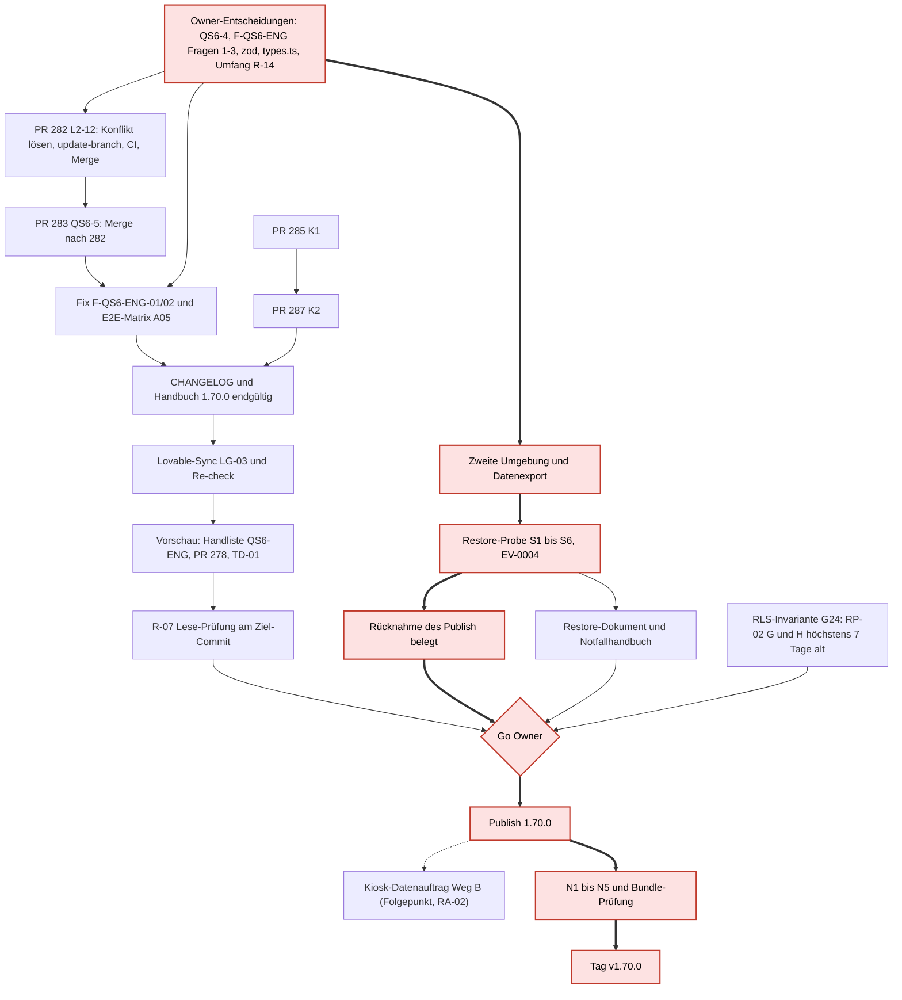

# Publish-Gate-Bericht (vor dem ersten Publish 1.70.0)

Stand: 2026-11-06, Nachträge 2026-11-07 (A28, A40) · Auftrag A21 · Art: nur lesen, keine Freigabe · Grundlage: origin/main 02cb3d2868195fc1cfbcc897b62b4cbb7ac0e9a9

Erstellt 2026-11-06T06:38+01:00 aus `C:\dev\sysingdashboard` (Branch `docs/2026-11-06-tagesbuendel`, Head `d7843a4a`, liegt hinter `origin/main`), `origin/ops/reports` (`93e5bb3c`) und `gh` (nur lesen). Dieser Bericht spricht keine Freigabe aus. „erfüllt“ steht nur mit Beleg.

## Nachtrag 2026-11-07

Befund Hauptsitzung (2026-11-07 08:30): PR 282 und PR 283 wurden am 2026-11-07 um 07:08 Z gemergt (main be712548). G07 und G15 stehen in dieser Zählung noch als „in PR“, G08 und G09 als offen; ihr Code liegt jetzt auf main, G10 (Engineer-Abnahme) bleibt offen. Ob G07, G08, G09 und G15 damit erfüllt sind, hängt von der Gate-Definition ab und wird nicht geraten; die Zählung ist im nächsten Gate-Nachtrag neu abzuleiten.

PR 287 ist am 2026-11-06T06:10Z gemergt (`7dc4699d`, CI 15/15), PR 285 ist als in 287 enthalten geschlossen. `bun audit` auf `main` `7dc4699d` am 2026-11-07: 54 Funde (24 hoch, 24 mittel, 6 niedrig), 0 kritisch, `dompurify` und `shell-quote` nicht gemeldet. Vorschlag A38 (Entscheidung des Owners offen): lesendes Gate G24 „RLS-Invariante“ (RLS 25/25, keine Policy für public oder anon, anon-Rechte nur bekannte Liste). Vorschlag A29 (Entscheidung des Owners offen): neues Gate G23 „Migrationsanwendung beim Publish geklärt und Selbstregistrierung entschieden“ (nicht „QS-01 B/C angewendet“; B und C liegen nicht im Repository). G11 und G12 sind damit erfüllt. G19 ist teilweise belegt: Vorschauprüfung des Owners am 2026-11-06 (EV-0007), Netzwerk-Reiter, Formularfelder und Link ungeprüft. Stand der Gates: 3 erfüllt (TD-01, G11, G12), 2 in PR (QS6-5, L2-12), 1 extern, 16 offen.

Ergänzung A28 (2026-11-07): G02 (Go-Ausnahme `types.ts`, D5), G06 (QS6-4 kein Serverbefund, D4) und G13 (zod 3 befristet akzeptiert, D3) sind erfüllt (Entscheidung des Owners 2026-11-06, laut Auftrag A28 in `origin/ops/queue`). Ablage: `docs/LOVABLE-PUBLISH-PRUEFUNG.md` (Go-Ausnahme), `docs/QS-06-VIEWER-ABRECHNUNG.md` und Merge-Checkliste N4a, `docs/RISIKOREGISTER.yaml` RA-01. Neue Zählung: **6 erfüllt** (TD-01, G02, G06, G11, G12, G13), 2 in PR (G07, G15), 1 extern (G14), **13 offen**. Ablauf und Muss-Gates: `docs/PUBLISH-PLAN.md`. Der Lese-Prompt enthält jetzt die Fragen 6 (Migrationen beim Publish oder Sync) und 7 (Erreichbarkeit, Selbstregistrierung).

Ergänzung A40 (2026-11-07): Entscheidungen des Owners vom 2026-11-07 (Quelle: Planer-Auftrag A40, `origin/ops/queue`, `queue/A40.yaml`).

- **G24 neu (Muss-Gate) „RLS-Invariante vor Publish belegt“:** RLS auf 25 von 25 Tabellen aktiv; keine Policy mit Rolle `public` oder `anon`; `anon`-Tabellenrechte nur auf der bekannten Liste (heute 9: `app_settings`, `audit_log`, `avkk_competence`, `avkk_consequence`, `avkk_responsibility`, `avkk_responsibility_type`, `avkk_subject`, `profiles`, `user_roles`) oder leer. Beleg: lesender Datenauftrag (Wiederholung RP-02 Teile G und H) höchstens 7 Tage vor dem Publish. Stand: **erfüllt** laut RP-02 vom 2026-11-07 (Anlage `queue/anlagen/RP-02-ergebnis-2026-11-07.md` in `origin/ops/queue`, Ausführung 05:44 bis 05:45 +01:00, nur SELECT; Teil H: „RLS ist auf allen 25 Tabellen aktiv“, `anon` nur auf den 9 genannten Tabellen; Teil G: 65 Policies, Rollen durchgehend `{authenticated}`). Der Beleg verfällt am **2026-11-14**; liegt der Publish später (laut `docs/PUBLISH-PLAN.md` frühestens KW 48), muss RP-02 G und H in P4 wiederholt werden (ca. 0,5 h). Bewertung des Befunds: `reports/A38-BERICHT.md` (B1, B2) in `origin/ops/reports`.
- **G20 (Kiosk-Datenauftrag Weg B) wird Folgepunkt nach dem Publish:** Das Restrisiko bm@ (Anzeigemodus mit Rolle Systemadministrator) ist befristet akzeptiert, Nachfrist 30 Tage nach dem Publish (RA-02 in `docs/RISIKOREGISTER.yaml`). G20 ist kein Go-Kriterium mehr. Offene Frage 7 ist damit beantwortet.
- **QS-01 Migration C′** (Rechtebereinigung nach A38) ist ein Folgepunkt vor L8 im Backlog, kein Publish-Gate.
- **G23** (Migrationsanwendung beim Publish geklärt, Selbstregistrierung entschieden) bleibt Vorschlag aus A29; er steht nicht in der Tabelle und wird nicht gezählt.

Herleitung der Zählung: Stand A28 bei 22 Gates (G01 bis G22) 6 erfüllt, 2 in PR, 1 extern, 13 offen. G20 wechselt von offen zu Folgepunkt (offen 13 − 1 = 12). G24 kommt als erfüllt hinzu (erfüllt 6 + 1 = 7, Gates 22 + 1 = 23). Neue Zählung: **23 geführte Gates, davon 22 vor dem Publish: 7 erfüllt** (G02, G06, G11, G12, G13, G18 TD-01, G24), **2 in PR** (G07, G15), **1 extern** (G14), **12 offen** (G01, G03, G04, G05, G08, G09, G10, G16, G17, G19, G21, G22); **1 Folgepunkt** (G20). G23 als Vorschlag nicht gezählt.

Die übrigen Aussagen dieses Berichts gelten unverändert; die Zeilen zu PR 285 und 287 in Ergebnis, Diagramm und Aufwand sind überholt.

## Ergebnis

1. Von 22 Gates ist 1 erfüllt (TD-01-Sichtprüfung, mit Widerspruch im Tracker), 4 liegen in PRs (QS6-5, K1, K2, L2-12), 1 ist extern und nicht ermittelbar (TanStack im Stand 1.69.0), 16 sind offen.
2. PR 282 und PR 283 sind `CONFLICTING` (Konflikt nur in `docs/CURRENT-STATUS.md`), PR 285 und 287 sind mergebar und haben CI 15/15. Kein Tag nach `v1.65.0` existiert.
3. Neu vor dem Publish sind F-QS6-ENG-01 (Tätigkeitsdialog zeigt dem Engineer Stundensatz und Betrag) und F-QS6-ENG-02 (JSON-Backup mit `hourlyRate`). Beide sind in keinem PR behoben. Der CHANGELOG 1.70.0 auf `main` widerspricht F-QS6-ENG-01.
4. Kritischer Pfad: R-14 (zweite Umgebung, Datenexport, Restore-Probe, EV-0004 „nicht bestanden“), dann Rollback-Beleg, Go des Owners, Publish, N1 bis N5 und Tag. Der Code-Pfad ist kürzer.
5. Dauer (Schätzung): Aufwand Claude Code 16/25/40 h, Owner 11/21/40 h, dazu Wartezeit auf Lovable und den Support. Kalenderdauer 1 / 3 / 6 Wochen bei 1 bis 2 Owner-Arbeitstagen pro Woche (R-11).

## Gates

Stand: erfüllt, in PR, offen, extern, Folgepunkt (nach dem Publish, kein Go-Kriterium; seit A40). Aufwand in Stunden als Schätzung A21 (min bis max), sofern keine Quelle genannt ist.

| Nr. | Gate                                                                                                                        | Quelle der Forderung                                                                                                                             | Stand      | Beleg                                                                                                                                                                                                                                                                                                                                                                                                                           | Verantwortlich                                                                                                 | Aufwand h |
| --- | --------------------------------------------------------------------------------------------------------------------------- | ------------------------------------------------------------------------------------------------------------------------------------------------ | ---------- | ------------------------------------------------------------------------------------------------------------------------------------------------------------------------------------------------------------------------------------------------------------------------------------------------------------------------------------------------------------------------------------------------------------------------------- | -------------------------------------------------------------------------------------------------------------- | --------- |
| G01 | R-07 Publish-Quelle und Auth-Broker: Lese-Prüfung am Ziel-Commit, Go-Kriterien                                              | `CLAUDE.md:14`; `docs/LOVABLE-PUBLISH-PRUEFUNG.md:41-51`, `:100-101`                                                                             | offen      | Support 2026-10-30: Publish liefert den Lovable-Projektstand ohne Pinning (`LOVABLE-PUBLISH-PRUEFUNG.md:85`). Weg B gemessen am 31.10. (`:129-155`). Neuester Sync-Branch `lovable-sync-1793857259` (`ca463857`, Basis `fd7878f9`) ohne Broker, `client.ts:63` = `window.localStorage`, Abweichung nur `types.ts` +5 (git diff, A21). Eine Prüfung für `02cb3d28` fehlt. Die Nachfrage beim Support vom 05.11. ist nicht belegt | Owner (Prompt, Go), Lovable, Claude Code (Auswertung)                                                          | 1–2       |
| G02 | Abweichung `types.ts` (+5 Zeilen `__InternalSupabase`) als Go-Ausnahme                                                      | `LOVABLE-PUBLISH-PRUEFUNG.md:43` (Arbeitskopie = `main`)                                                                                         | erfüllt    | Nachtrag 2026-11-07: erfüllt, Entscheidung des Owners 2026-11-06 (laut Auftrag A28, D5); Go-Ausnahme in `docs/LOVABLE-PUBLISH-PRUEFUNG.md`. Vorher: A14: „bewusst ignorieren“, eine Übernahme macht Schema-Drift rot (`reports/A14-BERICHT.md`). Owner-Entscheidung nur in der PR-282-Beschreibung, nicht auf `main`                                                                                                            | Owner                                                                                                          | 0,25      |
| G03 | R-14 Datenexport und Restore-Probe in einer zweiten Umgebung                                                                | Tracker `:660-669` (Entscheidung 2026-11-02); `docs/BACKLOG.md:261`; `docs/standards/STANDARD-WIEDERHERSTELLBARKEIT.md:26`, `:28`, `:59`, `:194` | offen      | EV-0004 „nicht bestanden, Abbruch wegen fehlender Testumgebung“ (`docs/NACHWEISE.yaml:45-55`). Ablage TeamDrive nicht nach REST-15 belegt                                                                                                                                                                                                                                                                                       | Owner (Umgebung, Export), Claude Code (Protokoll, Schema-Vergleich), Lovable-Support (Exportweg Lovable Cloud) | 8–32      |
| G04 | Restore-Dokument und Notfallhandbuch (REST-01, R-04)                                                                        | `STANDARD-WIEDERHERSTELLBARKEIT.md:21`; Risikoregister R-04, R-14                                                                                | offen      | `docs/NOTFALL-HANDBUCH.md` ist ein Entwurf mit 12 offenen Lücken (`:182-194`). A19 meldet Abweichungen (Grundlagenname, `npm ci` statt `bun.lock`)                                                                                                                                                                                                                                                                              | Owner (Freigabe), Claude Code (Korrektur)                                                                      | 1–3       |
| G05 | Rücknahme eines Publish belegt (REST-10)                                                                                    | `docs/MERGE-CHECKLISTE-GOLDEN-GATE.md:48-51`; `STANDARD-WIEDERHERSTELLBARKEIT.md:30`                                                             | offen      | Rücksetzen „im Lovable-Editor (zu belegen)“ (`NOTFALL-HANDBUCH.md:53`). Lücke 7 (`:188`). Kein Probe-Protokoll                                                                                                                                                                                                                                                                                                                  | Owner, Lovable-Support                                                                                         | 0,5–3     |
| G06 | QS6-4: Server liefert keine Beträge                                                                                         | `docs/QS-06-VIEWER-ABRECHNUNG.md:27`, `:49`                                                                                                      | erfüllt    | Nachtrag 2026-11-07: erfüllt, Entscheidung des Owners 2026-11-06 (laut Auftrag A28, D4); `docs/QS-06-VIEWER-ABRECHNUNG.md` Abschnitt 5, Smoke-Test N4a. Vorher: Analyse A01: kein Server-Pfad liefert Beträge (`docs/BERICHT-QS6-4-ANALYSE.md`, `reports/A01-BERICHT.md`). Die Entscheidung des Owners, QS6-4 zu schließen, fehlt                                                                                               | Owner                                                                                                          | 0,25      |
| G07 | QS6-5: Exporte ohne `billing.view` ohne Satz, Betrag und Summe                                                              | `QS-06-VIEWER-ABRECHNUNG.md:28`                                                                                                                  | in PR      | PR 283 (Draft, Head `4b82a0a1`, CI 15/15, `CONFLICTING` in `docs/CURRENT-STATUS.md`, enthält PR 282); `reports/A15-BERICHT.md`                                                                                                                                                                                                                                                                                                  | Claude Code (Konflikt), Owner (Merge)                                                                          | 1–2       |
| G08 | F-QS6-ENG-01: Tätigkeitsdialog zeigt dem Engineer Stundensatz, Status und Betrag                                            | `QS-06-VIEWER-ABRECHNUNG.md:71`, `:175`; `docs/BACKLOG.md:340`                                                                                   | offen      | `ActivityDialog.tsx:33`, `:134-146` ohne Rechteprüfung (`reports/A05-BERICHT.md`). Weder PR 273 noch PR 283 ändern die Datei. CHANGELOG 1.70.0 auf `main` (`CHANGELOG.md:18`) sagt das Gegenteil                                                                                                                                                                                                                                | Owner (Fragen 1 und 3), Claude Code (Fix)                                                                      | 2–3       |
| G09 | F-QS6-ENG-02: „Vollständiges JSON-Backup“ enthält `hourlyRate` für jede Rolle                                               | `QS-06-VIEWER-ABRECHNUNG.md:74`, `:176`                                                                                                          | offen      | `dashboard.tsx:335-352`, `:1168`; in PR 283 unverändert (A05)                                                                                                                                                                                                                                                                                                                                                                   | Owner (Frage 2), Claude Code                                                                                   | 1–2       |
| G10 | Engineer-Abnahme QS-06 (A05): E2E-Matrix QS6-E2E-01 bis -11, Handliste QS6-ENG-01 bis -14                                   | `QS-06-VIEWER-ABRECHNUNG.md:51-185`, `:169`                                                                                                      | offen      | Plan liegt vor. EV-0005 mit Einschränkung „Engineer ungeprüft“. Lokal 7/7 für `qs06-billing-view.spec.ts` (A05)                                                                                                                                                                                                                                                                                                                 | Claude Code (E2E 4–6 h), Owner (Handliste)                                                                     | 5–8,5     |
| G11 | K1 `dompurify` 3.4.17 (GHSA-cg2g-xh64-v4q7)                                                                                 | `docs/BERICHT-AUDIT-2026-11-04.md:17`, `:37`; Gate-Charakter nur als Empfehlung (A02, A16), keine Owner-Entscheidung gefunden                    | erfüllt    | Nachtrag 2026-11-07: in PR 287 enthalten, gemergt `7dc4699d`; PR 285 geschlossen; `bun audit` auf `main` ohne `dompurify`. Vorher: PR 285 (Head `7a01ce95`); `reports/A16-BERICHT.md`                                                                                                                                                                                                                                           | Owner (Merge), Claude Code (update-branch)                                                                     | 0,25–0,5  |
| G12 | K2 `shell-quote` 1.12.0 (GHSA-pqg4-j6r4-53mv)                                                                               | wie G11, `BERICHT-AUDIT-2026-11-04.md:18`                                                                                                        | erfüllt    | Nachtrag 2026-11-07: PR 287 gemergt 2026-11-06T06:10Z (`7dc4699d`, CI 15/15). `bun audit` auf `main`: 54 Funde, 0 kritisch                                                                                                                                                                                                                                                                                                      | Owner, Claude Code                                                                                             | 0,25–0,5  |
| G13 | Entscheidung zu zod 3 (GHSA-mrhx-c7xc-m3w5): Risikoakzeptanz oder Migration                                                 | `docs/BERICHT-AUDIT-SAMMELBEWERTUNG.md:11`, `:298`; `docs/BACKLOG.md:342`                                                                        | erfüllt    | Nachtrag 2026-11-07: erfüllt, Entscheidung des Owners 2026-11-06 (laut Auftrag A28, D3); Risikoakzeptanz RA-01 in `docs/RISIKOREGISTER.yaml`. Vorher: `reports/A20-BERICHT.md`. Entscheidung: 1 h, eine Migration danach 8–16 h                                                                                                                                                                                                 | Owner, Claude Code (Vorlage)                                                                                   | 1         |
| G14 | TanStack GHSA-qx66-fv34-fjm8 im veröffentlichten Stand 1.69.0                                                               | `BERICHT-AUDIT-2026-11-04.md:10-11`, `:42-49`                                                                                                    | extern     | Auf `main` behoben (PR 276, `44b5ebf5`). Release-Commit 1.69.0 `3732df26` verwundbar. Das ausgelieferte Bundle ist nicht geprüft (nicht ermittelbar). Wird mit dem Publish beseitigt                                                                                                                                                                                                                                            | Claude Code (Bundle lesen), Owner                                                                              | 0,5–1     |
| G15 | L2-12 Handbuch und CHANGELOG 1.70.0 (endgültige Fassung)                                                                    | Tracker L2-12; `docs/CURRENT-STATUS.md:73`                                                                                                       | in PR      | Auf `main`: CHANGELOG 1.70.0 vom 2026-11-04 (PR 280, `9ab42d15`). PR 282 (Draft, CI 15/15, `CONFLICTING`): Cockpit-Kapitel, Handbuch 1.26.0, Tag v1.70.0 in der Checkliste. Einträge zu K1/K2, F-QS6-ENG und PR 278 fehlen                                                                                                                                                                                                      | Claude Code, Owner (Merge)                                                                                     | 1,5–4     |
| G16 | Tag `v1.70.0`                                                                                                               | `MERGE-CHECKLISTE-GOLDEN-GATE.md:35` (heute v1.69.0, Änderung in PR 282); Owner 2026-11-05: Version 1.70.0 bleibt (Tracker `:719-724`)           | offen      | `git ls-remote --tags origin`: letzter Tag `v1.65.0`, v1.66 bis v1.70 fehlen                                                                                                                                                                                                                                                                                                                                                    | Owner (Auftrag), Claude Code                                                                                   | 0,25      |
| G17 | Lovable-Sync nach dem letzten Merge (LG-03, „Repository-Version behalten“, Re-check)                                        | `docs/standards/STANDARD-LOVABLE-GRENZEN.md:17`; Risikoregister R-12                                                                             | offen      | Für `02cb3d28` gibt es keinen Beleg. Letzter Sync-Branch basiert auf `fd7878f9` (2026-11-05)                                                                                                                                                                                                                                                                                                                                    | Owner, Lovable                                                                                                 | 0,5–1     |
| G18 | TD-01 Sichtprüfung in der App                                                                                               | `CURRENT-STATUS.md:73`                                                                                                                           | erfüllt    | Tracker `:1111-1112` (2026-10-28, Bildschirmfotos des Nutzers 19:25 bis 19:27). Widerspruch: Paket TD-01 `preview_verified: no` (Tracker `:296-298`), Befund TB-7 offen. Die Datumswerte haben den Stichtag 28.10.                                                                                                                                                                                                              | Owner (Bestätigung)                                                                                            | 0,25–1    |
| G19 | PR 278 react-pdf: Prüfung in der Lovable-Vorschau                                                                           | `docs/BERICHT-PR-BESTAND-2026-11-06.md:9`, `:152-181`                                                                                            | offen      | Merge erfüllt: 2026-11-06T05:11Z, `02cb3d28`, CI `42166954669` und Security `42166954701` success. Die Vorschauprüfung (Schritte 1–11, EV-Eintrag) ist nicht belegt (kein EV in `NACHWEISE.yaml`)                                                                                                                                                                                                                               | Owner                                                                                                          | 0,5–1,5   |
| G20 | Kiosk-Datenauftrag Weg B (anzeige@, Archivieren kiosk@ und bm@)                                                             | `docs/DATENAUFTRAG-KIOSK-KONTO.md:4`, `:44-46`; Restrisiko `QS-06-VIEWER-ABRECHNUNG.md:48`                                                       | Folgepunkt | Nachtrag A40: Owner 2026-11-07 Folgepunkt nach dem Publish; Restrisiko bm@ befristet akzeptiert (RA-02, Nachfrist 30 Tage nach dem Publish). Vorher: Freigabe 1 und 2 für Weg B offen, EV-0006 Entwurf (A17). Eine Gate-Eigenschaft vor dem Publish ist nicht belegt                                                                                                                                                            | Owner                                                                                                          | 0,5–2     |
| G21 | Go und Publish durch den Owner                                                                                              | `LOVABLE-PUBLISH-PRUEFUNG.md:50-51`; `CLAUDE.md:14`                                                                                              | offen      | Go gilt nur für den geprüften Commit                                                                                                                                                                                                                                                                                                                                                                                            | Owner                                                                                                          | 0,5       |
| G22 | Smoke-Test N1 bis N5 und Bundle-Prüfung (Broker-Kennungen, TanStack) nach dem Publish                                       | `MERGE-CHECKLISTE-GOLDEN-GATE.md:38-46`; `LOVABLE-PUBLISH-PRUEFUNG.md:169`, `:179`                                                               | offen      | Nicht veröffentlicht. N4 nennt „Abrechnung bleibt bis QS-06 offen“, die Erwartung muss nachgezogen werden                                                                                                                                                                                                                                                                                                                       | Owner (N1–N5), Claude Code (Bundle, Protokoll)                                                                 | 1,5–4     |
| G24 | RLS-Invariante vor Publish belegt (RLS 25/25, keine Policy für `public`/`anon`, `anon`-Rechte nur bekannte Liste oder leer) | Owner 2026-11-07 (Planer-Auftrag A40); Vorschlag `reports/A38-BERICHT.md` (B2)                                                                   | erfüllt    | Nachtrag A40: RP-02 vom 2026-11-07 (`queue/anlagen/RP-02-ergebnis-2026-11-07.md`, Teil G: 65 Policies nur `{authenticated}`; Teil H: RLS 25/25, `anon` nur auf 9 Tabellen der Liste). Gültig bis 2026-11-14 (höchstens 7 Tage vor dem Publish), danach Wiederholung RP-02 G und H                                                                                                                                               | Owner (Datenauftrag lesen), Claude Code (Auswertung)                                                           | 0,5       |

```yaml
grundlage: 02cb3d2868195fc1cfbcc897b62b4cbb7ac0e9a9
stand: 2026-11-06
zaehlung: { erfuellt: 1, in_pr: 4, offen: 16, extern: 1 }
zaehlung_nachtrag_2026_11_07: { erfuellt: 6, in_pr: 2, offen: 13, extern: 1 }
zaehlung_nachtrag_a40_2026_11_07:
  { gates: 23, vor_publish: 22, erfuellt: 7, in_pr: 2, offen: 12, extern: 1, folgepunkt: 1 }
nicht_gezaehlt: [G23 Vorschlag A29]
gates:
  - gate: G01 R-07 Publish-Quelle und Auth-Broker
    quelle: CLAUDE.md:14; docs/LOVABLE-PUBLISH-PRUEFUNG.md:41-51, :100-101
    stand: offen
    beleg: Support 2026-10-30 (Publish = Lovable-Projektstand); Messung Weg B 2026-10-31; lovable-sync-1793857259 (ca463857) ohne Broker; keine Prüfung für 02cb3d28
    verantwortlich: [Owner, Lovable, Claude Code]
    aufwand_h: "1-2"
  - gate: G02 types.ts-Abweichung als Go-Ausnahme
    quelle: docs/LOVABLE-PUBLISH-PRUEFUNG.md:43
    stand: erfüllt
    beleg: Entscheidung des Owners 2026-11-06 (laut Auftrag A28, D5); docs/LOVABLE-PUBLISH-PRUEFUNG.md Go-Ausnahme types.ts; vorher ops/reports reports/A14-BERICHT.md
    verantwortlich: [Owner]
    aufwand_h: "0.25"
  - gate: G03 R-14 Datenexport und Restore-Probe
    quelle: docs/GOLDEN-GATE-EXECUTION-TRACKER.yaml:660-669; docs/BACKLOG.md:261; docs/standards/STANDARD-WIEDERHERSTELLBARKEIT.md:26, :28, :59, :194
    stand: offen
    beleg: docs/NACHWEISE.yaml EV-0004 (nicht bestanden, keine Testumgebung)
    verantwortlich: [Owner, Claude Code, Lovable-Support]
    aufwand_h: "8-32"
  - gate: G04 Restore-Dokument und Notfallhandbuch (REST-01)
    quelle: docs/standards/STANDARD-WIEDERHERSTELLBARKEIT.md:21
    stand: offen
    beleg: docs/NOTFALL-HANDBUCH.md (Entwurf, Lücken :182-194); ops/reports reports/A19-BERICHT.md
    verantwortlich: [Owner, Claude Code]
    aufwand_h: "1-3"
  - gate: G05 Rücknahme eines Publish belegt (REST-10)
    quelle: docs/MERGE-CHECKLISTE-GOLDEN-GATE.md:48-51; docs/standards/STANDARD-WIEDERHERSTELLBARKEIT.md:30
    stand: offen
    beleg: docs/NOTFALL-HANDBUCH.md:53 (zu belegen); kein Probe-Protokoll
    verantwortlich: [Owner, Lovable-Support]
    aufwand_h: "0.5-3"
  - gate: G06 QS6-4 Server liefert keine Beträge
    quelle: docs/QS-06-VIEWER-ABRECHNUNG.md:27, :49
    stand: erfüllt
    beleg: Entscheidung des Owners 2026-11-06 (laut Auftrag A28, D4); docs/QS-06-VIEWER-ABRECHNUNG.md Abschnitt 5; Smoke-Test N4a; docs/BERICHT-QS6-4-ANALYSE.md
    verantwortlich: [Owner]
    aufwand_h: "0.25"
  - gate: G07 QS6-5 Exporte
    quelle: docs/QS-06-VIEWER-ABRECHNUNG.md:28
    stand: in PR
    beleg: PR 283 (Draft, 4b82a0a1, CI 15/15, CONFLICTING docs/CURRENT-STATUS.md); ops/reports reports/A15-BERICHT.md
    verantwortlich: [Claude Code, Owner]
    aufwand_h: "1-2"
  - gate: G08 F-QS6-ENG-01 Tätigkeitsdialog Engineer
    quelle: docs/QS-06-VIEWER-ABRECHNUNG.md:71, :175; docs/BACKLOG.md:340
    stand: offen
    beleg: src/components/dashboard/dialogs/ActivityDialog.tsx:33, :134-146; ops/reports reports/A05-BERICHT.md; Widerspruch CHANGELOG.md:18
    verantwortlich: [Owner, Claude Code]
    aufwand_h: "2-3"
  - gate: G09 F-QS6-ENG-02 JSON-Backup mit hourlyRate
    quelle: docs/QS-06-VIEWER-ABRECHNUNG.md:74, :176
    stand: offen
    beleg: src/routes/_authenticated/dashboard.tsx:335-352, :1168; ops/reports reports/A05-BERICHT.md
    verantwortlich: [Owner, Claude Code]
    aufwand_h: "1-2"
  - gate: G10 Engineer-Abnahme QS-06 (A05)
    quelle: docs/QS-06-VIEWER-ABRECHNUNG.md:51-185
    stand: offen
    beleg: Plan A05 (e8afbc6b); EV-0005 mit Einschränkung Engineer ungeprüft
    verantwortlich: [Claude Code, Owner]
    aufwand_h: "5-8.5"
  - gate: G11 K1 dompurify 3.4.17
    quelle: docs/BERICHT-AUDIT-2026-11-04.md:17, :37
    stand: erfüllt
    beleg: PR 287 gemergt (7dc4699d, enthält 285), PR 285 geschlossen; bun audit main 7dc4699d am 2026-11-07 ohne dompurify; ops/reports reports/A16-BERICHT.md
    verantwortlich: [Owner, Claude Code]
    aufwand_h: "0.25-0.5"
  - gate: G12 K2 shell-quote 1.12.0
    quelle: docs/BERICHT-AUDIT-2026-11-04.md:18
    stand: erfüllt
    beleg: PR 287 gemergt 2026-11-06T06:10Z (7dc4699d, CI 15/15); bun audit main am 2026-11-07 54 Funde, 0 kritisch
    verantwortlich: [Owner, Claude Code]
    aufwand_h: "0.25-0.5"
  - gate: G13 Entscheidung zod 3
    quelle: docs/BERICHT-AUDIT-SAMMELBEWERTUNG.md:11, :298; docs/BACKLOG.md:342
    stand: erfüllt
    beleg: Entscheidung des Owners 2026-11-06 (laut Auftrag A28, D3); docs/RISIKOREGISTER.yaml RA-01; ops/reports reports/A20-BERICHT.md
    verantwortlich: [Owner, Claude Code]
    aufwand_h: "1"
  - gate: G14 TanStack GHSA-qx66-fv34-fjm8 im Stand 1.69.0
    quelle: docs/BERICHT-AUDIT-2026-11-04.md:10-11, :42-49
    stand: extern
    beleg: PR 276 (44b5ebf5) auf main; Bundle 1.69.0 nicht geprüft (nicht ermittelbar)
    verantwortlich: [Claude Code, Owner]
    aufwand_h: "0.5-1"
  - gate: G15 L2-12 Handbuch und CHANGELOG 1.70.0
    quelle: docs/CURRENT-STATUS.md:73; Tracker L2-12
    stand: in PR
    beleg: CHANGELOG.md:16 auf main (PR 280, 9ab42d15); PR 282 (Draft, 92bf1d3b, CI 15/15, CONFLICTING)
    verantwortlich: [Claude Code, Owner]
    aufwand_h: "1.5-4"
  - gate: G16 Tag v1.70.0
    quelle: docs/MERGE-CHECKLISTE-GOLDEN-GATE.md:35; Tracker fortschritt 2026-11-05 (Version 1.70.0 bleibt)
    stand: offen
    beleg: git ls-remote --tags origin (letzter Tag v1.65.0)
    verantwortlich: [Owner, Claude Code]
    aufwand_h: "0.25"
  - gate: G17 Lovable-Sync nach letztem Merge (LG-03)
    quelle: docs/standards/STANDARD-LOVABLE-GRENZEN.md:17
    stand: offen
    beleg: kein Sync-Beleg für 02cb3d28; letzter Sync-Branch Basis fd7878f9
    verantwortlich: [Owner, Lovable]
    aufwand_h: "0.5-1"
  - gate: G18 TD-01 Sichtprüfung
    quelle: docs/CURRENT-STATUS.md:73
    stand: erfüllt
    beleg: Tracker :1111-1112 (2026-10-28, Bildschirmfotos); Widerspruch preview_verified no (Tracker :298); TB-7 offen
    verantwortlich: [Owner]
    aufwand_h: "0.25-1"
  - gate: G19 PR 278 Vorschauprüfung
    quelle: docs/BERICHT-PR-BESTAND-2026-11-06.md:9, :152-181
    stand: offen
    beleg: Merge 02cb3d28 (2026-11-06T05:11Z), CI 42166954669 und Security 42166954701 success; Vorschauprüfung ohne Beleg
    verantwortlich: [Owner]
    aufwand_h: "0.5-1.5"
  - gate: G20 Kiosk-Datenauftrag Weg B
    quelle: docs/DATENAUFTRAG-KIOSK-KONTO.md:4, :44-46; docs/QS-06-VIEWER-ABRECHNUNG.md:48
    stand: Folgepunkt
    beleg: Owner 2026-11-07 (Planer-Auftrag A40) Folgepunkt nach dem Publish; Restrisiko bm@ befristet akzeptiert, RA-02 in docs/RISIKOREGISTER.yaml (Nachfrist 30 Tage nach dem Publish); vorher Freigaben Weg B offen, EV-0006 Entwurf, ops/reports reports/A17-BERICHT.md
    verantwortlich: [Owner]
    aufwand_h: "0.5-2"
  - gate: G21 Go und Publish
    quelle: docs/LOVABLE-PUBLISH-PRUEFUNG.md:50-51; CLAUDE.md:14
    stand: offen
    beleg: nicht veröffentlicht
    verantwortlich: [Owner]
    aufwand_h: "0.5"
  - gate: G22 Smoke-Test N1 bis N5 und Bundle-Prüfung
    quelle: docs/MERGE-CHECKLISTE-GOLDEN-GATE.md:38-46; docs/LOVABLE-PUBLISH-PRUEFUNG.md:169, :179
    stand: offen
    beleg: nicht veröffentlicht
    verantwortlich: [Owner, Claude Code]
    aufwand_h: "1.5-4"
  - gate: G24 RLS-Invariante vor Publish belegt
    quelle: Owner 2026-11-07 (Planer-Auftrag A40, origin/ops/queue queue/A40.yaml); Vorschlag ops/reports reports/A38-BERICHT.md (B2)
    stand: erfüllt
    beleg: origin/ops/queue queue/anlagen/RP-02-ergebnis-2026-11-07.md Teil G (65 Policies, Rollen nur authenticated) und Teil H (RLS 25/25; anon nur app_settings, audit_log, avkk_competence, avkk_consequence, avkk_responsibility, avkk_responsibility_type, avkk_subject, profiles, user_roles)
    gueltig_bis: 2026-11-14
    wiederholung: lesender Datenauftrag RP-02 Teile G und H höchstens 7 Tage vor dem Publish
    verantwortlich: [Owner, Claude Code]
    aufwand_h: "0.5"
```

## Abhängigkeiten

Kritischer Pfad: rote Knoten und dicke Kanten. Gestrichelt: Abhängigkeit nicht als Gate belegt.



## Kritischer Pfad

1. Owner-Entscheidung zum Umfang von R-14: alle Stufen S1 bis S6 (`STANDARD-WIEDERHERSTELLBARKEIT.md:59`) oder mindestens S4, danach S5 und S6 (`:194`). Die beiden Stellen widersprechen sich.
2. Zweite Umgebung anlegen und Daten aus Lovable Cloud exportieren. Der Exportweg ist nicht belegt (R-10, Rückfrage beim Support offen).
3. Restore-Probe mit Protokoll (REST-06), EV-0004 neu.
4. Rücknahme eines Publish belegen (REST-10), denn ohne diesen Beleg bleibt der Publish laut Standard No-Go.
5. Go des Owners für genau einen Commit, Publish, N1 bis N5 mit Bundle-Prüfung, Tag v1.70.0.

Parallel und kürzer ist der Code-Pfad: Entscheidungen, PR 282 und 283, Fix F-QS6-ENG, PR 285 und 287, CHANGELOG, Sync, Vorschau-Abnahmen, R-07-Prüfung. Er wird kritisch, wenn der Owner den Umfang von R-14 verkleinert oder vorzieht. Jeder Merge nach dem R-07-Check macht die Prüfung ungültig (`LOVABLE-PUBLISH-PRUEFUNG.md:50`). Deshalb gehören alle Merges vor G17.

## Dauer

Schätzung A21 (Analogie, keine Messung) in Stunden Aufwand. Die Kalenderdauer hängt von der Verfügbarkeit des Owners ab (R-11: 1 bis 2 Arbeitstage pro Woche).

| Teil                                                                              | Bestimmt durch  | min         | wahrscheinlich | max                       |
| --------------------------------------------------------------------------------- | --------------- | ----------- | -------------- | ------------------------- |
| Konflikte 282/283 lösen, update-branch, CI (282, 283, 285, 287, 286)              | Claude Code     | 1           | 2              | 3                         |
| Fix F-QS6-ENG-01/02 und E2E-Matrix mit Doku (A05: 8–12 h, ohne Owner-Handliste)   | Claude Code     | 7           | 9              | 11                        |
| CHANGELOG, Handbuch, Vorlage zur zod-Entscheidung, Korrektur des Notfallhandbuchs | Claude Code     | 2           | 4              | 7                         |
| R-14 Unterstützung (Restore-Dokument, Schema-Vergleich, Protokoll)                | Claude Code     | 4           | 8              | 15                        |
| Bundle-Prüfung, Protokoll N1–N5, Tag, Dokupflege                                  | Claude Code     | 2           | 2              | 4                         |
| **Summe Claude Code**                                                             |                 | **16**      | **25**         | **40**                    |
| Entscheidungen (G02, G06, G08, G09, G13, Umfang R-14, G20)                        | Owner           | 1           | 2              | 3                         |
| Merges per REST (5 bis 7 PRs)                                                     | Owner           | 1           | 1,5            | 3                         |
| Sync, Re-check, R-07-Prompt                                                       | Owner           | 1           | 1,5            | 3                         |
| Vorschau: QS6-ENG-01 bis -14, PR 278, TD-01                                       | Owner           | 2           | 3              | 5                         |
| R-14: Umgebung, Export, Import, Anmeldung je Rolle                                | Owner           | 4           | 8              | 17                        |
| Rücknahme des Publish belegen                                                     | Owner           | 0,5         | 1              | 3                         |
| Go, Publish, N1–N5                                                                | Owner           | 1,5         | 3              | 4                         |
| Kiosk-Datenauftrag (falls vor dem Publish gewünscht)                              | Owner           | 0           | 1              | 2                         |
| **Summe Owner**                                                                   |                 | **11**      | **21**         | **40**                    |
| Antwort des Supports (Exportweg, Rücknahme, R-10)                                 | Lovable-Support | 0 Tage      | 3 Werktage     | nicht begrenzbar          |
| Sync und Vorschau-Build                                                           | Lovable         | Minuten     | unter 1 h      | Sync-Dialog-Fehler (R-12) |
| **Kalenderdauer bis Tag v1.70.0**                                                 | alle            | **1 Woche** | **3 Wochen**   | **6 Wochen**              |

## Nicht ermittelbar

- Ob das veröffentlichte Bundle 1.69.0 von GHSA-qx66-fv34-fjm8 betroffen ist. Das klärt nur eine Lese-Prüfung des Bundles.
- Wann und aus welchem Commit 1.69.0 veröffentlicht wurde (`LOVABLE-PUBLISH-PRUEFUNG.md:165`).
- Der Lovable-Projektstand nach den Merges 284 und 278 (`02cb3d28`). Es gibt keinen Sync-Branch und keinen Prompt-Beleg.
- Ob die Vorschauprüfung von PR 278 vor dem Merge stattgefunden hat. In Git gibt es keinen Nachweis.
- Wie Daten aus Lovable Cloud exportiert werden und wie eine zweite Umgebung angelegt wird. Ein Plattformweg ist nicht belegt.
- Ob die Nachfrage beim Lovable-Support vom 2026-11-05 erfolgt ist und ob eine Antwort vorliegt.
- Ob der Dev-Server der Lovable-Vorschau von außen erreichbar ist (A20).
- Live-Datenbank gegen Migrationsstand (R-10). Das betrifft den Schema-Vergleich in S3.

## Offene Fragen

1. R-14: Gilt vor dem Publish S1 bis S6 oder S1 bis S4? Wo entsteht die zweite Umgebung (eigenes Supabase-Projekt oder zweites Lovable-Projekt)? Ist TeamDrive als Ablage freigegeben (REST-15)?
2. Wird F-QS6-ENG-01/02 in PR 283 aufgenommen oder als eigenes Paket umgesetzt? Wie lauten die Antworten auf die Fragen 1 bis 5 in `QS-06-VIEWER-ABRECHNUNG.md:180-184`?
3. Wird QS6-4 als „kein Serverbefund“ geschlossen (A01)?
4. Akzeptiert der Owner das Risiko zod 3 vor dem Publish, oder wird die Migration vorgezogen?
5. Gilt die Abweichung `types.ts` +5 als zulässig im Go-Kriterium „Arbeitskopie = main“ (G02)?
6. Sind K1 und K2 Gates vor dem Publish oder nur Empfehlungen? Eine Owner-Entscheidung ist nicht gefunden.
7. Ist der Kiosk-Datenauftrag Weg B Voraussetzung für den Publish oder ein Folgepunkt (Restrisiko bm@)? Beantwortet 2026-11-07 (Owner, Planer-Auftrag A40): Folgepunkt, RA-02.
8. TD-01: Gilt die Sichtprüfung vom 28.10. trotz `preview_verified: no` und gealterter Stichtagsdaten? Ist TB-7 vor dem Publish zu klären?
9. Wurde PR 278 vor dem Merge in der Vorschau geprüft? Falls ja, wo liegt der Nachweis?
10. Welche Erwartung gilt für N4 (Viewer, Abrechnung) nach QS-06?
