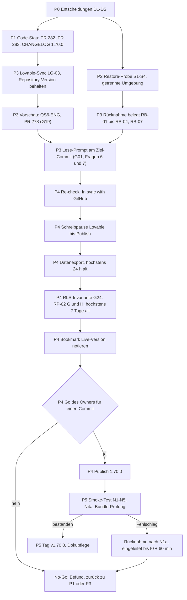

# Publish-Plan 1.70.0 (Runbook)

Stand: 2026-11-07 · Auftrag A28, ergänzt A40 (mit Nachtrag 2 nach dem Merge von PR 283) · Status: Plan, keine Freigabe · Publish bleibt No-Go (R-07, `CLAUDE.md`) bis zum Go des Owners für genau einen geprüften Commit · Bezug: `docs/PUBLISH-GATE-BERICHT.md` (Gates G01 bis G22 und G24, Nachträge 2026-11-07), `docs/LOVABLE-PUBLISH-PRUEFUNG.md`, `docs/MERGE-CHECKLISTE-GOLDEN-GATE.md`, `docs/NOTFALL-HANDBUCH.md` (N1a)

Dieser Plan legt Reihenfolge, Muss-Gates und Anforderungen für den ersten Publish seit 1.69.0 fest. Er ersetzt keine Prüfung: „erfüllt“ steht nur mit Beleg im Gate-Bericht.

## 1 Owner-Entscheidungen (Grundlage)

Quelle: Entscheidung des Owners 2026-11-06, dokumentiert im Planer-Auftrag A28 (`origin/ops/queue`, `queue/A28.yaml`).

| ID  | Entscheidung                                                                                                                             | Gate | Ablage                                                       |
| --- | ---------------------------------------------------------------------------------------------------------------------------------------- | ---- | ------------------------------------------------------------ |
| D3  | `zod@3.25.76` (GHSA-mrhx-c7xc-m3w5) wird befristet bis nach dem Publish akzeptiert; Migration auf `zod@4.6.6` danach (8 bis 16 h).       | G13  | `docs/RISIKOREGISTER.yaml` (RA-01), `docs/RISIKOREGISTER.md` |
| D4  | QS6-4 wird als „kein Serverbefund“ geschlossen (A01); der Smoke-Test erhält eine Netzwerkprüfung mit Viewer-Konto.                       | G06  | `docs/QS-06-VIEWER-ABRECHNUNG.md`, Merge-Checkliste N4a      |
| D5  | Die Abweichung `types.ts` (+5 Zeilen, Block `__InternalSupabase`, `PostgrestVersion` "14.5") ist eine Go-Ausnahme.                       | G02  | `docs/LOVABLE-PUBLISH-PRUEFUNG.md`, Go-Kriterien             |
| D6  | Neues Muss-Gate G24 „RLS-Invariante vor Publish belegt“; Beleg durch Wiederholung RP-02 Teile G und H höchstens 7 Tage vor dem Publish.  | G24  | `docs/PUBLISH-GATE-BERICHT.md` (Nachtrag A40)                |
| D7  | G20 (Kiosk-Datenauftrag Weg B) ist Folgepunkt nach dem Publish; Restrisiko bm@ befristet akzeptiert, Nachfrist 30 Tage nach dem Publish. | G20  | `docs/RISIKOREGISTER.yaml` (RA-02), `docs/RISIKOREGISTER.md` |
| D8  | QS-01 Migration C′ (Rechtebereinigung, A38) ist Folgepunkt vor L8, kein Publish-Gate.                                                    | –    | `docs/BACKLOG.md`                                            |

D6 bis D8: Entscheidung des Owners 2026-11-07, dokumentiert im Planer-Auftrag A40 (`origin/ops/queue`, `queue/A40.yaml`).

D1 (Restore-Minimalprobe S1 bis S4 lokal) und D2 (Engineer-Befunde in PR 283) stehen im Tracker (`reihenfolge_owner`, Ergänzung 2026-11-07) und werden in A27 und A30 dokumentiert.

## 2 Phasen

| Phase | Inhalt             | Ergebnis (Abnahme)                                                                                                                          | Verantwortlich             |
| ----- | ------------------ | ------------------------------------------------------------------------------------------------------------------------------------------- | -------------------------- |
| P0    | Entscheidungen     | D1 bis D5 mit Datum und Owner in `docs/`; Gate-Bericht nachgezogen                                                                          | Owner, Claude Code         |
| P1    | Code-Stau auflösen | PR 282 (L2-12) und PR 283 (QS6-5, F-QS6-ENG-01/02) gemergt, CI 15/15; CHANGELOG und Handbuch 1.70.0 endgültig                               | Claude Code, Owner (Merge) |
| P2    | Restore-Probe      | Probe S1 bis S4 in getrennter Umgebung mit Protokoll, neuer EV-Eintrag „bestanden“ (G03, G04)                                               | Owner, Claude Code         |
| P3    | Vorbereitung       | Rücknahme belegt (G05, RB-01 bis RB-04, RB-07); Lovable-Sync (G17); Vorschau-Abnahmen (G10, G19); Lese-Prompt (G01)                         | Owner, Lovable             |
| P4    | Go und Publish     | Re-check, Schreibpause, Datenexport, RLS-Invariante (G24, RP-02 G und H höchstens 7 Tage alt), Bookmark, Go für einen Commit, Publish (G21) | Owner                      |
| P5    | Nachlauf           | Smoke-Test N1 bis N5 und N4a, Bundle-Prüfung (G22), Tag `v1.70.0` (G16), Dokupflege; danach zod-4-Migration (Backlog)                       | Owner, Claude Code         |



Jeder Merge nach `main` und jede Lovable-Änderung nach dem Lese-Prompt macht die Prüfung ungültig; dann beginnt P3 ab dem Sync erneut (`LOVABLE-PUBLISH-PRUEFUNG.md`, „Ein Go gilt nur für den geprüften Commit“).

## 3 Muss-Gates

Stand laut `docs/PUBLISH-GATE-BERICHT.md`, Nachtrag 2026-11-07 (inkl. A28, A40 und A40 Nachtrag 2). Zählung nach dem Merge von PR 283 (`be712548`): 23 geführte Gates, davon 22 vor dem Publish (9 erfüllt, 0 in PR, 1 extern, 12 offen) und 1 Folgepunkt (G20); G23 ist Vorschlag und nicht gezählt. Muss-Gates: 15, davon 6 erfüllt (G02, G06, G07, G09, G13, G24), 0 in PR, 9 offen. P1 ist damit bis auf G08 (Frage 1 zum Abrechnungsstatus) und G15 (CHANGELOG-Einträge K1/K2 und PR 278) abgeschlossen. Ohne Beleg „erfüllt“ kein Go.

```yaml
muss_gates:
  - { gate: G01, inhalt: R-07 Lese-Prüfung am Ziel-Commit, phase: P3, stand: offen }
  - {
      gate: G02,
      inhalt: types.ts als Go-Ausnahme,
      phase: P0,
      stand: erfüllt,
      beleg: "Entscheidung des Owners 2026-11-06 (laut Auftrag A28)",
    }
  - { gate: G03, inhalt: R-14 Datenexport und Restore-Probe, phase: P2, stand: offen }
  - { gate: G04, inhalt: Restore-Dokument und Notfallhandbuch, phase: P2, stand: offen }
  - { gate: G05, inhalt: Rücknahme eines Publish belegt, phase: P3, stand: offen }
  - {
      gate: G06,
      inhalt: QS6-4 kein Serverbefund,
      phase: P0,
      stand: erfüllt,
      beleg: "Entscheidung des Owners 2026-11-06 (laut Auftrag A28)",
    }
  - {
      gate: G07,
      inhalt: QS6-5 Exporte,
      phase: P1,
      stand: erfüllt,
      beleg: "PR 283 gemergt be712548 (2026-11-07), 15/15 Checks am Head 9c60a92f",
    }
  - {
      gate: G08,
      inhalt: F-QS6-ENG-01 Tätigkeitsdialog,
      phase: P1,
      stand: offen,
      hinweis: "teilweise belegt; Satz und Betrag ausgeblendet, Abrechnungsstatus sichtbar, Frage 1 offen",
    }
  - {
      gate: G09,
      inhalt: F-QS6-ENG-02 JSON-Backup,
      phase: P1,
      stand: erfüllt,
      beleg: "Fix 9c60a92f, gemergt be712548; qs6-ga09-json-backup.test.ts",
    }
  - { gate: G10, inhalt: Engineer-Abnahme QS-06, phase: P3, stand: offen }
  - {
      gate: G13,
      inhalt: Entscheidung zod 3,
      phase: P0,
      stand: erfüllt,
      beleg: "Entscheidung des Owners 2026-11-06 (laut Auftrag A28)",
    }
  - {
      gate: G15,
      inhalt: L2-12 Handbuch und CHANGELOG 1.70.0,
      phase: P1,
      stand: offen,
      hinweis: "Inhalt PR 282 auf main; Einträge K1/K2 und PR 278 fehlen",
    }
  - { gate: G17, inhalt: Lovable-Sync nach letztem Merge, phase: P3, stand: offen }
  - {
      gate: G19,
      inhalt: PR 278 Vorschauprüfung,
      phase: P3,
      stand: offen,
      hinweis: teilweise belegt (EV-0007),
    }
  - {
      gate: G24,
      inhalt: RLS-Invariante vor Publish belegt,
      phase: P4,
      stand: erfüllt,
      beleg: "RP-02 vom 2026-11-07, Teile G und H (Entscheidung des Owners 2026-11-07, Planer-Auftrag A40)",
      gueltig_bis: 2026-11-14,
      hinweis: Wiederholung RP-02 G und H höchstens 7 Tage vor dem Publish,
    }
weitere_schritte: [G16 Tag, G21 Go und Publish, G22 Smoke-Test und Bundle-Prüfung]
folgepunkte_nach_publish:
  ["G20 Kiosk-Datenauftrag Weg B (Owner 2026-11-07, RA-02, Nachfrist 30 Tage nach dem Publish)"]
vorschlag_offen: G23 Migrationsanwendung beim Publish geklärt und Selbstregistrierung entschieden (A29, Entscheidung des Owners offen)
```

## 4 Anforderungen

| ID    | Anforderung                                                                                                                                                                                                                                                   | Abnahme                                                    |
| ----- | ------------------------------------------------------------------------------------------------------------------------------------------------------------------------------------------------------------------------------------------------------------- | ---------------------------------------------------------- |
| PP-01 | Die Restore-Probe muss in einer von der Produktion getrennten Umgebung laufen; sie darf die Live-Datenbank nicht schreiben.                                                                                                                                   | Protokoll mit Umgebung, EV-Eintrag                         |
| PP-02 | Die Rücknahme muss vor dem Go belegt sein (N1a, RB-01 bis RB-04 und RB-07, Messwert RB-04 unter 60 Minuten).                                                                                                                                                  | Screenshots mit Uhrzeit, EV-Eintrag                        |
| PP-03 | Zwischen Re-check und Publish muss für Lovable eine Schreibpause gelten: keine Prompts mit Schreibwirkung, kein Merge nach `main`.                                                                                                                            | Notiz Beginn und Ende der Pause im Protokoll               |
| PP-04 | Der Datenexport muss am Go-Tag vorliegen und darf zum Zeitpunkt des Publish höchstens 24 Stunden alt sein.                                                                                                                                                    | Dateiname mit Zeitstempel, Ablageort ohne Zugangsdaten     |
| PP-05 | Nach dem Publish muss der Smoke-Test N1 bis N5 und N4a (Viewer-Netzwerkprüfung) mit allen Rollen laufen.                                                                                                                                                      | Protokoll je Zeile mit Uhrzeit                             |
| PP-06 | Das veröffentlichte Bundle muss frei von Broker-Kennungen (`lovable-preview-auth:get`, `:set`, `:remove`, `:result`) sein und `@tanstack/react-start` ab 1.168.60 enthalten (GHSA-qx66-fv34-fjm8).                                                            | Lesende Bundle-Prüfung, Dateiname und Fundstellen          |
| PP-07 | Bei Fehlschlag des Smoke-Tests muss die Rücknahme innerhalb von 60 Minuten nach Feststellung eingeleitet sein (N1a).                                                                                                                                          | Protokoll t0, Entscheidung, Unpublish oder Publish changes |
| PP-08 | Das Go muss für genau einen Commit gelten; der Lese-Prompt (G01) muss an diesem Commit beantwortet sein, einschließlich der Fragen 6 (Migrationen) und 7 (Erreichbarkeit).                                                                                    | Antwort im Lovable-Chat, Abgleich mit Git                  |
| PP-09 | Der Owner sollte nach dem Publish mindestens zwei Stunden erreichbar sein, damit PP-07 einhaltbar bleibt.                                                                                                                                                     | Zeitfenster im Protokoll                                   |
| PP-10 | Bestätigt der Lese-Prompt, dass Lovable beim Publish oder Sync Repo-Migrationen anwendet, muss vor dem Go geklärt sein, dass `20260917182000` nicht erneut läuft (würde `has_permission` und den Projektions-Snapshot zurücksetzen).                          | Antwort Frage 6, Entscheidung des Owners                   |
| PP-11 | Vor dem Go muss die RLS-Invariante (G24) mit einem lesenden Datenauftrag (Wiederholung RP-02 Teile G und H) belegt sein, der höchstens 7 Tage alt ist: RLS 25/25, keine Policy für `public` oder `anon`, `anon`-Rechte nur auf der bekannten Liste oder leer. | Ergebnisdatei mit Datum, Auswertung im Gate-Bericht        |

## 5 Terminlage

- Das Go darf frühestens in KW 48 (2026-11-23 bis 2026-11-29) liegen. Grund: P1 bis P3 und die Antwort des Lovable-Supports (EV-0008, offen) stehen aus; Schätzung im Gate-Bericht 1 / 3 / 6 Wochen ab 2026-11-06.
- Der Publish darf nicht in der Nacht zum 01.12. liegen. Grund: Demodaten-Basisdatum in UTC (`src/lib/demo-data/dataset.ts`, `toISOString`; Backlog „Seed-Basisdatum in UTC“) zeigt zwischen 00:00 und 01:00 Berliner Zeit den Vortag; zugleich fällt der Monatswechsel der Live-Demodaten (`docs/DATENAUFTRAG-DEMODATEN-MONAT.md`, ZP-03). Ein Fehlerbild im Smoke-Test wäre dann nicht eindeutig dem Publish zuzuordnen.
- Der Publish sollte an einem Werktag tagsüber erfolgen, wenn Owner und Claude Code erreichbar sind (PP-09).

## 6 Rollen

| Rolle           | Aufgabe                                                                                                    |
| --------------- | ---------------------------------------------------------------------------------------------------------- |
| Owner           | Entscheidungen, Merges per REST, Sync und Re-check, Lese-Prompt, Datenexport, Go, Publish, Smoke-Test, Tag |
| Claude Code     | PRs, Doku, Auswertung Lese-Prompt gegen Git, Bundle-Prüfung, Protokoll, Gate-Bericht                       |
| Lovable         | Projektstand, Vorschau, Publish-Ausführung (nur auf Anweisung des Owners)                                  |
| Lovable-Support | Antwort zu R-07 und R-10 (Migrationsversionen, leere Statements; EV-0008)                                  |

## 7 Rücknahme

- Ablauf und Entscheidungskriterium: `docs/NOTFALL-HANDBUCH.md`, Abschnitt N1a (eingeleitet innerhalb von 60 Minuten nach t0; Unpublish oder Revert auf die zuletzt gute Version und „Publish changes“).
- Vorbereitung und Kurzfassung: `docs/MERGE-CHECKLISTE-GOLDEN-GATE.md`, Abschnitt 5 (Bookmark der bisher veröffentlichten Version vor dem Publish, Bookmark der neuen Version mit `main`-SHA danach).
- Eine Rücknahme auf 1.69.0 stellt den Auth-Broker wieder her (ADR-0036) und braucht eine dokumentierte Entscheidung des Owners (N1a, Vorbereitung Punkt 3).
- Revert setzt Daten und Schema nicht zurück; Datenfehler laufen über N5 und einen Datenauftrag nach ADR-0037.
