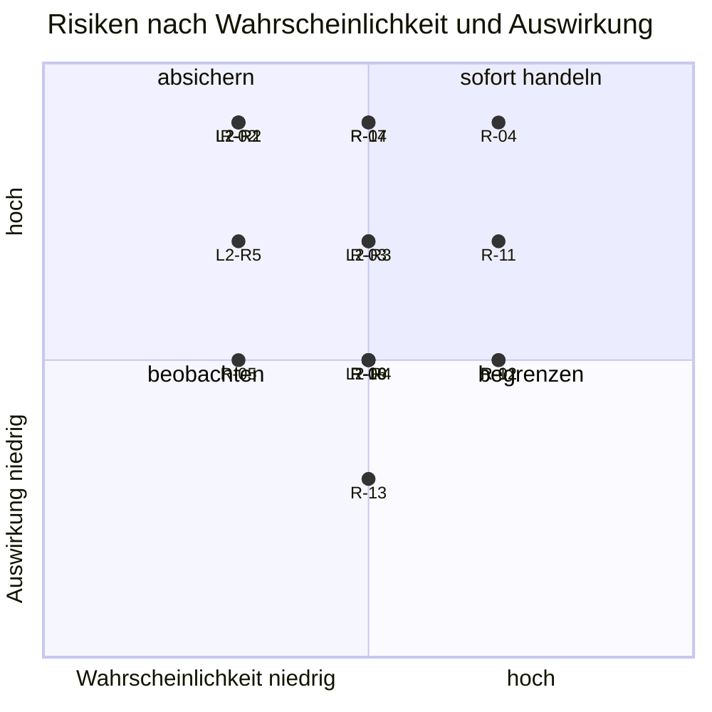

# Risikoregister Golden Gate

Stand: 2026-11-02 · Daten: `docs/RISIKOREGISTER.yaml` (führend für Bewertung) · Texte zu R-01 bis R-14: Tracker, Abschnitt `risiken` · Status: **Bewertung vom Owner am 2026-11-02 bestätigt** (R-04, R-11, R-07 und R-14 einzeln, die übrigen nach der vereinbarten Regel)

## 1 Methode

- Wahrscheinlichkeit `w` und Auswirkung `a` je 1 bis 5; Score = `w` × `a`. Stufen: **hoch** ab 15, **mittel** 8 bis 14, **niedrig** bis 7.
- Die Bewertung ist eine Einschätzung (Analogie, keine Messung). Der Owner hat sie am 2026-11-02 bestätigt (`bestaetigt_durch_owner: true`); Änderungen sind jederzeit möglich.
- Die Spalte SPoF kennzeichnet einen Single Point of Failure, FuSi einen Bezug zur funktionalen Sicherheit (falsche oder unberechtigte Anzeige, Datenverlust).
- Prüfrhythmus: bei jedem Tagesabschluss Status und nächste Prüfung ansehen; Neubewertung nach jedem gemergten L2-Schritt und bei jeder Antwort des Lovable-Supports.

## 2 Rangfolge

| ID    | Risiko                                                                                                                 | w   | a   | Score | Stufe   | Status            | SPoF | FuSi | Nächste Prüfung |
| ----- | ---------------------------------------------------------------------------------------------------------------------- | --- | --- | ----- | ------- | ----------------- | ---- | ---- | --------------- |
| R-04  | Einzelner Betreiber als SPoF für Freigaben und Supabase-Zugriff                                                        | 4   | 5   | 20    | hoch    | offen             | ja   | –    | 2026-11-09      |
| R-11  | Terminrisiko durch knappe Kapazität des Betreibers                                                                     | 4   | 4   | 16    | hoch    | offen             | ja   | –    | 2026-11-09      |
| R-07  | Lovable erzeugt den verbotenen Auth-Storage-Broker bei jeder Arbeitskopie neu                                          | 3   | 5   | 15    | hoch    | offen             | ja   | –    | 2026-11-05      |
| R-14  | Kein Nachweis für Wiederherstellung von Daten, Konfiguration und Schema                                                | 3   | 5   | 15    | hoch    | offen             | ja   | ja   | 2026-11-09      |
| L2-R3 | Fehlende Daten wirken wie „alles in Ordnung“                                                                           | 3   | 4   | 12    | mittel  | offen             | –    | ja   | 2026-11-02      |
| R-01  | Lovable-Basis divergiert erneut von GitHub                                                                             | 4   | 3   | 12    | mittel  | beherrscht        | –    | –    | 2026-11-02      |
| R-03  | Cockpit ist größter noch nicht begonnener Block                                                                        | 3   | 4   | 12    | mittel  | in_arbeit         | –    | –    | 2026-11-02      |
| R-12  | Abhängigkeit von der Lovable-Plattform (Credits, Plattform-Änderungen, Sync-Dialoge)                                   | 4   | 3   | 12    | mittel  | beobachten        | ja   | –    | 2026-11-09      |
| L2-R1 | Zweite Rechte- oder KPI-Logik im Composer                                                                              | 2   | 5   | 10    | mittel  | beherrscht        | –    | ja   | 2026-11-02      |
| L2-R2 | Beträge ohne billing.view angezeigt (QS-06 offen)                                                                      | 2   | 5   | 10    | mittel  | beherrscht        | –    | ja   | 2026-11-02      |
| R-02  | Unwiderrufliche Datenbankmigrationen                                                                                   | 2   | 5   | 10    | mittel  | beherrscht        | –    | ja   | 2026-11-09      |
| L2-R4 | Publish-Weg unklar: Code ohne Auslieferung                                                                             | 3   | 3   | 9     | mittel  | beobachten        | –    | –    | 2026-11-05      |
| R-06  | Gemeinsame Projektion ohne Bedienweg bleibt leer                                                                       | 3   | 3   | 9     | mittel  | beobachten        | –    | –    | 2026-11-02      |
| R-09  | Kein Bereitstellungspfad für die erste Systemhaus-Mitgliedschaft; Mandantentabellen live leer                          | 3   | 3   | 9     | mittel  | beobachten        | –    | –    | 2026-11-16      |
| R-10  | Migrationshistorie der Live-Datenbank hat Lücken (20260913213000, 20260917182000, 20260917190000) und leere Statements | 3   | 3   | 9     | mittel  | wartet_auf_dritte | –    | –    | 2026-11-05      |
| L2-R5 | Single Point of Failure im Server-Read                                                                                 | 2   | 4   | 8     | mittel  | offen             | ja   | ja   | 2026-11-02      |
| R-05  | Gelesene PASS-Statusanzeigen ohne Evidenz                                                                              | 2   | 3   | 6     | niedrig | beherrscht        | –    | –    | 2026-11-09      |
| R-13  | Branch-Wildwuchs erschwert Überblick und Aufräumen                                                                     | 3   | 2   | 6     | niedrig | beobachten        | –    | –    | 2026-11-09      |
| R-08  | Live-Datenbank weicht von den Migrationen ab (FK reference_value_history_systemhouse_fk)                               | 1   | 3   | 3     | niedrig | geschlossen       | –    | –    | –               |

## 3 Matrix (nur offene und beobachtete Risiken)

## 4 Einordnung

**Single Points of Failure:** R-04 (Einzelbetreiber), R-07 (Publish-Weg und Auth-Broker nur über den Lovable-Support klärbar), R-11 (Kapazität des Betreibers), R-12 (Lovable-Plattform), R-14 (keine Wiederherstellungsprobe), L2-R5 (Server-Read). R-04 und R-11 hängen zusammen: Fällt der Owner aus, stehen Freigaben, Merges und Datenaufträge still.

**Hinweis R-04 (2026-11-04):** Der Datenauftrag Kiosk-Konto weicht von ADR-0037 ab. Der Owner gibt beide Stufen allein frei; die nachträgliche Bestätigung durch eine zweite Person ist offen (`docs/DATENAUFTRAG-KIOSK-KONTO.md`). Mails an kiosk@ erreichen nur den Owner.

**Hinweis R-04 (2026-11-06):** Zugänge, zweite berechtigte Person und Notfallkonto je Dienst stehen ohne Werte in `docs/ZUGAENGE-UND-NOTFALLKONTO.md` (Entwurf, A09; Prüfliste ZN-01 bis ZN-18, REST-20, REST-21, N7, N9). Stand: für keinen Dienst ist eine zweite Person oder ein Notfallkonto belegt; Wiederherstellungsadressen sind offen; Auth-Mails der App-Konten und der Aliase kiosk@ und anzeige@ erreichen nur das Postfach info@. RTO-Werte nach ADR-0042 gelten bis dahin nur bei Verfügbarkeit des Owners.

**Funktionale Sicherheit:** R-02 (unwiderrufliche Migrationen), R-14 (Daten nicht wiederherstellbar nachgewiesen), L2-R1, L2-R2, L2-R3 und L2-R5 (falsche oder unberechtigte Anzeige im Cockpit). Gegenmaßnahmen sind die RED-Testmatrix und die Sicherheitstests aus U2 und U3 (Voraussetzung für Entscheidung E2).

**Schwerpunkte der nächsten sieben Tage:**

1. R-07/R-10: Nachfrage beim Lovable-Support am 2026-11-05; Publish bleibt No-Go.
2. R-03/L2-R3/L2-R5: Sicherheitstests und RED-Fälle in U2 und U3 mit Beleg.
3. R-04/R-11: Betreiberhoheit (BSF-06) als Konzept einplanen; zweite berechtigte Person benennen und offene Felder in `docs/ZUGAENGE-UND-NOTFALLKONTO.md` füllen; Tempo nach drei L2-Schritten neu messen.

## 5 Pflege

- Neues Risiko: Eintrag im Tracker (`risiken`, Text und Gegenmaßnahme) und im Register (Bewertung); `npm run docs:project` prüft, dass jede Tracker-ID im Register steht.
- Geschlossene Risiken bleiben im Register mit Status `geschlossen` (Nachvollziehbarkeit im Diff).
