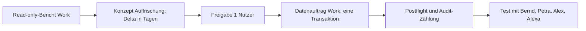

# TD-01 Stufe b – Live-Demo-Mandant auffrischen (Konzept)

Stand: 2026-10-25 · Status: Konzept, Umsetzung nur als Datenaufträge nach ADR-0037 · Voraussetzung: L0c, Kunde-B-Auftrag erledigt

## 1 Ausgangslage

- Stufe a (Code-Demodaten, lokal im Browser) ist umgesetzt: Datensatz 2.2.0, Datumsangaben relativ zum Stichtag (`day(±n)`), Neu-Einspielen setzt den Stand zurück (`docs/DEMO-DATA.md`).
- Der Live-Demo-Mandant (Systemhaus …0d1, Kunde A …0d2, Kunde B …0d3) enthält veröffentlichte Projektionen mit festen Datumswerten. Sie altern; Fälligkeiten rutschen in „Überfällig“ bzw. in die Vergangenheit.
- Die Kunde-B-Verantwortlichen (Petra Owner, Bernd Stellvertretung) fehlen noch (Datenauftrag steht aus).

## 2 Ziel

Der Live-Mandant muss für Testläufe mit Bernd, Petra, Alex und Alexa jederzeit realistische, nachvollziehbare Fälligkeiten zeigen, ohne dass jemand Daten von Hand pflegt.

## 3 Anforderungen (SMART)

| ID   | Anforderung                                                                                                                                          | Abnahme                                              |
| ---- | ---------------------------------------------------------------------------------------------------------------------------------------------------- | ---------------------------------------------------- |
| TB-1 | Das System muss die Fälligkeiten der aktiven Demo-Projektionen relativ zu einem Stichtag verschieben können, ohne Status oder Zuordnungen zu ändern. | Read-only-Vorher/Nachher-Bericht, exakte Zeilenzahl  |
| TB-2 | Erledigte Arbeitspakete dürfen nicht zeitlich verschoben werden.                                                                                     | Vorprüfung zählt 0 Änderungen an Status „done“       |
| TB-3 | Jeder Auffrischungsauftrag muss ein Datenauftrag nach ADR-0037 sein (zwei Freigaben, Projekt-ID-Bindung, eine Transaktion, Rollback über feste IDs). | Auftragstext enthält alle ADR-0037-Pflichtfelder     |
| TB-4 | Der Auftrag muss je Änderung genau benannte Audit-Zählungen erwarten; `audit_log` darf nie gelöscht werden.                                          | Nachprüfung: Audit-Zahl = Erwartung                  |
| TB-5 | Die Kategorien der Demo-Pakete sollten die lokalen Demodaten (2.2.0) widerspiegeln, damit Filter und Gruppen im Live-Mandanten sinnvoll sind.        | Bericht listet Kategorien je Projektion              |
| TB-6 | Der Kiosk-Befund „Infrastruktur-Spalte leer“ sollte geklärt werden: Ursache Datenstand oder Anzeige.                                                 | Befund mit Ursache, Zuordnung zu Daten- oder Codefix |

## 4 Vorgehen

1. Read-only-Bericht (Work): aktive Projektionszeilen je Kunde mit Fälligkeit, Status, Kategorie; Zahl der Audit-Einträge als Basis.
2. Delta bestimmen: Verschiebung in ganzen Tagen, sodass die Fälligkeitsverteilung der lokalen Demodaten (überfällig, heute, künftig) entsteht.
3. Datenauftrag formulieren und vom Nutzer in zwei Stufen freigeben lassen.
4. Nachprüfung und Test.

## 5 Risiken

- R-TB-1: Eine Verschiebung wirkt auf alle Betrachter des Mandanten gleichzeitig. Gegenmaßnahme: Testfenster abstimmen.
- R-TB-2: Fester Stichtag im Datenauftrag altert erneut. Gegenmaßnahme: Auffrischung als wiederholbarer Auftrag mit Stichtag als Parameter; später ggf. geplante Aufgabe (nach dem Golden Gate).
- R-TB-3: Verschieben ohne Statusprüfung macht Erledigtes „offen“. Gegenmaßnahme: TB-2.

## 6 Offene Fragen

- Ist der Zielzustand „wie lokale Demodaten“ oder ein fester Realtermin (z. B. Abnahme Montag)?
- Darf die Auffrischung auch Kunde A treffen, obwohl dessen Verantwortliche bereits gesetzt sind? (Empfehlung: ja, nur Datumsfelder.)
