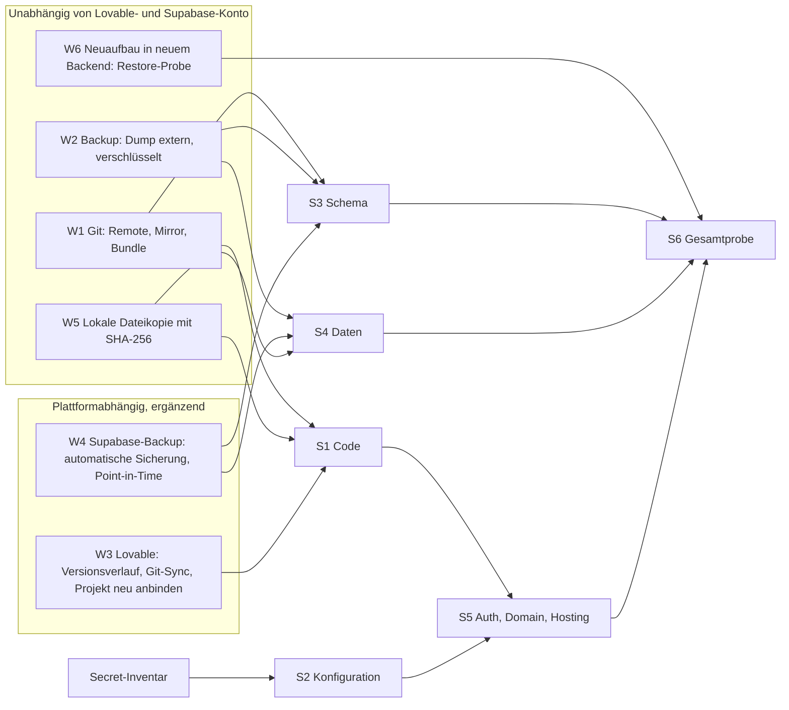

# Standardergänzung: Wiederherstellbarkeit (Restore) für Claude–Lovable–Git-Projekte

> **Status: Entwurf.** Abgelegt am 2026-11-05 (Auftrag A07) als versionierbare Kopie aus dem Projekt. Übernahme in `bmarnau-standards` erst nach der ersten bestandenen Restore-Probe. Die BSI-Einordnung ist eine Zuordnung, keine Konformitätsbehauptung (REST-23, REST-24).
>
> **Offene Punkte (Kopf):** RTO und RPO (REST-09, ADR offen) · TeamDrive-Eignungsnachweis (REST-15) · zweite berechtigte Person und Notfallkonto (REST-20, REST-21) · Zuordnung REST zu Grundschutz++ am Volltext prüfen (REST-25, `docs/standards/BSI-MAPPING.yaml`).
>
> Quelle: Entwurf Fassung 7 vom 03.11.2026, Teil B (übertragbarer Standard). Teil A (Pilotprojekt und Einordnung) liegt nur in der PDF-Fassung vor und ist hier nicht enthalten.

Status: Entwurf 2026-11-03 · Herkunft: Projekt sysingdashboard (Risiken R-04, R-10, R-14) · Geltung: alle Projekte, in denen Lovable als Entwicklungs- oder Publish-Plattform und Supabase als Backend dienen

Kennzeichnung: Aussagen zu Plattformfunktionen (Lovable, Supabase) sind Angaben der Hersteller oder allgemein bekannt. Sie gelten im Projekt erst als belegt, wenn ein Probe-Protokoll (Abschnitt 7) sie bestätigt. Bis dahin tragen sie den Vermerk „zu belegen“.

## 1 Zweck

Eine über Lovable veröffentlichte Anwendung ist aus Git allein nicht vollständig wiederherstellbar. Live-Daten, Secrets, Auth- und Domain-Konfiguration und der Publish-Stand liegen außerhalb von Git. Dieser Standard verlangt einen belegten Weg zur Wiederherstellung der Gesamtanwendung mit ihren Daten, mindestens in Etappen (Stufen), und auf mehreren Wegen, von denen mindestens zwei vom Ausfall der Plattformkonten unabhängig sind.

## 2 Anforderungen

| ID      | Anforderung                                                                                                                                                                                                                                                                                                                                                                                      | Abnahme                                |
| ------- | ------------------------------------------------------------------------------------------------------------------------------------------------------------------------------------------------------------------------------------------------------------------------------------------------------------------------------------------------------------------------------------------------ | -------------------------------------- |
| REST-01 | Das Projekt muss vor dem ersten Publish ein Restore-Dokument besitzen, das die Wiederherstellung der Gesamtanwendung inklusive Daten in den Stufen S1 bis S6 beschreibt.                                                                                                                                                                                                                         | Dokument im Git, Review                |
| REST-02 | Für jede Stufe muss es mindestens zwei unabhängige Wege geben (Abschnitt 5). Als unabhängig gelten nur Wege, die den gleichzeitigen Ausfall von Lovable-Konto und Supabase-Konto überstehen (W1, W2, W5, W6). Die Wege W3 und W4 ergänzen, ersetzen aber keinen unabhängigen Weg.                                                                                                                | Matrix ohne Stufe mit weniger als zwei |
| REST-03 | Der Code muss über Git wiederherstellbar sein: Remote, zusätzlicher Mirror oder Bundle außerhalb von GitHub. Ein Bundle muss mit `git bundle verify` geprüft und mit SHA-256 dokumentiert sein.                                                                                                                                                                                                  | Prüfprotokoll                          |
| REST-04 | Daten müssen als Backup (Export oder Dump von Schema und Daten) außerhalb von Lovable und Supabase vorliegen, verschlüsselt, mit Datum, Prüfsumme und Zeilenzahl je Tabelle.                                                                                                                                                                                                                     | Backup-Protokoll                       |
| REST-05 | Secrets dürfen nie in Git, Bundles oder Dokumentation stehen. Das Projekt muss ein Inventar der Secret-Namen mit Fundort und Neubeschaffungsweg führen (ohne Werte).                                                                                                                                                                                                                             | Inventar im Git                        |
| REST-06 | Das Projekt muss eine Restore-Probe in einer getrennten Umgebung (neues, leeres Backend) durchführen und protokollieren: Datum, Commit, Dauer, Abweichungen, Ergebnis je Stufe.                                                                                                                                                                                                                  | Probe-Protokoll mit Beleg              |
| REST-07 | Die Aussage „wiederherstellbar“ darf nur mit einem Probe-Protokoll getroffen werden, nie aus Annahme oder Herstellerangabe.                                                                                                                                                                                                                                                                      | Beleg im Tracker                       |
| REST-08 | Die Restore-Probe muss vor dem ersten Publish und danach vor jedem Release-Gate wiederholt werden, mindestens einmal je Quartal.                                                                                                                                                                                                                                                                 | Terminplan                             |
| REST-09 | Das Projekt sollte die Wiederherstellungszeit (RTO) und den höchsten tolerierten Datenverlust (RPO) festlegen und als ADR führen.                                                                                                                                                                                                                                                                | ADR                                    |
| REST-10 | Die Wirkung eines Publish auf Schema und Daten sowie die Möglichkeit, einen Publish zurückzunehmen, müssen vor dem ersten Publish belegt sein. Ist beides unbekannt, bleibt der Publish No-Go.                                                                                                                                                                                                   | Plattform-Prüfbericht                  |
| REST-11 | Beim Restore dürfen Rollenrechte (RLS, Permissions) nicht weiter öffnen als im Betrieb. Die Rollenabnahme je Rolle (Stufe S6) muss nach jeder Wiederherstellung wiederholt werden.                                                                                                                                                                                                               | Abnahme-Protokoll                      |
| REST-12 | Das Projekt muss für jedes Notfallszenario aus Abschnitt 12 ein Runbook führen, das ein Mensch ohne Claude und ohne Zugriff auf Chatverläufe ausführen kann.                                                                                                                                                                                                                                     | Runbooks im Git                        |
| REST-13 | Das Projekt muss die Notfallszenarien mindestens halbjährlich als Planübung (Tabletop) durchspielen; Szenario N2 (Claude nicht erreichbar) muss dabei allein aus dem Git-Stand wieder aufgenommen werden.                                                                                                                                                                                        | Übungsprotokoll                        |
| REST-14 | Entscheidungen, Auftragstexte, Planungsseiten, Skripte und Startdateien müssen im Git liegen. Was nur in Chatverläufen, Plattformspeichern oder auf einem Einzelrechner liegt, gilt als nicht gesichert.                                                                                                                                                                                         | Prüfliste im Restore-Dokument          |
| REST-15 | Backups (Weg W2) und Notfallmappe (Weg W5) müssen auf einem vom Owner freigegebenen, datenschutzkonformen Ablagemedium außerhalb von Lovable, Supabase und GitHub liegen. Das Projekt muss die Eignung belegen: Vertrag zur Auftragsverarbeitung, Serverstandort, Ende-zu-Ende-Verschlüsselung, Zugriffskonzept, Aufbewahrungs- und Löschkonzept, Versionierung gegen Überschreiben und Löschen. | Eignungsnachweis im Restore-Dokument   |
| REST-16 | Das Projekt muss jedes Notfallszenario nach Eintritt und Auswirkung bewerten, nach derselben Skala wie sein Risikoregister, und die Bewertung dort führen. Die Bewertung muss nach jedem Vorfall und jeder Übung überprüft werden.                                                                                                                                                               | Risikobasierter Ansatz                 |
| REST-17 | Das Projekt muss Daten und Dienste in Schutzklassen (normal, hoch, kritisch) einteilen und die Einteilung begründen.                                                                                                                                                                                                                                                                             | Schutzbedarf                           |
| REST-18 | Das Projekt sollte aus der Schutzklasse RTO, RPO, Backup-Rhythmus, Übungsrhythmus und die Zahl unabhängiger Wege ableiten und als Tabelle im ADR zu REST-09 führen.                                                                                                                                                                                                                              | Ableitung der Tiefe                    |
| REST-19 | Szenarien der Stufe hoch müssen ein Runbook haben und mindestens halbjährlich geübt werden. Bei niedriger Stufe darf das Projekt auf Runbook und Übung verzichten, wenn es den Verzicht begründet und im Risikoregister vermerkt.                                                                                                                                                                | Aufwand nach Stufe                     |
| REST-20 | Für jeden Dienst der Schutzklasse kritisch muss es mindestens zwei voneinander unabhängige Zugangswege geben (zweite berechtigte Person oder Notfallkonto). Ein einzelnes Konto je Dienst gilt als Single Point of Failure.                                                                                                                                                                      | Konten                                 |
| REST-21 | Notfallzugänge müssen getrennt vom Alltagszugang geführt werden (anderes Gerät, anderer Tresor, andere Wiederherstellungsadresse, anderer zweiter Faktor) und jede Nutzung muss protokolliert werden.                                                                                                                                                                                            | Konten                                 |
| REST-22 | Test-, Probe- und Produktivumgebung müssen getrennte Konten, Schlüssel und Secrets haben. Eine Restore-Probe darf keinen Produktivschlüssel verwenden.                                                                                                                                                                                                                                           | Umgebungen                             |
| REST-23 | Das Projekt sollte die Begriffe des BSI-Standards 200-4 (zum Beispiel Wiederanlaufzeit, tolerierbare Ausfallzeit, Wiederanlaufplan, Wiederherstellungsplan) verwenden oder eine Zuordnung zu den eigenen Begriffen führen.                                                                                                                                                                       | Begriffe                               |
| REST-24 | Verpflichtet ein Kunde, ein Vertrag oder die Organisation zu einem Business Continuity Management, muss das Projekt Runbooks, Übungsprotokolle und Restore-Belege so führen, dass sie als Nachweise in dieses Management eingehen können. Es darf keine Konformität zu BSI-Standard 200-4 oder ISO 22301 behaupten, ohne sie geprüft zu haben.                                                   | Abgrenzung                             |
| REST-25 | Das Projekt sollte seine Anforderungen mit den Kennungen des Katalogs Grundschutz++ des BSI (Praktik NOT, ASST.7.4, BES.5.13, BER.3.22, TEST.4.4) verknüpfen, in einer maschinenlesbaren Datei in Git, mit ID, Titel und dem geprüften Katalogstand, ohne Textkopie. Das Projekt darf daraus keinen Konformitätsanspruch ableiten.                                                               | Nachvollziehbarkeit                    |
| REST-26 | Das Projekt muss jede Aussage „wiederherstellbar“, „geübt“ oder „bestanden“ mit einem Nachweis (Evidence) belegen und die Nachweise in einem Nachweisregister in Git führen. Je Nachweis müssen Kennung, zugehörige Anforderung oder Stufe, Art, Link oder Fundort, Datum, Prüfer und ein Hinweis auf Quelle oder Grenzen angegeben sein. Nachweise ohne Link zur Quelle gelten nicht.           | Evidence                               |

## 3 Stufen der Wiederherstellung

| Stufe | Inhalt                    | Prüfung                                                       |
| ----- | ------------------------- | ------------------------------------------------------------- |
| S1    | Code und Tests            | Clone, Installation, Build, CI grün                           |
| S2    | Konfiguration und Secrets | Inventar vollständig, alle Secrets neu beschaffbar            |
| S3    | Datenbankschema           | Migrationen in leerer Instanz, Schema-Vergleich zum Betrieb   |
| S4    | Daten                     | Import, Zeilenzahlen je Tabelle, Stichproben, Audit-Tabellen  |
| S5    | Auth, Domain, Hosting     | Auth-Provider, Redirect-URLs, Domain, Lovable-Verbindung      |
| S6    | Gesamtprobe               | Anmeldung je Rolle, Rollenabnahme, Smoke-Test, E2E-Hauptpfade |

Etappen sind zulässig: Ein Projekt darf S1 bis S3 früher nachweisen als S4 bis S6, muss aber vor dem ersten Publish alle sechs Stufen belegt haben.

## 4 Sicht auf die Wege



## 5 Beschreibung der Wege

### W1 Git (unabhängig)

- Inhalt: Quellcode, Tests, Migrationen, Dokumentation, ADRs, Tracker. Nicht enthalten: Daten, Secrets, Auth- und Domain-Konfiguration, Publish-Stand.
- Wiederherstellung: Repository klonen, Abhängigkeiten installieren, Build und CI ausführen (S1). Schema aus den Migrationen in eine leere Instanz anwenden (S3).
- Ausbau: Zusätzlich zum GitHub-Remote ein Mirror (anderer Anbieter oder lokal) und ein verifiziertes Bundle (`git bundle verify`), Prüfsumme dokumentiert.
- Grenzen: Der Lovable-Stand kann von Git abweichen (Plattformdateien, `lovable-sync-*`-Branches). Das Schema in Git ist nur dann maßgeblich, wenn die Migrationshistorie vollständig ist (Schema-Vergleich in S3).
- Nachweis: Clone in leerem Verzeichnis, Build grün, CI-Lauf, Bundle-Prüfung.

### W2 Backup (unabhängig)

- Inhalt: Dump von Schema und Daten (zum Beispiel `pg_dump`, ergänzend Export von Auth-Benutzern, Storage-Objekten und Konfiguration, soweit vorhanden).
- Wiederherstellung: Import in ein leeres Backend (S3, S4), danach Prüfung der Zeilenzahlen je Tabelle und von Stichproben, Audit-Tabellen vollständig.
- Ausbau: Verschlüsselt, mit Datum, Prüfsumme und Aufbewahrungsdauer, an einem Ort außerhalb von Lovable, Supabase und dem Entwicklungsrechner (REST-15). Zugriff dokumentieren, weil Dumps personenbezogene und sensible Daten enthalten können.
- Ablageort im Projekt sysingdashboard: TeamDrive (Entscheidung des Owners 2026-11-03: als datenschutzkonformes Backupmedium nutzbar). Die Eignung nach REST-15 ist zu belegen. Zusätzlich sollten Dumps vor dem Ablegen mit einem eigenen Schlüssel verschlüsselt werden, der nicht im selben TeamDrive-Bereich liegt. Weil TeamDrive synchronisiert, müssen Versionierung oder schreibgeschützte Ablagestände verhindern, dass ein beschädigter oder gelöschter Stand alle Kopien überschreibt (zu belegen).
- Grenzen: Auth-Passwörter und Secrets sind nur im Rahmen der Exportfunktionen enthalten (zu belegen). Daten zwischen Backup und Ausfall gehen verloren (RPO).
- Nachweis: Backup-Protokoll, Restore in W6.

### W3 Lovable (plattformabhängig, ergänzend)

- Inhalt: Lovable-Projektstand, Versionsverlauf des Projekts, Verbindung zum GitHub-Repository (zweiseitiger Sync), Publish-Stand.
- Wiederherstellung: (a) Rücksetzen auf eine frühere Projektversion im Editor, (b) Abgleich mit Git über Re-check und Sync-Dialog („Repository-Version behalten“), (c) bei Verlust des Projekts: neues Lovable-Projekt aus dem Git-Repository anbinden (zu belegen, ob und wie das im Plan möglich ist).
- Grenzen: Publish deployt immer den aktuellen Lovable-Stand, kein Pinning auf Commit oder Branch (Support-Auskunft). Rücksetzen und Veröffentlichen ändern nicht automatisch Daten. Ob ein Publish Schemaänderungen anwendet und ob sich ein Publish zurücknehmen lässt, ist zu belegen (REST-10).
- Abhängigkeit: am Lovable-Konto, daher nicht unabhängig im Sinne REST-02.
- Nachweis: Dokumentierte Probe im Editor (Rücksetzen, Re-check), Protokoll mit Datum und Commit.

### W4 Supabase-Backup (plattformabhängig, ergänzend)

- Inhalt: Automatische Sicherungen des Supabase-Projekts, gegebenenfalls Point-in-Time-Recovery (PITR). Verfügbarkeit, Aufbewahrungsdauer und Wiederherstellungsweg hängen vom Plan ab (zu belegen). Bei Lovable Cloud ist zu klären, ob und wie Backups einsehbar sind (offen in R-10).
- Wiederherstellung: Auswahl des Sicherungszeitpunkts im Plattform-Dashboard und Wiederherstellung im selben oder in einem neuen Projekt (S3, S4).
- Grenzen: Gleiches Konto wie das Produktivsystem, daher bei Kontoverlust oder Fehlbedienung des Kontos nicht verfügbar. Wiederherstellung überschreibt gegebenenfalls den Ist-Stand (vorher Dump nach W2 ziehen). Auth-Konfiguration und Secrets sind nicht in jedem Fall enthalten (zu belegen).
- Nachweis: Plan und Aufbewahrungsdauer dokumentiert; Probe-Wiederherstellung in ein neues Projekt mit Protokoll.

### W5 Lokale Dateikopie (unabhängig)

- Inhalt: Arbeitsstand als Dateikopie (Quellbaum, Bundle, Konfigurationsvorlagen ohne Secrets) mit SHA-256-Liste, außerhalb von GitHub und außerhalb von OneDrive-Synchronisation.
- Wiederherstellung: Hashes prüfen, Kopie in leeres Verzeichnis entpacken, Build (S1). Dient als Rückfall, wenn GitHub-Remote oder Mirror nicht erreichbar sind.
- Vorbild im Projekt: `backup/codex-2026-10-31` mit Bundle (111 Refs), Dateikopie (33 Dateien) und SHA-256, nachgeprüft.
- Grenzen: Enthält keine Live-Daten. Veraltet, wenn nicht regelmäßig erneuert.
- Nachweis: Hash-Prüfung und Build-Lauf.

### W6 Neuaufbau in neuem Backend (unabhängig, Restore-Probe)

- Inhalt: Die Probe selbst: leeres Supabase-Projekt, Schema aus Migrationen (W1), Daten aus Dump (W2), Konfiguration aus Inventar (S2), neue Auth-Konfiguration (S5).
- Wiederherstellung: Schrittfolge S1 bis S6, jede Stufe mit Prüfung und Zeitmessung (RTO).
- Grenzen: Aufwand und Kosten eines zweiten Projekts; Probe darf keine Produktivdaten gefährden und keine Produktiv-Secrets verwenden.
- Nachweis: Probe-Protokoll nach Abschnitt 7.

## 6 Matrix Stufe × Weg

| Stufe | W1 Git      | W2 Backup   | W3 Lovable | W4 Supabase-Backup | W5 Lokale Kopie | W6 Neuaufbau  |
| ----- | ----------- | ----------- | ---------- | ------------------ | --------------- | ------------- |
| S1    | ja          | nein        | ja         | nein               | ja              | ja (nutzt W1) |
| S2    | Inventar    | Inventar    | teilweise  | teilweise          | Vorlagen        | ja (Inventar) |
| S3    | Migrationen | Schema-Dump | nein       | ja                 | nein            | ja            |
| S4    | nein        | ja          | nein       | ja                 | nein            | ja (nutzt W2) |
| S5    | Doku        | Doku        | teilweise  | teilweise          | Doku            | ja            |
| S6    | nein        | nein        | nein       | nein               | nein            | ja            |

Bedingung REST-02: je Stufe mindestens zwei Spalten aus {W1, W2, W5, W6} mit „ja“. Für S6 gilt W6 als einziger Weg; hier genügt der Nachweis der Probe (REST-06).

## 7 Szenarien: Was ist ausgefallen, welcher Weg greift?

| Szenario                                                 | Zuerst                      | Danach                               | Hinweis                                                      |
| -------------------------------------------------------- | --------------------------- | ------------------------------------ | ------------------------------------------------------------ |
| Fehlerhafte Änderung oder Überschreiben im Lovable-Stand | W3 (Rücksetzen), W1         | Abgleich per Re-check                | `lovable-sync-*`-Branches nicht mergen                       |
| Fehlerhafter Publish                                     | W3 (Rücksetzen, zu belegen) | W1 Neu-Sync, Publish wiederholen     | REST-10: Rücknahme vorab belegen                             |
| Datenverlust oder fehlerhafte Migration im Backend       | W4 (Point-in-Time)          | W2 (Dump)                            | Vor jeder Wiederherstellung aktuellen Zustand sichern        |
| Supabase-Projekt oder -Konto nicht mehr verfügbar        | W6 mit W2                   | W1 für Schema                        | S5 (Auth, Domain) neu einrichten, Rollenabnahme S6           |
| Lovable-Projekt oder -Konto nicht mehr verfügbar         | W1                          | neues Lovable-Projekt anbinden (W3c) | Publish-Quelle neu festlegen                                 |
| GitHub nicht erreichbar                                  | W1 (Mirror)                 | W5                                   | Bundle verifizieren                                          |
| Gesamtausfall (Lovable, Supabase, GitHub)                | W5, W1 (Mirror, Bundle)     | W6 mit W2                            | Nur möglich, wenn W2 und W5 außerhalb der Plattformen liegen |

## 8 Restore-Probe (Protokollinhalt)

Jedes Probe-Protokoll muss enthalten: Datum und Uhrzeit, geprüfter Commit, verwendeter Backup-Stand (Prüfsumme), Zielumgebung, Ergebnis je Stufe S1 bis S6 mit Dauer, Abweichungen (zum Beispiel Schemaunterschiede, fehlende Secrets, abweichende Rollenrechte), Entscheidung (bestanden, bestanden mit Auflagen, nicht bestanden) und Verantwortlichen. Ohne Protokoll gilt die Stufe als nicht belegt (REST-07).

## 9 Risiken und Single Points of Failure

- SPoF Lovable-Projekt: Publish-Quelle ist der Lovable-Stand, nicht Git.
- SPoF Supabase-Projekt: Daten, Auth und Schema liegen in einem Konto; Plattform-Backups im selben Konto sind kein unabhängiger Weg.
- Schema nicht belegt identisch zu den Migrationen (Lücken in der Migrationshistorie): vor Wegen W1 und W2 Schema-Vergleich durchführen.
- Funktionale Sicherheit: Wiederherstellung darf Rollenrechte (RLS, Permissions) nicht aufweichen (REST-11).
- Secrets in Dumps und Bundles: verschlüsseln, Zugriff begrenzen, nie in Git.
- Backups, die nie wiederhergestellt wurden, gelten als unbelegt.

## 10 Anhang: Plattformgrenzen aus dem Pilotprojekt (Lernpunkte)

1. Publish-Quelle früh klären: Publish deployt den Lovable-Stand, kein Pinning; Git ist der Spiegel.
2. Plattformdateien (`client.ts`-Broker, `types.ts` mit 5 zusätzlichen Zeilen) per Vertragstest und ADR absichern.
3. Support-Aussagen sind keine Messung: Wirkung messen und mit Datum belegen.
4. Lovable-Schreibaufträge und Merges nie parallel; `lovable-sync-*` nie mergen; im Sync-Dialog „Repository-Version behalten“; lesende Prompts bevorzugen (Credits).
5. Demo-Konten für jede Rolle von Anfang an, sonst bleibt die Rollenabnahme lückenhaft.
6. UI-Gating ersetzt keine serverseitige Filterung.
7. Alte Drafts per Cherry-Pick auf aktuellem `main` neu aufbauen statt mergen.
8. Gate-Liste vor dem Publish von Beginn an führen, mit Verantwortlichem je Punkt; ein Go gilt nur für den geprüften Commit.

## 11 Projektbezug sysingdashboard (nicht Teil des allgemeinen Standards)

- Deckt R-04 (kein Restore-Dokument) und R-14 (kein Nachweis für Daten, Konfiguration, Schema).
- Gate vor dem ersten Publish: Restore-Probe nach REST-06 mindestens bis S4 mit Datenexport (W2), danach S5 und S6.
- Ablageort für W2 und W5: TeamDrive (Entscheidung des Owners 2026-11-03). Eignung nach REST-15 (Vertrag zur Auftragsverarbeitung, Serverstandort, Verschlüsselung, Zugriffs- und Löschkonzept, Versionierung) ist noch zu belegen.
- Offen: Lovable Cloud oder eigenes Supabase-Projekt (R-10, Support-Rückfrage), Plan und Aufbewahrungsdauer der Supabase-Backups.

## 12 Notfallszenarien (Katalog)

Pflichtfelder je Runbook: Auslöser und Erkennung, Entscheidungsbefugter, Sofortmaßnahme (erste Stunde), Weg zur Wiederherstellung (Abschnitt 5), Kommunikation, Nachweis, Rückkehr in den Normalbetrieb.

| ID  | Szenario                                                                             | Wirkung                                                                                             | Sofortmaßnahme                                                                                                                                                                                                                                | Weg                       | Bekannte Lücke im Pilotprojekt                                                                               |
| --- | ------------------------------------------------------------------------------------ | --------------------------------------------------------------------------------------------------- | --------------------------------------------------------------------------------------------------------------------------------------------------------------------------------------------------------------------------------------------- | ------------------------- | ------------------------------------------------------------------------------------------------------------ |
| N1  | App defekt (nach Publish, Frontend, Daten oder Auth)                                 | Nutzer können nicht arbeiten oder sehen falsche Daten                                               | Art des Defekts eingrenzen (Code, Daten, Auth); bei Codefehler Stand aus Git prüfen und Rücksetzen (W3, zu belegen) oder Fix über Git, Sync, erneuten Publish; bei Datenfehler Wiederherstellung W4 oder W2, vorher aktuellen Zustand sichern | W1, W3, W4, W2            | Rücknahme eines Publish nicht belegt (REST-10)                                                               |
| N2  | Claude nicht mehr erreichbar (Chat und Claude Code)                                  | Keine Aufträge, Reviews und Planung; die laufende App ist nicht betroffen                           | Arbeit aus dem Git-Stand wieder aufnehmen: CLAUDE.md, Doku-Pflegeauftrag, Tracker, CURRENT-STATUS, ADRs; Skripte und REST-Merge nach Dokumentation von Hand ausführen; Entwicklung durch Menschen oder einen anderen Assistenten              | W1, W5                    | Auftragstexte (U1 bis U7) nur im Chat; Planungsseite nur als Artifact; Projekt-Memory nicht in Git (REST-14) |
| N3  | Lovable nicht mehr erreichbar (vorübergehend oder dauerhaft)                         | Editor, Preview und Publish nicht verfügbar; ob die veröffentlichte App weiterläuft, ist zu belegen | Vorübergehend: lokal in Git weiterentwickeln und testen, nicht publizieren. Dauerhaft: App aus Git an anderer Stelle hosten (Container-Portabilität ist laut Projektdoku Architekturziel) und neu an Auth und Backend anbinden                | W1, W6, W5                | Kein Runbook für alternatives Hosting; Publish-Stand und Domain nur in Lovable                               |
| N4  | Git (GitHub) nicht mehr erreichbar                                                   | Keine PRs, CI und Merges; Lovable-Sync gestört                                                      | Lokaler Klon ist vollständig; Mirror oder Bundle als neuer Remote; Tests und Prüfungen lokal; Merges pausieren                                                                                                                                | W1 (Mirror), W5           | CI läuft nur auf GitHub Actions; Merge-Regeln beziehen sich auf GitHub-REST                                  |
| N5  | Supabase nicht erreichbar, Daten defekt oder fehlerhafte Migration                   | Daten oder Auth fehlen oder sind falsch                                                             | Schreibzugriffe stoppen, Ist-Zustand sichern (W2), dann Wiederherstellung (W4 zum Zeitpunkt vor dem Fehler) oder Neuaufbau (W6)                                                                                                               | W4, W2, W6                | Plan, Aufbewahrung und Neuanbindung nicht belegt (R-10, R-14)                                                |
| N6  | Arbeitsrechner oder lokaler Klon defekt                                              | Keine lokale Entwicklung, Startdatei und lokale Skripte fehlen                                      | Neuer Klon aus W1, Hash-geprüfte Kopie aus W5                                                                                                                                                                                                 | W1, W5                    | Startdatei `start-sysingboard.ps1` liegt nur lokal (Backlog); lokaler Pfad OneDrive-frei halten              |
| N7  | Kontoinhaber nicht verfügbar oder Konto gesperrt (GitHub, Lovable, Supabase, Claude) | Niemand kann Konten verwalten oder Secrets ändern                                                   | Zweite berechtigte Person oder Notfallzugang laut Inventar; Passwort-Tresor mit Übergabeverfahren                                                                                                                                             | Secret-Inventar (REST-05) | Alle Konten liegen bei einer Person (Bus-Faktor 1)                                                           |
| N8  | Secret kompromittiert oder Sicherheitsvorfall                                        | Unbefugter Zugriff möglich                                                                          | Secret rotieren, Sitzungen ungültig machen, `audit_log` sichern und nie löschen, Vorfall dokumentieren, Rollenrechte prüfen                                                                                                                   | Secret-Inventar, W2       | Rotationsanleitung je Secret fehlt                                                                           |
| N9  | Domain, DNS, Zertifikat oder Auth-Provider-Konfiguration verloren                    | App nicht erreichbar oder Anmeldung scheitert                                                       | Konfiguration aus Inventar (S2, S5) neu setzen, Redirect-URLs prüfen, Rollenabnahme (S6)                                                                                                                                                      | Inventar, W6              | S5 nicht dokumentiert                                                                                        |
| N10 | Lieferkette: npm-Registry oder Paket nicht verfügbar oder kompromittiert             | Build nicht möglich oder unsicher                                                                   | `package-lock.json` als Maßstab, `npm ci`, Mirror oder Offline-Cache, kompromittierte Version sperren                                                                                                                                         | W1, W5                    | Kein Mirror oder Offline-Cache                                                                               |

Vollständigkeit: Der Katalog ist ein Mindestumfang. Neue Szenarien (zum Beispiel Ausfall eines Subdienstleisters, Rechtsfall, Datenschutzvorfall) sind in der Planübung (REST-13) zu ergänzen.

## 13 Risikobasierter Ansatz

Die Tiefe der Vorsorge richtet sich nach dem Risiko, nicht nach dem Wunsch nach Vollständigkeit. Jedes Szenario aus Abschnitt 12 wird bewertet (REST-16), jede Dienstleistung einer Schutzklasse zugeordnet (REST-17).

Skala (wie im Risikoregister des Pilotprojekts): Eintritt und Auswirkung je 1 bis 3, Score = Eintritt × Auswirkung; ab 6 hoch, 3 bis 4 mittel, bis 2 niedrig.

**Schutzklassen und Richtwerte (Vorschlag, im ADR festzulegen, REST-18):**

| Klasse   | Beispiel                                       | RTO               | RPO                         | Backup                          | Übung                     | Unabhängige Wege     |
| -------- | ---------------------------------------------- | ----------------- | --------------------------- | ------------------------------- | ------------------------- | -------------------- |
| normal   | Demo- und Testdaten, Dokumentation             | bis 5 Arbeitstage | bis 1 Woche                 | wöchentlich                     | jährlich                  | 1                    |
| hoch     | Quellcode, Konfiguration, Rollen und Rechte    | bis 2 Arbeitstage | bis 1 Tag                   | täglich oder bei jeder Änderung | halbjährlich              | 2                    |
| kritisch | Echte Kunden- und Zeitdaten, Auth, `audit_log` | bis 1 Arbeitstag  | bis 1 Tag, besser stündlich | täglich, verschlüsselt extern   | halbjährlich, mit Messung | 2 plus Notfallzugang |

**Bewertung der Szenarien (Vorschlag aus dem Pilotprojekt, vom Projekt zu bestätigen):**

| ID  | Szenario                           | Eintritt (1–3) | Auswirkung (1–3) | Score | Stufe   | Folge                                   |
| --- | ---------------------------------- | -------------- | ---------------- | ----- | ------- | --------------------------------------- |
| N1  | App defekt                         | 3              | 2                | 6     | hoch    | Runbook und Planübung Pflicht           |
| N2  | Claude nicht erreichbar            | 2              | 2                | 4     | mittel  | Runbook, Planübung jährlich             |
| N3  | Lovable nicht erreichbar           | 2              | 3                | 6     | hoch    | Runbook und Planübung Pflicht           |
| N4  | Git nicht erreichbar               | 1              | 3                | 3     | mittel  | Runbook, Planübung jährlich             |
| N5  | Supabase, Daten, Fehlmigration     | 2              | 3                | 6     | hoch    | Runbook und Planübung Pflicht           |
| N6  | Arbeitsrechner defekt              | 2              | 2                | 4     | mittel  | Runbook, Planübung jährlich             |
| N7  | Kontoinhaber fehlt, Konto gesperrt | 2              | 3                | 6     | hoch    | Runbook und Planübung Pflicht           |
| N8  | Secret kompromittiert              | 2              | 3                | 6     | hoch    | Runbook und Planübung Pflicht           |
| N9  | Domain, DNS, Auth-Konfiguration    | 1              | 3                | 3     | mittel  | Runbook, Planübung jährlich             |
| N10 | Lieferkette (npm)                  | 1              | 2                | 2     | niedrig | Beschreibung genügt, Verzicht begründen |

**Konten und Umgebungen (REST-20 bis REST-22):**

- Ein Konto je Dienst reicht nicht für kritische Dienste. Gefordert sind eine zweite berechtigte Person oder ein Notfallkonto (Break-Glass), das getrennt vom Alltagszugang geführt wird.
- Postfach und Domain, über die Konten wiederhergestellt werden, sind selbst kritisch: Fällt das Postfach aus, fallen alle daran hängenden Konten mit aus (N9). Das Postfach darf deshalb nicht die einzige Wiederherstellungsadresse sein.
- Test, Probe und Produktion dürfen weder Konto noch Schlüssel teilen. Ob sich Lovable Cloud und Probe-Backend trennen lassen, ist je Plan zu belegen.

## 14 Bezug zum BSI-Standard 200-4 (Business Continuity Management)

Quelle: [BSI-Standard 200-4](https://www.bsi.bund.de/DE/Themen/Unternehmen-und-Organisationen/Standards-und-Zertifizierung/IT-Grundschutz/BSI-Standards/BSI-Standard-200-4-Business-Continuity-Management/bsi-standard-200-4_Business_Continuity_Management_node.html). Nach der Seite des BSI (zuletzt aktualisiert 13.12.2023) bietet der Standard eine praxisnahe Anleitung zum Aufbau eines Business Continuity Management Systems (BCMS), einen normativen Anforderungskatalog mit Zuordnung zur ISO 22301:2019, ein Glossar und eine Dokumentvorlage für Wiederanlauf- und Wiederherstellungspläne. Eine Zertifizierung ist laut BSI derzeit nicht geplant.

**Abgrenzung (angemessen und mit Bedacht):** Dieser Standard erhebt keinen Anspruch, ein BCMS nach BSI-Standard 200-4 oder ISO 22301 zu sein, und ersetzt es nicht. Er ist ein schlanker, projektbezogener Teil für Anwendungen, die mit Claude, Lovable, Supabase und Git entstehen. Er übernimmt Denkweise und Begriffe des BSI-Standards, soweit sie für ein kleines Entwicklungsprojekt tragen, und führt sonst nur Querverweise. Verpflichtet ein Kunde, ein Vertrag oder die Organisation zu einem BCMS, ist das BCMS der Organisation führend und dieser Standard liefert ihm die technischen Nachweise (Runbooks, Übungsprotokolle, Backup- und Restore-Belege).

**Zuordnung der Begriffe (Vorschlag, am Standardtext zu prüfen):**

| BSI-Standard 200-4 (Begriff)                                         | Dieser Standard                                                                    | Hinweis                                                                                     |
| -------------------------------------------------------------------- | ---------------------------------------------------------------------------------- | ------------------------------------------------------------------------------------------- |
| Business-Impact-Analyse (BIA), kritische Prozesse und Ressourcen     | Schutzklassen und Bewertung der Szenarien (REST-16, REST-17, Abschnitt 13)         | Die Bewertung ist eine vereinfachte BIA für ein Projekt; keine formale BIA der Organisation |
| Risikoanalyse                                                        | Szenarienbewertung nach Eintritt und Auswirkung, Risikoregister (REST-16)          | Skala des Projekts, nicht die des BSI                                                       |
| Wiederanlaufzeit und tolerierbare Ausfallzeit                        | RTO (REST-09, REST-18)                                                             | Begriff vom Projekt festlegen und im ADR zuordnen                                           |
| tolerierbarer Datenverlust                                           | RPO (REST-09, REST-18)                                                             | RPO ist ein verbreiteter Begriff; Zuordnung im ADR                                          |
| Wiederanlauf- und Wiederherstellungspläne (Dokumentvorlage beim BSI) | Runbooks je Szenario, Stufen S1 bis S6 (REST-12, Abschnitt 3)                      | Pflichtfelder der Runbooks gegen die BSI-Vorlage abgleichen                                 |
| Notfall- und Krisenorganisation, Entscheidungsbefugnis               | Pflichtfeld „Entscheidungsbefugter“, Kontenregeln, Notfallkonto (REST-20, REST-21) | Vertretung und Erreichbarkeit nach BSI-Gedanken                                             |
| Übungen und Tests                                                    | Planübung und Restore-Probe (REST-13, Abschnitt 8)                                 | Rhythmus nach Schutzklasse (REST-19)                                                        |
| Kontinuierliche Verbesserung                                         | Überprüfung der Bewertung nach Vorfall und Übung (REST-16)                         |                                                                                             |
| Glossar                                                              | Begriffe dieses Standards                                                          | Begriffe des BSI-Glossars sollten verwendet werden (REST-23)                                |

**Vorgehensweise mit Augenmaß:** Der BSI-Standard stuft den Einstieg nach dem Reifegrad der Organisation ein. Für ein kleines Projekt ohne eigenes BCMS genügt die Einstiegsstufe: bekannte Ausfallszenarien, Sofortmaßnahmen, Wiederanlaufpläne und Übungen (Abschnitte 3, 12 und 8). Die Bezeichnung der Stufen und ihren Umfang bitte am aktuellen Standardtext prüfen, bevor sie zitiert werden. Wächst das Projekt oder verlangt es der Kunde, sollte es zu einer formalen BIA, einer Notfallstrategie und einem Anforderungsabgleich mit dem Katalog des BSI wechseln.

**Einordnung der Tiefe (kein Zertifizierungsziel):** Dieser Standard strebt weder eine Zertifizierung noch einen Konformitätsnachweis an. Der BSI-Standard 200-4 dient als Orientierung und Wörterbuch. Der Maßstab ist das Mindestniveau, das ein kleines Projekt mit realen Ausfallrisiken braucht: Szenarien, Pläne, Sicherung, Probe, Zuständigkeit. Das entspricht dem normalen Schutzbedarf. Für die Schutzklasse kritisch (Abschnitt 13) orientiert sich der Standard am erhöhten Schutzbedarf.

**Maschinenlesbare Grundlage des BSI (Grundschutz++, OSCAL):** Das BSI veröffentlicht in der [Stand-der-Technik-Bibliothek](https://github.com/BSI-Bund/Stand-der-Technik-Bibliothek) maschinenlesbare Kataloge im Format OSCAL (JSON), Lizenz CC BY-SA 4.0. Die Auswertung durch Claude Code am Stand vom 30.10.2026 (Commit c3f3785) ergab:

- Einen eigenen Katalog zum BSI-Standard 200-4 gibt es dort nicht. Notfallinhalte stehen im Katalog Grundschutz++ als Praktik NOT (Grundlagen, besondere Aufbauorganisation, Notfallvorsorge, Datensicherung), ohne gesonderten Katalog zum BCM selbst.
- Bausteine des IT-Grundschutz-Kompendiums 2023 (CON.3, DER.4) liegen nur über ein Mapping im Status Entwurf vor, DER.4 lückenhaft, CON.3 fehlt. Sie taugen deshalb nicht als Zieladresse.
- Zieladresse für ein Mapping ist deshalb Grundschutz++ (Praktik NOT sowie ASST.7.4, BES.5.13, BER.3.22, TEST.4.4).
- Die Auswertung ist nicht am Volltext der Anforderungen geprüft. Die Zuordnung unten ist ein Vorschlag.

**Vorschlag zur Zuordnung (nur ID und Titel, vor Übernahme am Text zu prüfen, REST-25):**

| Anforderung dieses Standards                     | Grundschutz++ (ID und Titel)                                                                |
| ------------------------------------------------ | ------------------------------------------------------------------------------------------- |
| REST-02, REST-03 (unabhängige Wege)              | NOT.4.2 Sicherung des Systems; BES.5.13 Bereitstellung von Datensicherungen                 |
| REST-07 (Probe, Nachweis)                        | ASST.7.4 Wiederherstelltest                                                                 |
| REST-12 (Runbooks, Wiederanlauf)                 | NOT.3.1 Wiederanlaufplan                                                                    |
| Notbetrieb ohne System (Abschnitt 12, N3 bis N5) | NOT.3.2 Geschäftsfortführungsplan                                                           |
| REST-15 (Ablage der Backups)                     | NOT.4 Datensicherung (Praktik)                                                              |
| REST-16, REST-17 (Bewertung, Schutzklassen)      | NOT.1 Grundlagen (Praktik)                                                                  |
| REST-20, REST-21 (Notfallzugang, zweite Person)  | BER.3.22 Notfallzugang; NOT.2 Besondere Aufbauorganisation (Praktik); NOT.2.1.2 Alarmierung |
| REST-24 (Abgrenzung zum BCM)                     | NOT.1.1.4 Business Continuity Management System                                             |
| Änderungen im Notfall (N1, Datenaufträge)        | TEST.4.4 Geregelte Notfalländerungen                                                        |

Die Zuordnung sollte maschinenlesbar in `docs/standards/BSI-MAPPING.yaml` geführt werden, mit dem geprüften Commit des Katalogs. Anforderungstexte werden nicht kopiert; wer Texte übernimmt, muss die Lizenz CC BY-SA 4.0 und die Quelle angeben.

## 15 Nachweise (Evidence), Hinweise und Quellen

Hinweise, Links und Quellen sind Teil des Standards, nicht Beiwerk: Eine Aussage zählt erst mit Beleg. Das gilt für Restore-Proben, Übungen, Backups und Rollenabnahmen.

**Nachweisarten (Beispiele):** Pull Request und Merge-Commit, CI-Lauf, Probe-Protokoll (Abschnitt 8), Prüfsumme (SHA-256) eines Backups, Protokoll einer Planübung, Zeitmessung (RTO), Protokoll einer Rollenabnahme, Bestätigung des Anbieters (nur als Hinweis, nicht als Nachweis, REST-07).

**Pflichtfelder eines Nachweises (REST-26):**

```yaml
nachweise:
  - id: EV-0001
    bezug: [REST-07, S1] # Anforderung oder Stufe
    art: ci-lauf # pr | commit | ci-lauf | probe-protokoll | pruefsumme | uebungsprotokoll | abnahme | hinweis
    ort: https://… # Link oder Pfad in Git; ohne Ort kein Nachweis
    datum: 2026-11-03
    pruefer: Owner # wer hat geprüft
    ergebnis: bestanden # bestanden | nicht bestanden | teilweise
    grenzen: "" # was der Nachweis nicht belegt
    quelle: "" # Herstellerangabe, Standard, Link
```

Das Nachweisregister liegt als `docs/NACHWEISE.yaml` in Git und ist im Artefaktverzeichnis verlinkt (Standard Artefakte, ART-17). Angaben von Herstellern (Lovable, Supabase, Hosting) sind Hinweise und werden mit Quelle und Abrufdatum geführt, bis eine eigene Probe sie belegt.

**Quellen und Hinweise zu diesem Standard:**

- [BSI-Standard 200-4 Business Continuity Management](https://www.bsi.bund.de/DE/Themen/Unternehmen-und-Organisationen/Standards-und-Zertifizierung/IT-Grundschutz/BSI-Standards/BSI-Standard-200-4-Business-Continuity-Management/bsi-standard-200-4_Business_Continuity_Management_node.html) (Seite zuletzt aktualisiert 13.12.2023).
- [Stand-der-Technik-Bibliothek des BSI](https://github.com/BSI-Bund/Stand-der-Technik-Bibliothek) (OSCAL, CC BY-SA 4.0), geprüfter Stand Commit c3f3785.
- [NIST: BSI goes OSCAL](https://csrc.nist.gov/Presentations/2026/german-bsi-baseline-manual-goes-oscal) und [heise: IT-Grundschutz++](https://heise.de/-9994578) als Hintergrund, nicht im Detail geprüft.
- Zuordnung dieses Standards zu Grundschutz++: Abschnitt 14, Datei `docs/standards/BSI-MAPPING.yaml`.

## 16 Offene Punkte des Standards

- Zuordnung der Begriffe zum BSI-Standard 200-4 und die Zuordnung zu Grundschutz++ am Text prüfen und bestätigen (Abschnitt 14, REST-23, REST-25).
- RTO und RPO festlegen (REST-09) und die Schutzklassen-Tabelle bestätigen (REST-17, REST-18).
- Bewertung der Szenarien N1 bis N10 bestätigen (REST-16).
- Zweite berechtigte Person und Notfallkonto je Dienst festlegen (REST-20, REST-21).
- Trennung von Test-, Probe- und Produktivumgebung belegen (REST-22).
- Zielrepo in bmarnau-standards und Verhältnis zum Standard „Lovable-Grenzen“ klären.
- Verfügbarkeit und Grenzen von W3 und W4 im jeweiligen Plan belegen und hier eintragen.
- Aufbewahrungsdauer der Backups und Struktur des TeamDrive-Bereichs (Rechte, Versionierung) festlegen; Eignungsnachweis nach REST-15 führen.
- Anwendungseigenes Backup (Backupformat 2.0, `backup-service`, ADR-0015, ADR-0022, ADR-0026) als zusätzlichen Weg prüfen: Gilt es auch für Team-Daten in der Datenbank oder nur für lokale Daten?
- Planungsseite, Auftragstexte und Startdatei ins Git übernehmen (REST-14).
