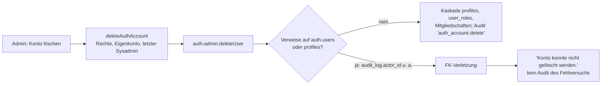

```yaml
id: A22
titel: "Lovable-Befund: Konten mit Audit-Historie lassen sich nicht löschen (Analyse)"
status: erledigt
start: 2026-11-07T05:31+01:00
ende: 2026-11-07T05:55+01:00
branch: keiner
pr: keiner
commit: 72a85f49 (Tagesbündel)
ci: läuft am Head 72a85f49, Stand im Kommentar zu PR 286
grundlage:
  main: 7dc4699d (PR 287), lesender Worktree
  quelle: Lovable-Meldung 2026-11-06 ("Admins can't delete user accounts that have any activity history")
  live_system: kein Zugriff
```

# A22 – Ausgeschiedene Benutzer: Löschen scheitert an Audit-Verweisen

## Ergebnis

Das Verhalten ist strukturell bedingt und kein Einzelfehler: `audit_log.actor_id` und 16 weitere Spalten verweisen ohne `ON DELETE`-Regel auf `auth.users`, fünf Spalten mit `RESTRICT` und eine ohne Regel auf `profiles`. Wer je gehandelt hat, ist nicht löschbar.
Die Serverfunktion `deleteAuthAccount` prüft das nicht vorab und verschluckt die Ursache im Fehlertext „Konto konnte nicht gelöscht werden.“.
Der Weg „archivieren statt löschen“ ist bereits angelegt (Status `archived`, Archiv-Knopf in der Benutzerverwaltung, Weg B im Datenauftrag Kiosk-Konto), sperrt aber nicht vollständig: `has_permission` prüft den Status nicht.
Empfehlung: (c) Löschen bei Historie sperren und (a) Archivieren als Standardweg, zusammen ohne Migration, etwa 5 bis 7 h. (b) Anonymisieren erst bei konkretem Löschbegehren, als eigenes Paket nach Golden Gate.
Zusätzlich sollte die Statusprüfung in `has_permission` als Härtung (Migration nach ADR-0035) eingeplant werden.

### Ist-Stand

| Punkt                                   | Beobachtung                                                                                                                                                                                                                                                                                 | Beleg                                                                                                     |
| --------------------------------------- | ------------------------------------------------------------------------------------------------------------------------------------------------------------------------------------------------------------------------------------------------------------------------------------------- | --------------------------------------------------------------------------------------------------------- |
| Zweck „Konto löschen“                   | Nur für fehlerhaft angelegte Konten vorgesehen; Schutz für eigenes Konto und letzten aktiven Systemadministrator                                                                                                                                                                             | `docs/BACKEND-ADMINISTRATION.md:38`                                                                       |
| Benutzerverwaltung                      | Hinweistext: „Löschen ist bewusst nicht vorgesehen — deaktivieren Sie Konten stattdessen über den Status ‚archiviert‘.“                                                                                                                                                                      | `src/components/UserManagementDialog.tsx:445-447`                                                         |
| Archiv-Knopf                            | Umschalten `active` ↔ `archived` über `svcSetUserStatus`                                                                                                                                                                                                                                    | `src/components/UserManagementDialog.tsx:548-561`, `src/lib/users-supabase-service.ts:108-111`            |
| Lösch-Knopf Backend-Dialog              | `window.confirm`, dann `deleteAuthAccount`; kein Hinweis auf Historie                                                                                                                                                                                                                       | `src/components/BackendAdminDialog.tsx:394-410`                                                           |
| Serverfunktion                          | Prüft `users.manage`, Eigenkonto, letzten Systemadministrator; ruft `admin.auth.admin.deleteUser`; jeder Fehler wird zu „Konto konnte nicht gelöscht werden.“; Audit erst nach Erfolg, Fehlversuch wird nicht protokolliert                                                                  | `src/lib/admin/auth-accounts.functions.ts:145-176` (Zeile 172-174)                                        |
| `audit_log.actor_id`                    | `REFERENCES auth.users(id)` ohne `ON DELETE` (NO ACTION); `target` ist `TEXT` ohne Fremdschlüssel                                                                                                                                                                                           | `supabase/migrations/20260717041306_18b7bd99-4d78-4233-a222-0e42881146d2.sql:131-140`                     |
| `audit_log` Schreibschutz               | Nur `SELECT` für `authenticated`, keine Insert-, Update- oder Delete-Policy; Schreiben nur `service_role`                                                                                                                                                                                   | `…20260717041306_….sql:142-149`                                                                           |
| Kaskade                                 | `profiles.id` und `user_roles.user_id` mit `ON DELETE CASCADE`                                                                                                                                                                                                                              | `…20260717041306_….sql:21`, `:48`                                                                         |
| Weitere Sperren auf `auth.users`        | NO ACTION: `user_roles.granted_by`, `app_settings.updated_by`, `reference_value.created_by/updated_by`, `avkk_subject`, `avkk_responsibility`, `avkk_responsibility_type`, `avkk_competence`, `avkk_consequence` (je `created_by`/`updated_by`)                                              | `…20260717041306_….sql:51`; `20260802033452_….sql:6`; `20260809025207_….sql:105-106, 202-203, 227-228, 250, 271-272, 301-302` |
| Leistungsnachweis                       | NO ACTION, `NOT NULL`: `customer_activity_billable_override.changed_by`, `customer_performance_statement.finalized_by`, `customer_performance_statement_request.requested_by`                                                                                                               | `supabase/migrations/20260921095742_bsf03b_performance_statement.sql:77, 143, 254`                        |
| Sperren auf `profiles` (greifen über Kaskade) | `RESTRICT`: `avkk_responsibility.person_id`, `shared_project_projection.published_by`, `shared_work_package_projection.published_by`, `shared_activity_projection.engineer_id/published_by`; NO ACTION: `customer_responsibility.user_id`                                           | `20260809025207_….sql:220`; `20260902031900_….sql:29, 67, 109, 116`; `20260908032151_….sql:8`              |
| Kaskade auf `profiles`                  | `systemhouse_membership.user_id`, `customer_access.user_id` mit `CASCADE`                                                                                                                                                                                                                   | `20260825090229_….sql:62-63, 93-94`                                                                       |
| Statusmodell                            | `user_status`: `active`, `inactive`, `locked`, `archived`                                                                                                                                                                                                                                   | `…20260717041306_….sql:15`                                                                                |
| Schutz letzter Systemadministrator      | Trigger `protect_last_sysadmin_profile` verhindert Deaktivieren des letzten aktiven Systemadministrators                                                                                                                                                                                    | `supabase/migrations/20260720031101_f91cbc77-7151-4442-bd5d-efd315eb8790.sql:113-145`                     |
| Anmeldesperre bei Archiv                | Routenwächter prüft `is_account_active` und meldet ab (`account_inactive`); bei RPC-Fehler läuft er weiter (fail-open)                                                                                                                                                                      | `src/routes/_authenticated/route.tsx:86-99`                                                               |
| Laufzeit-Serverfunktionen               | AVKK, Cockpit, Leistungsnachweis, Projektcontrolling, Projektionen prüfen `is_account_active`                                                                                                                                                                                              | z. B. `src/lib/performance-statement-runtime/performance-statement.functions.ts:141`                     |
| Lücke `has_permission`                  | Aktuelle Fassung prüft nur `user_roles`, nicht `profiles.status`; ein archiviertes Konto mit gültigem Token behält über RLS-Policies, die nur `has_permission` nutzen, seine Rechte                                                                                                           | `supabase/migrations/20260809025207_c4af947d-fe65-4973-9636-423b020152a8.sql:8-22`                        |
| Rolle bleibt bei Archiv                 | `setUserStatus` ändert nur `profiles.status`; `user_roles` bleibt                                                                                                                                                                                                                           | `src/lib/users-supabase-service.ts:108-111`                                                               |
| Personenbezug im Audit                  | Audit-Einträge tragen `actor_id` und `target` (Konto-ID); Payload je Aktion, beim Löschen leer                                                                                                                                                                                             | `src/lib/admin/auth-accounts.server.ts:61-76`, `auth-accounts.functions.ts:174`                           |
| Bezug Kiosk                             | Weg B: bm@ wird archiviert, nicht gelöscht; reaktivierbar über Status                                                                                                                                                                                                                       | `docs/DATENAUFTRAG-KIOSK-KONTO.md:14, 64, 75, 108`                                                        |



### Optionen

| Kriterium            | (a) Deaktivieren (Status `archived`)                                                                                         | (b) Anonymisieren, Verweise bleiben                                                                                                                                  | (c) Löschen sperren mit Hinweis                                                       |
| -------------------- | ---------------------------------------------------------------------------------------------------------------------------- | -------------------------------------------------------------------------------------------------------------------------------------------------------------------- | ------------------------------------------------------------------------------------- |
| `audit_log`          | unverändert, Verweise gültig                                                                                                 | unverändert (kein Update, kein Delete); Konto-ID bleibt, Klarname nur noch über Ersatzwert auflösbar                                                                | unverändert                                                                           |
| Berichte             | historische Namen bleiben korrekt; Auswahllisten mit Statusfilter blenden das Konto aus                                       | historische Einträge zeigen Ersatzname („Ehemaliger Benutzer …“); Nachvollziehbarkeit über ID                                                                        | unverändert                                                                           |
| Rollen               | bleiben ohne Zusatz bestehen; sollten beim Archivieren entzogen oder durch statusabhängige `has_permission` neutralisiert werden | Rollen entziehen; Konto zusätzlich sperren                                                                                                                         | unverändert                                                                           |
| Exporte              | Namen erscheinen weiter                                                                                                       | Ersatzname in Exporten; bereits erzeugte Exporte außerhalb des Systems bleiben unberührt                                                                             | unverändert                                                                           |
| Backup/Restore       | voll umkehrbar, Restore konsistent                                                                                            | im System nicht umkehrbar; ein Restore holt Klardaten zurück, deshalb Löschregister zum Nachziehen nötig (Bezug ADR-0042)                                            | ohne Wirkung                                                                          |
| Anmeldung            | Routenwächter meldet ab; Auth-Konto bleibt anmeldefähig, bis Sperre auf Auth-Ebene ergänzt ist                                | Auth-E-Mail ersetzen und Konto sperren                                                                                                                               | ohne Wirkung                                                                          |
| Aufwand              | 3 bis 4 h (Archiv-Aktion im Backend-Dialog, Rollenentzug oder Auth-Sperre, Tests, Doku)                                        | 12 bis 20 h (Serverfunktion, Feldliste, Auth-Update, Tests, Löschregister, Datenschutzprüfung)                                                                       | 2 bis 3 h (Vorabprüfung der Verweise, klarer Fehlertext, Audit des Fehlversuchs, Tests) |
| Migrationsbedarf     | keiner für den Standardweg; Härtung `has_permission` = Migration nach ADR-0035 (4 bis 6 h, eigener Auftrag)                    | Serverfunktion ohne Schema-Änderung möglich; Anwendung auf Bestandskonten im Live-System nur als Datenauftrag nach ADR-0037 (zwei Freigaben, feste IDs, Rollback)       | keiner                                                                                |
| Risiko               | gering; Restrechte über `has_permission`                                                                                       | mittel; irreversibel, Personenbezug in Payloads und Exporten nicht vollständig erfasst                                                                              | gering                                                                                |

### Empfehlung

1. (c) und (a) zusammen umsetzen: `deleteAuthAccount` muss vor `deleteUser` prüfen, ob Verweise bestehen, und dann mit „Konto hat Aktivitätshistorie. Bitte archivieren.“ abbrechen; der Fehlversuch sollte protokolliert werden. Der Backend-Dialog sollte für solche Konten „Archivieren“ anbieten. Löschen bleibt für Konten ohne Historie (Fehlanlage).
2. Beim Archivieren sollten Rollen entzogen oder das Auth-Konto gesperrt werden, solange `has_permission` den Status nicht prüft.
3. Die Statusprüfung in `has_permission` sollte als Härtungsmigration nach ADR-0035 eingeplant werden (Backlog, nach Golden Gate oder als Gate-Kandidat, Owner-Entscheidung).
4. (b) erst bei konkretem Löschbegehren als eigenes Paket mit Datenschutzprüfung und Löschregister.
5. `audit_log` bleibt in allen Optionen unverändert. Ein Umbau der Fremdschlüssel auf `ON DELETE SET NULL` wird nicht empfohlen, weil er die Zuordnung im Prüfprotokoll zerstört.

## Offene Fragen

- Owner: Kombination (c)+(a) freigeben? Rollen beim Archivieren entziehen oder Auth-Sperre?
- Owner: Härtung `has_permission` (Status) als Gate-Kandidat vor Publish oder als Backlog nach Golden Gate?
- Welches Konto war in der Lovable-Meldung betroffen? Die tatsächliche Ursache ist ohne Live-Zugriff nicht belegbar; die Analyse stützt sich nur auf die Migrationen in `main`.
- Gibt es Tabellen mit Benutzerspalten ohne Fremdschlüssel (z. B. lokale Bestände, JSON-Payloads)? Nur `REFERENCES`-Klauseln wurden ausgewertet.
- Datenschutz: Reicht Archivieren als Antwort auf ausgeschiedene Mitarbeitende, oder ist Anonymisierung nach Frist gefordert? Juristische Klärung offen.
- Abweichungen vom Auftrag: Bericht liegt als Scratchpad-Datei vor, nicht unter `reports/A22-BERICHT.md`; Übernahme ins Tagesbündel erfolgt durch den Koordinator. Aufwandsangaben sind Schätzungen ohne Messung.

## Eigene Ideen

- Fehlertexte der Serverfunktionen sollten den Anbieter-Statuscode (ohne Inhalte) im Audit festhalten; `providerStatusOf` existiert bereits (`src/lib/admin/auth-accounts.server.ts:114`).
- Ein lesender Test sollte alle Fremdschlüssel auf `auth.users` und `profiles` aus den Migrationen zählen und bei neuen Verweisen ohne Entscheidung rot werden (Schutz gegen erneute Überraschung).
- Der Fail-open im Routenwächter (`route.tsx:96-98`) sollte gegen die Kiosk-Logik (fail-safe `unavailable`) abgewogen werden.
- „Konto löschen“ im Backend-Dialog könnte erst nach Vorschau der Verweiszahl aktiv werden („0 Verweise – löschbar“).
- Den Status `locked` für vorübergehende Sperren und `archived` für Ausgeschiedene in der Hilfe klar trennen (`src/lib/help-documentation.ts:467`).

## Abschluss

Hygiene: 0 gemergte Remote-Branches, 5 offene PRs, davon 4 Drafts.

```yaml
Reifegrad: Entwurf (Golden Gate in Arbeit; MVP abgeschlossen, ADR-0038)
Projektstatus: >-
  Publish 1.70.0 bleibt No-Go (main 7dc4699d, 2026-11-07). A22 ist eine lesende Analyse ohne Gate-Wirkung.
  Löschen von Konten mit Historie scheitert strukturell an Fremdschlüsseln; Archivieren ist der vorgesehene Weg,
  sperrt aber über has_permission nicht vollständig.
Offene_Fragen:
  - (c)+(a) freigeben, Rollenentzug oder Auth-Sperre beim Archivieren?
  - has_permission-Härtung vor Publish oder nach Golden Gate?
  - Anonymisierung nach Frist rechtlich gefordert?
Roadmap:
  Sprints_bis_BSF: "13 / 15 / 17 (grob, unverändert laut A26)"
  Sprints_bis_MVP: 0
```
