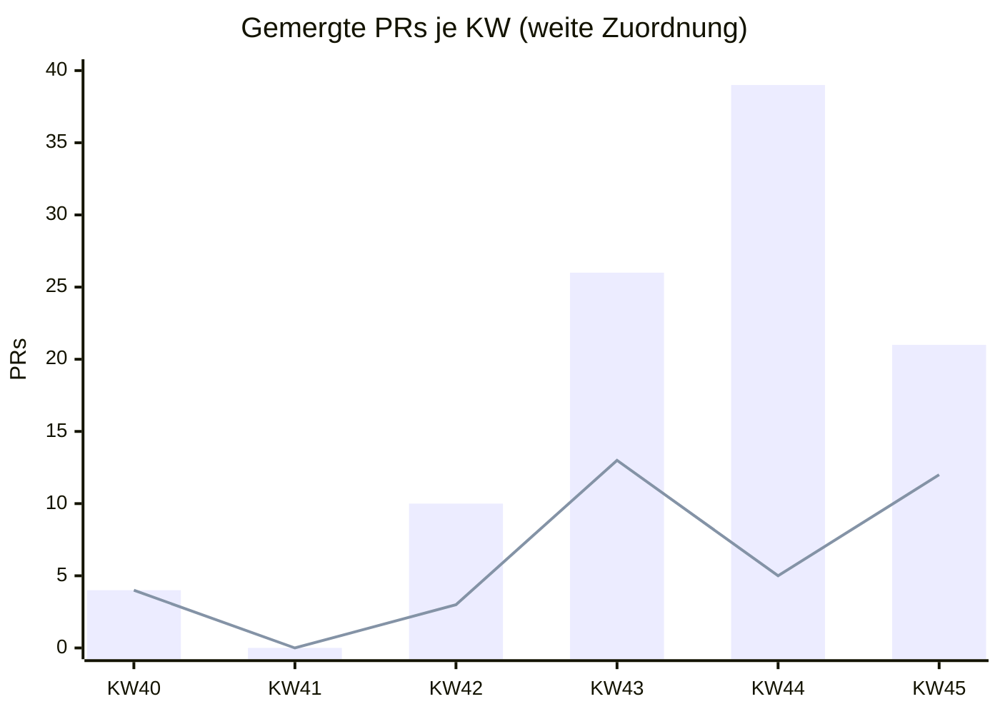
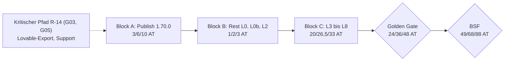

```yaml
id: A26
titel: "Roadmap-Neubewertung: Gates, Tempo, Schätzung (Stand 2026-11-07)"
status: erledigt
start: 2026-11-07T05:05+01:00
ende: 2026-11-07T05:40+01:00
branch: docs/2026-11-06-tagesbuendel
pr: 286
commit: 36d9f039 (Tagesbündel)
ci: läuft am Head 36d9f039, Stand im Kommentar zu PR 286
grundlage:
  main: 7dc4699d (PR 287)
  doku: origin/docs/2026-11-06-tagesbuendel 56c97606 (PR 286, Draft, behind, CI 15/15 am Head)
  github: REST, nur lesend, Abruf 2026-11-07 ca. 05:15+01:00
```

# A26 Roadmap-Neubewertung: Gates, Tempo, Schätzung

## Ergebnis

1. Gate-Zählung neu (main `7dc4699d`): 3 erfüllt (G11, G12, G18), 2 in PR (G07, G15), 1 extern (G14), 16 offen. Gegenüber `02cb3d28` sind G11 und G12 von „in PR“ nach „erfüllt“ gewandert; G19 bleibt offen (teilweise, EV-0007).
2. Für G02, G06, G13 (D5, D4, D3) und den Umfang von G03 (D1, D1a) sowie G08/G09 (D2) liegen Owner-Entscheidungen vom 2026-11-06 vor. Sie stehen nur in `queue/A27.yaml`, `A28.yaml`, `A30.yaml`, nicht in `docs/`. Bis A28 gemergt ist, zählen sie nicht als erfüllt.
3. Tempo: 100 gemergte PRs seit 2026-10-01 (KW40 bis KW45). Seit KW44 überwiegen Doku-PRs (KW44 34 von 39). In KW45 stieg der Anteil der Fach-PRs auf 12 von 21. Abgeschlossene Lieferpakete: 2 seit 2026-10-28 (S0-05, S0-06), L2 ist fast fertig. Das sind grob 1 bis 1,3 Sprints pro Woche, die `tempo_historie` bestätigt sich am unteren Rand.
4. Schätzung neu (grob, keine Zusage): bis Golden Gate 7/9/11 Sprints und 24/36/48 Arbeitstage, bis BSF 13/15/17 Sprints und 49/68/88 Arbeitstage. Die alte Spanne (26 bis 43 bzw. 51 bis 83 Arbeitstage) bleibt damit fast gleich. Erledigte Arbeit (S0-06, L2 U1 bis U7) und die neuen Publish-Gates (R-14, QS-06-Befunde) gleichen sich ungefähr aus.
5. Kalenderdauer bis Golden Gate bei 1 bis 2 Owner-Arbeitstagen pro Woche: grob 12 bis 48 Wochen, erwartet etwa 24 Wochen. Das gemessene Durchsatzbild der letzten 1,5 Wochen (grob 3 bis 4 geschätzte Arbeitstage je Kalenderwoche) liegt über dieser Annahme. Die Einheit Arbeitstag ist damit noch nicht belastbar nachgemessen.

| Punkt | Beobachtung | Beleg |
| --- | --- | --- |
| Gate-Zählung | 3 / 2 / 1 / 16 (erfüllt / in PR / extern / offen) | `docs/PUBLISH-GATE-BERICHT.md`, Nachtrag 2026-11-07; PR 287 `7dc4699d`; EV-0007 |
| YAML-Zählung im Gate-Bericht veraltet | `zaehlung: { erfuellt: 1, in_pr: 4, ... }` und G19-Beleg „Vorschauprüfung ohne Beleg“ nicht nachgezogen | `docs/PUBLISH-GATE-BERICHT.md` YAML-Block (Branch 286, `56c97606`) |
| Tracker L2 veraltet | L2 `code_merged: no`, `ist_stand_code` nennt Draft-PRs 226/231; tatsächlich U1 bis U7 gemergt (PR 262 bis 273), L2-12 in PR 282 | Tracker Zeilen 355 bis 376; REST-Liste der gemergten PRs |
| PR 282, 283 | `mergeable_state: dirty` (Konflikt), Draft | `gh api repos/bmarnau/sysingdashboard/pulls/282`, `/283` (2026-11-07) |
| PR 286 | Draft, `behind`, Check-Runs 15/15 success am Head `56c97606` | `gh api .../pulls/286`, `.../commits/56c97606.../check-runs` |
| Tempo | KW40 4, KW42 10, KW43 26, KW44 39, KW45 21 gemergte PRs | `gh api repos/bmarnau/sysingdashboard/pulls?state=closed` (paginiert), Zählung nach `merged_at` in Europe/Berlin |
| Schätzung | Spannen siehe Abschnitt Schätzung | Tracker `schaetzung`-Felder L3 bis L8, `planungsrunde`; Gate-Bericht Abschnitt Dauer |

## Gate-Tabelle (alt, neu, Beleg)

„Alt“ ist der Stand des Gate-Berichts A21 (Grundlage `02cb3d28`, 2026-11-06). „Neu“ ist der Stand auf main `7dc4699d` am 2026-11-07. „Entscheidung“ heißt: Owner-Entscheidung vom 2026-11-06, bisher nur in der Warteschlange dokumentiert und nicht in `docs/` (nicht in Git auf main oder im Tagesbündel).

| Nr. | Gate (kurz) | alt | neu | Beleg / Änderung |
| --- | --- | --- | --- | --- |
| G01 | R-07 Publish-Quelle, Auth-Broker | offen | offen | unverändert; Lese-Prüfung am Ziel-Commit fehlt |
| G02 | types.ts +5 als Go-Ausnahme | offen | offen (Entscheidung D5) | D5 „types.ts als Go-Ausnahme“ in `queue/A28.yaml`; Doku in `LOVABLE-PUBLISH-PRUEFUNG.md` fehlt noch |
| G03 | R-14 Datenexport, Restore-Probe | offen | offen (Umfang entschieden: D1, D1a) | D1/D1a: Minimalprobe S1 bis S4, lokal in Docker, Export per lesendem Datenauftrag (`queue/A30.yaml`); RP-01 am 2026-11-06 ausgeführt (laut A30-Eingang), Export lokal unter `C:\dev\restore-probe`, Inhalt unbekannt; EV-0004 weiter „nicht bestanden“ |
| G04 | Restore-Dokument, Notfallhandbuch | offen | offen | unverändert; A31 bereit |
| G05 | Rücknahme Publish belegt | offen | offen | unverändert; A32 bereit |
| G06 | QS6-4 kein Serverbefund | offen | offen (Entscheidung D4) | D4 in `queue/A28.yaml`; Eintrag in `QS-06-VIEWER-ABRECHNUNG.md` fehlt |
| G07 | QS6-5 Exporte | in PR | in PR | PR 283 Draft, `dirty` (2026-11-07) |
| G08 | F-QS6-ENG-01 Tätigkeitsdialog | offen | offen (Paketierung entschieden: D2) | D2: Behebung in PR 283 (`queue/A27.yaml`); kein Code-Commit |
| G09 | F-QS6-ENG-02 JSON-Backup | offen | offen (D2) | wie G08 |
| G10 | Engineer-Abnahme QS-06 | offen | offen | unverändert; folgt auf A27 |
| G11 | K1 dompurify | in PR | **erfüllt** | PR 287 gemergt 2026-11-06T06:10Z (`7dc4699d`, CI 15/15); `bun audit` main 2026-11-07 ohne dompurify |
| G12 | K2 shell-quote | in PR | **erfüllt** | wie G11; 54 Funde, 0 kritisch |
| G13 | zod 3 Entscheidung | offen | offen (Entscheidung D3) | D3 „zod 3.25.76 befristet bis nach dem Publish akzeptiert“ in `queue/A28.yaml`; Risikoregister-Eintrag fehlt |
| G14 | TanStack im Stand 1.69.0 | extern | extern | unverändert; A33 (Bundle-Prüfung) bereit |
| G15 | L2-12 Handbuch, CHANGELOG | in PR | in PR | PR 282 Draft, `dirty` |
| G16 | Tag v1.70.0 | offen | offen | letzter Tag v1.65.0 (laut A21) |
| G17 | Lovable-Sync nach letztem Merge | offen | offen | nach Merge 287 kein Sync-Beleg für `7dc4699d` |
| G18 | TD-01 Sichtprüfung | erfüllt | erfüllt | unverändert; Widerspruch `preview_verified: no` bleibt |
| G19 | PR 278 Vorschauprüfung | offen | offen (teilweise) | EV-0007 (2026-11-06, Owner): Laden, PDF-Anzeige, Text markierbar bestanden; Netzwerk-Reiter, Formularfelder, Link ungeprüft |
| G20 | Kiosk-Datenauftrag Weg B | offen | offen | unverändert |
| G21 | Go und Publish | offen | offen | Publish bleibt No-Go |
| G22 | Smoke-Test N1 bis N5, Bundle | offen | offen | A34, A33 bereit |

```yaml
gate_zaehlung:
  alt: { grundlage: 02cb3d28, stand: 2026-11-06, erfuellt: 1, in_pr: 4, extern: 1, offen: 16 }
  neu: { grundlage: 7dc4699d, stand: 2026-11-07, erfuellt: 3, in_pr: 2, extern: 1, offen: 16 }
  aenderungen:
    - { gate: G11, von: in_pr, nach: erfuellt, beleg: "PR 287, 7dc4699d, bun audit 2026-11-07" }
    - { gate: G12, von: in_pr, nach: erfuellt, beleg: "PR 287, 7dc4699d, bun audit 2026-11-07" }
    - { gate: G19, von: offen, nach: offen_teilweise, beleg: EV-0007 }
  entscheidungen_nicht_in_git:
    hinweis: Owner-Entscheidungen 2026-11-06, dokumentiert nur in origin/ops/queue; zählen erst mit Doku-Beleg (A28, A27, A30)
    D1_D1a: { gate: G03, inhalt: "Minimalprobe S1 bis S4, lokal in Docker, Export per lesendem Datenauftrag", quelle: queue/A30.yaml }
    D2: { gates: [G08, G09], inhalt: "Engineer-Befunde in PR 283 beheben", quelle: queue/A27.yaml }
    D3: { gate: G13, inhalt: "zod 3 befristet bis nach dem Publish akzeptiert", quelle: queue/A28.yaml }
    D4: { gate: G06, inhalt: "QS6-4 als kein Serverbefund schließen", quelle: queue/A28.yaml }
    D5: { gate: G02, inhalt: "types.ts +5 als Go-Ausnahme", quelle: queue/A28.yaml }
  ausblick: Mit A28 im Tagesbündel könnten G02, G06, G13 auf erfüllt gehen (dann 6 erfüllt, 13 offen). Das ist eine Prognose, kein Stand.
```

## Tempo-Tabelle

Gemergte PRs je ISO-Kalenderwoche seit 2026-10-01, ermittelt mit `gh api repos/bmarnau/sysingdashboard/pulls?state=closed&per_page=100` (paginiert), Zuordnung nach `merged_at` in Europe/Berlin. Zwei Zuordnungen nach Titel:

- **streng**: Doku = Titel beginnt mit `docs:` (Vorgabe A26).
- **weit**: Doku = Titel beginnt mit `docs:` oder `docs(…):`. Diese Zuordnung entspricht der bisherigen `tempo_historie`, deren KW42-Wert 3/7 nur so zustande kommt.

`chore:`, `merge:` und Titel ohne Präfix zählen als Fach.

| KW | Zeitraum | gesamt | Fach (streng) | Doku `docs:` | Fach (weit) | Doku `docs*` | tempo_historie (alt, Fach/Doku) |
| --- | --- | --: | --: | --: | --: | --: | --- |
| 40 | 01.10. bis 04.10. | 4 | 4 | 0 | 4 | 0 | 4 / 0 |
| 41 | 05.10. bis 11.10. | 0 | 0 | 0 | 0 | 0 | – |
| 42 | 12.10. bis 18.10. | 10 | 6 | 4 | 3 | 7 | 3 / 7 |
| 43 | 19.10. bis 25.10. | 26 | 24 | 2 | 13 | 13 | 12 / 14 |
| 44 | 26.10. bis 01.11. | 39 | 8 | 31 | 5 | 34 | 2 / 12 (nur bis 28.10.) |
| 45 | 02.11. bis 07.11. (Teilwoche) | 21 | 12 | 9 | 12 | 9 | – |
| **Summe** | | **100** | **54** | **46** | **37** | **63** | |

Beobachtungen:

- KW43 weicht um einen PR von der `tempo_historie` ab (13/13 statt 12/14). Ursache vermutlich PR 194 (`merge:`, Lovable-Sync), den die alte Zählung als Doku führte. Die Gesamtzahl 26 stimmt überein.
- In KW44 entfallen 34 von 39 PRs auf Doku. Grund sind Planung, R-07, S0-06 und die Tagesabschlüsse. In KW45 kehrt sich das um: 12 Fach-PRs, davon 9 für L2 U1 bis U7 und QS-06.
- Seit KW44 ist die Zahl der PRs kein gutes Tempomaß mehr. Die Doku-PRs sind teils sehr klein, und die Tagesbündelung (Regel 7) senkt ihre Zahl ab KW45 künstlich.
- Lieferpakete als Sprint-Einheit (ADR-0038): S0-05 (28.10.) und S0-06 (31.10.) sind abgeschlossen. L2 hat U1 bis U7 gemergt (01.11. bis 03.11.), L2-12 liegt in PR 282, die Veröffentlichung fehlt. Das sind grob 2 abgeschlossene und 1 fast abgeschlossenes Paket in 1,5 Wochen, also etwa 1 bis 1,3 Sprints pro Woche. Die `tempo_historie` (1 bis 1,5) gilt weiter, am unteren Rand.
- Arbeitstag nachgemessen (grob): Die seit 28.10. erledigten Pakete haben Schätzwerte von zusammen etwa 4 bis 7 Arbeitstagen (S0-06 1 bis 2, L2 3 bis 5; S0-05 ohne Schätzfeld). Das ergibt etwa 3 bis 4 geschätzte Arbeitstage je Kalenderwoche. Owner-Stunden sind nicht erfasst, deshalb lässt sich der Unterschied nicht auflösen. Zwei Erklärungen kommen in Frage: Der Owner war mehr als 1 bis 2 Tage pro Woche verfügbar, oder die Teilautomatik entkoppelt Claude-Code-Arbeit von der Owner-Zeit. Ebenfalls nicht in den Schätzfeldern enthalten ist ungeplante Arbeit: QS-06 als U7, der react-pdf-Vorschauabsturz (PR 275, 277, 278), die Audit-Funde (PR 276, 287) und 21 Teilautomatik-Aufträge.



Balken: gesamt. Linie: Fach (weit).

## Schätzung (grob, keine Zusage)

Einheit: 1 Sprint ist ein abgeschlossenes Arbeitspaket mit eigenem PR (ADR-0038). 1 Arbeitstag ist der Gesamtaufwand aus Claude Code, Lovable und den Freigaben und Prüfungen des Owners (Entscheidung 2026-10-28). Die Spannen sind Analogieschätzungen aus den `schaetzung`-Feldern und dem Gate-Bericht und nicht gemessen.

### Herleitung bis Golden Gate

| Block | Inhalt | Sprints min / erw. / max | Arbeitstage min / erw. / max | Quelle |
| --- | --- | --- | --- | --- |
| A Publish 1.70.0 | 16 offene und 2 in PR liegende Gates; schließt L0, L0b, L2 mit Veröffentlichung ab | 1 / 2 / 3 | 3 / 6 / 10 | Gate-Bericht Dauer: Claude Code 16/25/40 h, Owner 11/21/40 h (zusammen 27/46/80 h, bei 8 h je Tag) |
| B Rest L0, L0b, L2 | Restpunkte außerhalb der Gates (L0-Offenpunkte, L2-12-Nacharbeit, Tracker-Abgleich) | 0 / 1 / 2 | 1 / 2 / 3 | Tracker L0, L0b, L2; Annahme A26 |
| C L3 bis L8 | 6 Pakete, unverändert geplant | 6 / 6 / 6 | 20 / 26,5 / 33 | Summe `schaetzung.arbeitstage` (L3 4–6, L4 3–5, L5 3–5, L6 3–5, L7 3–5, L8 4–7) |
| D Zuschlag ungeplant | Erfahrung KW44/45: QS-06, Vorschauabsturz, Audit-Funde | 0 / 0 / 0 | 0 / 1,5 / 2 | Annahme A26, etwa 5 % auf C im Erwartungswert |
| **Summe Golden Gate** | | **7 / 9 / 11** | **24 / 36 / 48** | Sprints: max bei getrennten Paketen für R-14 und QS-06-Fix |

### Bis BSF

| Block | Sprints min / erw. / max | Arbeitstage min / erw. / max | Quelle |
| --- | --- | --- | --- |
| Golden Gate | 7 / 9 / 11 | 24 / 36 / 48 | oben |
| Pakete bis BSF (BSF-06, BSF-04, BSF-04A, BSF-DOC-01 bis 03, QS-06-Rest, BSF-FINAL-INTERNAL) | 6 / 6 / 6 | 25 / 32 / 40 | Tracker `planungsrunde.nach_golden_gate_bis_bsf`, unverändert, nicht gemessen |
| **Summe BSF** | **13 / 15 / 17** | **49 / 68 / 88** | |

### Kalenderdauer

Die Kalenderdauer ergibt sich als Arbeitstage geteilt durch die Owner-Kapazität. Das unterstellt wie bisher, dass jeder Arbeitstag einen Owner-Tag bindet. Das ist eine konservative Annahme, siehe Unsicherheit U2.

| Meilenstein | 1 AT/Woche | 1,5 AT/Woche (erwartet) | 2 AT/Woche | gemessen ca. 3–4 AT/Woche (Hinweis, nicht Planungsgröße) |
| --- | --- | --- | --- | --- |
| Publish 1.70.0 (Block A) | 3–10 Wochen | ca. 4 Wochen | 1,5–5 Wochen | 1–3 Wochen (A21: 1 / 3 / 6 Wochen) |
| Golden Gate | 24–48 Wochen | ca. 24 Wochen | 12–24 Wochen | ca. 6–16 Wochen |
| BSF | 49–88 Wochen | ca. 45 Wochen | 25–44 Wochen | ca. 12–29 Wochen |

Planungsgröße bei 1 bis 2 Owner-Arbeitstagen pro Woche: Golden Gate grob 12 bis 48 Wochen, erwartet etwa 24 Wochen (rund 5 bis 6 Monate). Bisher stand im Tracker „2 bis 6 Monate“. Die neue Spanne ist breiter, weil die alte Angabe offenbar mit etwa 2 Arbeitstagen pro Woche gerechnet hat. Das ist keine Terminzusage.



### Annahmen

- A1: Die `schaetzung`-Felder von L3 bis L8 und die Pakete bis BSF gelten unverändert. Sie sind nicht nachgemessen und stammen aus früheren Codex-Schätzungen.
- A2: Der Publish 1.70.0 schließt L0, L0b und L2 fachlich ab (Veröffentlichung, N1 bis N5). L2 zählt als ein Sprint, nicht als sieben Teilpakete U1 bis U7.
- A3: Die Owner-Entscheidungen D1 bis D5 gelten wie in der Warteschlange beschrieben und werden ohne Änderung in Git übernommen (A27, A28, A30).
- A4: Die Restore-Probe bleibt bei der Minimalprobe S1 bis S4 lokal (D1). Eine zweite Lovable- oder Supabase-Umgebung ist nicht eingeplant.
- A5: Owner-Kapazität 1 bis 2 Tage pro Woche (Angabe 2026-10-28). Ein Arbeitstag bindet einen Owner-Tag.
- A6: Es kommen keine neuen Publish-Gates hinzu. Der pauschale Zuschlag D deckt nur kleine Funde ab.

### Unsicherheiten

- U1: R-14 und R-10 (Export aus Lovable Cloud, Schema-Abweichung bei 4 plus 1 Migrationen, Auth-Nutzer) können Block A deutlich über 10 Arbeitstage treiben. Die Wartezeit auf den Support lässt sich nicht begrenzen.
- U2: Die Einheit Arbeitstag ist nicht nachgemessen. Das Durchsatzbild KW44/45 (etwa 3 bis 4 geschätzte Arbeitstage je Kalenderwoche) passt nicht zur Kapazitätsannahme. Ohne Erfassung der Owner-Stunden bleibt offen, ob die Kalenderdauer eher 6 bis 16 Wochen (gemessen) oder 12 bis 48 Wochen (Annahme) beträgt.
- U3: Ungeplante Arbeit (QS-06, react-pdf, Audit) war in KW44/45 erheblich. Der Zuschlag D von 5 % kann zu niedrig sein.
- U4: Die Schätzungen für L3 bis L8 stammen aus Codex-Zeiten. Das Tempo mit Claude Code und der Teilautomatik ist erst an S0-06 und L2 beobachtet.
- U5: Jeder Merge nach dem R-07-Check macht die Lese-Prüfung ungültig. Parallele Lovable-Schreibaufträge können den Merge-Stau verlängern (R-12).
- U6: Die PR-Zählung hängt am Titelpräfix. Die Bündelung der Doku ab KW45 verzerrt den Vergleich mit KW43/44.

## Offene Fragen

1. Sollen die Owner-Entscheidungen D1 bis D5 vom 2026-11-06 in einem Zug mit A28 in `docs/` (Tracker `fortschritt`, Risikoregister, Gate-Bericht) übernommen werden? Erst dann können G02, G06 und G13 auf erfüllt gehen.
2. Soll die Owner-Zeit je Paket erfasst werden, etwa als Stunden im Bericht, damit sich der Arbeitstag nachmessen lässt (U2)?
3. Soll die Tempo-Zählung künftig streng (`docs:`) oder weit (`docs*`) erfolgen? Die `tempo_historie` nutzt weit, der Auftrag streng.
4. Soll der Tracker-Eintrag L2 (`code_merged: no`, `ist_stand_code` mit Drafts 226/231) im Tagesbündel korrigiert werden?
5. Abweichungen vom Auftrag: Dateien wurden nur als Lieferung in den Scratchpad geschrieben. Es gab kein Commit, keinen Push, kein `docs:check`, kein `docs:project` und kein Prettier (Vorgabe des Koordinators). Commit, CI und Einpflege in den Tracker übernimmt der Koordinator. Der Bericht liegt noch nicht unter `reports/A26-BERICHT.md`.
6. Risiko: Die YAML-Zählung im Gate-Bericht (`zaehlung: erfuellt 1, in_pr 4`) und der G19-Beleg widersprechen dem Nachtrag. Wer liest maschinell, erhält einen veralteten Stand.

## Eigene Ideen

- Die Gate-Zählung im Gate-Bericht sollte nur noch aus dem YAML-Block abgeleitet werden. Ein kleines Skript (`npm run gates:count`) könnte Tabelle, Nachtrag und YAML gegeneinander prüfen und in `docs:check` laufen. Das verhindert den hier gefundenen Widerspruch.
- Die Tempo-Messung sollte als Skript im Repository liegen (REST-Abruf, ISO-Woche, beide Zuordnungen) und jede Woche im Tagesbündel laufen. Das Ergebnis sollte als `tempo_messung` mit Datum in den Tracker gehen statt als Fließtext.
- Owner-Entscheidungen sollten am Entscheidungstag mit einer Zeile im Tracker (`fortschritt`) in Git landen, auch wenn die Umsetzung erst später folgt. Dann wären D1 bis D5 heute belegbar.
- Der Bericht sollte je Paket ein Feld `ist_arbeitstage` (Owner-Stunden plus Zahl der Claude-Code-Läufe) führen. Nach drei Paketen ließe sich die Einheit Arbeitstag dann tatsächlich nachmessen (Entscheidung 2026-10-28).
- Die Sprint-Zählung sollte Teilpakete (U1 bis U7) als `teilpakete` ausweisen. So bleibt sichtbar, dass L2 viele PRs, aber nur einen Sprint erzeugt.
- Zuschlag D: Ein fester Puffer für ungeplante Gates von etwa 10 % je Paket sollte vom Owner entschieden werden, statt ihn bei jeder Neubewertung neu zu verhandeln.

## Abschluss

Hygiene: 0 gemergte Remote-Branches, 5 offene PRs, davon 4 Drafts.

```yaml
Reifegrad: Entwurf (Golden Gate in Arbeit; MVP abgeschlossen, ADR-0038)
Projektstatus: >-
  Publish 1.70.0 bleibt No-Go. Gates 3 erfüllt, 2 in PR, 1 extern, 16 offen (main 7dc4699d, 2026-11-07).
  Kritischer Pfad R-14 (G03, G05). Owner-Entscheidungen D1 bis D5 (2026-11-06) liegen vor, sind aber noch nicht in Git.
  PR 282 und 283 haben Konflikte. Tempo etwa 1 bis 1,3 Sprints pro Woche.
Offene_Fragen:
  - D1 bis D5 mit A28 in docs/ übernehmen?
  - Owner-Zeit je Paket erfassen, um den Arbeitstag nachzumessen?
  - Tempo-Zuordnung streng oder weit?
  - Tracker L2 korrigieren (code_merged, ist_stand_code)?
  - YAML-Zählung im Gate-Bericht nachziehen?
Roadmap:
  Sprints_bis_GoldenGate: "7 / 9 / 11 (min / erwartet / max, grob)"
  Arbeitstage_bis_GoldenGate: "24 / 36 / 48 (grob)"
  Sprints_bis_BSF: "13 / 15 / 17 (grob)"
  Arbeitstage_bis_BSF: "49 / 68 / 88 (grob)"
  Sprints_bis_MVP: 0
  Kalenderdauer_GoldenGate: "12 bis 48 Wochen bei 1 bis 2 Owner-Arbeitstagen pro Woche, erwartet ca. 24 Wochen; keine Zusage"
```
