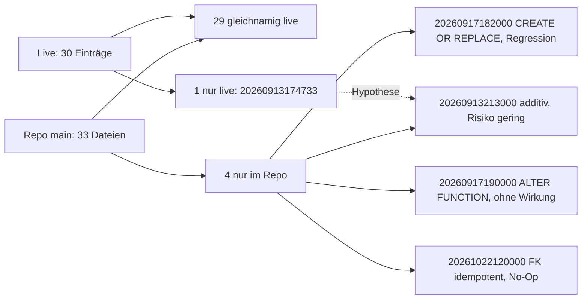

# A29-Bericht

Grundlage: `origin/main` 7dc4699d (lesender Worktree), `docs/NACHWEISE.yaml` vom Branch `origin/docs/2026-11-06-tagesbuendel`, Auftrag `queue/A29.yaml`, RP-01-Ergebnis aus `queue/A30.yaml` (Feld `eingaenge`) auf `origin/ops/queue`. Keine Live-Abfrage, keine Datenänderung. Zeilenangaben ohne Branch-Zusatz beziehen sich auf `main` 7dc4699d.

## Ergebnis

1. EV-0007 (G19, PR 278) ist in `docs/NACHWEISE.yaml` genau einmal vorhanden und belegt (PR, Head, Merge, Screenshots im Chat); kein Doppelanlegen, Ergebnis `teilweise`.
2. EV-0008 (Erstantwort des Supports, Lea, 2026-11-06 abends) ist einfügefertig in `A29-NACHWEIS.yaml`, Status `offen`, nur mit dem Inhalt aus der Auftrags-YAML.
3. Von QS-01 liegt nur Migration A im Repository und gilt als live angewendet; B (Bootstrap-Admin) und C (Default-Privilegien) existieren weder als Datei noch als Anwendung, nur als Entwurf in ADR-0036.
4. Ein fremdes Konto startet nach Registrierung als aktiver `viewer` ohne Systemhaus-Mitgliedschaft: keine Kundendaten, Lesezugriff nur auf globale Referenzdaten, globale AVKK-Objekte und eigene Profil- und Rollenzeile. Ob Lovable beim Publish oder Sync Repo-Migrationen anwendet, ist nicht belegt (Frage für A28).
5. Neuer Befund: Eine Anwendung von `20260917182000` auf den Live-Stand wäre kein No-Op; sie würde `has_permission` und `bsf02c_publish_shared_projection_snapshot` auf einen älteren Stand zurücksetzen. Empfehlung: G23 einführen, aber als Gate „Migrationsanwendung beim Publish geklärt und Selbstregistrierung entschieden“, nicht als „QS-01 B/C angewendet“.

## Befundtabelle

| Nr  | Punkt                                       | Beobachtung                                                                                                                                                                                                                                                                                                                                                                          | Beleg                                                                                                                                                                                                                                                          |
| --- | ------------------------------------------- | ------------------------------------------------------------------------------------------------------------------------------------------------------------------------------------------------------------------------------------------------------------------------------------------------------------------------------------------------------------------------------------ | -------------------------------------------------------------------------------------------------------------------------------------------------------------------------------------------------------------------------------------------------------------- |
| 1   | EV-0007 vorhanden                           | Ein Eintrag, Bezug G19 und PR 278, Ergebnis `teilweise` (drei Prüfpunkte offen), Beleg PR 278 Head 4aad97a8 CI 15/15, Merge 02cb3d28; Screenshots nur im Chat. Kein Nachtrag nötig.                                                                                                                                                                                                 | `docs/NACHWEISE.yaml:100-128` (Branch Tagesbündel); `git show … \| grep -c EV-0007` = 1                                                                                                                                                                       |
| 2   | Nächste freie ID                            | Höchste ID EV-0007, nächste EV-0008. Kein weiterer Eintrag zur Support-Antwort vorhanden.                                                                                                                                                                                                                                                                                            | `docs/NACHWEISE.yaml:7-128` (Branch Tagesbündel)                                                                                                                                                                                                               |
| 3   | EV-0008 Support-Erstantwort                 | Einfügefertig: Speicherzeile `client.ts` wirkte; Helper kam nach README-Änderung nicht zurück; Fragen 1 und 2 sagt der Support für denselben Thread zu. Status `offen`.                                                                                                                                                                                                              | `queue/A29.yaml` Schritt 2 (`origin/ops/queue`); `A29-NACHWEIS.yaml`                                                                                                                                                                                           |
| 4   | QS-01 A im Repository                       | `20261022090000_qs01_a_profile_self_update_guard.sql` liegt vor.                                                                                                                                                                                                                                                                                                                     | `supabase/migrations/` (33 Dateien, Datei 32)                                                                                                                                                                                                                  |
| 5   | QS-01 A angewendet                          | Live am 2026-10-22 16:55 MESZ nach ADR-0035, Postflight bestanden, Retest des Owners am 2026-10-24 bestanden. RP-01 führt `20261022090000` nicht unter „nur im Repository“, die Version ist also live gleichnamig vorhanden.                                                                                                                                                    | `docs/GOLDEN-GATE-EXECUTION-TRACKER.yaml:468-472`, `:1327-1331`, `:1333-1339`; `queue/A30.yaml` `eingaenge[1]`                                                                                                                                                  |
| 6   | QS-01 B (Bootstrap-Admin)                   | Keine Migration im Repository, keine Anwendung. Stand „Entwurf offen“; Entscheidung: Bindung an Admin-E-Mail in `app_settings`. Migration A schloss B ausdrücklich aus.                                                                                                                                                                                                             | `docs/ADR/0036-qs01-konto-und-berechtigungsschutz.md:19`, `:39-46`; `docs/QS-01-LOVABLE-PROMPT-MIGRATION-A.md:47`; `docs/QS-01-WORK-AUFTRAG-MIGRATION-A.md:74-75`; Tracker `:489-491`, `:502`                                                                 |
| 7   | QS-01 C (Default-Privilegien)               | Keine Migration, keine Anwendung. Das Schema aus den Migrationen vergibt weiter `ALL` auf Tabellen, Funktionen und Sequenzen an `anon` und `authenticated`. TRUNCATE ist über PostgREST nicht erreichbar. Ein `pg_default_acl`-Inventar der Live-Datenbank fehlt (RP-01 enthält keins).                                                                                       | `supabase/schema/public-schema.sql:3994-4017`; ADR-0036 `:20`, `:22-23`, `:47-51`; `queue/A30.yaml` `eingaenge[0]`                                                                                                                                             |
| 8   | Startrolle neuer Konten                     | `handle_new_user` legt das Profil an und vergibt `systemadministrator` nur, wenn noch keiner existiert (Advisory-Lock), sonst `viewer`. Profilstatus ist standardmäßig `active`. Die Oberfläche kündigt das an.                                                                                                                                                                    | `public-schema.sql:1434-1483` (Lock `:1458`, Prüfung `:1460-1466`), `:2223`; `src/routes/auth.tsx:290-291`                                                                                                                                                     |
| 9   | Bootstrap-Risiko live                       | Live gibt es mindestens ein Konto mit Rolle Systemadministrator (bm@, Abnahme 2026-11-04). Damit greift der Bootstrap-Zweig live nicht. Der Schutz für den letzten Systemadministrator bleibt bestehen. Einstufung laut ADR: LOW bei laufender Datenbank mit Admin.                                                                                                                   | `docs/NACHWEISE.yaml:74-78`; ADR-0036 `:19`, `:76-77`                                                                                                                                                                                                          |
| 10  | Rechte eines fremden Kontos (Lesen)         | `viewer` hat `dashboard.view`, `documentation.view`, `avkk.view`, `referencedata.view`. Ohne Mitgliedschaft lesbar: `reference_catalog` (alle Zeilen), `reference_value` mit `systemhouse_id IS NULL`, `avkk_subject` mit Systemhaus und Kunde `NULL`, `app_settings` mit zwei öffentlichen Schlüsseln, eigene Zeilen in `profiles`, `user_roles`, `customer_access`, `systemhouse_membership`. | `public-schema.sql:1614-1615`, `:3512`, `:3538`, `:3384`, `:3276`, `:3497`, `:3608`, `:3398`, `:3474`                                                                                                                                                         |
| 11  | Rechte eines fremden Kontos (geschützt)     | Kunden, Projektionen (Projekt, Arbeitspaket, Tätigkeit), Leistungsnachweise und Kundenverantwortung setzen Mitgliedschaft oder Kundenzugriff voraus; `audit_log` und fremde Profile nur für Administratoren; Inserts in `audit_log` und `profiles` sind gesperrt; Rollenänderung nur durch Systemadministratoren; Profil-Selbstupdate durch Migration A eingeschränkt.          | `public-schema.sql:3458`, `:3553`, `:3568`, `:3583`, `:3440`, `:3478`, `:3283`, `:3287`, `:3485`, `:3493`, `:3612-3620`, `:3501`                                                                                                                               |
| 12  | Schreiben durch ein fremdes Konto           | `viewer` hat keine Schreibberechtigung (`*.edit`, `*.manage`). Serverseitig kann es nur die eigenen erlaubten Profilfelder ändern. Lokale Demodaten (`DemoDataDialog`, synthetisch) nicht geprüft.                                                                                                                                                                            | `public-schema.sql:1614-1615`, `:3501`; `src/components/DemoDataDialog.tsx` (nicht geprüft)                                                                                                                                                                   |
| 13  | Lücke: Sperrstatus und globale Lesepfade    | `has_permission` prüft `is_account_active` nicht. Die globalen Lesepolicies (Nr. 10) gelten deshalb auch für gesperrte oder archivierte Konten. Geringe Wirkung (nur globale Stammdaten).                                                                                                                                                                                        | `public-schema.sql:1573-1584` (ohne Aktivprüfung), `:1640-1647`, `:3384`, `:3512`, `:3538`                                                                                                                                                                     |
| 14  | Selbstregistrierung und E-Mail-Bestätigung  | Registrierung ist im Client offen (`signUp` mit `emailRedirectTo`), mit Zweig für fehlende Session (Bestätigung nötig). Der Tracker meldet am 2026-10-22 „E-Mail-Bestätigung aktiv“, führt die Frage bei QS-01 aber weiter als offen (Widerspruch). Plattform-Mails sind für externe Empfänger unzuverlässig. Die Bestätigung belegt nur den Postfachbesitz, keine Identität. | `src/routes/auth.tsx:144-168`; Tracker `:1346`, `:504-505`; `docs/BACKLOG.md:17`; ADR-0036 `:45-46`                                                                                                                                                          |
| 15  | Wendet Lovable beim Publish Migrationen an? | Nicht belegt. Belegt ist: Eine Variant merkt DB-Änderungen nur vor und wendet sie bei der Übernahme an. Das Lovable-Werkzeug übernimmt keine festen Dateinamen. ADR-0036 befürchtet eine Anwendung durch Sync. Der Support hat die Migrationsfragen am 2026-10-30 zurückgestellt. Publish nimmt immer den aktuellen Lovable-Projektstand. → Frage für den Lese-Prompt A28. | ADR-0036 `:58-60`, `:145-149`; `docs/LOVABLE-PUBLISH-PRUEFUNG.md:85`, `:88`; `docs/ENTWICKLUNGSTAGEBUCH.md:233`; `queue/A28.yaml` Schritt 6                                                                                                                     |
| 16  | Indiz zu Nr. 15                             | Die drei History-Lücken-Migrationen liegen seit September auf `main`, und Lovable und GitHub galten als synchron. Trotzdem stehen sie live nicht unter ihrer Repo-Version. Das spricht gegen eine automatische Anwendung unter der Repo-Version beim Sync. Eine Anwendung unter anderer Version schließt es nicht aus (genau Frage 1 an den Support).            | `queue/A30.yaml` `eingaenge[1]`; Tracker `:1321-1322`, `:1334-1336`                                                                                                                                                                                            |
| 17  | Abgleich 30 live gegen 33 Repo              | Bilanz geht auf: 33 − 4 nur im Repo + 1 nur live = 30. Zehn Live-Einträge haben `statements` NULL (History-Einträge ohne Protokoll). Hypothese, nicht belegt: `20260913174733 bsf03d_reference_data_systemhouse_scope` ist die von Lovable versionierte Anwendung des Inhalts von `20260913213000` (gleicher Tag, gleiche Ticketkennung). Klärung durch Support und RP-02 Teil A. | `queue/A30.yaml` `eingaenge[1]`; ADR-0036 `:146-148`; `supabase/migrations/20260913213000_…sql:1-7`                                                                                                                                                         |
| 18  | Wirkung bei Anwendung von `20260913213000`  | Additiv: `IF NOT EXISTS`, `ON CONFLICT DO NOTHING`, Defaults, eindeutiger Index `IF NOT EXISTS`. Geringes Risiko.                                                                                                                                                                                                                                                              | `supabase/migrations/20260913213000_…sql:5-7`, `:20-21`, `:47-48`, `:92`                                                                                                                                                                                      |
| 19  | Wirkung bei Anwendung von `20260917182000`  | **Kein No-Op.** `CREATE OR REPLACE FUNCTION has_permission` (`:24`) enthält `performance.statement.manage` nicht (0 Treffer). Die spätere Migration `20260921095742` (`:9`, `:37`) fügt es hinzu. `bsf02c_publish_shared_projection_snapshot` (`:83`) wird später durch `20260929053733` (`:7`) ersetzt. Wird sie nachträglich angewendet, entfällt `performance.statement.manage` für Teamleiter (sicherer Fehlerfall). Außerdem verliert die Veröffentlichungsfunktion die Fälligkeitsprojektion P3b (funktionale Regression). | `supabase/migrations/20260917182000_bsf03a_project_controlling.sql:24`, `:83`; `20260921095742_bsf03b_performance_statement.sql:6-9`, `:37`; `20260929053733_bsf03e_p3b_due_projection.sql:7`; vorher schon so eingeschätzt: `docs/QS-01-WORK-AUFTRAG-MIGRATION-A.md:75-76` |
| 20  | Wirkung bei Anwendung von `20260917190000`  | Nur `ALTER FUNCTION has_permission SECURITY INVOKER`. Ohne Wirkung, wenn schon gesetzt.                                                                                                                                                                                                                                                                                              | `supabase/migrations/20260917190000_bsf03a_preserve_permission_security_invoker.sql:7`                                                                                                                                                                        |
| 21  | Wirkung bei Anwendung von `20261022120000`  | Idempotent, legt den FK nur an, wenn er fehlt; live ein No-Op.                                                                                                                                                                                                                                                                                                                  | `supabase/migrations/20261022120000_db_fk_reference_value_history_systemhouse.sql:6-12`                                                                                                                                                                       |
| 22  | Gate-Nummer                                 | Der Gate-Bericht führt G01 bis G22; G23 ist frei.                                                                                                                                                                                                                                                                                                                                    | `docs/PUBLISH-GATE-BERICHT.md:25-46` (Branch Tagesbündel)                                                                                                                                                                                                      |

## Bewertung Migrationsabgleich



Die Formulierung in A29 („die drei anderen verwenden IF NOT EXISTS, CREATE OR REPLACE oder ALTER FUNCTION“) trifft für `20260913213000` und `20260917190000` zu. Für `20260917182000` reicht sie nicht: Ein `CREATE OR REPLACE` überschreibt den neueren Live-Stand. Würde ein Publish oder Sync ausstehende Repo-Migrationen nach Versionsnummer nachholen, entstünde genau diese Regression. Ob die Objekte live dem Endstand entsprechen, klärt RP-02 Teil A. Dieser Bericht bewertet nur die Dateien.

## Empfehlung G23

```yaml
G23:
  titel: Migrationsanwendung beim Publish geklärt und Selbstregistrierung entschieden
  empfehlung: einführen (Muss-Gate vor Publish)
  muss:
    - Belegt (Support-Antwort oder Lese-Prompt A28), ob Publish oder Sync Migrationen aus supabase/migrations anwendet; falls ja, welche und unter welcher Version.
    - Falls ja: 20260917182000 darf nicht angewendet werden (Regression has_permission und bsf02c_publish_shared_projection_snapshot); Abhilfe vor dem Go festlegen.
    - Owner-Entscheidung zur offenen Selbstregistrierung in der veröffentlichten App (Risikoakzeptanz Viewer-Startrolle oder Registrierung abschalten), mit Beleg zum Stand der E-Mail-Bestätigung.
  sollte:
    - QS-01 B und C nicht vor diesem Gate ins Repository mergen, damit kein Publish oder Sync sie außerhalb von ADR-0035 anwendet.
    - pg_default_acl-Inventar der Live-Datenbank als lesender Datenauftrag (Voraussetzung für C).
  nicht_gefordert:
    - Anwendung von QS-01 B und C vor dem Publish. Begründung: B ist live LOW (Systemadministrator vorhanden), C ist LOW bis MEDIUM und über PostgREST nicht erreichbar; beide sind kein CRITICAL oder HIGH im Sinne von L8. Zuordnung (vor L8 oder nach dem Golden Gate) entscheidet der Owner.
```

## Offene Fragen

- Für den Lese-Prompt A28 (zusätzlich zu dessen Schritt 6): Wendet Lovable beim Publish oder Sync ausstehende Repo-Migrationen an, in welcher Reihenfolge und unter welcher Version? Wurde `20260913174733` aus dem Inhalt von `20260913213000` erzeugt? Ist die Selbstregistrierung in Lovable Cloud abschaltbar, und ist „Confirm email“ aktiv?
- Widerspruch im Tracker: E-Mail-Bestätigung „aktiv“ (`:1346`) gegen offenen Punkt (`:505`). Sollte bei der nächsten Tracker-Pflege bereinigt werden; ein Beleg (Screenshot der Auth-Einstellung) fehlt.
- `has_permission` ohne Aktivprüfung (Befund 13): als Backlog-Punkt aufnehmen? Kein Gate, weil nur globale Stammdaten betroffen sind.
- Abweichungen vom Auftrag: keine Live-Abfrage, keine Dateien in den Repos geändert. Der Bericht liegt im Scratchpad, nicht unter `reports/`. EV-0008 nennt die Uhrzeit nur als „abends“, weil die Auftrags-YAML keine Uhrzeit nennt.
- Lokale Demodaten-Funktion für `viewer` nicht geprüft (Befund 12).

## Eigene Ideen

- Den CI-Job „Database Schema Drift“ um eine Liste der erwarteten Live-Abweichungen erweitern (4 nur im Repo, 1 nur live), damit eine neue Abweichung sofort auffällt (Vorstufe zu QS-05).
- Für `20260917182000` einen Kopfkommentar „nicht erneut anwenden, durch 20260921095742 und 20260929053733 überholt“ ergänzen. Der Kommentar darf nur per Doku-Hinweis oder in einer neuen Datei stehen, die Migrationsdatei bleibt byte-identisch.
- Einen DB-Vertragstest „fremdes Konto“ anlegen (neuer `viewer` ohne Mitgliedschaft): Er liest keine Kunden und keine Projektionen und schreibt nichts. Er sichert Befund 10 und 11 dauerhaft ab.
- Den Hinweistext in `src/routes/auth.tsx:290-291` („Erste Registrierung wird automatisch System-Administrator“) für die veröffentlichte App entfernen oder neutral fassen; er beschreibt Fremden den Bootstrap-Mechanismus.
- In `has_permission` die Aktivprüfung ergänzen; das wäre eine eigene Migration nach ADR-0035, sinnvoll zusammen mit QS-01 B.

## Abschluss

Hygiene: 0 gemergte Remote-Branches, 5 offene PRs, davon 4 Drafts.

```yaml
Reifegrad: Golden Gate vor Publish; QS-01 A live und abgenommen, QS-01 B/C nur Entwurf
Projektstatus: Publish No-Go (R-07, R-10 offen); EV-0007 belegt (teilweise), EV-0008 vorbereitet (offen); G23 empfohlen
Offene_Fragen:
  - Wendet Publish oder Sync Repo-Migrationen an (Reihenfolge, Version)? Frage an Support und Lese-Prompt A28
  - Antwort des Supports zu Frage 1 und 2 (EV-0008) steht aus
  - Owner-Entscheidung Selbstregistrierung in der veröffentlichten App; Beleg E-Mail-Bestätigung
  - Owner-Entscheidung G23 und Zuordnung QS-01 B/C (vor L8 oder nach dem Golden Gate)
  - RP-02 Teil A: Live-Objekte der vier Repo-Migrationen
Roadmap:
  Sprints_bis_BSF: offen, nicht aus Belegen ableitbar
  Sprints_bis_MVP: offen, nicht aus Belegen ableitbar
```
