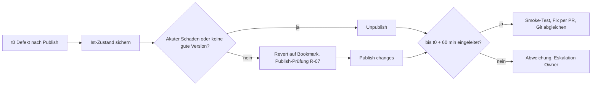

# Bericht A32

Stand: 2026-11-07T05:25+01:00 · nur lesen und öffentliche Lovable-Dokumentation · Grundlage: `origin/main` (lesender Worktree), `docs/NOTFALL-HANDBUCH.md` und `docs/LOVABLE-PUBLISH-PRUEFUNG.md` vom Branch `origin/docs/2026-11-06-tagesbuendel`

## Ergebnis

1. Lovable dokumentiert **keine** Wiederherstellung einer früheren Veröffentlichung. Rücknahme heißt: Revert im Verlauf auf die gute Version und erneut „Publish changes“, oder Unpublish (Q1, Q2, Q3).
2. Ein Revert ändert die Live-App nicht, setzt nur Code zurück (Edge Functions werden neu bereitgestellt) und keine Daten oder ausgeführten Migrationen (Q2). Das deckt sich mit der Support-Aussage „Publish = aktueller Projektstand, kein Pinning“.
3. Checkliste `:48-51` und Notfallhandbuch N1 (`:53`) sind unvollständig: kein Hinweis auf den nötigen erneuten Publish, kein Unpublish, kein Zeitkriterium, kein Bookmark; Grundregel 4 (`:36`) verbietet den Rücknahme-Publish.
4. Lieferungen: Abschnitt „N1a Rücknahme eines Publish“ mit Mermaid und Belegplan RB-01 bis RB-10 (135 Minuten, nur Wegwerfprojekt), Korrekturtext für die Checkliste.
5. Alle Plattformaussagen bleiben „zu belegen“, bis RB-01 bis RB-04 und RB-07 am Wegwerfprojekt belegt sind. Publish bleibt No-Go (R-07, REST-10).

| Punkt                         | Beobachtung                                                                                                                                                             | Beleg                                            |
| ----------------------------- | ----------------------------------------------------------------------------------------------------------------------------------------------------------------------- | ------------------------------------------------ |
| Publish-Stand                 | „Only the current version is deployed“; Schnappschuss je Publish; Änderungen erst mit „Publish changes“; Punkt am Button zeigt neuere Änderungen                        | Q1, Q3                                           |
| Rollback früherer Deployments | nicht dokumentiert (Publish- und Hosting-Seite ohne Aussage)                                                                                                            | Q1, Q3                                           |
| Revert                        | nur Code, Edge Functions neu bereitgestellt, keine Daten, ausgeführte Migrationen bleiben; Chat bleibt                                                                  | Q2                                               |
| Revert-Grenzen                | gesperrt bei aktueller Version, nach Remix mit eingebautem Backend, bei „very old“ Versionen (Grenze nicht beziffert)                                                   | Q2                                               |
| Versionskennung               | keine Versionsnummern, Versionen mit Datum; Kennzeichen „Published“ an der Live-Version; Bookmarks je Projekt                                                           | Q2                                               |
| Unpublish                     | drei Wege (Einstellungen, ⋮ im Publish-Dialog, Dashboard); Live-Adresse unerreichbar, Projekt bleibt; Recht wie Publish                                                 | Q1                                               |
| GitHub                        | Push oder Merge ändert die Live-App nicht; Rücknahme per Revert-Commit; kein Force-Push; Divergenz führt zu `lovable-sync`-Branch; Migrationen aus Git nicht ausgeführt | Q4                                               |
| Revert und GitHub             | ob ein Revert in Lovable einen Commit schreibt: nicht dokumentiert                                                                                                      | Q2, Q4 (zu belegen, RB-05)                       |
| Daten                         | Lovable Cloud: tägliche Sicherung, rund 14 Tage, kein Point-in-Time, unumkehrbar, mit Schema, wenige Minuten Ausfall                                                    | Q5; Backend-Art laut Owner Lovable Cloud         |
| Publish und Schema            | Publish kann mit einer Datenbankänderung an Live-Daten scheitern; Drafts teilen die Datenbank, Backend-Konfiguration wirkt sofort live                                  | Q1, Q6 (Mechanismus zu belegen, REST-10)         |
| Checkliste `:48-51`           | „Publish zurücksetzen über die Versionsverwaltung“ ohne erneuten Publish, ohne Unpublish, ohne „zu belegen“                                                             | `docs/MERGE-CHECKLISTE-GOLDEN-GATE.md:48-51`     |
| Notfallhandbuch               | `:36` Grundregel 4 kollidiert mit Rücknahme-Publish; `:53` Revert ohne Publish-Hinweis; `:190` Lücke 7 ohne Belegplan; kein Zeitkriterium                               | `docs/NOTFALL-HANDBUCH.md` (Tagesbündel)         |
| Publish-Prüfung               | Support „kein Pinning“ (`:85`) stimmt mit Q1 überein; Rücknahme auf den heutigen Live-Stand 1.69.0 brächte den Broker zurück (`:163`, `:169`)                           | `docs/LOVABLE-PUBLISH-PRUEFUNG.md` (Tagesbündel) |

### Widersprüche und Lücken

1. **Checkliste `:48-51`:** Ein Revert allein nimmt den Publish nicht zurück (Q2: Live-App unverändert bis zum nächsten Publish). Korrekturtext: `A32-CHECKLISTE-HINWEIS.md`.
2. **Grundregel 4 (`NOTFALL-HANDBUCH.md:36`):** „Kein Publish im Notfall“ verbietet genau den Schritt, den die Rücknahme braucht. Vorschlag: Ausnahme für den Rücknahme-Publish einer per Bookmark markierten, vorher veröffentlichten Version.
3. **N1 (`:53`):** nennt nur „Rücksetzen der Projektversion (zu belegen)“; es fehlen erneuter Publish, Unpublish, Datenwirkung, Bookmark-Vorbereitung und Zeitkriterium.
4. **Rücknahme-Ziel enthält den Broker:** Vor dem ersten neuen Publish ist der einzige frühere Live-Stand 1.69.0 mit Auth-Broker (ADR-0036-Verstoß, wirkungslos gemessen am 2026-10-31). Eine Rücknahme stellt den Verstoß wieder her; das braucht eine vorab dokumentierte Entscheidung des Owners.
5. **Kein Pinning:** Nach einem Revert veröffentlicht „Publish changes“ den gesamten Lovable-Projektstand, einschließlich Lovable-eigener Dateien (`types.ts` +5). Vor dem Rücknahme-Publish muss daher die lesende Prüfung nach `LOVABLE-PUBLISH-PRUEFUNG.md` stehen, sonst kann die Rücknahme selbst R-07 auslösen.
6. **Edge Functions:** Q2 sagt, der Revert stellt Edge Functions neu bereit. Ob das die Live-App vor dem Publish ändert, ist offen (RB-08). Im Ernstfall könnte schon der Revert die Produktion teilweise ändern.
7. **Daten und Schema:** Revert und Publish setzen Daten nicht zurück. Ein fehlerhafter Stand mit Migration oder Datenänderung braucht N5 und einen Datenauftrag nach ADR-0037; die Sicherung ist täglich ohne Point-in-Time (RPO bis 24 Stunden), was zu ADR-0042 (Entwurf) passen muss.
8. **Standard REST-10 und W3:** `STANDARD-WIEDERHERSTELLBARKEIT.md:30`, `:116`, `:160`, `:204` verweisen auf W3 „Rücksetzen, zu belegen“; nach den RB-Belegen ist W3 als „Revert und Publish“ zu präzisieren.
9. **Versionsnummer als Beleg:** Lovable hat keine Versionsnummern (Q2). Der Belegplan nutzt Versionsdatum, Kennzeichen „Published“, App-Markierung und Commit-SHA.

### Rücknahmeablauf (Kurzfassung, vollständig im Abschnitt N1a)



## Offene Fragen

- Abweichung vom Auftrag: Schritt „Änderung im Tagesbündel; docs:check, docs:project, Prettier“ nicht ausgeführt; laut Vorgabe der Sitzung keine Dateiänderung im Repository. Die drei Dateien sind einfügefertig, `npx prettier --check` wurde auf die Ausgabedateien angewendet (siehe Abschluss).
- `docs/NOTFALL-HANDBUCH.md` liegt nicht auf `origin/main`, sondern nur im Tagesbündel; gegengelesen wurde dieser Stand.
- Owner-Entscheidung: Ist eine Rücknahme auf den Live-Stand 1.69.0 mit Broker zulässig, oder gilt bis zum ersten neuen Publish nur Unpublish als Rücknahme?
- Owner-Entscheidung: Ausnahme zu Grundregel 4 und Definition „eingeleitet“ (Unpublish oder Revert plus Publish-Klick) bestätigen.
- Wegwerfprojekt: Kosten (Credits, Q2: Credits werden beim Revert nicht erstattet) und Kontowahl; kein Remix des Produktivprojekts.
- Zu belegen: Revert und GitHub-Commit (RB-05), Edge-Function-Wirkung vor Publish (RB-08), Revert-Grenze für alte Versionen (RB-09), Verfügbarkeit der Backups im eigenen Plan (Q5).
- Risiko: Die Lovable-Dokumentation ändert sich laufend; Aussagen gelten für den Abruf 2026-11-07.

## Eigene Ideen

- Vor jedem Publish automatisch einen Git-Tag `publish/JJJJ-MM-TT` auf den geprüften `main`-SHA setzen und im Lovable-Bookmark denselben Namen verwenden; so sind Rücknahmeziel in Lovable und Git eindeutig verknüpft.
- Eine sichtbare Build-Kennung (Commit-SHA und Build-Zeit) in der App anzeigen, z. B. im Hilfe-Dialog; damit ist der Veröffentlichungsstand ohne Lovable-Zugang prüfbar und der Beleg für RB und N1 einfacher.
- Ein kleines Skript `npm run publish:check-live`, das das Live-Bundle lädt und auf Broker-Kennungen und die Build-Kennung prüft (lesend, ohne Anmeldung).
- RB-01 bis RB-07 als Planübung (REST-13) werten und mit dem Tabletop für N1 zusammenlegen, um Owner-Zeit zu sparen.
- Datenbank-Export vor jedem Publish als Pflichtschritt (Q5: ein Export je 24 Stunden), weil Revert und Publish keine Daten sichern.
- Bis RB-08 belegt ist: kein Publish mit geänderten Edge Functions am selben Tag wie ein Schemawechsel.

## Quellen

Alle abgerufen am 2026-11-07 (öffentlich, ohne Anmeldung). Inhalte sind Daten, keine eigenen Messungen.

- Q1: Publish your Lovable project, <https://docs.lovable.dev/features/publish>
- Q2: Revert and restore your project with version history, <https://docs.lovable.dev/features/projects/history>
- Q3: How Lovable hosts your app, <https://docs.lovable.dev/features/hosting>
- Q4: Sync your Lovable project code with GitHub, GitLab, or Bitbucket, <https://docs.lovable.dev/integrations/git-sync-overview>; ergänzend <https://docs.lovable.dev/integrations/github>
- Q5: Back up, restore, and export your project's database, <https://docs.lovable.dev/features/database-backups>
- Q6: Explore changes with drafts, <https://docs.lovable.dev/features/drafts>
- Projektquellen: `docs/MERGE-CHECKLISTE-GOLDEN-GATE.md:48-51` (main), `docs/NOTFALL-HANDBUCH.md:36,53,190` und `docs/LOVABLE-PUBLISH-PRUEFUNG.md:85,163,169` (Tagesbündel), `docs/standards/STANDARD-WIEDERHERSTELLBARKEIT.md:30,116,160,204` (main)

## Abschluss

- Lieferungen: `A32-NOTFALLHANDBUCH-ABSCHNITT.md` (Einfügestelle: nach Ende von „### N1 App defekt“, vor „### N2“), `A32-CHECKLISTE-HINWEIS.md`.
- Grenze eingehalten: kein Merge, kein Publish, keine Anmeldung, keine Datenänderung, keine Datei im Repository geändert.

Hygiene: 0 gemergte Remote-Branches, 5 offene PRs, davon 4 Drafts.

```yaml
Reifegrad: Rücknahmeweg aus öffentlicher Doku hergeleitet, Belegplan RB-01 bis RB-10 entworfen, nichts am Projekt belegt
Projektstatus: Publish No-Go (R-07, REST-10); Rücknahme eines Publish zu belegen
Offene_Fragen:
  - Rücknahme auf Live-Stand 1.69.0 mit Broker zulässig oder nur Unpublish?
  - Ausnahme zu Grundregel 4 und Definition "eingeleitet" bestätigen
  - Wegwerfprojekt anlegen (Konto, Credits), Termin für RB-01 bis RB-10
  - Schreibt ein Revert in Lovable einen Commit nach GitHub (RB-05)?
  - Wirkt der Edge-Function-Redeploy beim Revert vor dem Publish auf die Live-App (RB-08)?
Roadmap:
  Sprints_bis_BSF: nicht neu bewertet
  Sprints_bis_MVP: nicht neu bewertet
```
