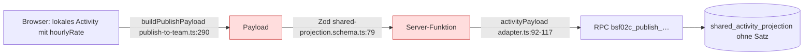

# A36 Plan: `hourlyRate` aus der gemeinsamen Projektion entfernen (QS6-4 Härtung)

Stand: 2026-11-07 05:20 +01:00 · Auftrag A36 (ops/queue) · Grundlage: `origin/main` 7dc4699d · Art: nur Plan, keine Umsetzung

## 1 Ergebnis

1. Die Datenbank hat keine Spalte für Stundensatz oder Betrag in `shared_*_projection`. Die Veröffentlichungsfunktion `bsf02c_publish_shared_projection_snapshot` liest und schreibt keinen Satz.
2. `hourlyRate` lebt auf dem Veröffentlichungsweg nur im Zod-Schema der Server-Funktion, im Client-Payload-Typ und in einer Client-Prüfung. Der Adapter verwirft den Wert, er steht nicht im `source_hash`.
3. Das Entfernen ist eine reine TypeScript-Änderung in fünf Dateien (Option A). Option B (Spalte per Datenauftrag) ist gegenstandslos, da keine Spalte existiert.
4. Keine Dateiüberschneidung mit PR 283 und A27.
5. Empfehlung: Option A als eigener kleiner Code-PR nach Freigabe, kein Publish-Gate. Aufwand rund 3 h, Publish-Risiko niedrig.

## 2 Fundstellen (Beleg Datei:Zeile, `origin/main` 7dc4699d)

### 2.1 Schema und Server-Funktion

| Fundstelle                                                         | Inhalt                                                                                                    |
| ------------------------------------------------------------------ | --------------------------------------------------------------------------------------------------------- |
| `src/lib/customer-data-runtime/shared-projection.schema.ts:79`     | `hourlyRate: z.number().finite().nonnegative()` im `activitySchema` (Pflichtfeld)                         |
| `src/lib/customer-data-runtime/shared-projection.schema.ts:71-82`  | `activitySchema` ist `z.object` ohne `.strict()`; Zod 3 entfernt unbekannte Schlüssel standardmäßig      |
| `src/lib/customer-data-runtime/shared-projection.functions.ts:97`  | `.validator((input) => publishSchema.parse(input))`                                                       |
| `src/lib/customer-data-runtime/shared-projection.functions.ts:100-106` | `buildSharedDataMigrationPlan({ …, activities: data.activities })`                                    |
| `src/lib/customer-data/types.ts:87`                                | `SharedDataMigrationInput.activities: readonly Activity[]` (lokaler Typ mit Pflichtfeld `hourlyRate`)     |
| `src/lib/customer-data/migration.ts:69`                            | `buildCandidates(…, activities: readonly Activity[], …)`; `migration.ts` liest `hourlyRate` nicht        |
| `src/lib/dashboard-data.ts:60`                                     | `hourlyRate: number; // €/h` im lokalen Typ `Activity`                                                    |
| `package.json:133`                                                 | `"zod": "^3.25.76"`                                                                                       |

Folge: Wird Zeile 79 ersatzlos gestrichen, bricht die Typprüfung an `shared-projection.functions.ts:104`, weil `data.activities` dann nicht mehr `Activity[]` erfüllt. `types.ts:87` und `migration.ts:69` müssen deshalb auf `Omit<Activity, "hourlyRate">` (oder einen eigenen Typ) verengt werden.

### 2.2 Client-Payload (Veröffentlichen an das Team)

| Fundstelle                                     | Inhalt                                                                           |
| ---------------------------------------------- | -------------------------------------------------------------------------------- |
| `src/lib/customer-data/publish-to-team.ts:59`  | `export interface PublishPayload`                                                |
| `src/lib/customer-data/publish-to-team.ts:83`  | `hourlyRate: number;` im Payload-Typ `activities`                                |
| `src/lib/customer-data/publish-to-team.ts:197-203` | Prüfung „Ungültiger Stundensatz“ in `findInvalidEntries`                     |
| `src/lib/customer-data/publish-to-team.ts:290` | `hourlyRate: activity.hourlyRate,` in `buildPublishPayload`                      |

### 2.3 Speicherung und Lesepfad (kein Satz)

| Fundstelle                                                                 | Inhalt                                                                                                       |
| -------------------------------------------------------------------------- | ------------------------------------------------------------------------------------------------------------ |
| `src/integrations/supabase/shared-projection-adapter.ts:92-117`            | `activityPayload`: `duration_hours`, `billable`, `billing_status`, `source_hash` ohne `hourlyRate`          |
| `src/integrations/supabase/shared-projection-adapter.ts:107-116`           | `sha256({ … duration, billable, billingStatus })` ohne Satz                                                  |
| `src/integrations/supabase/shared-projection-adapter.ts:185-202`           | Lesemapping Zeile → Objekt: `duration`, `billable`, `billingStatus`; kein Satz                               |
| `src/lib/customer-data/types.ts:67-81`                                     | `SharedActivityProjection` ohne `hourlyRate`                                                                 |
| `src/lib/customer-data-runtime/shared-projection.functions.ts:162`         | Lese-Funktion mit eigenem `readSchema`, kein Satz                                                            |
| `src/integrations/supabase/types.ts:1126-1148`                             | `shared_activity_projection.Row`: `billing_status`, `duration_hours`, kein Satz                              |

### 2.4 Veröffentlichungsfunktion und Tabellen (Datenbank)

| Fundstelle                                                                          | Inhalt                                                                                                                   |
| ----------------------------------------------------------------------------------- | ------------------------------------------------------------------------------------------------------------------------ |
| `supabase/migrations/20260929053733_bsf03e_p3b_due_projection.sql:7`                | jüngste Definition `CREATE OR REPLACE FUNCTION public.bsf02c_publish_shared_projection_snapshot(`                        |
| `supabase/migrations/20260929053733_bsf03e_p3b_due_projection.sql:295-302`          | INSERT in `shared_activity_projection`: `duration_hours`, `billable`, `billing_status`; kein Satz                         |
| `supabase/migrations/20260929053733_bsf03e_p3b_due_projection.sql:318-323`          | UPDATE-Zweig: `duration_hours`, `source_hash`; kein Satz                                                                 |
| `supabase/migrations/20260904041745_…sql:4`, `20260917182000_bsf03a_project_controlling.sql:83` | frühere Definitionen derselben Funktion                                                                       |
| `supabase/migrations/20260902031900_6d4075e1-…sql:101-145`                          | `CREATE TABLE public.shared_activity_projection`: `duration_hours numeric(10,2)` (:113), `billable` (:114), `billing_status` (:115); keine Satz- oder Betragsspalte |
| `supabase/migrations/20260902031900_6d4075e1-…sql:21`, `:55`                        | `shared_project_projection`, `shared_work_package_projection`; ohne Satz                                                  |
| Gegenprobe                                                                          | `grep -rni "hourly"` über `supabase/` (Migrationen, `schema/public-schema.sql`, Tests): 0 Treffer                        |

Der Live-Stand der Datenbank ist hier nicht geprüft. Dass dort keine Spalte nachträglich angelegt wurde, folgt nur aus den Migrationen im Repository und bleibt für die Live-Instanz **zu belegen**.

## 3 Wirkung

```yaml
datenbank:
  spalten_shared_projection: keine betroffen (keine Satzspalte vorhanden)
  rpc_bsf02c_publish_shared_projection_snapshot: unverändert, liest keinen Satz
  migration_noetig: nein
  datenauftrag_adr_0037: nein
server_funktion:
  vertrag: hourlyRate entfällt im Eingang; gesendetes Feld wird von Zod entfernt (kein Fehler)
  typpruefung: types.ts:87 und migration.ts:69 verengen, sonst Fehler an shared-projection.functions.ts:104
client:
  payload: publish-to-team.ts:83 und :290 entfallen
  pruefung: publish-to-team.ts:197-203 entfällt (Satz wird nicht geteilt; lokale Normalisierung bleibt in src/components/dashboard/domain.ts:40)
tests:
  anzupassen: keine zwingend; Fixtures in publish-to-team.test.ts:94/:188/:215, shared-projection-contract.test.ts:39, shared-projection-runtime.test.ts:45 nutzen den lokalen Typ Activity (Obermenge) und bleiben gültig
  neu: Schema-Test "hourlyRate wird beim Parsen entfernt" in src/__tests__/lib/shared-projection-publish-schema.test.ts; Payload-Test "buildPublishPayload enthält kein hourlyRate" in publish-to-team.test.ts
  sql_tests: keine Änderung (supabase/tests ohne Satz)
export: nicht betroffen (json-export-service.ts, text-export.ts, export-data.ts bleiben bei PR 283)
import: nicht betroffen (json-schema.ts:112, :133 bleibt; lokales Format Schema 1.1.0)
demodaten: nicht betroffen (src/lib/demo-data/dataset.ts:494-589, src/data/dashboard.json bleiben lokal)
oberflaeche: keine sichtbare Änderung; Veröffentlichungsdialog meldet keinen "Ungültigen Stundensatz" mehr
```

## 4 Abgrenzung zu PR 283 und A27

PR 283 (Draft, `fix/qs6-5-export-billing-view`, Stand `gh pr view 283` am 2026-11-07) ändert 23 Dateien. A27 ergänzt laut `queue/A27.yaml` `src/components/dashboard/dialogs/ActivityDialog.tsx` und `src/routes/_authenticated/dashboard.tsx` (JSON-Backup).

| Datei von Option A                                             | in PR 283 | in A27 |
| -------------------------------------------------------------- | --------- | ------ |
| `src/lib/customer-data-runtime/shared-projection.schema.ts`    | nein      | nein   |
| `src/lib/customer-data/types.ts`                               | nein      | nein   |
| `src/lib/customer-data/migration.ts`                           | nein      | nein   |
| `src/lib/customer-data/publish-to-team.ts`                     | nein      | nein   |
| `src/__tests__/lib/publish-to-team.test.ts`                    | nein      | nein   |
| `src/__tests__/lib/shared-projection-publish-schema.test.ts`   | nein      | nein   |

Einzige gemeinsame Berührung sind die Doku-Dateien (`CHANGELOG.md`, Tracker, `CURRENT-STATUS.md`, `ENTWICKLUNGSTAGEBUCH.md`, `BACKLOG.md`). Diese sollten im Tagesbündel gepflegt werden, nicht im Code-PR, um Konflikte mit 283 zu vermeiden. `src/lib/json-schema.ts` darf Option A nicht ändern, weil A27/G09 dort ggf. `hourlyRate` optional macht (BACKLOG-Notiz in PR 283).



Option A schneidet `hourlyRate` an den beiden rot markierten Stellen ab; ab dem Adapter ist der Weg bereits satzfrei.

## 5 Optionen

### Option A: nur Schema und Typen (empfohlen)

1. `shared-projection.schema.ts:79` streichen. Kein `.strict()` setzen, damit ältere Browser-Tabs, die das Feld noch senden, ohne Fehler veröffentlichen (Zod entfernt das Feld).
2. `types.ts:87` auf `readonly Omit<Activity, "hourlyRate">[]` verengen; `migration.ts:69` gleich.
3. `publish-to-team.ts:83` und `:290` streichen; Prüfung `:197-203` entfernen.
4. Zwei Regressionstests (Abschnitt 3).
5. `npm test`, `tsc`/Lint, Prettier; CI auf dem Head. Doku im Tagesbündel (Tracker, CHANGELOG-Eintrag „intern, keine sichtbare Änderung“).

Aufwand: 3 h (Code 0,5 h, Tests 1 h, CI und Review 1 h, Doku 0,5 h).

### Option B: zusätzlich Spalte per Datenauftrag nach ADR-0037

Gegenstandslos laut Repository: Es gibt keine Satzspalte (Abschnitt 2.4). Ein Datenauftrag wäre nur nötig, wenn die Live-Datenbank abweichend eine Spalte trägt. Vorgeschlagen ist deshalb nur eine lesende Gegenprobe der Live-Spaltenliste von `shared_activity_projection` (z. B. `information_schema.columns`), durchgeführt vom Owner. Ergibt sie eine Spalte, folgt ein eigener Datenauftrag (zwei Freigaben, feste IDs, Rollback).

Aufwand: 0,5 h Gegenprobe; Datenauftrag nur im Abweichungsfall, dann 2 bis 3 h.

## 6 Risiko für den Publish

```yaml
risiko_publish: niedrig
gruende:
  - keine Datenbankänderung, keine Migration, keine Edge Function
  - Zod entfernt unbekannte Schlüssel; alte Clients bleiben kompatibel
  - Satz wurde schon bisher nicht gespeichert (adapter.ts:92-117), also keine Verhaltensänderung in der Projektion
restrisiken:
  - Versionsversatz neuer Client mit altem Server würde am Pflichtfeld scheitern; bei gemeinsamem Bundle der TanStack-Start-App unwahrscheinlich, für Lovable-Publish zu belegen
  - Wegfall der Prüfung "Ungültiger Stundensatz" ändert die Vorschau (ein negativer lokaler Satz blockiert die Veröffentlichung nicht mehr); fachlich gewollt, da der Satz nicht geteilt wird
gate: kein Publish-Gate; QS6-4 ist durch D4 geschlossen
empfohlener_zeitpunkt: nach Merge von PR 283 oder unabhängig davon, nicht während Lovable schreibende Aufträge ausführt
```

## 7 Empfehlung

Option A nach Freigabe des Owners als Draft-PR umsetzen (Datensparsamkeit, Vertrag ehrlich machen). Option B nur als lesende Live-Gegenprobe durch den Owner. Ohne Freigabe bleibt es bei diesem Plan.
