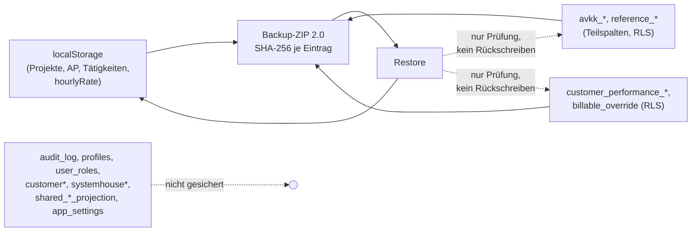

# A37 – App-Backup Format 2.0 gegen die 25 Tabellen in `public`

Grundlage: Code auf `origin/main` 7dc4699d (lesender Worktree), ADR-0042 und `docs/NOTFALL-HANDBUCH.md` vom Branch `origin/docs/2026-11-06-tagesbuendel` (e32f5242), Tabellenliste aus RP-01 (`queue/A30.yaml`, Feld `eingaenge`) und `supabase/schema/public-schema.sql`.

## Ergebnis

Das App-Backup ist im Kern eine Sicherung des **lokalen Browserzustands** (localStorage), ergänzt um zwei Cloud-Ausschnitte (AVKK mit Reference Data, Leistungsnachweise BSF-03B), die nur so weit gelesen werden, wie RLS es dem angemeldeten Nutzer erlaubt.
Von 25 Tabellen werden 5 spaltenvollständig exportiert, 7 teilweise, 13 gar nicht; darunter `audit_log` (336 Zeilen), `profiles`, `user_roles`, `customer*`, `systemhouse*` und die drei `shared_*_projection`-Tabellen (72 Zeilen).
Der Restore schreibt **keine einzige** Tabelle in die Datenbank zurück; AVKK- und Leistungsnachweis-Daten werden nur geprüft (ADR-0026).
Das Archiv ist nicht verschlüsselt, enthält keine Zeilenzahl je Tabelle, kein Schema und keine Auth-Konten und liegt zunächst nur in der IndexedDB des Browsers.
Empfehlung: W2 ist mit dem App-Backup **nicht** erreichbar; ein Datenbank-Dump (Schema und Daten, RP-02 bzw. A30) bleibt nötig. Das App-Backup bleibt ein ergänzender Weg für lokale Local-First-Daten.

| Punkt | Beobachtung | Beleg |
| --- | --- | --- |
| Formatversion | Manifest `2.0`, MAJOR 2; ältere Formate werden migriert, neuere nur mit `allowNewer` | `src/lib/backup/constants.ts:120-123`, `src/lib/backup/restore.ts:121-150` |
| Prüfsummen | SHA-256 je Archiveintrag (`sha256:<hex>`), Prüfung beim Erstellen und beim Restore | `src/lib/backup/checksum.ts:20-30`, `src/lib/backup/zip.ts:131-145`, `src/lib/backup/integrity.ts:69-70` |
| Inhalt lokal | localStorage-Schlüssel nach Allowlist (u. a. `northbit-dashboard-v2` mit Projekten, Arbeitspaketen, Tätigkeiten), sensible Schlüssel ausgeschlossen | `src/lib/backup/constants.ts:28-61`, `:66-112`, `src/lib/backup/snapshot.ts:148-166` |
| Inhalt Cloud | `avkk.json`, `reference-data.json`, `performance-statements.json`, zusätzlich `dashboard.json` | `src/lib/backup/snapshot.ts:186-190`, `src/lib/backup/zip.ts:81-129` |
| Lesepfad Cloud | Nutzer-Client mit RLS, kein Service-Role-Client; Fehler führen nur zu Warnungen, Backup bleibt „gültig“ | `src/integrations/supabase/performance-statement-backup-adapter.ts:20-26`, `src/lib/backup/avkk-payload.ts:116-121`, `:151-156`, `src/lib/backup/performance-statement-collector.ts:8-26` |
| Restore | Nur localStorage; AVKK und Leistungsnachweise „geprüft, aber nicht in die Datenbank zurückgeschrieben“ | `src/lib/backup/restore.ts:36-37`, `:158-197`, `:203-241`; Test `src/__tests__/backup/avkk-backup.test.ts:43` |
| Ablage | ZIP ohne Verschlüsselung in IndexedDB `engineer-dashboard-backups`; Download nur manuell | `src/lib/backup/zip.ts:154`, `src/lib/backup/constants.ts:10-12`, `src/lib/backup/create-backup.ts:181`, `:290-299` |
| Rhythmus | Automatisch höchstens einmal je UTC-Kalendertag, nur wenn die App offen ist (Start und alle 6 h) | `src/lib/backup/create-backup.ts:104-120`, `:274-287`, `src/routes/_authenticated/dashboard.tsx:308` |
| Separater „JSON-Backup“ | `exportData` in `dashboard.tsx` ist **kein** Format 2.0: Projekte, Arbeitspakete, Tätigkeiten, Engineer-Profil als lose JSON, ohne Manifest und Prüfsumme | `src/routes/_authenticated/dashboard.tsx:335-352`, `:1168` |

## Matrix: 25 Tabellen × App-Backup

Legende Export: **abgedeckt** = alle Spalten laut `supabase/schema/public-schema.sql` im Archiv; **teilweise** = Teilmenge der Spalten oder nur indirekt; **nicht abgedeckt** = kein Bezug im Backupcode. Spaltenabgleich gegen das Repo-Schema; Gleichheit mit Live ist nicht belegt (R-10), also „zu belegen“. Alle Cloud-Exporte enthalten nur Zeilen, die RLS dem sichernden Nutzer zeigt. Spalte DB-Restore: in keinem Fall vorhanden (`src/lib/backup/restore.ts:158-197`).

| # | Tabelle | Export | DB-Restore | Fehlend bzw. Bemerkung | Beleg |
| --- | --- | --- | --- | --- | --- |
| 1 | app_settings | nicht abgedeckt | nein | Risikoschwelle u. a. nur zur Laufzeit gelesen | `src/lib/backup/snapshot.ts:186-190` (nur AVKK und BSF-03B), `src/lib/avkk/adapter.ts:343` |
| 2 | audit_log | nicht abgedeckt | nein | 336 Zeilen (RP-01); Schutzklasse kritisch (ADR-0042:42) | kein Zugriff in `src/lib/backup/*`; einziger Lesezugriff `src/lib/admin/auth-accounts.server.ts:71`, `:282` |
| 3 | avkk_competence | teilweise | nein (nur Prüfung) | ohne `dimension_value_id`, `rating_value_id`, Label-Snapshots, `created_by`, `updated_by`, `updated_at` | `src/lib/backup/avkk-payload.ts:195-206`; Schema `supabase/schema/public-schema.sql:1934-1955` |
| 4 | avkk_consequence | teilweise | nein (nur Prüfung) | ohne `*_value_id`, Label-Snapshots, `created_*`, `updated_*` | `src/lib/backup/avkk-payload.ts:207-217`; Schema `:1956-1979` |
| 5 | avkk_responsibility | teilweise | nein (nur Prüfung) | ohne `role_value_id`, `role_label_snapshot`, `created_*`, `updated_*` | `src/lib/backup/avkk-payload.ts:183-194`; Schema `:1980-1999` |
| 6 | avkk_responsibility_type | teilweise | nein | nur `typeKeys` je Verantwortung; ohne `id`, `type_value_id`, Label, `created_*` | `src/lib/backup/avkk-payload.ts:189`; Schema `:2000-2013` |
| 7 | avkk_subject | teilweise | nein (nur Prüfung) | ohne `systemhouse_id`, `customer_id`, `created_by`, `updated_by`; Subjekte ohne Dossier entfallen | `src/lib/backup/avkk-payload.ts:170-182`; Schema `:2014-2036` |
| 8 | customer | nicht abgedeckt | nein | – | kein Zugriff in `src/lib/backup/*` |
| 9 | customer_access | nicht abgedeckt | nein | – | kein Zugriff in `src/lib/backup/*` |
| 10 | customer_activity_billable_override | abgedeckt (13/13) | nein (nur Prüfung) | RLS-Sichtbereich | `src/integrations/supabase/performance-statement-backup-adapter.ts:29-35`, `:73-87`; Schema `:2071-2090` |
| 11 | customer_performance_activity_claim | abgedeckt (6/6) | nein (nur Prüfung) | RLS-Sichtbereich | `…-backup-adapter.ts:51-55`, `:148-155`; Schema `:2091-2103` |
| 12 | customer_performance_statement | abgedeckt (22/22) | nein (nur Prüfung) | RLS-Sichtbereich; Versionsketten werden geprüft | `…-backup-adapter.ts:41-45`, `:101-124`; Test `src/__tests__/backup/performance-statement-backup.test.ts:12`, `:39` |
| 13 | customer_performance_statement_item | abgedeckt (21/21) | nein (nur Prüfung) | RLS-Sichtbereich | `…-backup-adapter.ts:46-50`, `:125-147`; Schema `:2141-2170` |
| 14 | customer_performance_statement_request | abgedeckt (11/11) | nein (nur Prüfung) | RLS-Sichtbereich | `…-backup-adapter.ts:36-40`, `:88-100`; Schema `:2171-2192` |
| 15 | customer_responsibility | nicht abgedeckt | nein | – | kein Zugriff in `src/lib/backup/*` |
| 16 | profiles | nicht abgedeckt | nein | 9 Zeilen; Konten bewusst ausgeschlossen | `src/lib/backup/constants.ts:22-27` |
| 17 | reference_catalog | teilweise | nein (nur Versionsabgleich) | ohne `description`, `is_hierarchical`, `scope_type`, Zeitstempel | `src/lib/backup/avkk-payload.ts:131-138`; Schema `:2233-2251` |
| 18 | reference_value | teilweise | nein | ohne `description`, `parent_value_id`, `attributes`, `systemhouse_id`, `created_*`, `updated_*` | `src/lib/backup/avkk-payload.ts:139-149`, Quelle `src/lib/reference-data/adapter.ts:84-85`; Schema `:2252-2275` |
| 19 | reference_value_history | nicht abgedeckt | nein | – | kein Zugriff in `src/lib/backup/*`; Schema `:2276-2291` |
| 20 | shared_activity_projection | nicht abgedeckt (nur indirekt) | nein | 47 Zeilen; nur die lokale Quelle des sichernden Nutzers (`northbit-dashboard-v2`), nicht die Projektion anderer Nutzer | `src/lib/backup/constants.ts:29`, `src/integrations/supabase/shared-projection-adapter.ts:244-270` (nicht im Backup) |
| 21 | shared_project_projection | nicht abgedeckt (nur indirekt) | nein | 5 Zeilen; wie Nr. 20 | wie Nr. 20 |
| 22 | shared_work_package_projection | nicht abgedeckt (nur indirekt) | nein | 20 Zeilen; wie Nr. 20 | wie Nr. 20 |
| 23 | systemhouse | nicht abgedeckt | nein | – | kein Zugriff in `src/lib/backup/*` |
| 24 | systemhouse_membership | nicht abgedeckt | nein | – | kein Zugriff in `src/lib/backup/*` |
| 25 | user_roles | nicht abgedeckt | nein | 9 Zeilen | kein Zugriff in `src/lib/backup/*` |

```yaml
# A37 Abdeckung App-Backup Format 2.0 gegen public (Stand origin/main 7dc4699d)
summe:
  tabellen: 25
  export_abgedeckt: 5 # customer_activity_billable_override, customer_performance_*(4)
  export_teilweise: 7 # avkk_*(5), reference_catalog, reference_value
  export_nicht_abgedeckt: 13 # davon 3 shared_*_projection nur indirekt über lokale Quelle
  db_restore: 0
ausserhalb_public:
  auth_users: nicht abgedeckt # 9 Konten laut RP-01
  schema_migrationen_funktionen_policies: nicht abgedeckt
  storage: entfällt # 0 Buckets laut RP-01
eignung_w2:
  schema: nein
  daten_vollstaendig: nein
  verschluesselt: nein # zip.ts:154
  zeilenzahl_je_tabelle: nein # Manifest nur keyCount, snapshot.ts:197
  pruefsumme: ja # checksum.ts:28
  ausserhalb_plattform: teilweise # Browser-IndexedDB, Download manuell
  unabhaengig_von_rls: nein
```



## F-QS6-ENG-02 (hourlyRate im JSON-Backup) – Einordnung

G09 wird hier nicht geändert (A27). Befund im Code von `origin/main`:

1. **Lose JSON-Sicherung** `exportData` (`src/routes/_authenticated/dashboard.tsx:335-352`) schreibt `activities` mit `hourlyRate` (`src/lib/dashboard-data.ts:60`) ohne Rechteprüfung; die Funktion wird unbedingt an `ExportDialog` übergeben (`dashboard.tsx:1168`, angezeigt in `src/components/ExportDialog.tsx:261-266`). Das ist der in A27 genannte Fund; er betrifft nicht das Format 2.0.
2. **Format-2.0-ZIP**: Dieselben Tätigkeiten liegen in `data/northbit-dashboard-v2*.json` (`src/lib/backup/constants.ts:29`, `src/lib/backup/snapshot.ts:149-165`) und zusätzlich in `dashboard.json` (`src/lib/backup/zip.ts:112-124`; `hourlyRate` in `timeEntries` `src/lib/json-export-service.ts:204`). Der Tageslauf startet für **jede** Rolle (`dashboard.tsx:308`), das Backup-Menü mit Download aber nur mit `backup.restore` (`src/components/dashboard/header/ServiceMenu.tsx:174`; Recht nur Systemadministrator und Administrator, `src/lib/rbac/permissions.ts:131`, `:156`). Für Engineer entsteht so ein ZIP mit `hourlyRate` in der IndexedDB, das die Oberfläche nicht anbietet.
3. **Bezug zu W2**: `hourlyRate` hat in der Datenbank keine Spalte (`shared_activity_projection`, `supabase/schema/public-schema.sql:2292-2325`), obwohl der Veröffentlichungsvertrag das Feld führt (`src/lib/customer-data/publish-to-team.ts:290`, `src/lib/customer-data-runtime/shared-projection.schema.ts:79`); ob der Server es verwirft, ist zu belegen. Der Stundensatz existiert damit nur lokal; das App-Backup ist seine **einzige** Sicherung. Filtert A27 `hourlyRate` für Rollen ohne `billing.view` aus dem Backup, ist dieser Wert nach einem Geräteverlust nicht wiederherstellbar. Das muss in A27 bewusst entschieden werden (Datenverlust gegen Vertraulichkeit).

## Bewertung für RTO und RPO (ADR-0042, Entwurf)

- **RPO**: Für die abgedeckten Teile höchstens 1 Tag, aber nur, wenn ein berechtigter Nutzer die App an diesem Tag öffnet (`create-backup.ts:104-120`, `:283-286`). Ein garantierter Rhythmus wie in H-A oder K-A („täglicher Dump“) ist so nicht nachweisbar; ein Backup-Protokoll liegt nur im Browser (`src/lib/backup/constants.ts:14-16`).
- **RTO**: Für die Datenbank nicht bestimmbar, weil kein Restore-Pfad in die Datenbank existiert (`restore.ts:158-197`). Für den lokalen Zustand eines einzelnen Browsers wenige Minuten (Restore in localStorage mit Rollback, `restore.ts:235-265`); ein Zeitnachweis fehlt.
- **Schutzklasse kritisch** (`audit_log`, Benutzerkonten, Kundendaten, ADR-0042:42): vom App-Backup nicht bedient. Klasse **hoch** (Rollen und Rechte, Schema, ADR-0042:41): nicht bedient.
- **W2-Kriterien** (Dump von Schema und Daten außerhalb der Plattform, verschlüsselt, Datum, Prüfsumme, Zeilenzahl je Tabelle; ADR-0042:230, NOTFALL-HANDBUCH.md:213, :217): erfüllt sind nur Datum und Prüfsumme.

**Empfehlung**: W2 muss über einen Datenbank-Dump erfolgen (RP-02, Plan A30; Export über Lovable „Export data“ zu belegen). Das App-Backup sollte in ADR-0042 als ergänzender Weg für lokale Local-First-Daten (Projekte, Arbeitspakete, Tätigkeiten, Stundensätze) und als Prüfstand für AVKK- und Leistungsnachweis-Daten aufgeführt werden, nicht als Weg W2. Zusätzlich sollte die Bedienoberfläche oder Hilfe klarstellen, dass das „Backup“ keine Datenbanksicherung ist (vgl. Hinweis im Manifest `src/lib/backup/snapshot.ts:200-202`, der nur Quellcode nennt).

## Offene Fragen

1. Abweichung vom Auftrag: `dashboard.tsx:335-352` und `:1168` gehören nicht zum Format 2.0, sondern zu einer separaten JSON-Sicherung ohne Manifest. Der Bericht behandelt beide Pfade getrennt.
2. Abweichung: ADR-0042 und `docs/NOTFALL-HANDBUCH.md` liegen nicht auf `origin/main`, sondern auf `origin/docs/2026-11-06-tagesbuendel` (e32f5242); Zeilenangaben beziehen sich auf diesen Stand.
3. Abweichung: RP-01 im Feld `eingaenge` nennt nur Zahlen, keine Tabellennamen. Die 25 Namen stammen aus `supabase/schema/public-schema.sql:1907-2413` und stimmen mit der Gruppierung in A37 überein; Gleichheit mit Live ist zu belegen (R-10, RP-02).
4. Risiko: Ein Backup mit fehlgeschlagenem Cloud-Teil gilt als erfolgreich, das Fehlen steht nur als Warnung im Protokoll (`avkk-payload.ts:151-156`, `performance-statement-collector.ts:19-26`). Wer das ZIP als Datensicherung versteht, erkennt den Verlust nicht ohne Blick ins Manifest.
5. Risiko: Cloud-Teile hängen von RLS des sichernden Nutzers ab; welche Rolle alle Zeilen sieht, ist im Repo nicht geprüft (zu belegen).
6. Frage an A27: Soll `hourlyRate` für Rollen ohne `billing.view` aus Backup und JSON-Export entfernt werden, obwohl das Backup die einzige Sicherung dieses lokalen Wertes ist? Alternative: Feld im Archiv belassen, aber Download nur mit Recht; oder Stundensatz serverseitig führen.
7. Frage: Soll der automatische Tageslauf für Rollen ohne `backup.restore` überhaupt laufen (`dashboard.tsx:308`)? Er erzeugt Archive, die diese Rollen weder herunterladen noch einspielen können.
8. Inhalt und Format des vom Owner am 2026-11-06 ausgelösten Exports unter `C:\dev\restore-probe` sind unbekannt; nicht geprüft (kein Zugriff vorgesehen).

## Eigene Ideen

- Manifest um `tableCounts` je Cloud-Tabelle und um `coverage: partial` erweitern, damit das Archiv selbst sagt, dass es keine DB-Sicherung ist.
- Cloud-Fehler im Backup als Status `warning` sichtbar im Dialog markieren statt nur im Protokoll.
- Restore-Probe A30 um einen Abgleich ergänzen: App-Backup-Inhalt gegen Dump-Zeilen derselben Tabellen (Stichprobe der 5 vollständig exportierten Tabellen).
- Lose JSON-Sicherung (`exportData`) entweder auf Format 2.0 umstellen oder in „Datenexport“ umbenennen, damit es nur ein „Backup“ gibt.
- In der Hilfe (`src/lib/help-documentation.ts:1552`) einen Satz „Das Backup sichert keine Datenbank, keine Konten und kein audit_log“ aufnehmen.

## Abschluss

Hygiene: 0 gemergte Remote-Branches, 5 offene PRs, davon 4 Drafts.

```yaml
Reifegrad: "Analyse abgeschlossen; App-Backup 2.0 als W2 ungeeignet (5/25 vollständig, 7/25 teilweise, 13/25 nicht; 0/25 DB-Restore)"
Projektstatus: "Golden Gate offen; R-14 und G03 unverändert offen; Publish No-Go"
Offene_Fragen:
  - "Datenbank-Dump als W2 über RP-02/A30 belegen (Export Lovable 'Export data', Inhalt C:\\dev\\restore-probe unbekannt)"
  - "A27: hourlyRate-Filter gegen Datenverlust lokaler Stundensätze abwägen"
  - "Automatischer Tageslauf für Rollen ohne backup.restore beibehalten?"
  - "Welche Rolle sieht per RLS alle Zeilen der Cloud-Teile (zu belegen)"
  - "ADR-0042: App-Backup als ergänzenden Weg aufführen, nicht als W2"
Roadmap:
  Sprints_bis_BSF: "zu belegen (abhängig von G03/R-14 und Owner-Entscheidungen zu ADR-0042)"
  Sprints_bis_MVP: "zu belegen"
```
