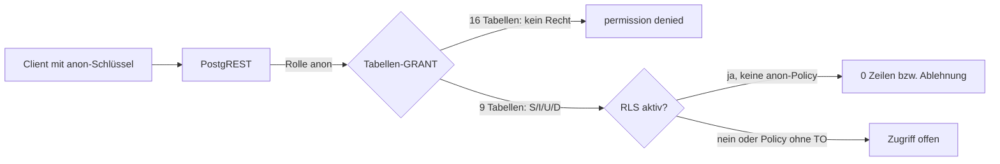

# A38-Bericht

Grundlage: Anlage `queue/anlagen/RP-02-ergebnis-2026-11-07.md` (Branch `ops/queue`, Owner, 2026-11-07 05:44 bis 05:45 +01:00, nur SELECT), Aufträge `queue/A38.yaml` und `queue/A30.yaml`, Worktree auf Tagesbündel `72a85f49`: `supabase/migrations` (33 Dateien), `supabase/schema/public-schema.sql` (Snapshot aus den Migrationen), `docs/ADR/0036-qs01-konto-und-berechtigungsschutz.md`, Tracker QS-01. Keine Live-Abfrage, keine Datenänderung, der Dump des Owners wurde nicht geöffnet. Schwere nach Risikoskala 1 bis 5 (`docs/RISIKOREGISTER.md`, Auswirkung bei Eintritt unter Berücksichtigung der Erreichbarkeit).

## Ergebnis

1. `anon` hat auf 9 Tabellen rohe Rechte SELECT, INSERT, UPDATE, DELETE (live, RP-02 H); dieselben 9 Tabellen haben im Git-Snapshot `GRANT ALL` an `anon`. Ursache sind die Supabase-Default-Privilegien beim Anlegen; diese 9 Tabellen wurden nie per `REVOKE` bereinigt. Schutz allein durch RLS, das heute nachweislich greift (RLS 25/25, alle 65 Policies nur `authenticated`).
2. QS-01 Migration C ist **nicht angewendet** und existiert nur als Entwurf (ADR-0036). Selbst angewendet würde sie nach heutigem Zuschnitt nur TRUNCATE, REFERENCES, TRIGGER entziehen; die rohen Rechte SELECT/INSERT/UPDATE/DELETE für `anon` blieben bestehen. Empfehlung: C erweitern (C′), kein hartes Publish-Gate für die Rechteänderung, aber ein lesender Prüfpunkt „RLS-Invariante“ im Publish-Gate.
3. Neuer Befund (Schwere 3): `avkk_people_directory` (SECURITY DEFINER, EXECUTE für `authenticated`) gibt jedem Konto mit `avkk.view`, also auch jedem `viewer` und damit jedem selbst registrierten Konto, Anzeigename, Rolle und Status aller Personen mit aktiver AVKK-Verantwortung aus, ohne Mandantenbezug und ohne Kontostatusprüfung.
4. Vorabvergleich Git-Snapshot gegen RP-02 ohne lokalen Aufbau: 302/302 Spalten, alle Objektnamen, 65/65 Policy-md5 gleich; 37/41 Funktions-md5 gleich, 4 Funktionen der Verantwortungsverwaltung (Migration `20260913150000`) weichen ab; ein Funktionsrecht weicht ab.
5. A30-Nachtrag eingearbeitet: Plan Abschnitt 15 (Soll-Tabelle, Abnahmekriterien S3/S4, Wege W1/W2, Owner-Schritt `pg_restore --list`, Folgen der unveränderten RP-02-Fassung); RP-02 in `docs/DATENAUFTRAG-RESTORE-PROBE.md` als ausgeführt vermerkt.

## Befundtabelle

| Nr  | Befund                                                                                                                                                                                                                                                                                                                                                   | Beleg                                                                                                                                                                                                                                                                                                      | Schwere | Empfehlung                                                                                                                                                                                                                                   |
| --- | -------------------------------------------------------------------------------------------------------------------------------------------------------------------------------------------------------------------------------------------------------------------------------------------------------------------------------------------------------- | ---------------------------------------------------------------------------------------------------------------------------------------------------------------------------------------------------------------------------------------------------------------------------------------------------------- | ------- | -------------------------------------------------------------------------------------------------------------------------------------------------------------------------------------------------------------------------------------------- |
| B1  | `anon` hat SELECT, INSERT, UPDATE, DELETE auf `app_settings`, `audit_log`, `avkk_competence`, `avkk_consequence`, `avkk_responsibility`, `avkk_responsibility_type`, `avkk_subject`, `profiles`, `user_roles`. Wirksam verhindert nur RLS den Zugriff (keine Policy für `anon`). Der `anon`-Schlüssel steht im Client-Bundle; Defense in Depth fehlt.    | Anlage Teil H (Zeile 760, Hinweis Zeile 769); `supabase/schema/public-schema.sql:3860-3988` (`GRANT ALL … TO "anon"`); keine `REVOKE … FROM anon` für diese 9 Tabellen in `supabase/migrations` (Tabellen angelegt in `20260717041306_…sql:34-143`, `20260802033452_…sql:9`, `20260809025207_…sql:73-310`) | 3       | QS-01 C′: `REVOKE ALL … FROM PUBLIC, anon` für die 9 Tabellen nach Muster `20260825090229_…sql:19-22` und `20260827035555_…sql:4-19`; Vertragstest wie `supabase/tests/sec02-reference-data-grants.sql` (T11) auf alle 25 Tabellen erweitern |
| B2  | Bedingung für die heutige Sicherheit: RLS auf allen Tabellen und keine Policy für `public`/`anon`. Eine künftige Policy ohne `TO`-Klausel (gilt dann für PUBLIC, also auch `anon`) oder ein abgeschaltetes RLS würde die 9 Tabellen sofort für nicht angemeldete Aufrufer öffnen, inklusive `profiles` und `user_roles`.                                 | Anlage Teil G (Rollen `{authenticated}`, 65/65) und H (RLS 25/25, FORCE 0); alle 89 `CREATE POLICY` in `supabase/migrations` haben eine `TO`-Klausel (Zählung A38)                                                                                                                                         | 3       | Lesender Prüfpunkt im Publish-Gate (Vorschlag G24, siehe unten) und als CI-Vertragstest: RLS 25/25, keine Policy mit Rolle `public` oder `anon`                                                                                              |
| B3  | `authenticated` hat auf denselben 9 Tabellen alle vier Rechte, obwohl die Migrationen enger vergeben (z. B. `audit_log` nur SELECT, `app_settings` nur SELECT/INSERT/UPDATE). `audit_log` ist gegen UPDATE/DELETE durch angemeldete Konten nur über fehlende Policies geschützt. Mit offener Selbstregistrierung ist `authenticated` jedes fremde Konto. | Anlage Teil H, Zeile 767 („alle übrigen Tabellen“ = die 9); `20260717041306_…sql:142` (`GRANT SELECT ON public.audit_log TO authenticated`) gegen `public-schema.sql:3867` (`GRANT ALL`); A29 (fremdes Konto startet als `viewer`)                                                                         | 3       | In C′: `REVOKE ALL … FROM authenticated` und die beabsichtigten Rechte aus den Migrationen neu vergeben; für `audit_log` nur SELECT                                                                                                          |
| B4  | QS-01 Migration C ist nicht angewendet, keine Datei. Ihr Zuschnitt (nur TRUNCATE, REFERENCES, TRIGGER) beseitigt B1 und B3 nicht.                                                                                                                                                                                                                        | `docs/ADR/0036-…md:20`, `:47-51`; Tracker QS-01 `status_detail` („Migration B und C folgen getrennt“); A29                                                                                                                                                                                                 | 3       | ADR-0036 Abschnitt 3 um B1, B3 und die Default-Privilegien für `anon` erweitern (Owner-Entscheidung)                                                                                                                                         |
| B5  | Ob live TRUNCATE, REFERENCES, TRIGGER an `anon`/`authenticated` vergeben sind, ist **zu belegen**; RP-02 H fragt nur vier Rechte ab. Der Git-Snapshot vergibt `GRANT ALL` (umfasst sie). TRUNCATE umgeht RLS, ist aber über PostgREST nicht erreichbar.                                                                                                  | Anlage Teil H (vier Spalten); `public-schema.sql:3860`, `:4014-4017` (Default-Privilegien `ALL ON TABLES`); `docs/ADR/0036-…md:22-24`                                                                                                                                                                      | 2       | RP-02b: alle sieben Tabellenrechte und `pg_default_acl` je Grantor lesen (ADR-0036 C verlangt dieses Inventar ohnehin)                                                                                                                       |
| B6  | Default-Privilegien im Schema `public` vergeben `ALL` auf Tabellen, Funktionen und Sequenzen an `anon` und `authenticated`. Jede neue Tabelle oder Funktion ist ohne explizites `REVOKE` für `anon` offen; die Bereinigung hängt an der Sorgfalt jeder Migration.                                                                                        | `public-schema.sql:3994-4017`                                                                                                                                                                                                                                                                              | 2       | In C′: `ALTER DEFAULT PRIVILEGES FOR ROLE postgres IN SCHEMA public REVOKE ALL ON TABLES, SEQUENCES FROM anon` und `REVOKE EXECUTE ON FUNCTIONS FROM PUBLIC, anon`; andere Grantor-Rollen erst nach Inventar                                 |
| E1  | `bsf02c_projection_identity_guard` und `customer_responsibility_identity_guard` haben EXECUTE für `anon` und PUBLIC. Beide sind Trigger-Funktionen (`RETURNS trigger`) und SECURITY INVOKER; ein direkter Aufruf außerhalb eines Triggers ist in PostgreSQL nicht möglich, PostgREST bietet sie nicht als RPC an. Kein ausnutzbarer Weg erkennbar.       | Anlage Teil E (Zeilen 597, 610, 634); `20260902031900_…sql:4` und `20260908032151_…sql:209` ohne `REVOKE`; `public-schema.sql:3658`, `:3730`                                                                                                                                                               | 1       | Bei C′ mitbereinigen (`REVOKE ALL … FROM PUBLIC, anon, authenticated`), wie bei den übrigen Guard-Funktionen (z. B. `20260913033000_…sql:90`)                                                                                                |
| E2  | `avkk_people_directory` (SECURITY DEFINER) prüft nur `has_permission(auth.uid(), 'avkk.view')`. `viewer` hat `avkk.view`; neue Konten starten als `viewer`. Zweig „aktive Verantwortung“ liefert Anzeigename, Rolle und Status aller Personen mit offener `avkk_responsibility`, ohne Systemhaus- oder Kundenbezug. Kein Kontostatus-Check (A22).        | `20260822110427_…sql:9-56` (einzige Definition); Live-md5 `4f390a43…` gleich dem nachgebildeten Repo-Text (A38-Vergleich); `has_permission` in `public-schema.sql:1573-1620` (viewer mit `avkk.view`); A29 (Startrolle `viewer`); J2: `avkk_responsibility` 48 Zeilen                                      | 3       | Owner-Entscheidung: Verzeichnis auf Personen in Subjekten beschränken, die der Aufrufer per `avkk_subject_read` sehen darf, und `is_account_active(auth.uid())` verlangen; DB-Vertragstest „fremdes viewer-Konto sieht 0 Personen“           |
| E3  | `avkk_can_write` (SECURITY DEFINER) prüft Recht, Mitgliedschaft, Kundenschreibzugriff und Engineer-Bezug; gibt nur `boolean` zurück. Kontostatus nur indirekt (A22).                                                                                                                                                                                     | `20260922185458_…sql:249-290`; Live-md5 gleich Repo                                                                                                                                                                                                                                                        | 1       | Keine eigene Maßnahme; Kontostatus über die A22-Entscheidung zu `has_permission` mitlösen                                                                                                                                                    |
| E4  | Alle übrigen 19 Funktionen mit EXECUTE für `authenticated` sind SECURITY INVOKER; die öffentlichen Wrapper rufen SECURITY-DEFINER-Funktionen im Schema `private` mit eigener Scope-Prüfung. `private` ist in RP-02 nicht erfasst.                                                                                                                        | Anlage Teil E; `20260913150000_…sql:8-140`, `20260927050827_…sql:19-476`, `20260922185458_…sql:547-577`                                                                                                                                                                                                    | 2       | RP-02b: Funktionen in `private` (prosecdef, Rechte, md5) lesen; bis dahin gilt die Prüfung nur für das Repo                                                                                                                                  |
| D1  | Drift Funktionen: 4 von 41 Funktions-md5 ungleich zwischen nachgebildetem Repo-Text und live: `customer_responsibility_management_candidates`, `customer_responsibility_management_overview`, `end_customer_responsibility`, `set_customer_responsibility`. Alle aus `20260913150000` (live `statements` NULL). Art der Abweichung unbekannt.            | Anlage Teil E; `public-schema.sql:1230`, `:1241`, `:1320`, `:1847`; RP-01 (statements NULL)                                                                                                                                                                                                                | 2       | In der Probe als bekannter Befund führen (Plan 15.2, 15.3); RP-02b: Länge und zeilenweise md5 der vier Funktionstexte; danach entscheiden, ob eine Abgleichsmigration nötig ist                                                              |
| D2  | Drift Rechte: `reference_value_validate_scope` hat im Git-Snapshot EXECUTE für `authenticated`, live nicht. Die Funktion stammt im Repo aus der Datei `20260913213000` (nur im Repo), live aus `20260913174733` (nur live). Live ist strenger; ohne Wirkung (Trigger-Funktion).                                                                          | Anlage Teil E (Funktionsrechte); `20260913213000_…sql:150`; `public-schema.sql` (GRANT an `authenticated`)                                                                                                                                                                                                 | 1       | Als bekannte Abweichung im Probeprotokoll; bei C′ angleichen                                                                                                                                                                                 |
| D3  | Ohne lokalen Aufbau gleich: 302/302 Spalten (Name, Position, NULL), 153 Constraint-, 74 Index-, 41 Trigger-, 65 Policy-, 41 Funktionsnamen; 65/65 Policy-md5 nach Normalisierung; Tabellenrechte `anon` identisch. Definitionen von Constraints und Indizes sind in der Anlage verkürzt dargestellt und nicht textgleich vergleichbar.                   | Vergleichsskripte A38 (Scratchpad, nicht im Repo) gegen `public-schema.sql`; Anlage Teile B bis H                                                                                                                                                                                                          | –       | Vollständiger Beleg nur durch den lokalen Lauf nach Plan 15.3                                                                                                                                                                                |
| P1  | md5 von `pg_get_functiondef` ist nur bei gleicher Postgres-Hauptversion (17) vergleichbar. J2 hängt zusätzlich von der Sitzungszeitzone ab; RP-02 lief in UTC (`now()` mit `+00`).                                                                                                                                                                       | Anlage Teil E, J2 (Zeile 794)                                                                                                                                                                                                                                                                              | 2       | Lokal Postgres 17 und `SET TimeZone = 'UTC'`; im Plan 15.1 vermerkt                                                                                                                                                                          |
| P2  | RP-02 lief unverändert (nicht RP-02a): kein SQL-Text (V-01), keine Zielbindung (V-02), keine Sitzungseinstellungen (V-03), `jsonb` nicht in J2 (V-04). `audit_log.payload` ist damit nicht geprüft.                                                                                                                                                      | Anlage Teil J1, K; Plan Abschnitt 10                                                                                                                                                                                                                                                                       | 2       | RP-02b oder RP-03 Teil 0 und D; Plan 15.6                                                                                                                                                                                                    |

## Bewertung Teil H und QS-01 Migration C



- Ist-Stand: Schutz durch eine Schicht (RLS). Die zweite Schicht (GRANT) fehlt bei 9 Tabellen. Heute ist kein Zugriff möglich (Beleg Teil G und H).
- Was Migration C ändern sollte (ADR-0036): TRUNCATE, REFERENCES, TRIGGER für `anon` und `authenticated` entziehen, für bestehende Tabellen und als Default-Privileg, nach einem lesenden Inventar von `pg_default_acl`.
- Was zusätzlich nötig ist (C′): `anon` auf allen 25 Tabellen ohne Rechte, `authenticated` auf den beabsichtigten Rechten der Migrationen, Default-Privilegien für `anon` entzogen, die zwei Guard-Funktionen bereinigt.
- Funktionale Wirkung von C′: Abfragen ohne Sitzung liefern dann einen Fehler statt einer leeren Menge. `src/lib/session/idle-config.ts:100-114` fängt Fehler ab und nutzt den Rückfallwert; weitere Aufrufe ohne Sitzung sind vor C′ zu prüfen (zu belegen).

### Empfehlung zum Gate

A29 hat die Nummer G23 bereits für „Migrationsanwendung beim Publish geklärt und Selbstregistrierung entschieden“ vorgeschlagen. Für die Rechte empfiehlt A38:

```yaml
gate_vorschlag:
  id: G24 # Nummer vergibt der Owner; G23 ist durch A29 belegt
  titel: RLS-Invariante vor Publish belegt
  kriterium:
    - RLS auf 25 von 25 Tabellen aktiv
    - keine Policy mit Rolle public oder anon
    - anon-Tabellenrechte nur auf der bekannten Liste (heute 9) oder leer
  beleg: lesender Datenauftrag (Wiederholung RP-02 G und H) höchstens 7 Tage vor Publish
  heute: erfüllt laut RP-02 vom 2026-11-07
  aufwand_h: 0.5
rechtebereinigung:
  einordnung: QS-01 Migration C′ vor L8 (Golden Gate), kein hartes Publish-Gate
  begruendung: kein ausnutzbarer Weg belegt; Wirkung bei Fehlkonfiguration hoch (profiles, user_roles, audit_log)
```

### Beschreibung der Änderung als kontrollierter Auftrag (nur beschrieben, nicht erstellt)

Eine Rechteänderung ist DCL und damit eine Migration nach ADR-0035 (Merge nach `main`, Work-Lauf mit Preflight, byte-identischer Anwendung samt History-Eintrag, Postflight). Die Kontrollen aus ADR-0037 gelten sinngemäß:

```yaml
auftrag_qs01_c_strich:
  weg: ADR-0035 Migration, Kontrollen nach ADR-0037
  datei: supabase/migrations/<Zeitstempel>_qs01_c_table_privileges.sql
  freigaben:
    [Freigabe 1 Auftragstext und Migration, Freigabe 2 Go nach Preflight]
  zielbindung: Lovable-Projekt-ID, höchste Migrationsversion, Zeilenzahl profiles
  feste_objekte:
    tabellen_anon_revoke:
      [
        app_settings,
        audit_log,
        avkk_competence,
        avkk_consequence,
        avkk_responsibility,
        avkk_responsibility_type,
        avkk_subject,
        profiles,
        user_roles,
      ]
    tabellen_authenticated_neu: Rechte je Tabelle wie in den Ursprungsmigrationen (audit_log nur SELECT)
    alle_tabellen: TRUNCATE, REFERENCES, TRIGGER von anon und authenticated entziehen
    funktionen:
      [bsf02c_projection_identity_guard, customer_responsibility_identity_guard]
    default_privilegien: FOR ROLE postgres IN SCHEMA public, anon ohne Rechte, Funktionen ohne PUBLIC
  preflight_nur_lesen:
    - Tabellenrechte aller drei Rollen mit allen sieben Rechten (Ist-Liste wird Rückbau-Grundlage)
    - pg_default_acl je Grantor
    - RLS 25/25, Policies nur authenticated
  postflight_nur_lesen:
    - anon ohne Tabellenrecht (0 Zeilen), H = 50 Zeilen
    - authenticated je Tabelle wie Soll-Liste
    - Funktions-md5 unverändert (41)
    - Zeilenzahlen J2 unverändert
  tests:
    - neuer DB-Vertragstest anon ohne Rechte auf 25 Tabellen (Muster sec02-reference-data-grants.sql T11)
    - App-Smoke Anmeldung, Idle-Timeout, AVKK-Ansicht je Rolle
  rueckbau: GRANT exakt nach Preflight-Liste, nur auf ausdrückliches Kommando
  audit_log: keine Zeile löschen oder ändern
```

## Soll-Tabelle für die Restore-Probe

Übernommen in `docs/PLAN-RESTORE-PROBE-LOKAL.md`, Abschnitt 15.1 (nur Zählwerte und Verweise, keine Rohdaten): 302 Spalten, 153 Constraints, 74 Indizes, 41 Funktionen mit md5 (15 SECURITY DEFINER), 109 Funktionsrechte-Zeilen, 41 Trigger, 65 Policies, 59 Tabellenrechte-Zeilen, 0 Sequenzen, J2 mit 25 Tabellen und 728 Zeilen. **Hinweis: Die md5-Werte von `pg_get_functiondef` sind nur bei gleicher Postgres-Hauptversion (17) vergleichbar.**

## Nachtrag A30

| Punkt                             | Umsetzung                                                                                                                                                                                                        | Ort                                                           |
| --------------------------------- | ---------------------------------------------------------------------------------------------------------------------------------------------------------------------------------------------------------------- | ------------------------------------------------------------- |
| Abnahmekriterien aus RP-02        | S3: RP-02 B bis H mit Funktions-md5 lokal gegen die Anlage; S4: J2 (Zeilenzahl und md5 je Tabelle, ohne J1-Spalten, UTC). Der Auftragstext nennt „S1/S2“ und „S3“; der Plan behält die Standard-Stufen S3 und S4 | Plan 15.3                                                     |
| Vergleich der zwei Wege           | W1 `db:schema:rebuild` plus `pg_restore --data-only`; W2 `pg_restore` aus dem Dump; W2 führend für R-14; Unterschiede W1/W2 sind Drift, kein Probefehler                                                         | Plan 15.4, Entscheidung E8                                    |
| Owner-Schritt `pg_restore --list` | Entpacken, SHA-256, `pg_restore` 17 im Container, nur Zählwerte ins Protokoll (u. a. `TABLE DATA public` Soll 25, Schema `auth`)                                                                                 | Plan 15.5                                                     |
| Soll-Tabelle                      | Zählwerte, Verweis auf die Anlage, Hinweis Hauptversion 17 und Zeitzone UTC                                                                                                                                      | Plan 15.1                                                     |
| Vorabvergleich                    | 37/41 Funktions-md5, 65/65 Policy-md5, 302/302 Spalten                                                                                                                                                           | Plan 15.2                                                     |
| RP-02 als ausgeführt              | Status, Ausführung 04:44 bis 04:45 UTC, Kernwerte als YAML, Freigaben-Tabelle, Ablage                                                                                                                            | `docs/DATENAUFTRAG-RESTORE-PROBE.md` Kopf, Abschnitte 3, 5, 7 |
| Prettier                          | beide Dateien formatiert, `--check` ohne Befund                                                                                                                                                                  | Worktree `wt-a38`                                             |

## Offene Fragen

- Owner: Zuschnitt QS-01 C′ (B1, B3, B6, E1 aufnehmen) und Zeitpunkt (vor L8 empfohlen).
- Owner: Nummer und Aufnahme des Gate-Vorschlags „RLS-Invariante“ (G24, da G23 durch A29 belegt).
- Owner: Maßnahme zu E2 (`avkk_people_directory`), zusammen mit der Entscheidung zur Selbstregistrierung (A29) und zu `has_permission` (A22).
- Zu belegen: TRUNCATE/REFERENCES/TRIGGER live (B5), `pg_default_acl` live, Funktionen in `private`, Art der Abweichung der vier Funktionen (D1). Vorschlag: ein lesender Ergänzungsauftrag RP-02b.
- Zu belegen: Ob Aufrufe ohne Sitzung außer `idle-config.ts` Tabellen lesen (Wirkung von C′).
- Abweichung vom Auftrag: Bericht nicht unter `reports/` im Repo, sondern als Lieferdatei; Stufenbezeichnung S1/S2/S3 aus `queue/A30.yaml` auf die Standard-Stufen S3/S4 abgebildet. Kleine Unstimmigkeit in `queue/A30.yaml`: RP-01 einmal 18:21 UTC, einmal 17:21 UTC.

## Eigene Ideen

- Die Anlage RP-02 enthält nur Katalogdaten, Zählwerte und md5; sie sollte als `docs/probe/RP-02-ERGEBNIS-2026-11-07.md` in Git übernommen werden (Ablageregel `docs/DATENAUFTRAG-RESTORE-PROBE.md` Abschnitt 7), damit der Plan nicht auf `ops/queue` verweisen muss.
- Die Vergleichsskripte aus A38 (Spalten, Namen, Policy-md5, Funktions-md5 aus dem Dump nachgebildet) eignen sich als Kern des Vergleichsskripts aus Plan Abschnitt 5 Punkt 2; sie laufen ohne Datenbank gegen `public-schema.sql`.
- Ein CI-Vertragstest „RLS-Invariante“ (RLS 25/25, keine Policy für `public`/`anon`, `anon` ohne Tabellenrecht nach C′) würde B2 dauerhaft absichern und wäre ein billiger Beleg für G24 auf Repo-Seite.

## Abschluss

Hygiene: 0 gemergte Remote-Branches, 6 offene PRs, davon 5 Drafts.

```yaml
Reifegrad: RP-02 ausgewertet; Rechte-Ist live belegt, Repo-Gleichheit für Spalten, Namen und Policies belegt, für 37 von 41 Funktionen belegt; lokale Probe nicht ausgeführt
Projektstatus: Publish No-Go (R-07); QS-01 B und C offen; drei Befunde Schwere 3 (anon-Rechte, authenticated-Rechte samt audit_log, Personenverzeichnis) und Migration C zu eng zugeschnitten
Offene_Fragen:
  - Zuschnitt und Zeitpunkt QS-01 C′ (Owner)
  - Gate-Nummer für die RLS-Invariante (G24 vorgeschlagen)
  - Maßnahme avkk_people_directory zusammen mit Selbstregistrierung und has_permission
  - RP-02b für TRUNCATE/REFERENCES/TRIGGER, pg_default_acl, private, vier Funktionstexte
  - Inhalt des Dumps per pg_restore --list (Owner)
Roadmap:
  Sprints_bis_BSF: 13 bis 17 (A26, grob, keine Zusage)
  Sprints_bis_MVP: unbekannt
```
