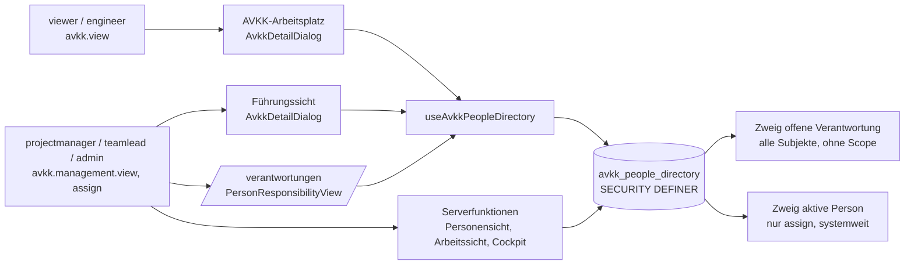

# A41-Bericht

Grundlage: `origin/main` 7dc4699d (lesender Worktree), Berichte A38 (E2), A29 (Befunde 8, 10, 13, 14, Vorschlag G23), A22 (`has_permission` ohne Kontostatus) auf `origin/ops/reports`, RP-02-Anlage nur für Struktur, Doku vom Tagesbündel `origin/docs/2026-11-06-tagesbuendel`. Keine Live-Abfrage, keine Datenbank, keine Container, keine Datei in Repos geändert. Zeilenangaben ohne Zusatz beziehen sich auf `main` 7dc4699d.

## Ergebnis

1. `avkk_people_directory` hat zwei Zweige: „offene Verantwortung“ (für jedes Konto mit `avkk.view`, also auch jeden selbst registrierten `viewer`) und „aktive Person“ (zusätzlich für `avkk.responsibility.assign`). Beide Zweige ignorieren den Systemhaus-/Kundenbezug und den Kontostatus des Aufrufers; die Funktion umgeht als SECURITY DEFINER die RLS von `avkk_subject` und `avkk_responsibility`.
2. Die UI braucht weniger als geliefert wird: Sie verwendet nur `id`, `display_name` und `status`; die Spalte `role` (App-Rolle, z. B. Systemadministrator) wird nirgends angezeigt. Benötigt werden nur Namen zu Verantwortungen, die der Aufrufer per RLS ohnehin sieht, plus die Personenauswahl für Rollen mit `avkk.responsibility.assign`.
3. Empfehlung: Variante (a) mit (d) als eine Migration (Zweig „offene Verantwortung“ auf RLS-sichtbare Subjekte, Aufrufer aktiv, globaler Zweig nur mit aktiver Systemhaus-Mitgliedschaft, `role` maskiert), etwa 7 h; Signatur bleibt gleich, kein Rollenwechsel, keine Typen-Neuerzeugung. (c) Selbstregistrierung schließen als Owner-Entscheidung in G23, nur wenn ein Weg zur Kontoanlage durch Admins belegt ist.
4. Befund Testinfrastruktur: „PGlite wie A11“ trifft nicht zu. A11 nutzte PGlite nur mit nachgebauten Tabellen ohne RLS und Trigger; PGlite ist keine Projektabhängigkeit. Vorhanden und geeignet ist der CI-Job „Database Schema Drift“ (`supabase start`, `psql`, `SET LOCAL ROLE authenticated`, JWT-Claims). Die beiden vorhandenen SEC-01-Tests zur Funktion laufen dort nicht.
5. Kritischer Pfad: Die Migration hängt an R-10/G23 (Anwendungsweg beim Publish ungeklärt). Ohne Migration vor dem Publish bleibt E2 offen; dann muss der Owner entweder (c) als Ausgleichsmaßnahme beschließen oder das Restrisiko schriftlich akzeptieren.

### Ist-Stand Funktion

| Punkt                       | Beobachtung                                                                                                                                                                                                         | Beleg                                                                                    |
| --------------------------- | ------------------------------------------------------------------------------------------------------------------------------------------------------------------------------------------------------------------- | ---------------------------------------------------------------------------------------- |
| Definition                  | `LANGUAGE sql STABLE SECURITY DEFINER SET search_path = ''`, Rückgabe `id, display_name, role, status`                                                                                                              | `supabase/migrations/20260822110427_2dd06fe8-b4fc-418f-bd4c-e37f52826a1d.sql:9-20`       |
| Eingangsprüfung             | Nur `auth.uid() IS NOT NULL` und `has_permission(auth.uid(), 'avkk.view')`; kein `is_account_active`                                                                                                                | `…20260822110427_….sql:38-39`                                                            |
| Zweig „aktive Person“       | Mit `avkk.responsibility.assign`: alle Profile mit `status = 'active'`, systemweit, auch `viewer`, `customer`, `kiosk`                                                                                              | `…20260822110427_….sql:41-44`                                                            |
| Zweig „offene Verantwortung“ | Alle Personen mit einer `avkk_responsibility` mit `valid_to IS NULL`, ohne Prüfung, ob der Aufrufer das Subjekt sehen darf; Status der Person beliebig                                                              | `…20260822110427_….sql:45-50`                                                            |
| Rolle                       | Jüngste App-Rolle der Person (`user_roles`, `ORDER BY granted_at DESC LIMIT 1`)                                                                                                                                      | `…20260822110427_….sql:31-37`                                                            |
| Rechte                      | `REVOKE ALL … FROM PUBLIC, anon`, `GRANT EXECUTE … TO authenticated`; Nachhärtung                                                                                                                                    | `…20260822110427_….sql:55-56`; `20260825103859_….sql:35-37`; `public-schema.sql:3652-3654` |
| Live-Gleichheit             | md5 live gleich nachgebildetem Repo-Text                                                                                                                                                                            | A38 E2                                                                                   |
| Vergleich RLS               | `avkk_subject_read`: `avkk.view` und (global oder aktive Mitgliedschaft und Kundenlesezugriff). `avkk_responsibility_read`: `avkk.view` und Subjekt sichtbar (Unterabfrage unter RLS des Aufrufers)                 | `public-schema.sql:3384`, `:3340-3342`                                                   |
| Hilfsfunktionen             | `has_active_systemhouse_membership` prüft `is_account_active` und Mitgliedschaftsstatus; `has_customer_access` setzt die Mitgliedschaft voraus                                                                       | `public-schema.sql:1489-1508` (Status `:1495`, `:1501`), `:1525-1551` (`:1533`, `:1540`)   |
| Rechte `viewer`             | `dashboard.view`, `documentation.view`, `avkk.view`, `referencedata.view`; `has_permission` ohne Kontostatus                                                                                                        | `public-schema.sql:1573-1620` (`:1614-1615`)                                             |
| Startrolle                  | `handle_new_user`: erstes Konto `systemadministrator`, sonst `viewer`; Profil `active`                                                                                                                              | `public-schema.sql:1434-1483` (`:1464-1466`); A29 Befund 8                               |
| Halter-Regel                | `is_eligible_responsibility_holder`: aktiv, Rolle ab `engineer`, nicht `viewer`/`customer`                                                                                                                          | `public-schema.sql:1654-1676`                                                            |
| Befund `avkk.manage`        | Ein Recht `avkk.manage` existiert nicht. Vorhanden: `avkk.view`, `avkk.edit`, `avkk.responsibility.assign`, `avkk.management.view`. Variante (b) wird daher auf `avkk.management.view` bzw. `avkk.edit` abgebildet. | `public-schema.sql:1583-1616`; Suche `avkk.manage` in `src`, `supabase`: 0 Treffer         |

### Aufrufer und Bedarf der UI

| Aufrufer                                                   | Zweck                                                                                                        | Benötigte Felder           | Erforderliches Recht im Aufrufpfad                                                         | Beleg                                                                                                                                       |
| ---------------------------------------------------------- | ------------------------------------------------------------------------------------------------------------ | -------------------------- | ------------------------------------------------------------------------------------------ | ------------------------------------------------------------------------------------------------------------------------------------------- |
| `people-directory-adapter.ts` → `people-directory.ts` → Hook | Einziger Client-Adapter; normalisiert Namen                                                                  | `id`, `display_name`       | –                                                                                          | `src/lib/avkk/people-directory-adapter.ts:16-24`; `src/lib/avkk/people-directory.ts:18-26`; `src/hooks/useAvkkPeopleDirectory.ts:25`          |
| `AvkkDetailDialog` (AVKK-Arbeitsplatz und Führungssicht)    | Namen zu Verantwortungen im Dossier; Auswahl beim Zuordnen; bei Fehler Zuordnung gesperrt, Lesen bleibt      | `id`, `displayName`        | Arbeitsplatz `avkk.view`, Führungssicht `avkk.management.view`; Zuordnen `avkk.responsibility.assign` | `src/components/avkk/AvkkDetailDialog.tsx:53-67`, `:109-117`, `:139`; `src/routes/_authenticated/dashboard.tsx:997-1009`, `:1013-1025`; `src/components/avkk/AvkkWorkspaceView.tsx:43-44` |
| Fallback ohne Treffer                                      | Anzeige „Person nicht verfügbar“                                                                             | –                          | –                                                                                          | `src/components/avkk/AvkkResponsibilitySection.tsx:54`                                                                                       |
| `PersonResponsibilityView` (Route `/verantwortungen`)       | Personenauswahl                                                                                              | `id`, `displayName`        | Route `avkk.management.view`                                                               | `src/components/avkk/person/PersonResponsibilityView.tsx:19`, `:64-68`; `src/routes/_authenticated/verantwortungen.tsx:18-20`                  |
| `responsibility-person-view-adapter` (Serverfunktion)       | Name der gewählten Person zu scoped Subjekten                                                                | `id`, `display_name`, `status` | `is_account_active` und `avkk.management.view`                                         | `src/integrations/supabase/responsibility-person-view-adapter.ts:103-105`, `:124`, `:166-169`, `:213`; `src/lib/avkk-runtime/responsibility-person-view.functions.ts:14`, `:34-47` |
| `work-package-work-view-adapter` (Serverfunktion, auch Cockpit) | Namen von Owner/Deputy zu RLS-sichtbaren scoped Subjekten                                                    | `id`, `display_name`, `status` | `is_account_active` und `avkk.management.view`                                         | `src/integrations/supabase/work-package-work-view-adapter.ts:84-90`, `:117-121`, `:150`; `src/lib/avkk-runtime/work-package-work-view.functions.ts:13`, `:28-29`; `src/lib/management-cockpit-runtime/management-cockpit.functions.ts:180-197` |
| Spalte `role`                                              | Wird gemappt, aber in keiner Komponente angezeigt oder ausgewertet (`row.role` in `PersonResponsibilityTable` ist die Verantwortungsrolle) | –                          | –                                                                                          | `src/lib/avkk/people-directory.ts:24`; `src/components/avkk/person/PersonResponsibilityTable.tsx:26`, `:81`                                  |



Fazit Bedarf: Jeder Aufrufer braucht nur Namen von Personen mit Verantwortung in Subjekten, die er per `avkk_subject_read` sehen darf (Dossier und Serveradapter lesen `avkk_responsibility` unter RLS), sowie für `assign` eine Auswahl zulässiger Halter.

## Varianten

Aufwand in Stunden einschließlich Test und Doku, ohne Wartezeit auf Lovable. Migrationsbedarf: jede Änderung an der Funktion ist eine neue Migrationsdatei (ADR-0035, Anwendung über Lovables Migrationspfad oder den kontrollierten Fallback); ein Datenauftrag nach ADR-0037 ist bei keiner Variante nötig, weil keine Daten geändert werden.

| Variante | Inhalt                                                                                                                                                                                                                                                                                                                                                                                       | Aufwand h | Migration (ADR-0035) / Datenauftrag (ADR-0037)                                                     | Wirkung auf E2                                                                                                         | Risiko                                                                                                                                                                                  |
| -------- | -------------------------------------------------------------------------------------------------------------------------------------------------------------------------------------------------------------------------------------------------------------------------------------------------------------------------------------------------------------------------------------------------------------- | --------- | -------------------------------------------------------------------------------------------------- | ---------------------------------------------------------------------------------------------------------------------- | --------------------------------------------------------------------------------------------------------------------------------------------------------------------------------------- |
| a1       | `CREATE OR REPLACE` mit gleicher Signatur: Eingang zusätzlich `public.is_account_active(auth.uid())`; Zweig „offene Verantwortung“ nur für Subjekte, die die Bedingung von `avkk_subject_read` erfüllen (global oder `has_active_systemhouse_membership` und `has_customer_access(…, 'read')`); globale Subjekte nur, wenn der Aufrufer eine aktive Systemhaus-Mitgliedschaft hat oder `assign` besitzt; Zweig „aktive Person“ auf `is_eligible_responsibility_holder(p.id)` beschränkt | 5 bis 6   | ja, eine Datei; kein Datenauftrag; keine Neuerzeugung von `types.ts` (Signatur unverändert)         | Fremdes Konto ohne Mitgliedschaft: 0 Personen; gesperrte Konten: 0; Mandantenbezug im Lesezweig hergestellt            | niedrig: UI-Bedarf ist Teilmenge (siehe Nachweis); Definer-Funktion bleibt, `search_path = ''` mit Schemaqualifizierung erforderlich; Anwendung hängt an R-10/G23                        |
| a2       | wie a1, zusätzlich Zweig „aktive Person“ nur für Personen mit aktiver Mitgliedschaft in einem Systemhaus des Aufrufers (Systemadministrator, Administrator ausgenommen)                                                                                                                                                                                                                      | +2        | wie a1                                                                                             | schließt auch die systemweite Personenliste für Projektleitung/Teamleitung                                             | mittel: Zuordnung zu globalen Subjekten an Personen außerhalb des eigenen Systemhauses entfällt; fachliche Klärung nötig, wie viele Systemhäuser live existieren (zu belegen)          |
| b        | Eingang `avkk.management.view` (bzw. „ab engineer“ als `avkk.edit`) statt `avkk.view`                                                                                                                                                                                                                                                                                                         | 3 bis 4   | ja, eine Datei                                                                                     | `viewer` sieht 0; ab engineer weiterhin alle Mandanten                                                                 | mittel: AVKK-Arbeitsplatz zeigt für `viewer` „Person nicht verfügbar“ statt Namen (Funktionsverlust); kein Mandantenbezug; Personensicht und Cockpit unverändert                        |
| c1       | Selbstregistrierung in der veröffentlichten App schließen: Plattform-Einstellung (zu belegen, ob in Lovable Cloud schaltbar), Registrier-Formular und Bootstrap-Hinweis entfernen                                                                                                                                                                                                             | 3 bis 4, +4 bis 6 für einen Admin-Weg zur Kontoanlage | nein                                                         | schließt den Angriffsweg „fremdes Konto“; interne `viewer` sehen weiter alle Mandanten                                 | mittel: ohne belegten Admin-Anlageweg kein Onboarding (heute nur `createKioskAuthAccount`, `confirmAuthAccount`); Einstellung zu belegen                                              |
| c2       | Neue Konten ohne `avkk.view`: neue Startrolle (Enum-Wert, `handle_new_user`, `has_permission`, RBAC-Matrix, UI-Leerzustand)                                                                                                                                                                                                                                                                   | 8 bis 12  | ja, mehrere Objekte inkl. `has_permission`                                                         | neues Konto sieht 0, bis ein Admin eine Rolle vergibt                                                                   | hoch: berührt `has_permission`, dessen ältere Fassung in `20260917182000` bei Nachholung zurückgesetzt würde (A29); Enum-Änderung nicht rückbaubar; ist für neue Konten ein Rollenwechsel |
| d        | Maskieren: `role` für Aufrufer ohne `assign` als `NULL`; `status` nur `active`-Zeilen ausliefern (Serveradapter filtern ohnehin auf `active`)                                                                                                                                                                                                                                                 | 1,5 bis 2 (allein), +0,5 in a1 | ja (allein eine Datei, sonst in a1)                                                   | entfernt die Rolleninformation (Ziel für Angriffe auf Admin-Konten); Namen bleiben sichtbar                             | niedrig: `role` wird in der UI nicht genutzt; allein unzureichend                                                                                                                       |

Namen zu maskieren (z. B. Initialen) scheidet aus: Die Anzeige des Namens ist der fachliche Zweck der Funktion (F-11, `…20260822110427_….sql:1-7`).

### Skizze a1 + d (nur Plan, kein Code-PR)

```yaml
migration: supabase/migrations/<neue Version>_sec_people_dir_scope.sql
art: CREATE OR REPLACE FUNCTION public.avkk_people_directory() (Signatur unverändert)
eingang:
  - auth.uid() IS NOT NULL
  - public.is_account_active(auth.uid())
  - public.has_permission(auth.uid(), 'avkk.view')
zweig_aktive_person:
  bedingung: public.has_permission(auth.uid(), 'avkk.responsibility.assign')
  zeilen: p.status = 'active' AND public.is_eligible_responsibility_holder(p.id)
zweig_offene_verantwortung:
  bedingung: EXISTS avkk_responsibility ar JOIN avkk_subject s (ar.valid_to IS NULL) mit
    - (s.systemhouse_id IS NULL AND s.customer_id IS NULL) AND (aktive Mitgliedschaft in irgendeinem Systemhaus OR assign)
    - OR (public.has_active_systemhouse_membership(auth.uid(), s.systemhouse_id)
          AND public.has_customer_access(auth.uid(), s.systemhouse_id, s.customer_id, 'read'))
  zeilen: nur p.status = 'active'
maskierung: role = CASE WHEN assign THEN ur.role ELSE NULL END
rechte: REVOKE ALL FROM PUBLIC, anon; GRANT EXECUTE TO authenticated (wiederholen)
kommentar: COMMENT ON FUNCTION neu fassen (Scope, Kontostatus, Maskierung)
offen:
  - Ob historische Verantwortungen (valid_to gesetzt) im Dossier Namen brauchen; heute nicht geliefert, also keine Änderung.
  - Ob Personen mit Status ungleich active im Zweig offene Verantwortung bleiben sollen; Serveradapter filtern sie ohnehin, AvkkDetailDialog nicht.
```

## Nachweis: kein Rollenwechsel nötig (Varianten a1, a2, d)

| Nr. | Aussage                                                                                                                                                                 | Beleg                                                                                                                         |
| --- | ----------------------------------------------------------------------------------------------------------------------------------------------------------------------- | ----------------------------------------------------------------------------------------------------------------------------- |
| N1  | `has_permission` und die Rechtematrix bleiben unverändert; `viewer` behält `avkk.view`.                                                                                  | Skizze ändert nur `avkk_people_directory`; `public-schema.sql:1614-1615`                                                      |
| N2  | Das Dossier im AVKK-Arbeitsplatz zeigt nur Verantwortungen, die der Aufrufer per `avkk_responsibility_read` sieht; diese verlangt ein sichtbares Subjekt. Genau diese Personen liefert der neue Zweig. | `public-schema.sql:3340-3342`, `:3384`; `AvkkDetailDialog.tsx:51-67`                                                          |
| N3  | Personensicht und Arbeitssicht verwenden nur scoped Subjekte, die per RLS gelesen wurden, und filtern auf `status = 'active'`; das ist eine Teilmenge des neuen Zweigs.  | `responsibility-person-view-adapter.ts:103-112`, `:166-169`; `work-package-work-view-adapter.ts:84-121`                       |
| N4  | Diese Serverfunktionen prüfen `is_account_active` bereits selbst; die neue Eingangsprüfung ändert ihr Verhalten nicht.                                                  | `responsibility-person-view.functions.ts:34-47`; `work-package-work-view.functions.ts:28-29`                                  |
| N5  | Die Auswahl beim Zuordnen (`assign`) zeigt künftig nur zulässige Halter; Konten, die nach `is_eligible_responsibility_holder` nicht Halter sein können, fallen weg. Das ist fachlich gewollt, kein Rollenwechsel. | `public-schema.sql:1654-1676`                                                                                                 |
| N6  | `role` wird in der UI nicht angezeigt; Maskierung ist ohne sichtbare Wirkung.                                                                                           | `people-directory.ts:24`; keine Verwendung in `src/components`                                                                |
| N7  | Einzige sichtbare Änderung: Ein `viewer` ohne aktive Systemhaus-Mitgliedschaft sieht bei globalen Subjekten „Person nicht verfügbar“ statt eines Namens. Das trifft genau das fremde Konto. | `AvkkResponsibilitySection.tsx:54`; A29 Befund 10                                                                             |
| N8  | Ob live interne `viewer` ohne Mitgliedschaft arbeiten, ist nicht belegt. Vor dem Merge sollte eine lesende Zählung (ohne Personendaten) das klären.                      | zu belegen (Vorschlag RP-03, Anzahl `viewer` ohne aktive Mitgliedschaft, Anzahl offener Verantwortungen je Scope global/scoped) |

## Testplan

### Befund Testinfrastruktur

| Punkt                         | Beobachtung                                                                                                                                                                                                                                       | Beleg                                                                                                     |
| ----------------------------- | ------------------------------------------------------------------------------------------------------------------------------------------------------------------------------------------------------------------------------------------------- | --------------------------------------------------------------------------------------------------------- |
| „PGlite wie A11“              | Trifft nicht zu: A11 testete gegen PGlite 0.2.17 mit nachgebauten Tabellen nach `types.ts`, ohne Trigger und RLS. Für RLS- und Definer-Tests fehlen Schema `auth`, `auth.uid()`, Rollen `anon`/`authenticated` und die Policies. PGlite ist keine Projektabhängigkeit. | `docs/DATENAUFTRAG-DEMODATEN-MONAT.md:427`; `reports/A11-BERICHT.md:19`, `:34`; `package.json` (kein Treffer `pglite`) |
| Vorhandene Alternative        | CI-Job „Database Schema Drift“: `supabase start`, `db reset --local --no-seed`, danach SQL-Verträge per `psql`; Muster mit `pg_temp.act_as` (JWT-Claims, `SET LOCAL ROLE authenticated`), Transaktion mit `ROLLBACK`                              | `.github/workflows/ci.yml:80-142`; `package.json:20`; `supabase/tests/bsf-03e-responsibility-scope.sql:1-30`, `:155-196` |
| Lücke                         | `sec01-people-directory-no-view.sql` und `sec01-settings-and-avkk-definer.sql` (Teil 4 Laufzeitvertrag der Funktion) sind nicht in `ci.yml` eingebunden; sie laufen nur manuell.                                                                  | `.github/workflows/ci.yml:98-142` (keine `sec01`-Zeile); `supabase/tests/sec01-settings-and-avkk-definer.sql:425-468`      |
| Statische Tests               | Vitest prüft Migrationstexte (`REVOKE EXECUTE … avkk_people_directory() FROM PUBLIC`); Adapter-Tests mocken die RPC                                                                                                                               | `src/__tests__/security/avkk-rls.test.ts:124-129`; `src/__tests__/lib/avkk/people-directory-adapter.test.ts:31-39`         |
| Bekannte Einschränkung        | Der bestehende Test 4.1 prüft nur „ohne `avkk.view` 0 Zeilen“; ein Test „mit `avkk.view`, fremder Mandant“ fehlt.                                                                                                                                  | `sec01-settings-and-avkk-definer.sql:432-447`                                                             |

### Neuer DB-Vertrag `supabase/tests/sec-people-dir-scope.sql` (TDD: auf heutigem Stand ROT)

Fixtures (synthetische UUIDs, `@example.invalid`, Transaktion mit `ROLLBACK`, Ankerkonto gegen Bootstrap wie `sec01-people-directory-no-view.sql:16-27`): Systemhäuser SH-A, SH-B; Kunden K-A (SH-A), K-B (SH-B); Subjekte G (global), S-A (SH-A/K-A), S-B (SH-B/K-B); Halter H-G, H-A, H-B (Rolle `engineer`, aktiv) mit offener Verantwortung je auf G, S-A, S-B; zusätzlich H-X (aktiv, `engineer`, ohne Verantwortung).

| Nr. | Rolle des Aufrufers                                        | Mitgliedschaft / Zugriff        | Erwartung a1 + d                                                  | Heute (erwartet rot)        |
| --- | ---------------------------------------------------------- | ------------------------------- | ----------------------------------------------------------------- | --------------------------- |
| T01 | `viewer`, fremdes Konto (wie Selbstregistrierung)          | keine                           | 0 Zeilen                                                          | H-G, H-A, H-B               |
| T02 | `viewer`                                                   | SH-A, K-A `read`                | genau H-G, H-A; `role` NULL                                       | H-G, H-A, H-B, `role` gefüllt |
| T03 | `viewer`, Profil `archived`                                | SH-A, K-A `read`                | 0 Zeilen                                                          | H-G, H-A, H-B               |
| T04 | `viewer`                                                   | SH-A aktiv, ohne Kundenzugriff  | genau H-G                                                         | H-G, H-A, H-B               |
| T05 | `engineer`                                                 | SH-A, K-A `write`               | genau H-G, H-A; `role` NULL                                       | H-G, H-A, H-B               |
| T06 | `engineer`                                                 | SH-B, Mitgliedschaft `inactive` | 0 Zeilen                                                          | H-G, H-A, H-B               |
| T07 | `projectmanager` (`assign`)                                | SH-A                            | a1: H-G, H-A, H-X und H-B nur über Zweig „aktive Person“; a2: ohne H-B; `role` gefüllt; keine `viewer`/`customer`/`kiosk` | alle aktiven Profile        |
| T08 | `administrator`                                            | keine                           | alle zulässigen Halter (H-G, H-A, H-B, H-X); `role` gefüllt       | alle aktiven Profile        |
| T09 | `administrator`, Profil `locked`                           | keine                           | 0 Zeilen                                                          | alle aktiven Profile        |
| T10 | `customer` (ohne `avkk.view`)                              | SH-A                            | 0 Zeilen (bestehender Vertrag)                                    | 0                           |
| T11 | `anon`                                                     | –                               | `insufficient_privilege` (bestehender Vertrag 4.3)                | verweigert                  |
| T12 | Katalog                                                    | –                               | `prosecdef = true`, `proconfig` `search_path=""`, kein EXECUTE für PUBLIC/anon | erfüllt                     |
| T13 | Gegenprobe RLS                                             | wie T02                         | Menge der `person_id` aus `SELECT … FROM avkk_responsibility WHERE valid_to IS NULL` unter `authenticated` ⊇ Ergebnis der Funktion (ohne Zweig „aktive Person“) | nicht erfüllt               |

Weitere Prüfungen:

- Vitest statisch (`src/__tests__/security/avkk-rls.test.ts`): neueste Definition von `avkk_people_directory` enthält `is_account_active` und `has_customer_access`; Rückgabesignatur unverändert.
- Vitest Adapter: bestehende Tests bleiben grün (RPC gemockt); ein Komponenten-Test, dass `AvkkDetailDialog` bei leerem Verzeichnis „Person nicht verfügbar“ zeigt und Lesen möglich bleibt.
- CI: `sec01-people-directory-no-view.sql`, `sec01-settings-and-avkk-definer.sql` und der neue Vertrag in den Job „Database Schema Drift“ aufnehmen (je ein `psql`-Schritt wie `ci.yml:98-142`).
- E2E/Smoke nach Anwendung (Vorschau, nicht live): Rollen `viewer`, `engineer`, `administrator` öffnen AVKK-Arbeitsplatz und `/verantwortungen`; Namen sichtbar wie vorher; fremdes Testkonto sieht keine Namen. Beleg als Screenshot mit Datum.
- Lokal ausführbar nur mit Docker (`supabase start`); in dieser Sitzung nicht ausgeführt, weil parallel eine Restore-Probe läuft.

## Entscheidungsvorlage

```yaml
entscheidung: SEC-PEOPLE-DIR (A38 E2, Schwere 3)
empfehlung:
  massnahme: a1 + d als eine Migration (optional a2 nach Klärung der Systemhaus-Anzahl)
  aufwand_h: 6 bis 7 (ohne Anwendung), Anwendung 1 bis 2 h nach ADR-0035
  begruendung:
    - Stellt die Gleichheit mit der RLS her, ohne Rollen oder has_permission zu ändern (Nachweis N1 bis N7).
    - Schließt fremde und gesperrte Konten (T01, T03, T09) und den Mandantenbezug (T02, T04, T05).
    - Kleinste Änderung: eine Funktion, gleiche Signatur, kein Datenauftrag, keine Typen-Neuerzeugung.
    - b verliert Funktion für viewer ohne Mandantenbezug; c2 berührt has_permission (A29-Regressionsrisiko); d allein reicht nicht.
  zusatz_g23: c1 (Selbstregistrierung schließen) als Owner-Entscheidung im Gate G23, nur wenn Plattform-Schalter und Admin-Anlageweg belegt sind; sonst Risikoakzeptanz mit a1.
  nicht_buendeln: Statusprüfung in has_permission (A22) als eigene Migration; sie verändert alle RLS-Pfade und gehört zu QS-01 B.
folgen_g23:
  - G23 Muss-Punkt "Selbstregistrierung entschieden" erhält zwei Optionen: (i) c1, (ii) Risikoakzeptanz Viewer-Startrolle mit a1 angewendet.
  - Ohne a1 und ohne c1 bleibt E2 bei Publish offen; dann muss die Risikoakzeptanz E2 ausdrücklich benennen.
folgen_kritischer_pfad:
  r10: Anwendungsweg von Migrationen beim Publish ist nicht belegt (R-10, PP-10, Lese-Prompt Frage 6).
  fall_1: Lovable wendet beim Publish Repo-Migrationen an -> a1 erst nach Klärung von 20260917182000 (PP-10) mergen; dann läuft a1 mit, kein eigener Schritt.
  fall_2: Lovable wendet nicht an -> a1 über den kontrollierten Fallback (ADR-0035) vor dem Publish oder nach dem Publish als erster Härtungsschritt.
  zeitbedarf_auf_pfad: 0 h, solange a1 parallel zur Klärung von R-10 vorbereitet und erst danach gemergt wird; c1 ohne Migration verlängert den Pfad nicht.
  gate: Vorschlag als Muss-Punkt in G23 oder als eigener Punkt vor L8; kein neues Gate.
owner_fragen:
  - a1 oder a1 + a2?
  - a1 vor dem Publish (Pfad über R-10/G23) oder c1 als Ausgleich und a1 danach?
  - Freigabe einer lesenden Zählung RP-03 (ohne Personendaten) für N8?
```

## Offene Fragen

- Zu belegen: Ist die Selbstregistrierung in Lovable Cloud abschaltbar, und gibt es dort einen Einladungs- oder Anlageweg für Admins? `supabase/config.toml` enthält keinen Abschnitt `[auth]`; die lokale Einstellung belegt ohnehin nichts für Lovable Cloud.
- Zu belegen: Anzahl Systemhäuser live, Anzahl `viewer` ohne aktive Mitgliedschaft, Verteilung der 48 Verantwortungen auf global und scoped (nur Zählwerte). Entscheidet über a2 und über N7/N8.
- Zu belegen: Anwendung von Migrationen beim Publish (R-10, PP-10); davon hängt der Zeitpunkt von a1 ab.
- Fachlich offen: Sollen inaktive Personen im Zweig „offene Verantwortung“ weiter mit Namen erscheinen? Der Plan liefert nur aktive; `AvkkDetailDialog` würde für sie „Person nicht verfügbar“ zeigen.
- Risiko: Die neue Funktion bleibt SECURITY DEFINER (INVOKER erzeugt laut technischem Bericht eine RLS-Rekursion über `avkk_subject_update`, `scripts/technical-report/manual-findings.json:18`). Die Scope-Bedingung muss deshalb im Funktionstext stehen und per T13 gegen die RLS geprüft werden.
- Abweichungen vom Auftrag: (1) „PGlite wie A11“ nicht übernommen, Begründung im Testplan; Alternative ist der vorhandene CI-Job mit `supabase start`. (2) Recht `avkk.manage` existiert nicht; Variante (b) auf `avkk.management.view`/`avkk.edit` abgebildet. (3) Der von A38 vorgeschlagene Vertrag „fremdes viewer-Konto sieht 0 Personen“ gilt nur, wenn der globale Zweig eine Mitgliedschaft verlangt; deshalb Teil von a1. (4) Bericht als Lieferdatei im Scratchpad, nicht unter `reports/`. (5) Keine Tests ausgeführt (nur Plan; Docker belegt).

## Eigene Ideen

- Die beiden SEC-01-Verträge sofort in `ci.yml` aufnehmen; das ist unabhängig von der Entscheidung, ohne Migration und schützt den heutigen Stand gegen Rückschritte.
- Die Gegenprobe T13 als allgemeines Muster für alle SECURITY-DEFINER-Lesefunktionen nutzen: „Ergebnis der Funktion ⊆ RLS-sichtbare Menge“. Das wäre ein billiger Repo-Beleg zu G24.
- `role` mittelfristig aus der Rückgabe entfernen (Signaturänderung, `types.ts` neu erzeugen) statt nur zu maskieren; erst nach dem Golden Gate.
- Den Bootstrap-Hinweis in `src/routes/auth.tsx` (A29) zusammen mit c1 entfernen, auch wenn c1 nicht gewählt wird.

## Abschluss

Hygiene: 0 gemergte Remote-Branches, 4 offene PRs, davon 3 Drafts.

```yaml
Reifegrad: Plan; Funktion und alle fünf Aufrufer belegt, Varianten bewertet, Testplan mit 13 Fällen, keine Tests ausgeführt
Projektstatus: Publish No-Go (R-07, R-10); E2 offen, Empfehlung a1 + d, c1 als Option in G23
Offene_Fragen:
  - Owner: a1 oder a1 + a2; Zeitpunkt vor oder nach Publish
  - Owner: Selbstregistrierung schließen (c1) oder Risikoakzeptanz in G23
  - Zu belegen: Schalter Selbstregistrierung und Admin-Anlageweg in Lovable Cloud
  - Zu belegen: Zählwerte RP-03 (Systemhäuser, viewer ohne Mitgliedschaft, Verantwortungen je Scope)
  - Zu belegen: Migrationsanwendung beim Publish (R-10, PP-10)
Roadmap:
  Sprints_bis_BSF: 13 bis 17 (A26, grob, keine Zusage)
  Sprints_bis_MVP: unbekannt (wie A38)
```
